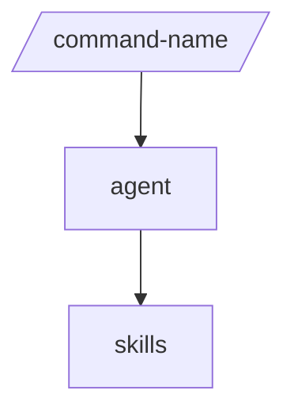

# <package-folder-name>

<Three plain sentences: what the package is, who it is for, when you need it.>

> <Version lock, only if the package pins versions. Delete this line otherwise.>

## Contents

<!-- BEGIN GENERATED:contents -->
<!-- END GENERATED:contents -->

## Installation

<!-- BEGIN GENERATED:installation -->
<!-- END GENERATED:installation -->

<Prerequisites the sources state: Node, Python, JDK, cloud CLIs, credentials. Delete if none.>

## Quick Start

```text
<the shortest real invocation, or a plain-text request that loads the skills>
```

<One sentence on what you get.>

## Usage Scenarios

### Scenario 1 - <The fastest default run>

<When to use it, one sentence.>

```text
<exact invocation>
```

<What you get.>

### Scenario 2 - <Input that is incomplete>

### Scenario 3 - <A request this package should not handle, and what to use instead>

### Scenario 4 - <Chaining to the next command>

## Commands Reference

<Packages with commands or inline orchestrators. For a package without entry points, replace this heading
with "## Skills Reference" and describe each skill: when it loads, what it locks, what it never does,
an example request.>

### `/command-name`

*<One-line title.>*

**Syntax**

```text
/command-name <required> [optional=value]
```

**Parameters**

| Parameter | Required | Default | Description |
|---|---|---|---|
| `<required>` | Yes | none | <meaning> |
| `optional` | No | <default or "not stated"> | <meaning> |

**Prerequisites**

- <what must exist first>

**What it does**

1. <step from the skill>

**What is updated and what is not**

| Changes | Does not change |
|---|---|
| <files or state> | <files or state> |

**Output files**

```text
<tree>
```

**Examples**

```text
<real invocation 1>
<real invocation 2>
```

## Pipeline



## Agents Reference

<!-- BEGIN GENERATED:agents-reference -->
<!-- END GENERATED:agents-reference -->

<A note per agent: what it does, what it never does, whether it is non-interactive.>

## Output structure

```text
<the file tree the package writes, when it writes files; delete this section otherwise>
```

## Limits and constraints

| Limit | Value | Source |
|---|---|---|
| <name> | <value> | <skill or agent file> |

## Related

- <guide page for the family, in docs/entry-points/>
- <architecture page, docs/agents/architecture.md>
- <packages this one depends on>
