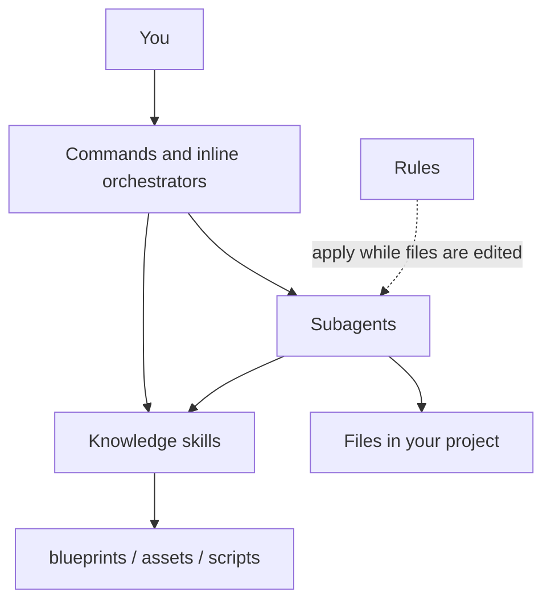
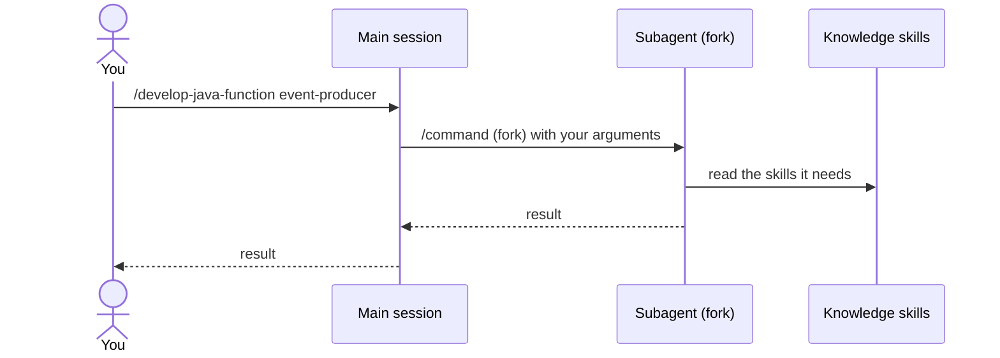
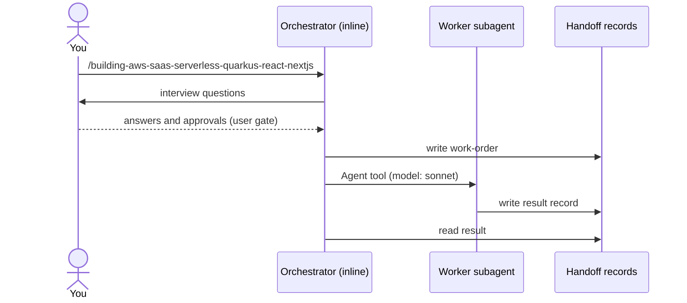
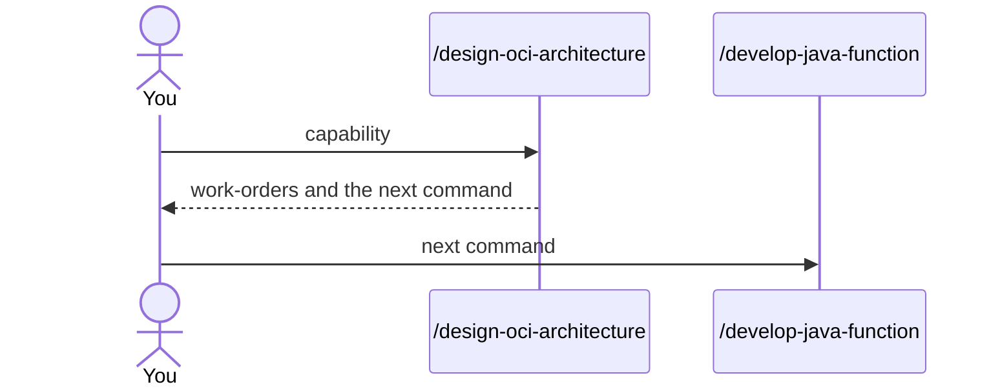
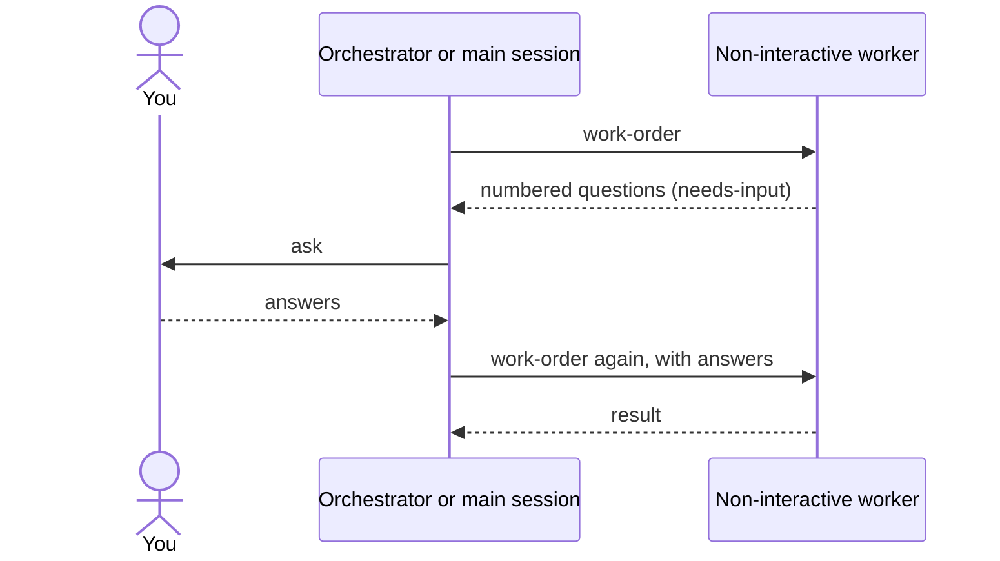

# Agent architecture

This page explains how each piece of the factory starts running, and what it can call. Read it
when you want to know why a command did what it did, or when you add a new artifact.

## The layers



- **Commands and orchestrators** are what you type.
- **Subagents** do the work in a separate context.
- **Knowledge skills** hold versioned facts and do/don't rules.
- **Rules** apply automatically to matching files.

## How each piece starts

### 1. A command starts one subagent

You type `/name`. The command's header has three fields that work together:

```yaml
context: fork
agent: oci-functions-java
disable-model-invocation: true
```

`context: fork` runs the work in a fresh context. `agent:` names the subagent. 
`disable-model-invocation: true` keeps Claude from starting the command on its own. The first and
last fields always come as a pair.



Example you can type: `/develop-java-function event-producer`.

### 2. An inline orchestrator runs in your session

An orchestrator has no `context: fork`. It runs in your session, so it can ask you questions and
wait for your approval. It starts workers with the Agent tool and chooses each worker's model.



The four inline orchestrators are `building-aws-saas-serverless-quarkus-react-nextjs`,
`bootstrapping-spec-from-poc`, `building-agent-packages` and `integrating-camel-quarkus`.

### 3. A knowledge skill starts when your request matches it

You type nothing special. Claude sees every knowledge skill's `description` and reads the matching
skill when your request fits. Long details sit in `blueprints/` and are read only when needed.

Examples of plain text that start a skill (taken from the skill's own evaluation scenarios):

- *"Since the last release clients get HTTP 500 with {"message": "Internal server error"} from the
  HTTP API. The function code did not change. Find the cause."* starts `debugging-aws-lambda`.

Each skill's `description` ends with a "Use when" clause and often a "Not for" clause. Those two
clauses decide when it starts and when it must not.

### 4. A rule applies when you edit a matching file

A rule has a `paths:` list. When Claude works on a file that matches, the rule joins the context.

```yaml
paths:
  - "**/src/main/java/**/*.java"
```

That example is from `quarkus-clean-code`: editing a Java file under `src/main/java` brings in its
clean-code rules. Rules routing keywords to skills (for example the `*-skills` rules) tell Claude
which skill to read for a request.

## What a subagent can call

Only four subagents have the `Agent` tool, so only they start other agents:

| Spawner | Starts |
|---|---|
| `framework-researcher` | `section-investigator` (in parallel) and `research-synthesizer` |
| `architecture-auditor` | three lens audits in parallel for a consensus run |
| `book-orchestrator` | the book workers (prose, code, diagrams, reviewers, assembler, validator) |
| `skill-evaluator` | the skill under test, once per scenario |

Every other subagent is a leaf worker. It cannot start anything. See the generated
[tool matrix](README.md#tools-per-agent).

## How agents pass work to each other

### Handoff records (orchestrated flows)

In orchestrated flows, agents never talk to each other. The orchestrator writes a **work-order**,
a worker returns a **result** record, and a different agent returns a **review** or **verify**
record. Scripts check the records (`check_records.py`, `board.py`, `detect_drift.py`), and the
protocol sets retry limits and escalation to you.

### User-mediated handoff (OCI)

OCI agents end by telling you which command to run next. You start it. This keeps each step visible
and under your control.



## Guardrails

- **Tool lists.** Each agent's header lists the tools it may use. Reviewers have no `Write`.
- **Hooks.** Some read-only agents have a `PreToolUse` hook that allows only a list of read-only
  commands. `static-site-verifier` is an example.
- **Non-interactive contract.** A subagent cannot ask you a question. When the input is incomplete,
  it returns numbered questions and stops. The caller asks you and runs it again.



## Models

Every agent pins a model. Most use sonnet. The architecture agents (`solution-architect`,
`aws-infrastructure-architect`), `book-orchestrator` and `chapter-writer` use opus. An inline
orchestrator itself runs in your session's model. The full list is in the
[roster](README.md#roster).

## Related

- [Entry points](../entry-points/README.md): what you can start.
- [Subagent roster](README.md): every agent, its tools and what starts it.
- [Conventions](../reference/conventions.md): the header fields in detail.
