# Templates — Artifact Scaffolding

> **`.claude/templates/` no longer exists.** APM (the packaging model this repo is migrating to)
> has no `templates` primitive — only a skill's own `assets/`, `references/`, `scripts/`
> subfolders, which deploy with the skill. Every former `.claude/templates/` file moved into the
> `assets/` of the skill that owns it: [`skill-creator`](../../.claude/skills/skill-creator/SKILL.md)
> (3 skill templates), [`agent-creator`](../../.claude/skills/agent-creator/SKILL.md) (3 agent
> templates), [`rules-compiler`](../../.claude/skills/rules-compiler/SKILL.md) (3 instruction
> templates). The `platform-research/` shared assets moved into
> [`researching-platform-software/blueprints/shared/`](../../.claude/skills/researching-platform-software/blueprints/shared/).
> The 6 prompt templates and the templates `README.md` were deleted — superseded (see
> Discrepancies below).
>
> **`.github/templates/`** (14 files below) is unaffected by this move — it belongs to the
> pre-migration Copilot mirror, still physically present though not a source of truth (see
> `CLAUDE.md`). This page documents both: the Copilot catalog as it exists today, and where its
> Claude Code equivalent now lives.

---

---

## Summary by Category

| Category | Templates | Purpose | Claude Code location |
|-----------|:---------:|-----------|-----------|
| Agent | 3 | Create agents (Implementation, Advisory, Orchestrator) | `agent-creator/assets/` |
| Prompt | 6 | Create prompts by operation type | Copilot-only — deleted on the Claude Code side (superseded) |
| Skill | 3 | Create versioned skills (action command, knowledge skill, evaluation scenarios) | `skill-creator/assets/` |
| Instruction | 3 | Create instructions/rules (Config, Standards, Skills-routing) | `rules-compiler/assets/` |
| Report | 1 | Post-incident reports | `docs/templates/` (human procedure, not a skill artifact) |
| Platform Research (CC-exclusive) | 8 | Shared assets for the platform-software family | `researching-platform-software/blueprints/shared/` |

---

## Agent Templates

### TEMPLATE.AGENT.md
> **File**: `.github/templates/agents/TEMPLATE.AGENT.md` · **Claude Code equivalent**: [`agent-creator/assets/TEMPLATE.AGENT.md`](../../.claude/skills/agent-creator/assets/TEMPLATE.AGENT.md)

| Field | Value |
|-------|-------|
| **Pattern** | Implementation (full P0-P5) |
| **Generates code?** | ✅ Yes |
| **When to use** | Create an agent that implements/generates code following skills |
| **Referenced by** | No prompt explicitly (use as manual reference when creating new agents) |
| **Real example** | `templates/examples/agents/oci-terraform.agent.md` |

### TEMPLATE.ADVISORY-AGENT.md
> **File**: `.github/templates/agents/TEMPLATE.ADVISORY-AGENT.md` · **Claude Code equivalent**: [`agent-creator/assets/TEMPLATE.ADVISORY-AGENT.md`](../../.claude/skills/agent-creator/assets/TEMPLATE.ADVISORY-AGENT.md)

| Field | Value |
|-------|-------|
| **Pattern** | Advisory (P0-P5 read-only) |
| **Generates code?** | ❌ No — produces designs, ADRs, diagrams |
| **When to use** | Create a design/review agent that delegates implementation |
| **Referenced by** | No prompt explicitly |
| **Real example** | `templates/examples/agents/oci-serverless-architect.agent.md` |

### TEMPLATE.ORCHESTRATOR-AGENT.md
> **File**: `.github/templates/agents/TEMPLATE.ORCHESTRATOR-AGENT.md` · **Claude Code equivalent**: [`agent-creator/assets/TEMPLATE.ORCHESTRATOR-AGENT.md`](../../.claude/skills/agent-creator/assets/TEMPLATE.ORCHESTRATOR-AGENT.md)

| Field | Value |
|-------|-------|
| **Pattern** | Orchestrator (P0-P5 cross-domain) |
| **Generates code?** | ✅ Yes — coordinates multiple domains |
| **When to use** | Create an agent that orchestrates Java + Terraform, or multiple skills |
| **Referenced by** | No prompt explicitly |
| **Real example** | `templates/examples/agents/oci-serverless-stack.agent.md` |

---

## Prompt Templates

> **Copilot-only.** These 6 exist only in `.github/templates/prompts/`. Their Claude Code
> equivalent was deleted (not moved) — each is a pre-progressive-disclosure ancestor whose
> content is now covered, more thoroughly, by a real skill (`TEMPLATE.GENERATOR.prompt.md` →
> [`methodologies-skill-generator`](../../.claude/skills/methodologies-skill-generator/SKILL.md)
> and [`rules-compiler`](../../.claude/skills/rules-compiler/SKILL.md); `TEMPLATE.RESEARCH.prompt.md`
> → [`researching-technical-frameworks`](../../.claude/skills/researching-technical-frameworks/SKILL.md)).
> `prompts` is also not a supported deploy target for Claude Code under APM.

### TEMPLATE.RESEARCH.prompt.md
> **File**: `.github/templates/prompts/TEMPLATE.RESEARCH.prompt.md`

| Field | Value |
|-------|-------|
| **Category** | Knowledge building |
| **When to use** | Create a prompt that researches a technology/methodology |
| **Referenced by** | None explicitly |
| **Implementations that follow** | `researching-technical-frameworks`, `terraform-engineering-best-practices-researcher`, `architecture-methodology-researcher`, `cloud-architecture-researcher`, `business-domain-researcher`, `requirements-methodology-researcher`, `technical-framework-researcher-terraform`, and the 15-command [platform-software family](../manual/platform-software-family.md) |

### TEMPLATE.GENERATOR.prompt.md
> **File**: `.github/templates/prompts/TEMPLATE.GENERATOR.prompt.md`

| Field | Value |
|-------|-------|
| **Category** | Research → artifact compilation |
| **When to use** | Create a prompt that transforms research into SKILL.md or .instructions.md |
| **Referenced by** | None explicitly |
| **Implementations that follow** | `skill-creator`, `architecture-approaches-skill-generator`, `methodologies-skill-generator`, `terraform-instructions-compiler` |

### TEMPLATE.VALIDATION.prompt.md
> **File**: `.github/templates/prompts/TEMPLATE.VALIDATION.prompt.md`

| Field | Value |
|-------|-------|
| **Category** | Quality assessment |
| **When to use** | Create a prompt that validates artifacts against standards |
| **Referenced by** | None explicitly |
| **Implementations that follow** | `copilot-compatibility-review`, `instructions-best-practices-validator`, `skill-best-practices-validator`, `project-analysis-validator` |

### TEMPLATE.ENTRY-POINT.prompt.md
> **File**: `.github/templates/prompts/TEMPLATE.ENTRY-POINT.prompt.md`

| Field | Value |
|-------|-------|
| **Category** | Routing to agent |
| **When to use** | Create a prompt that collects context and routes to an agent |
| **Referenced by** | None explicitly |
| **Implementations that follow** | Prompts with `agent:` field in YAML (entry-points for agents) |

### TEMPLATE.FEATURE-ADD.prompt.md
> **File**: `.github/templates/prompts/TEMPLATE.FEATURE-ADD.prompt.md`

| Field | Value |
|-------|-------|
| **Category** | Guided implementation |
| **When to use** | Create a prompt that guides adding a specific feature |
| **Referenced by** | None explicitly |
| **Implementations that follow** | Feature addition prompts (e.g., `add-oci-function` in examples) |

### TEMPLATE.DESIGN.prompt.md
> **File**: `.github/templates/prompts/TEMPLATE.DESIGN.prompt.md`

| Field | Value |
|-------|-------|
| **Category** | Architecture design |
| **When to use** | Create a prompt that collects context for an advisory agent |
| **Referenced by** | None explicitly |
| **Implementations that follow** | Design prompts (e.g., `design-api-gateway` in examples) |

---

## Skill Templates

### TEMPLATE.SKILL.md
> **File**: `.github/templates/skills/TEMPLATE.SKILL.md` · **Claude Code equivalent**: [`skill-creator/assets/TEMPLATE.SKILL.md`](../../.claude/skills/skill-creator/assets/TEMPLATE.SKILL.md)

| Field | Value |
|-------|-------|
| **When to use** | Create an action-command skill (`context: fork` + `disable-model-invocation: true`, forks to a subagent) |
| **Referenced by** | ✅ `skill-creator/SKILL.md` (4 sites), plus 3 weak External-Resources mentions (`architecture-approaches-skill-generator`, `methodologies-skill-generator`, `researching-technical-frameworks`) |
| **Implementations that follow** | All 52 skills in `.claude/skills/` that are action commands |

### TEMPLATE.KNOWLEDGE-SKILL.md
> **File**: **Claude Code equivalent**: [`skill-creator/assets/TEMPLATE.KNOWLEDGE-SKILL.md`](../../.claude/skills/skill-creator/assets/TEMPLATE.KNOWLEDGE-SKILL.md) (no `.github/` mirror)

| Field | Value |
|-------|-------|
| **When to use** | Create an auto-invocable reference skill — no fork/agent/blueprints, kept under 150 lines |
| **Referenced by** | ✅ `skill-creator/SKILL.md` Step 2 — decision table vs. `TEMPLATE.SKILL.md` |
| **Implementations that follow** | `rules-compiler` is the first knowledge skill in this repo (no `context: fork`) |

### TEMPLATE.EVALUATION-SCENARIOS.md
> **File**: **Claude Code equivalent**: [`skill-creator/assets/TEMPLATE.EVALUATION-SCENARIOS.md`](../../.claude/skills/skill-creator/assets/TEMPLATE.EVALUATION-SCENARIOS.md) (no `.github/` mirror)

| Field | Value |
|-------|-------|
| **When to use** | Scaffold a skill's `blueprints/evaluation-scenarios.md` (test cases for `skill-evaluator`) — requires 4 scenarios: canonical path, edge case, misuse rejection, anti-pattern trap |
| **Referenced by** | ✅ `skill-creator/SKILL.md` Step 3 and its ✅/🚫 guardrails |
| **Implementations that follow** | `evaluation-scenarios.md` blueprints across the 52 skills |

---

## Instruction Templates

> Their Claude Code equivalent is no longer scoped to Terraform. All 3 moved into
> [`rules-compiler/assets/`](../../.claude/skills/rules-compiler/SKILL.md) — the generic 5-phase
> engine that any `<domain>-instructions-compiler` skill (today: `terraform-instructions-compiler`;
> tomorrow: a Kubernetes/AWS equivalent) links into, per
> [`domain-compiler-contract.md`](../../.claude/skills/rules-compiler/blueprints/domain-compiler-contract.md).

### TEMPLATE.CONFIG.instructions.md
> **File**: `.github/templates/instructions/TEMPLATE.CONFIG.instructions.md` · **Claude Code equivalent**: [`rules-compiler/assets/TEMPLATE.CONFIG.md`](../../.claude/skills/rules-compiler/assets/TEMPLATE.CONFIG.md)

| Field | Value |
|-------|-------|
| **Purpose** | Project setup, dependencies, structure |
| **Referenced by** | ✅ `terraform-instructions-compiler/SKILL.md` (Phase 1, via `../rules-compiler/assets/`) |
| **When to use** | Create a project configuration instruction/rule |

### TEMPLATE.STANDARDS.instructions.md
> **File**: `.github/templates/instructions/TEMPLATE.STANDARDS.instructions.md` · **Claude Code equivalent**: [`rules-compiler/assets/TEMPLATE.STANDARDS.md`](../../.claude/skills/rules-compiler/assets/TEMPLATE.STANDARDS.md)

| Field | Value |
|-------|-------|
| **Purpose** | Code standards, naming, quality |
| **Referenced by** | ✅ `terraform-instructions-compiler/SKILL.md` (Phase 1, via `../rules-compiler/assets/`) |
| **When to use** | Create a coding standards instruction/rule |

### TEMPLATE.SKILLS.instructions.md
> **File**: `.github/templates/instructions/TEMPLATE.SKILLS.instructions.md` · **Claude Code equivalent**: [`rules-compiler/assets/TEMPLATE.SKILLS.md`](../../.claude/skills/rules-compiler/assets/TEMPLATE.SKILLS.md)

| Field | Value |
|-------|-------|
| **Purpose** | Skills routing (which skills to load per keyword) |
| **Referenced by** | ✅ `terraform-instructions-compiler/SKILL.md` (Phase 1, via `../rules-compiler/assets/`) |
| **When to use** | Create an instruction/rule that maps keywords → skills |

---

## Report Template

### POST_MORTEM_TEMPLATE.md
> **File**: `.github/templates/reports/POST_MORTEM_TEMPLATE.md` · **Claude Code side**: moved to
> [`docs/templates/POST_MORTEM_TEMPLATE.md`](../templates/POST_MORTEM_TEMPLATE.md) — it is a human
> procedure, not a Claude Code artifact (no skill reads it), so it lives in `docs/` rather than in
> any skill's `assets/`.

| Field | Value |
|-------|-------|
| **Purpose** | Post-incident analysis |
| **Referenced by** | ❌ None (orphan) — unchanged by the move |
| **When to use** | Document incident post-mortems |

---

## Platform Research Shared Assets (Claude Code-exclusive)

> **Location**: [`researching-platform-software/blueprints/shared/`](../../.claude/skills/researching-platform-software/blueprints/shared/)
> — moved here from `.claude/templates/platform-research/`; the router skill is the correct owner
> since it already inventories these assets. No `.github/` mirror. Reused by all 15 commands of
> the [platform-software family](../manual/platform-software-family.md).

| File | Purpose | Referenced by |
|------|---------|---------------|
| `output-format-base.md` | 13-section neutral output skeleton for every platform research file | All 14 sibling skills |
| `research-scope-operations.md` | §1–§12 operational research scope common to all families | All 14 sibling skills |
| `data-modeling-principles.md` | Cross-type data modeling principles | Datastore siblings (rdbms, document, kv, wide-column, graph, timeseries, columnar, vector, object) |
| `reference-card-template.md` | Canonical skeleton for a per-vendor, version-pinned reference card | All 14 sibling skills |
| `reference-card-example-kafka-3.7.md` | Fully-worked instance of the reference-card template | Referenced as the example by all siblings |
| `deployment-guides/kubernetes-operator-guide.md` | K8s operator deployment playbook | Siblings with `deployment=kubernetes-operator` |
| `deployment-guides/container-compose-guide.md` | Docker Compose deployment playbook | Siblings with `deployment=container-compose` |
| `deployment-guides/vm-and-bare-metal-guide.md` | VM / bare-metal deployment playbook | Siblings with `deployment=vm`/`bare-metal` |

---

## Traceability: Template → Implementations

```mermaid
graph TD
    subgraph "Templates"
        TA[TEMPLATE.AGENT]
        TAD[TEMPLATE.ADVISORY-AGENT]
        TO[TEMPLATE.ORCHESTRATOR-AGENT]
        TR[TEMPLATE.RESEARCH.prompt]
        TG[TEMPLATE.GENERATOR.prompt]
        TV[TEMPLATE.VALIDATION.prompt]
        TE[TEMPLATE.ENTRY-POINT.prompt]
        TF[TEMPLATE.FEATURE-ADD.prompt]
        TD[TEMPLATE.DESIGN.prompt]
        TS[TEMPLATE.SKILL]
        TCI[TEMPLATE.CONFIG.instructions]
        TSI[TEMPLATE.STANDARDS.instructions]
        TKI[TEMPLATE.SKILLS.instructions]
    end

    subgraph "Implementations"
        TR --> P1[7 research prompts + platform-software family]
        TG --> P2[4 compilation prompts]
        TV --> P3[4 validation prompts]
        TS --> SK[Generated skills]
        TCI --> I1[*.config.instructions.md]
        TSI --> I2[*.standards.instructions.md]
        TKI --> I3[*.skills.instructions.md]
    end

    style TA fill:#fff3cd
    style TAD fill:#fff3cd
    style TO fill:#fff3cd
    style TE fill:#fff3cd
    style TF fill:#fff3cd
    style TD fill:#fff3cd
```

> ⚠️ **Templates in yellow**: No explicit implementations found in the repository. They are used as manual references when creating new artifacts.

---

## Identified Discrepancies

| Issue | Description | Status |
|-------|-----------|---------------|
| Orphan | `POST_MORTEM_TEMPLATE.md` with no references | Still open — moved to `docs/templates/`, no flow adopted it |
| ~~Orphan~~ | ~~`TEMPLATE.KNOWLEDGE-SKILL.md` and `TEMPLATE.EVALUATION-SCENARIOS.md` not referenced explicitly by any prompt~~ | **Resolved** — `skill-creator/SKILL.md` now links both explicitly (Step 2 decision table, Step 3 scenario generation) |
| Fixed | `skill-creator/SKILL.md:32` asked for "at least 3" evaluation scenarios while `TEMPLATE.EVALUATION-SCENARIOS.md` requires 4 | **Resolved** — the skill now cites the 4-type contract directly |
| Fixed | `.claude/templates/` existed as a parallel, un-owned directory with no APM equivalent | **Resolved** — dissolved; every file relocated into the `assets/` of the skill that owns it (this page reflects the new locations throughout) |

> Resolved: `templates/README.md` previously referenced `TEMPLATE.COMPILER.prompt.md` / `TEMPLATE.SCAFFOLDING.prompt.md` — both ghost entries have since been corrected in the source file (`TEMPLATE.GENERATOR.prompt.md`, "formerly COMPILER"; scaffolding marked *not implemented*). That `.claude/` source file has since been deleted entirely (see banner at the top of this page); this note is retained as history.
