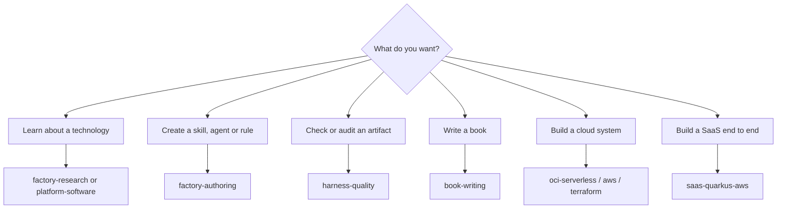

# Entry points

An entry point is something you start yourself. There are two kinds:

- **Command** (`/name`): runs in its own context and hands the work to one subagent. You give it
  arguments, it does the job, and returns the result.
- **Inline orchestrator** (`/name`): runs in your session. It asks you questions, plans, and starts
  worker subagents when needed. Use it when the task has several steps you need to approve.

Knowledge skills are not listed here. Claude loads them by itself when your request matches their
description. See [Agent architecture](../agents/architecture.md) for how each one starts.

## Which one do I need?

Family pages:

| Family | Page | What is in it |
|---|---|---|
| Research | [factory-research](factory-research.md) | Five research commands for frameworks, cloud, methodology and domain. |
| Research | [platform-software](platform-software.md) | Fifteen commands for self-hosted platforms (Kafka, Redis, PostgreSQL…). |
| Authoring | [factory-authoring](factory-authoring.md) | Create skills, agents and methodology skills; build a full package. |
| Quality | [harness-quality](harness-quality.md) | Audit architecture, validate artifacts, evaluate skill behavior. |
| Books | [book-writing](book-writing.md) | Write, rewrite, translate and package a technical book. |
| OCI | [oci-serverless](oci-serverless.md) | Build, deploy, debug, design and observe OCI Functions. |
| AWS | [aws](aws.md) | AWS architecture advice and live observability. |
| Terraform | [terraform](terraform.md) | Provisioning, research and rules for Terraform. |
| SaaS | [saas-quarkus-aws](saas-quarkus-aws.md) | Spec-driven build of a SaaS on Quarkus, AWS Lambda and Next.js. |
| Specs and GitHub | [specs-and-github](specs-and-github.md) | Sync specs with code and with GitHub Projects; draft specs from a POC. |
| Java | [java-integrations](java-integrations.md) | Stripe Java and Camel Quarkus integrations. |
| Quality and CI/CD | [quality-and-cicd](quality-and-cicd.md) | Acceptance tests from specs; GitHub Actions pipelines. |

## Full list

Generated from the package files. Do not edit this table by hand.

<!-- BEGIN GENERATED:entry-points -->
| Entry point | Kind | Package | Runs as | Routes to | Arguments | What it does |
|---|---|---|---|---|---|---|
| [`/aws-architecture-advisor`](../../packages/cloud/provider/aws/aws-architect/README.md#aws-architecture-advisor) | command | `aws-architect` | fork (subagent) | `aws-architect` | `<question or scope> (e.g. 'review my VPC design', 'design serverless event-driven API', 'assess WAF security posture')` | Routes an AWS architecture question, design request, or review to the aws-architect advisory agent. |
| [`/observe-aws-workload`](../../packages/cloud/provider/aws/aws-observability/README.md#observe-aws-workload) | command | `aws-observability` | fork (subagent) | `aws-observability` | `<function-name> region=<r> [mode=validate\|provision\|review] [wo=<work-order path; required for review and provision>] [nn=<NN>] [smoke-start=<epoch-s>] [api-type=REST\|HTTP\|NONE] [alarm-prefix=
] [dashboards=<n1,n2>]` | Reviews, provisions and validates observability (logs, metrics, X-Ray traces, alarms, dashboards) for an AWS Lambda workload via the aws-observability agent. |
| [`/design-oci-architecture`](../../packages/cloud/provider/oci/oci-architecture/README.md#design-oci-architecture) | command | `oci-architecture` | fork (subagent) | `oci-serverless-architect` | `<scope: full-stack \| api-surface \| security-model \| network-topology \| object-storage \| event-driven-pubsub> [capability-slug]` | Routes to the OCI Serverless Architect for designing and reviewing OCI serverless architectures (advisory only — produces ADRs, diagrams, and handoff work-orde… |
| [`/provision-oci-serverless-stack`](../../packages/cloud/provider/oci/oci-architecture/README.md#provision-oci-serverless-stack) | command | `oci-architecture` | fork (subagent) | `oci-serverless-stack` | `<capability-slug> [--integrate] (e.g. func-api-facade — matches the docs/handoff/<capability>/ directory; --integrate after result-java.md and result-terraform-infra.md exist)` | Routes to the OCI Serverless Stack deployer for end-to-end creation of a serverless capability (Java function code + Terraform infrastructure + API Gateway rou… |
| [`/debug-oci-function`](../../packages/cloud/provider/oci/oci-functions-java/README.md#debug-oci-function) | command | `oci-functions-java` | fork (subagent) | `oci-debugger` | `Function name and symptom (e.g. 'func-rr-rest-proxy returns 502', 'event-producer 503 OAuth 401')` | Debugs a deployed OCI Function via the oci-debugger agent (P0-P4 diagnostic workflow: classify symptom, investigate infra, query logs, systematic elimination,… |
| [`/deploy-oci-function`](../../packages/cloud/provider/oci/oci-functions-java/README.md#deploy-oci-function) | command | `oci-functions-java` | fork (subagent) | `oci-deployer` | `Function name or description [approve=tfplan sha256=<hash>] (e.g. 'func-rr-rest-proxy', 'deploy new version of event-producer with tag 0.0.5')` | Deploys an OCI Function via the oci-deployer agent (P0-P6 workflow: preflight, build, push to OCIR, Terraform apply, smoke test, auto-fix, rollback). |
| [`/develop-java-function`](../../packages/cloud/provider/oci/oci-functions-java/README.md#develop-java-function) | command | `oci-functions-java` | fork (subagent) | `oci-functions-java` | `Capability name or description (e.g. 'event-producer', 'add Object Storage write to func-api-facade')` | Develops Java OCI Functions via the oci-functions-java agent (P0-P5 workflow: classify, scaffold, implement, compile, validate). |
| [`/observe-oci-workload`](../../packages/cloud/provider/oci/oci-observability/README.md#observe-oci-workload) | command | `oci-observability` | fork (subagent) | `oci-observability` | `<capability-slug> [pillar: apm\|logging\|alarms\|connector-hub\|dashboards\|all]` | Designs, provisions, and validates end-to-end observability for OCI serverless workloads (APM & distributed tracing, Logging, Monitoring alarms, Connector Hub,… |
| [`/cleaning-up-oci-resources`](../../packages/cloud/terraform/oci-terraform/README.md#cleaning-up-oci-resources) | command | `oci-terraform` | fork (subagent) | `oci-terraform` | `[--dry-run] (compartment from OCI_COMPARTMENT_OCID)` | Guides teardown of all OCI resources in a compartment using the parametrized oci-cleanup.py script. |
| [`/provision-oci-infra`](../../packages/cloud/terraform/oci-terraform/README.md#provision-oci-infra) | command | `oci-terraform` | fork (subagent) | `oci-terraform` | `<capability-slug> [streaming\|functions\|api-gateway\|vault\|networking\|iam\|events\|full-stack]` | Provisions OCI serverless infrastructure with Terraform by invoking the oci-terraform agent. |
| [`/provision-aws-terraform`](../../packages/cloud/terraform/terraform/README.md#provision-aws-terraform) | command | `terraform` | fork (subagent) | `aws-terraform-engineer` | `<requirement summary> <terraform-dir> (e.g. 'private S3 bucket with KMS and access logging, with mocked test ./infra')` | Routes a closed AWS Terraform requirement (hashicorp/aws 6.x) to the aws-terraform-engineer agent. |
| [`/technical-framework-researcher-terraform`](../../packages/cloud/terraform/terraform/README.md#technical-framework-researcher-terraform) | command | `terraform` | fork (subagent) | `framework-researcher` | `<provider> <version> [depth=exhaustive] [iterations=5] (e.g. aws 5.x depth=deep iterations=3)` | Researches a Terraform provider/module for a pinned Terraform and provider version into a hallucination-proof IaC knowledge base. |
| [`/terraform-engineering-best-practices-researcher`](../../packages/cloud/terraform/terraform/README.md#terraform-engineering-best-practices-researcher) | command | `terraform` | fork (subagent) | `framework-researcher` | `<topic> [depth=exhaustive] [iterations=5] (e.g. module-design depth=deep iterations=3)` | Researches Terraform engineering best practices (project layout, module design, CI/CD, testing, governance) into a source-backed knowledge base. |
| [`/terraform-instructions-compiler`](../../packages/cloud/terraform/terraform/README.md#terraform-instructions-compiler) | command | `terraform` | fork (subagent) | `artifact-author` | `<research-file-path> (e.g. workspace/research_terraform_v1.5.md)` | Interactive compiler that extracts Terraform best practices from a research file, interviews the user, and compiles targeted rules/instruction files. |
| [`/terraform-rules-author`](../../packages/cloud/terraform/terraform/README.md#terraform-rules-author) | command | `terraform` | fork (subagent) | `terraform-rules-author` | `<research-file-path> <project-root> [platform: claude-code\|copilot]` | Non-interactive compiler that takes a Terraform research file and target project context, then generates scoped Terraform rules/instruction files without an in… |
| [`/enriching-book-chapter`](../../packages/content-generation/book-writing/README.md#enriching-book-chapter) | command | `book-writing` | fork (subagent) | `book-orchestrator` | `<path/to/chapter.md> slug=<book-slug> [chapter=<N>] [toc=<path/to/toc.md>] [code_style=working-code\|pseudocode-first\|pseudocode-only] [code_language=java\|go\|typescript\|python\|pseudocode] [audience=\"...\"]` | Infer [CODE:] and [DIAGRAM:] injection points in external unstructured prose, then run P4.2+P4.3 to produce a fully assembled chapter. |
| [`/formatting-book-epub`](../../packages/content-generation/book-writing/README.md#formatting-book-epub) | command | `book-writing` | fork (subagent) | `book-formatter` | `<path/to/book.md> [slug=<book-slug>] [toc=<path/to/toc.md>] [language=en\|pt-BR\|es] [author=\"Author Name\"]` | Converts an existing book.md to a valid EPUB 3.0 source tree and zips it for direct upload to Amazon KDP. |
| [`/rendering-mermaid-diagrams`](../../packages/content-generation/book-writing/README.md#rendering-mermaid-diagrams) | command | `book-writing` | fork (subagent) | `mermaid-renderer` | `<path/to/book.md>` | Renders all Mermaid diagram blocks in a completed book.md to PNG images and rewrites the file with Markdown image references, making diagrams visible in EPUB/K… |
| [`/repairing-book-epub`](../../packages/content-generation/book-writing/README.md#repairing-book-epub) | command | `book-writing` | fork (subagent) | `epub-repairer` | `<path/to/kindle/> \| <path/to/book.epub> [languages=en,pt-BR,es]` | Validates and repairs EPUB 3.0 files generated by the book pipeline. |
| [`/rewriting-book-chapter`](../../packages/content-generation/book-writing/README.md#rewriting-book-chapter) | command | `book-writing` | fork (subagent) | `book-orchestrator` | `<book-slug> chapter=<N> [reason=\"narrative issue: ...\"] [depth=standard]` | Regenerates a single chapter (prose, code examples, Mermaid diagrams, expert review, skeptical review, and assembly) for an existing book without re-running th… |
| [`/rewriting-book-introduction`](../../packages/content-generation/book-writing/README.md#rewriting-book-introduction) | command | `book-writing` | fork (subagent) | `book-orchestrator` | `<book-slug> [reason=\"...\"]` | Regenerates only the book introduction for an existing book without re-running the full pipeline. |
| [`/switching-book-language`](../../packages/content-generation/book-writing/README.md#switching-book-language) | command | `book-writing` | fork (subagent) | `book-orchestrator` | `<book-slug> language=<lang> [style=working-code\|pseudocode-first\|pseudocode-only] [additional=go,typescript] [translate=yes\|no] [epub=yes\|no]` | Switches or unifies the code language of an already generated technical book, regenerating code assets across all chapters and reassembling book.md, translatio… |
| [`/translating-book`](../../packages/content-generation/book-writing/README.md#translating-book) | command | `book-writing` | fork (subagent) | `book-translator` | `<path/to/book.md> target=<pt-BR\|es> [slug=<book-slug>]` | Translates an existing book.md to a target language (pt-BR or es), preserving all Markdown formatting and leaving code blocks and Mermaid syntax in English. |
| [`/writing-book-toc`](../../packages/content-generation/book-writing/README.md#writing-book-toc) | command | `book-writing` | fork (subagent) | `book-orchestrator` | `<topic> audience=<audience> [chapters=10] [depth=standard\|exhaustive]` | Researches a technical book topic and generates a structured table of contents (chapters with objectives, descriptions, and key concepts) for user review and a… |
| [`/writing-technical-book`](../../packages/content-generation/book-writing/README.md#writing-technical-book) | command | `book-writing` | fork (subagent) | `book-orchestrator` | `<topic> audience=<audience> context=<market-context> [chapters=10] [depth=standard\|exhaustive] [code_language=pseudocode] [code_style=pseudocode-only\|pseudocode-first\|working-code] [additional_languages=go,typescript] [decision_diagrams=flowchart]` | Generates a complete technical book (TOC, introduction, prose, code examples, Mermaid diagrams, expert and skeptical review, chapter assembly, narrative valida… |
| [`/building-cicd-pipelines`](../../packages/delivery/github/github-actions-cicd/README.md#building-cicd-pipelines) | command | `github-actions-cicd` | fork (subagent) | `cicd-pipeline-engineer` | `<requirement summary> <repo-root> (e.g. 'Java Lambda CI+CD to AWS via OIDC, Pro private repo, dev+prod, monorepo ./')` | Routes a closed GitHub Actions CI/CD requirement to the cicd-pipeline-engineer agent. |
| [`/syncing-spec-from-code`](../../packages/delivery/protocol/handoff-core/README.md#syncing-spec-from-code) | command | `handoff-core` | fork (subagent) | `spec-synchronizer` | `<change-id or handoff dir> [--repo <path>] [--profile <yaml>]` | Detects drift between code and the OpenSpec spec of a change and proposes a spec-delta plus open questions, without editing code or spec. |
| [`/syncing-openspec-to-github`](../../packages/delivery/specs/openspec-github/README.md#syncing-openspec-to-github) | command | `openspec-github` | fork (subagent) | `openspec-github-syncer` | `<change-id> --profile <yaml> [--stage E<n>] [--apply]` | Mirrors one OpenSpec change into its GitHub Project (issues, sub-issues, fields, delta comments) with a dry-run plan first and a status check. |
| [`bootstrapping-spec-from-poc`](../../packages/delivery/specs/openspec-poc/README.md#bootstrapping-spec-from-poc) | inline orchestrator | `openspec-poc` | inline in your session | - | `back=<dir> front=<dir> [id=<poc-id>] [repo=<target>] [hint=<stack>] [promote=<change-id>]` | Drafts OpenSpec specs from the code of a POC (back end and/or front end, any stack): inventory script, draft requirements with file:line evidence, architecture… |
| [`building-agent-packages`](../../packages/factory/agent-package-builder/README.md#building-agent-packages) | inline orchestrator | `agent-package-builder` | inline in your session | - | - | Orchestrates the existing workers from a brief, a research folder or an interrupted run to a committed APM package (skills, agent, rules). |
| [`/agent-creator`](../../packages/factory/artifact-authoring/README.md#agent-creator) | command | `artifact-authoring` | fork (subagent) | `artifact-author` | `<domain-role> [advisory\|orchestrator] (e.g. terraform-reviewer advisory)` | Creates a Claude Code subagent (.claude/agents/<name>.md) from a validated template — persona, P0–P5 workflow, tools whitelist, and model pin. |
| [`/architecture-approaches-skill-generator`](../../packages/factory/artifact-authoring/README.md#architecture-approaches-skill-generator) | command | `artifact-authoring` | fork (subagent) | `artifact-author` | `<approach> (e.g. event-driven, microservices)` | Researches a system-architecture methodology/notation and generates an operational SKILL.md for producing correct architecture artifacts. |
| [`/methodologies-skill-generator`](../../packages/factory/artifact-authoring/README.md#methodologies-skill-generator) | command | `artifact-authoring` | fork (subagent) | `artifact-author` | `<methodology> (e.g. TDD, scrum, kanban)` | Researches an engineering/process methodology and generates an operational SKILL.md for producing correct artifacts. |
| [`/skill-creator`](../../packages/factory/artifact-authoring/README.md#skill-creator) | command | `artifact-authoring` | fork (subagent) | `artifact-author` | `Path to research file (e.g. workspace/research_FastAPI_v0.115.md)` | Creates Agent Skills (SKILL.md) from a research_[TECH]_v[VERSION].md file following official Claude best practices and team conventions. |
| [`documenting-agent-packages`](../../packages/factory/package-docs/README.md#documenting-agent-packages) | inline orchestrator | `package-docs` | inline in your session | - | `mode=check\|package\|changed\|all\|bundles [package=<path>[,<path>]] [since=<git-ref>] [writers=<n>]` | Finds missing or incomplete package and bundle manuals in an APM repository, plans the work with the user, runs package-manual-author writers in parallel, then… |
| [`/architecture-methodology-researcher`](../../packages/factory/researching-frameworks/README.md#architecture-methodology-researcher) | command | `researching-frameworks` | fork (subagent) | `framework-researcher` | `<methodology> [depth=exhaustive] [iterations=5] (e.g. C4 depth=deep iterations=3)` | Researches an architecture methodology or notation (C4, UML, ADR, TOGAF, DDD, EDA) into a hallucination-proof knowledge base. |
| [`/business-domain-researcher`](../../packages/factory/researching-frameworks/README.md#business-domain-researcher) | command | `researching-frameworks` | fork (subagent) | `framework-researcher` | `<business-domain> [depth=exhaustive] [iterations=5] (e.g. supply-chain depth=deep iterations=3)` | Researches a business domain and its organizational processes into a structured, source-backed knowledge base. |
| [`/cloud-architecture-researcher`](../../packages/factory/researching-frameworks/README.md#cloud-architecture-researcher) | command | `researching-frameworks` | fork (subagent) | `framework-researcher` | `<cloud-provider> [depth=exhaustive] [iterations=5] (e.g. AWS depth=deep iterations=3)` | Researches a cloud provider's architecture framework/patterns (AWS WAF, Azure CAF, GCP, OCI) into a hallucination-proof, version-absolute knowledge base. |
| [`/requirements-methodology-researcher`](../../packages/factory/researching-frameworks/README.md#requirements-methodology-researcher) | command | `researching-frameworks` | fork (subagent) | `framework-researcher` | `<methodology> [depth=exhaustive] [iterations=5] (e.g. user-stories depth=deep iterations=3)` | Researches agile/product requirements methodologies (user stories, requirement artifacts) into a source-backed knowledge base. |
| [`/researching-technical-frameworks`](../../packages/factory/researching-frameworks/README.md#researching-technical-frameworks) | command | `researching-frameworks` | fork (subagent) | `framework-researcher` | `<tech> <version> [depth=exhaustive] [iterations=5] (e.g. FastAPI 0.115 depth=deep iterations=3)` | Researches technologies, frameworks, and SDKs to produce hallucination-proof research_[TECH]_v[VERSION].md documents. |
| [`/researching-api-gateway`](../../packages/factory/researching-platform/README.md#researching-api-gateway) | command | `researching-platform` | fork (subagent) | `framework-researcher` | `<platform> <version> [deployment=bare-metal\|vm\|container-compose\|kubernetes-operator\|hybrid] [depth=exhaustive] [iterations=5] (e.g. Kong 3.7 deployment=kubernetes-operator / APISIX 3.9)` | Researches self-managed API gateways / API management platforms (Kong, Apache APISIX, Tyk, Traefik Enterprise, KrakenD, Envoy Gateway) into a hallucination-pro… |
| [`/researching-cache-store`](../../packages/factory/researching-platform/README.md#researching-cache-store) | command | `researching-platform` | fork (subagent) | `framework-researcher` | `<platform> <version> [deployment=bare-metal\|vm\|container-compose\|kubernetes-operator\|hybrid] [depth=exhaustive] [iterations=5] (e.g. Redis 7.2 deployment=vm / Memcached 1.6 deployment=kubernetes-operator)` | Researches self-managed in-memory cache / session stores (Redis or Valkey as cache, Memcached, KeyDB, Dragonfly) into a hallucination-proof, version-absolute k… |
| [`/researching-columnar-analytics`](../../packages/factory/researching-platform/README.md#researching-columnar-analytics) | command | `researching-platform` | fork (subagent) | `framework-researcher` | `<platform> <version> [deployment=bare-metal\|vm\|container-compose\|kubernetes-operator\|hybrid] [depth=exhaustive] [iterations=5] (e.g. ClickHouse 24.3 deployment=kubernetes-operator)` | Researches self-managed columnar / OLAP analytics databases (ClickHouse, Apache Druid, Apache Pinot, DuckDB) into a hallucination-proof, version-absolute knowl… |
| [`/researching-coordination-service`](../../packages/factory/researching-platform/README.md#researching-coordination-service) | command | `researching-platform` | fork (subagent) | `framework-researcher` | `<platform> <version> [deployment=bare-metal\|vm\|container-compose\|kubernetes-operator\|hybrid] [depth=exhaustive] [iterations=5] (e.g. etcd 3.5 deployment=kubernetes-operator)` | Researches self-managed distributed coordination services (etcd, Apache ZooKeeper, HashiCorp Consul) into a hallucination-proof, version-absolute knowledge bas… |
| [`/researching-document-store`](../../packages/factory/researching-platform/README.md#researching-document-store) | command | `researching-platform` | fork (subagent) | `framework-researcher` | `<platform> <version> [deployment=bare-metal\|vm\|container-compose\|kubernetes-operator\|hybrid] [depth=exhaustive] [iterations=5] (e.g. MongoDB 7.0 deployment=kubernetes-operator)` | Researches self-managed document databases (MongoDB, Couchbase, RavenDB) into a hallucination-proof, version-absolute knowledge base covering installation, rep… |
| [`/researching-graph-database`](../../packages/factory/researching-platform/README.md#researching-graph-database) | command | `researching-platform` | fork (subagent) | `framework-researcher` | `<platform> <version> [deployment=bare-metal\|vm\|container-compose\|kubernetes-operator\|hybrid] [depth=exhaustive] [iterations=5] (e.g. Neo4j 5.20 deployment=kubernetes-operator)` | Researches self-managed graph databases (Neo4j, JanusGraph, ArangoDB, Nebula Graph) into a hallucination-proof, version-absolute knowledge base covering instal… |
| [`/researching-kv-store`](../../packages/factory/researching-platform/README.md#researching-kv-store) | command | `researching-platform` | fork (subagent) | `framework-researcher` | `<platform> <version> [deployment=bare-metal\|vm\|container-compose\|kubernetes-operator\|hybrid] [depth=exhaustive] [iterations=5] (e.g. Redis 7.2 deployment=vm / TiKV 7.5 deployment=kubernetes-operator)` | Researches self-managed persistent key-value stores (Redis or Valkey as primary datastore, RocksDB, LMDB, TiKV) into a hallucination-proof, version-absolute kn… |
| [`/researching-object-storage`](../../packages/factory/researching-platform/README.md#researching-object-storage) | command | `researching-platform` | fork (subagent) | `framework-researcher` | `<platform> <version> [deployment=bare-metal\|vm\|container-compose\|kubernetes-operator\|hybrid] [depth=exhaustive] [iterations=5] (e.g. MinIO 2024 deployment=kubernetes-operator)` | Researches self-managed S3-compatible object storage (MinIO, Ceph RGW, SeaweedFS, GarageHQ) into a hallucination-proof, version-absolute knowledge base coverin… |
| [`/researching-platform-software`](../../packages/factory/researching-platform/README.md#researching-platform-software) | command | `researching-platform` | fork (subagent) | `framework-researcher` | `<platform> <version> [datastore-type=rdbms\|document\|kv\|wide-column\|graph\|time-series\|columnar\|vector\|object] [deployment=bare-metal\|vm\|container-compose\|kubernetes-operator\|hybrid] [depth=exhaustive] [iterations=5] (e.g. Kafka 3.7 / MongoDB 7.0 / Kong 3.7 / Redis 7.2 datastore-type=kv)` | Entry-point that routes platform research requests to the correct specialized sibling skill (researching-streaming-broker, researching-rdbms, researching-docum… |
| [`/researching-rdbms`](../../packages/factory/researching-platform/README.md#researching-rdbms) | command | `researching-platform` | fork (subagent) | `framework-researcher` | `<platform> <version> [deployment=bare-metal\|vm\|container-compose\|kubernetes-operator\|hybrid] [depth=exhaustive] [iterations=5] (e.g. PostgreSQL 16 deployment=kubernetes-operator / MySQL 8.4)` | Researches self-managed relational / NewSQL databases (PostgreSQL, MySQL, MariaDB, CockroachDB) into a hallucination-proof, version-absolute knowledge base cov… |
| [`/researching-search-engine`](../../packages/factory/researching-platform/README.md#researching-search-engine) | command | `researching-platform` | fork (subagent) | `framework-researcher` | `<platform> <version> [deployment=bare-metal\|vm\|container-compose\|kubernetes-operator\|hybrid] [depth=exhaustive] [iterations=5] (e.g. Elasticsearch 8.13 deployment=kubernetes-operator)` | Researches self-managed full-text search & log analytics engines (Elasticsearch, OpenSearch, Apache Solr, Typesense, Meilisearch) into a hallucination-proof, v… |
| [`/researching-streaming-broker`](../../packages/factory/researching-platform/README.md#researching-streaming-broker) | command | `researching-platform` | fork (subagent) | `framework-researcher` | `<platform> <version> [deployment=bare-metal\|vm\|container-compose\|kubernetes-operator\|hybrid] [depth=exhaustive] [iterations=5] (e.g. Kafka 3.7 deployment=kubernetes-operator)` | Researches self-managed streaming & messaging brokers (Apache Kafka, RabbitMQ, Apache Pulsar, NATS, ActiveMQ) into a hallucination-proof, version-absolute know… |
| [`/researching-timeseries-db`](../../packages/factory/researching-platform/README.md#researching-timeseries-db) | command | `researching-platform` | fork (subagent) | `framework-researcher` | `<platform> <version> [deployment=bare-metal\|vm\|container-compose\|kubernetes-operator\|hybrid] [depth=exhaustive] [iterations=5] (e.g. InfluxDB 2.7 / TimescaleDB 2.14 deployment=kubernetes-operator)` | Researches self-managed time-series databases (InfluxDB, TimescaleDB, VictoriaMetrics, QuestDB) into a hallucination-proof, version-absolute knowledge base cov… |
| [`/researching-vector-store`](../../packages/factory/researching-platform/README.md#researching-vector-store) | command | `researching-platform` | fork (subagent) | `framework-researcher` | `<platform> <version> [deployment=bare-metal\|vm\|container-compose\|kubernetes-operator\|hybrid] [depth=exhaustive] [iterations=5] (e.g. Qdrant 1.9 deployment=kubernetes-operator / Milvus 2.4)` | Researches self-managed vector / ANN databases (Milvus, Qdrant, Weaviate, pgvector, Chroma) into a hallucination-proof, version-absolute knowledge base coverin… |
| [`/researching-wide-column-store`](../../packages/factory/researching-platform/README.md#researching-wide-column-store) | command | `researching-platform` | fork (subagent) | `framework-researcher` | `<platform> <version> [deployment=bare-metal\|vm\|container-compose\|kubernetes-operator\|hybrid] [depth=exhaustive] [iterations=5] (e.g. Cassandra 5.0 deployment=kubernetes-operator / ScyllaDB 6.0)` | Researches self-managed wide-column databases (Apache Cassandra, ScyllaDB, Apache HBase) into a hallucination-proof, version-absolute knowledge base covering i… |
| [`/audit-architecture-consensus`](../../packages/harness-quality/auditing/README.md#audit-architecture-consensus) | command | `auditing` | fork (subagent) | `architecture-auditor` | `Agent name to audit (e.g. oci-terraform) or path to a project directory` | Orchestrates a multi-model architecture audit (Scope + Flow + Engine in parallel) against a target agent and produces a consensus compliance report with priori… |
| [`/audit-architecture-engine`](../../packages/harness-quality/auditing/README.md#audit-architecture-engine) | command | `auditing` | fork (subagent) | `architecture-auditor` | `Agent name to audit (e.g. oci-terraform) or path to a project directory` | Audits agent architecture from the engine perspective — paths injection mechanics, context budget, frontmatter dedup, active vs passive loading, instruction co… |
| [`/audit-architecture-flow`](../../packages/harness-quality/auditing/README.md#audit-architecture-flow) | command | `auditing` | fork (subagent) | `architecture-auditor` | `Agent name to audit (e.g. oci-terraform) or path to a project directory` | Audits agent architecture from the invocation-flow perspective (command to agent to rules to skills) — complete chains, no dead-ends or cycles, everything reac… |
| [`/audit-architecture-scope`](../../packages/harness-quality/auditing/README.md#audit-architecture-scope) | command | `auditing` | fork (subagent) | `architecture-auditor` | `Agent name to audit (e.g. oci-terraform) or path to a project directory` | Audits agent architecture from the scope-hierarchy perspective (L0 to L4), detecting responsibility leakage, with scoring and remediation (Model A). |
| [`/audit-cc-architecture-consensus`](../../packages/harness-quality/auditing/README.md#audit-cc-architecture-consensus) | command | `auditing` | fork (subagent) | `architecture-auditor` | `Subagent/command name to audit (e.g. framework-researcher) or path to a .claude directory` | Orchestrates a multi-model Claude Code architecture audit (Scope + Flow + Engine in parallel via the Agent tool) and produces a consensus report prioritized by… |
| [`/audit-cc-architecture-engine`](../../packages/harness-quality/auditing/README.md#audit-cc-architecture-engine) | command | `auditing` | fork (subagent) | `architecture-auditor` | `Subagent/command name to audit (e.g. framework-researcher) or path to a .claude directory` | Audits Claude Code agent architecture from the engine perspective — paths glob firing, auto-listing budget of skills without disable-model-invocation, context… |
| [`/audit-cc-architecture-flow`](../../packages/harness-quality/auditing/README.md#audit-cc-architecture-flow) | command | `auditing` | fork (subagent) | `architecture-auditor` | `Subagent/command name to audit (e.g. framework-researcher) or path to a .claude directory` | Audits Claude Code agent architecture from the invocation-flow perspective (/command → subagent fork → rules → skills) — complete chains, no dead-ends or cycle… |
| [`/audit-cc-architecture-scope`](../../packages/harness-quality/auditing/README.md#audit-cc-architecture-scope) | command | `auditing` | fork (subagent) | `architecture-auditor` | `Subagent/command name to audit (e.g. framework-researcher) or path to a .claude directory` | Audits Claude Code agent architecture from the scope-hierarchy perspective (CLAUDE.md → subagent → rules → commands → skills), detecting responsibility leakage… |
| [`/evaluating-skill-scenarios`](../../packages/harness-quality/evaluating/README.md#evaluating-skill-scenarios) | command | `evaluating` | fork (subagent) | `skill-evaluator` | `Skill name to evaluate (e.g. cloud-architecture-researcher)` | Executes a skill's evaluation scenarios from blueprints/evaluation-scenarios.md, invokes the skill under test via LLM-as-judge, and reports pass/fail per crite… |
| [`/agent-router-pattern-validator`](../../packages/harness-quality/validating/README.md#agent-router-pattern-validator) | command | `validating` | fork (subagent) | `quality-validator` | `Optional: path to the agent project directory (e.g. .claude/ for Claude Code, .github/ for Copilot)` | Analyzes an agent project and reports Agent Router Pattern compliance — deviations and concrete improvements; technology-agnostic. |
| [`/copilot-compatibility-review`](../../packages/harness-quality/validating/README.md#copilot-compatibility-review) | command | `validating` | fork (subagent) | `quality-validator` | `Path to the Copilot assets repository/directory` | Reviews GitHub Copilot assets for compatibility against official documentation and reports gaps. |
| [`/instructions-best-practices-validator`](../../packages/harness-quality/validating/README.md#instructions-best-practices-validator) | command | `validating` | fork (subagent) | `quality-validator` | `Directory of instructions/rules to validate` | Analyzes instruction/rule files for quality and adherence to official (GitHub/VS Code) best practices and team conventions. |
| [`/project-analysis-validator`](../../packages/harness-quality/validating/README.md#project-analysis-validator) | command | `validating` | fork (subagent) | `quality-validator` | `Root directory of the agent project to validate (e.g. .claude/)` | Validates an entire agent project for structural integrity, CLAUDE.md accuracy, router consistency, frontmatter correctness, and naming conventions across all… |
| [`/skill-best-practices-validator`](../../packages/harness-quality/validating/README.md#skill-best-practices-validator) | command | `validating` | fork (subagent) | `quality-validator` | `Directory of skills to validate (e.g. .claude/skills/)` | Analyzes Agent Skills for quality and adherence to official Claude best practices and team conventions. |
| [`/integrate-stripe-java`](../../packages/java/libs/stripe-java/README.md#integrate-stripe-java) | command | `stripe-java` | fork (subagent) | `stripe-integrator` | `<requirement summary> <project-path> (e.g. 'implement PaymentIntent create with idempotency key path/to/project')` | Routes a closed Stripe Java integration requirement to the stripe-integrator executor agent. |
| [`/review-stripe-integration`](../../packages/java/libs/stripe-java/README.md#review-stripe-integration) | command | `stripe-java` | fork (subagent) | `stripe-advisor` | `<scope or question> <project-path> (e.g. 'review webhook handler for signature verification order ./payments-service')` | Routes a Stripe Java integration review request to the stripe-advisor read-only advisory agent. |
| [`integrating-camel-quarkus`](../../packages/java/quarkus/camel-quarkus-integrator/README.md#integrating-camel-quarkus) | inline orchestrator | `camel-quarkus-integrator` | inline in your session | - | - | Interviews the user and orchestrates Camel Quarkus 3.40 integrations, loading only the matching developing-camel-quarkus-* skills. |
| [`/building-acceptance-tests`](../../packages/quality/quarkus-acceptance-testing/README.md#building-acceptance-tests) | command | `quarkus-acceptance-testing` | fork (subagent) | `acceptance-test-engineer` | `<change-dir\|spec-root> <project-dir> [mode=features-only\|full]` | Routes a closed OpenSpec spec and a Quarkus 3.40 project to the acceptance-test-engineer agent. |
| [`building-aws-saas-serverless-quarkus-react-nextjs`](../../packages/saas/aws-saas-serverless-quarkus-react-nextjs/README.md#building-aws-saas-serverless-quarkus-react-nextjs) | inline orchestrator | `aws-saas-serverless-quarkus-react-nextjs` | inline in your session | - | - | Project manager for spec-driven development of a SaaS on AWS: Quarkus 3.40 Lambdas, Next.js static export on S3+CloudFront, AI in Lambdas, GitHub Actions deplo… |
<!-- END GENERATED:entry-points -->
