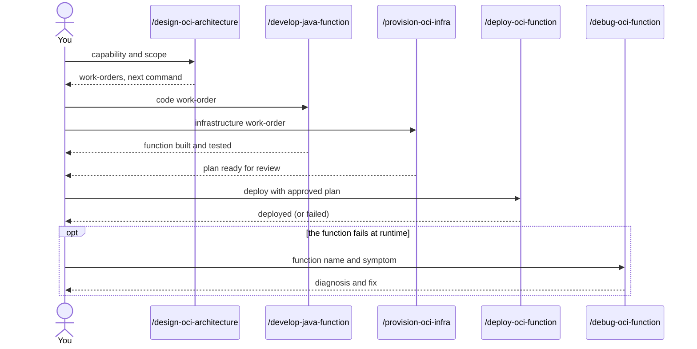

# OCI serverless commands

These commands cover OCI Functions in Java: writing the function, provisioning its infrastructure,
deploying it, debugging it, designing the architecture and observing it. Each one routes to one
agent. Between steps, the agent tells you which command to run next; you start it yourself.

## Commands

| Job | Command | Routes to |
|---|---|---|
| Write or change a Java function | [`/develop-java-function`](../../packages/cloud/provider/oci/oci-functions-java/README.md#develop-java-function) | `oci-functions-java` |
| Provision the infrastructure | [`/provision-oci-infra`](../../packages/cloud/terraform/oci-terraform/README.md#provision-oci-infra) | `oci-terraform` |
| Provision function, gateway and infrastructure together | [`/provision-oci-serverless-stack`](../../packages/cloud/provider/oci/oci-architecture/README.md#provision-oci-serverless-stack) | `oci-serverless-stack` |
| Deploy a function version | [`/deploy-oci-function`](../../packages/cloud/provider/oci/oci-functions-java/README.md#deploy-oci-function) | `oci-deployer` |
| Diagnose a failing function | [`/debug-oci-function`](../../packages/cloud/provider/oci/oci-functions-java/README.md#debug-oci-function) | `oci-debugger` |
| Design or review the architecture | [`/design-oci-architecture`](../../packages/cloud/provider/oci/oci-architecture/README.md#design-oci-architecture) | `oci-serverless-architect` |
| Set up or validate observability | [`/observe-oci-workload`](../../packages/cloud/provider/oci/oci-observability/README.md#observe-oci-workload) | `oci-observability` |
| Remove a test compartment (dry run only) | [`/cleaning-up-oci-resources`](../../packages/cloud/terraform/oci-terraform/README.md#cleaning-up-oci-resources) | `oci-terraform` |

## Typical flow



The agents do not call each other. Each step writes a record, and you start the next command.

## Examples

Write a function for a new capability:

```
/develop-java-function event-producer
```

Plan the infrastructure for it:

```
/provision-oci-infra event-producer functions
```

Deploy a new version:

```
/deploy-oci-function event-producer with tag 0.0.5
```

Debug a symptom:

```
/debug-oci-function func-rr-rest-proxy returns 502
```

Observe one pillar only:

```
/observe-oci-workload func-orders pillar: alarms
```

## Safety

- Deployment needs the approved plan. The argument `approve=tfplan sha256=<hash>` ties the deploy
  to a reviewed plan file.
- `/cleaning-up-oci-resources` only runs the dry run. The live deletion is yours: you run the script
  yourself and type `DELETE` at the prompt. Check the dry-run output first, including any shared
  policies it finds.

## Related

- Packages: [`oci-functions-java`](../../packages/cloud/provider/oci/oci-functions-java/README.md),
  [`oci-terraform`](../../packages/cloud/terraform/oci-terraform/README.md),
  [`oci-architecture`](../../packages/cloud/provider/oci/oci-architecture/README.md),
  [`oci-observability`](../../packages/cloud/provider/oci/oci-observability/README.md),
  [`oci-core`](../../packages/cloud/provider/oci/oci-core/README.md).
- Routing rules: the `*-skills` rules in `.claude/rules/` map keywords to skills.
