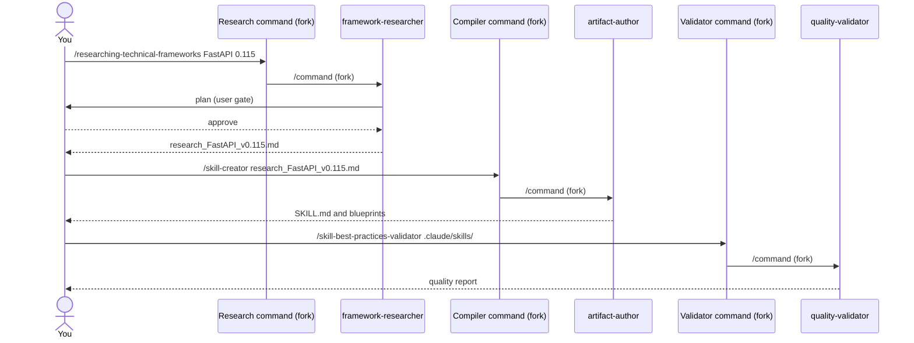

# Flow: from research to a validated skill

Use this flow when you need a new piece of version-pinned knowledge: research a technology, turn it
into a skill or rule, and check it.

## The flow



## Step 1: research

Pick the researcher for your subject. Always give an exact version; with no version there is no
research.

| You need | Command |
|---|---|
| A library or framework at one version | `/researching-technical-frameworks` |
| A self-hosted platform (Kafka, Redis, MongoDB…) | `/researching-platform-software` (routes to a sibling) |
| A Terraform provider | `/technical-framework-researcher-terraform` |
| Terraform engineering practice | `/terraform-engineering-best-practices-researcher` |
| An architecture method (C4, DDD) | `/architecture-methodology-researcher` |
| A cloud provider's guidance | `/cloud-architecture-researcher` |
| A business domain | `/business-domain-researcher` |
| A requirements method | `/requirements-methodology-researcher` |

Output: a research file with sources and dates, and *unverified* tags where a claim could not be
confirmed. Details: [research commands](../entry-points/factory-research.md) and
[platform commands](../entry-points/platform-software.md).

## Step 2: compile

| Research of | Compiler | Output |
|---|---|---|
| A technology or cloud service | `/skill-creator` | `SKILL.md` and `blueprints/` |
| An architecture approach | `/architecture-approaches-skill-generator` | `SKILL.md` |
| A methodology | `/methodologies-skill-generator` | `SKILL.md` |
| Terraform practice | `/terraform-instructions-compiler` | Scoped rules |

Details: [authoring commands](../entry-points/factory-authoring.md).

## Step 3: validate

| You generated | Validate with |
|---|---|
| A skill | `/skill-best-practices-validator` |
| Rules | `/instructions-best-practices-validator` |

If the validator reports problems, fix them and run it again. Then check behavior with
`/evaluating-skill-scenarios`; see the [quality loop](quality-loop.md).

## Variants

```
researching-technical-frameworks -> skill-creator -> skill-best-practices-validator
terraform-engineering-best-practices-researcher -> terraform-instructions-compiler -> instructions-best-practices-validator
architecture-methodology-researcher -> architecture-approaches-skill-generator -> skill-best-practices-validator
requirements-methodology-researcher -> methodologies-skill-generator -> skill-best-practices-validator
```

## After the skill exists

Add it to a package under `packages/` and regenerate `.claude/` (see
[Maintaining the docs](../reference/maintaining-docs.md)). To run the whole chain, including the
commit plan, use [the package builder](full-agent-package.md).
