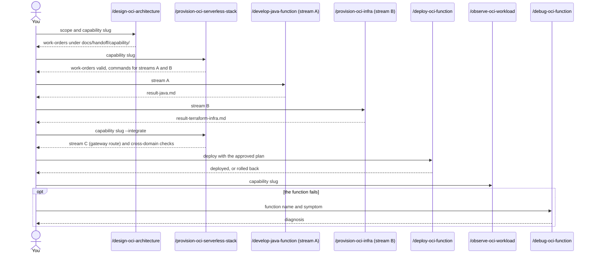

# Flow: an OCI serverless capability

Use this flow to build a capability that needs Java code, Terraform infrastructure and an API
Gateway route. The agents do not call each other. Each step writes a record and tells you which
command to run next, so you stay in control.

## Steps

1. **Design.** `/design-oci-architecture full-stack my-capability` returns advisory output and
   work-orders under `docs/handoff/my-capability/`. It writes no code and no Terraform.
2. **Validate the work-orders.** `/provision-oci-serverless-stack my-capability` checks the three
   work-orders and tells you the commands for the Java and Terraform streams.
3. **Build the two streams.** Run `/develop-java-function` (stream A) and `/provision-oci-infra`
   (stream B). Each writes its own result record.
4. **Integrate.** After both result records exist, run
   `/provision-oci-serverless-stack my-capability --integrate`. It does stream C, the API Gateway
   route, and the cross-domain checks.
5. **Deploy.** `/deploy-oci-function` deploys with an approved plan. See the safety notes in
   [OCI commands](../entry-points/oci-serverless.md#safety).
6. **Observe.** `/observe-oci-workload` sets up and validates logging, tracing, alarms and
   dashboards.
7. **Debug, only if needed.** `/debug-oci-function <name and symptom>` diagnoses a failing function.

## Related

- [OCI commands](../entry-points/oci-serverless.md).
- [Agent architecture: user-mediated handoff](../agents/architecture.md#user-mediated-handoff-oci).
