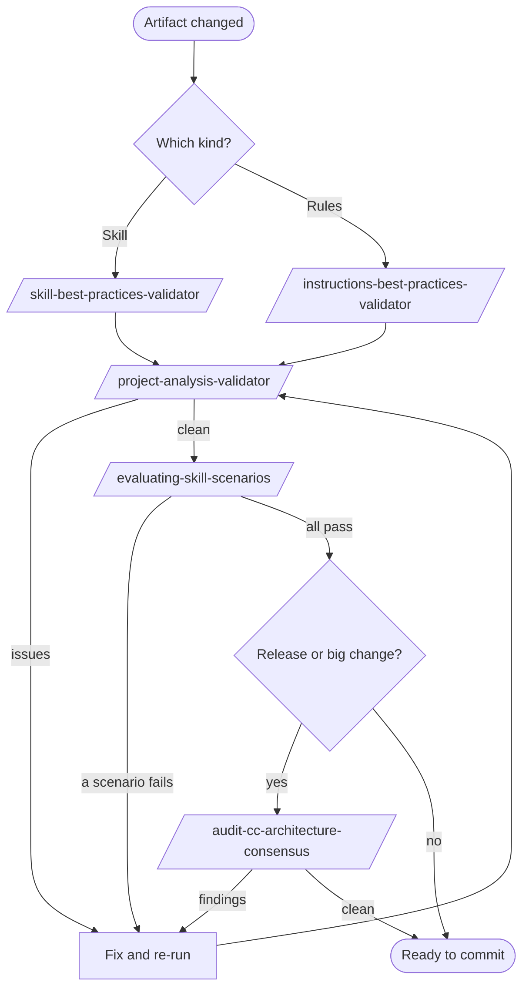

# Flow: the quality loop

Use this flow before you commit a new or changed artifact. It goes from the cheapest check to the
broadest, so you find simple problems first.

## Steps

| Step | Command | Checks | When |
|---|---|---|---|
| 1 | `/skill-best-practices-validator` or `/instructions-best-practices-validator` | The artifact against the skill or rule conventions. | Every change. |
| 2 | `/agent-router-pattern-validator` | That commands route to the right subagent. | You changed a command or an agent. |
| 3 | `/project-analysis-validator` | Structure and quality of the whole project: references, coverage, orphans. | After new artifacts. |
| 4 | `/evaluating-skill-scenarios <skill>` | Behavior: runs the skill's scenarios and judges each answer. | You changed what a skill says or does. |
| 5 | `/audit-cc-architecture-consensus` | Architecture, by three lenses merged into one report. | Before a release, or after a large structural change. |

Consensus findings are ranked by how many lenses agree: all three means must fix, two means should
fix, one means consider.

## When a step fails

1. Fix the highest-priority finding first.
2. Re-run the same step, not the whole loop.
3. Move on only when it passes.

The package builder runs this loop for you in rounds. See
[the package flow](full-agent-package.md).

## Auditing a Copilot project

The `audit-architecture-*` and `copilot-compatibility-review` commands are for projects that target
GitHub Copilot. This repository does not. Use them only on another project.

## Related

- [Quality and audit commands](../entry-points/harness-quality.md).
- [Knowledge-base flow](knowledge-base.md).
