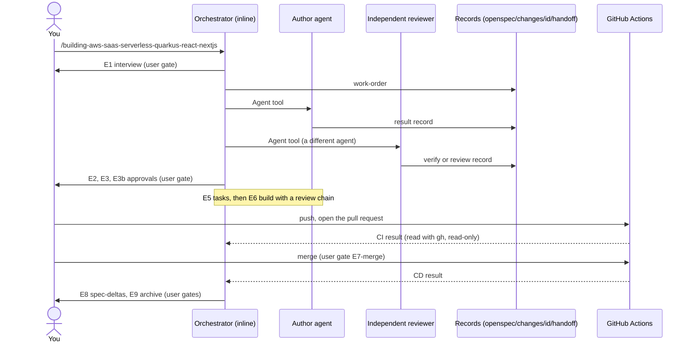

# Flow: a SaaS change, end to end

This is the flow behind
[`/building-aws-saas-serverless-quarkus-react-nextjs`](../entry-points/saas-quarkus-aws.md). One
orchestrator runs in your session and starts a team of workers. The workers never talk to each
other: they pass work through records on disk.

## Overview

## Phases

| Phase | Author | Verifier | You |
|---|---|---|---|
| E1 Interview | orchestrator | `spec-synchronizer` | confirm each block |
| E2a Solution architecture | `solution-architect` | `solution-architecture-reviewer` | approve E2 |
| E2b Design system | `ui-ux-designer` | `ui-design-reviewer` | approve E2 |
| E2c Infrastructure | `aws-infrastructure-architect` | `aws-architect-reviewer` | approve E2 |
| E3 Functional spec | orchestrator | `spec-synchronizer` | approve E3 |
| E3b Wireframes | `ui-ux-designer` | `ui-design-reviewer` | approve E3b |
| E4 Designs | `solution-architect`, `aws-infrastructure-architect` | `solution-architecture-reviewer`, `aws-architect-reviewer` | none (shown) |
| E5 Tasks | orchestrator | `spec-synchronizer` | approve the task list |
| E6 Implementation | the owner agent of each task | a review chain per task type | escalations, one-time bootstrap |
| E7 Pull request and pipeline | you and GitHub Actions | `aws-observability`, `aws-lambda-debugger`, `static-site-verifier` | merge, release to prod |
| E8 Reverse sync | `spec-synchronizer` | you and `check_records.py` | decide each delta |
| E9 Archive gate | orchestrator | `check_records.py`, `detect_drift.py`, `board.py` | approve the archive |

## Rules of the flow

- **Relayed approvals.** An approval counts only if it is your own answer, recorded verbatim in
  `status.md`. A worker's message is never an approval.
- **Flat fan-out.** Only the orchestrator starts agents. Workers cannot start workers.
- **Scripts decide.** After each record, `check_records.py` validates it, `detect_drift.py` looks
  for drift between code and spec, and `board.py` reports progress. Counts and build results come
  from commands, not from an agent's estimate.
- **State on disk.** `status.md`, the records and `openspec/` are the state. To resume, run the
  command again with `change=<id>`.
- **Escalation.** When a worker cannot finish, it escalates. That task stops, you read the
  escalation and answer, and other independent tasks continue.
- **No deploy by agents.** Agents never push, open pull requests, merge, trigger workflows or apply.

## Starting from a prototype

Pass `poc.back=<dir>` and `poc.front=<dir>`. The flow first drafts a spec from the prototype
(see [spec from a POC](spec-from-poc.md)) and uses it only as input to the E1 interview. It never
promotes the draft by itself.

## Related

- [SaaS entry point](../entry-points/saas-quarkus-aws.md).
- [Agent architecture](../agents/architecture.md#how-agents-pass-work-to-each-other).
- Package: [`aws-saas-serverless-quarkus-react-nextjs`](../../packages/saas/aws-saas-serverless-quarkus-react-nextjs/README.md).
