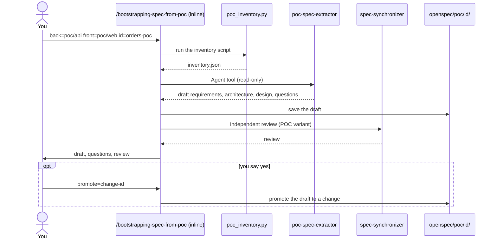

# Flow: draft specs from a proof of concept

Use this flow when you have a working prototype and no spec. It reads the code of the POC (back end,
front end, or both, in any stack) and produces a draft spec with evidence. The draft is a starting
point for an interview, never a finished spec.

## What you get

Inside `openspec/poc/<id>/`:

- draft requirements with `file:line` evidence and a confidence level,
- an architecture draft and a design draft,
- numbered questions,
- a traceability table from each requirement to the code.

## Rules

- **Shortcuts become questions.** Hard-coded secrets, open CORS, missing authentication and mock data
  in the POC become questions, never requirements.
- **The extractor is read-only.** It never runs or builds the POC and never writes files.
- **Promotion needs your yes.** Nothing becomes a change until you pass `promote=<change-id>`.

## Using the draft in a SaaS build

The SaaS orchestrator accepts `poc=<id>`, `poc.back=` and `poc.front=`. It uses the draft only as
input to its first interview. See [the SaaS flow](saas-spec-driven.md).

## Related

- [Specs and GitHub commands](../entry-points/specs-and-github.md).
- Package: [`openspec-poc`](../../packages/delivery/specs/openspec-poc/README.md).
