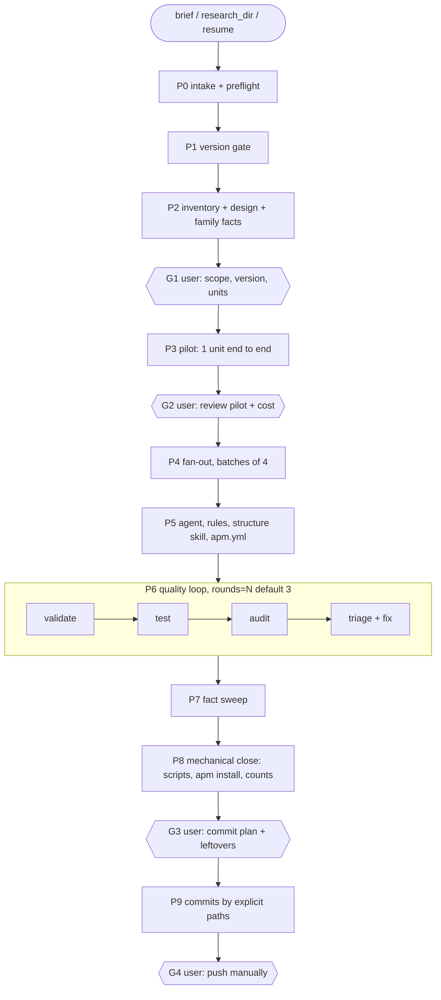

# Flow: Complete Agent Package

End-to-end orchestration from a brief to a committed APM package (skills + agent + rules), driven by
the inline skill [`building-agent-packages`](../../packages/agent-package-builder/README.md).

---

## Diagram

## Entry modes

| Mode | Input | Enters at |
|---|---|---|
| `new` | list of frameworks and/or needs | P0 |
| `from-research` | folder with finished research | inspect -> P2 -> G1 |
| `resume` | working directory (state file optional) | first unfinished step |

## Workers it drives (unchanged)

`framework-researcher` (research), `artifact-author` (skills, agent, rules), `quality-validator`,
`skill-evaluator`, `architecture-auditor`. Launched as subagents with each worker's SKILL.md as spec,
flat (no nesting), with genuine user approvals relayed and recorded.

## See also

[Knowledge Base Flow](fluxo-base-conhecimento.md) · [Quality Flow](fluxo-qualidade.md) · [Project Creation Flow](fluxo-criacao-projeto.md)
