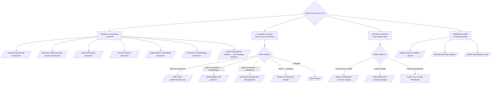

# Agent Usage Manual — Agents Factory

Complete reference for the 7 sub-agents (5 routers + 2 research helpers) and the 51 command skills that invoke them. The 13 agents of the book-writing pipeline are documented separately in [packages/book-writing/README.md](../../packages/book-writing/README.md), and the `camel-quarkus-integrator` subagent with its skills in [packages/camel-quarkus-integrator/README.md](../../packages/camel-quarkus-integrator/README.md).

---

## Navigation by Agent

| Agent | Model | Commands | File |
|--------|--------|:--------:|---------|
| [framework-researcher](framework-researcher.md) | opus | 22 | Research on technologies, frameworks, domains, architectures + the [platform-software family](platform-software-family.md) (15) |
| [artifact-author](artifact-author.md) | sonnet | 6 | Generation of SKILL.md, subagent, and rules/instructions artifacts (renamed from `skill-author` — it authors 3 of the 4 artifact types) |
| [architecture-auditor](architecture-auditor.md) | opus | 8 | Multi-model audit of agent architecture |
| [quality-validator](quality-validator.md) | sonnet | 5 | Quality and compliance validation of artifacts |
| [skill-evaluator](skill-evaluator.md) | sonnet | 1 | Behavioral evaluation of skills via LLM-as-judge |

> **Research helpers** (not directly invocable — spawned by `framework-researcher` at
> `depth=deep`/`exhaustive`): [section-investigator](section-investigator.md) (parallel
> sub-investigation) and [research-synthesizer](research-synthesizer.md) (merges findings into
> the output template).

---

## Quick Reference — All 52 Skills

### Research (`framework-researcher`)

```
/researching-technical-frameworks            # Research technology/framework by version
/technical-framework-researcher-terraform    # Research cloud service + Terraform (IaC)
/cloud-architecture-researcher               # Research cloud framework (AWS WAF, Azure CAF, OCI)
/business-domain-researcher                  # Research organizational domain (Finance, Legal, HR)
/requirements-methodology-researcher         # Research requirements framework (Scrum, SAFe)
/architecture-methodology-researcher         # Research architecture methodology (C4, DDD, TOGAF)
/terraform-engineering-best-practices-researcher  # Research Terraform engineering practices
```

### Platform Software family (`framework-researcher`) — self-managed platforms

```
/researching-platform-software <platform> <version>   # Orchestrator — routes to the right sibling
/researching-streaming-broker         # Kafka, RabbitMQ, Pulsar, NATS, ActiveMQ
/researching-cache-store              # Redis (cache), Memcached, KeyDB, Dragonfly
/researching-coordination-service     # etcd, ZooKeeper, Consul
/researching-search-engine            # Elasticsearch, OpenSearch, Solr, Typesense, Meilisearch
/researching-api-gateway              # Kong, APISIX, Tyk, Traefik EE, KrakenD, Envoy Gateway
/researching-rdbms                    # PostgreSQL, MySQL, MariaDB, CockroachDB
/researching-document-store           # MongoDB, Couchbase, RavenDB
/researching-kv-store                 # Redis (as DB), RocksDB, LMDB, TiKV
/researching-wide-column-store        # Cassandra, ScyllaDB, HBase
/researching-graph-database           # Neo4j, JanusGraph, ArangoDB, Nebula
/researching-timeseries-db            # InfluxDB, TimescaleDB, VictoriaMetrics, QuestDB
/researching-columnar-analytics       # ClickHouse, Druid, Pinot, DuckDB
/researching-vector-store             # Milvus, Qdrant, Weaviate, pgvector, Chroma
/researching-object-storage           # MinIO, Ceph RGW, SeaweedFS, GarageHQ
```
> Detail: [Platform Software Research Family](platform-software-family.md).

### Generation (`artifact-author`)

```
/skill-creator <path-to-research-file>             # Creates SKILL.md from any research file
/agent-creator <domain-role> [advisory|orchestrator]  # Creates a subagent (.claude/agents/<name>.md)
/methodologies-skill-generator <methodology>       # Research + generates methodology skill (all-in-one)
/architecture-approaches-skill-generator <topic>   # Research + generates architecture skill (all-in-one)
/terraform-instructions-compiler <research-file>   # Generates rules/instructions from Terraform research
```
> `rules-compiler` is the generic 5-phase engine `terraform-instructions-compiler` links into. It
> is a knowledge skill (no `/command`), not counted among the 6 commands above.

### Audit — Claude Code (`architecture-auditor`)

```
/audit-cc-architecture-consensus <target>    # Full audit 3 lenses in parallel (recommended)
/audit-cc-architecture-scope <target>        # Lens A: responsibility hierarchy
/audit-cc-architecture-flow <target>         # Lens B: invocation chains
/audit-cc-architecture-engine <target>       # Lens C: CC engine mechanics
```

### Audit — Copilot (`architecture-auditor`)

```
/audit-architecture-consensus <target>      # Full audit 3 lenses in parallel
/audit-architecture-scope <target>          # Lens A: L0→L4 hierarchy
/audit-architecture-flow <target>           # Lens B: invocation chains
/audit-architecture-engine <target>         # Lens C: VS Code engine mechanics
```

### Validation (`quality-validator`)

```
/skill-best-practices-validator .claude/skills/        # Validates SKILL.md against best practices
/instructions-best-practices-validator .claude/rules/  # Validates rules against best practices
/agent-router-pattern-validator                         # Validates project routing pattern
/copilot-compatibility-review                           # Checks Copilot documentation compatibility
/project-analysis-validator .claude/                   # Holistic project health analysis
```

### Evaluation (`skill-evaluator`)

```
/evaluating-skill-scenarios <skill-name>            # Runs LLM-as-judge scenarios for the skill
```

### Book writing (`book-orchestrator` and book agents)

```
/writing-technical-book "<topic>" audience="..." context="..."   # Full pipeline: TOC → chapters → translations → EPUB
/writing-book-toc | /rewriting-book-chapter | /rewriting-book-introduction | /switching-book-language | /enriching-book-chapter
/translating-book | /formatting-book-epub | /repairing-book-epub | /rendering-mermaid-diagrams
```
> Detail: [packages/book-writing/README.md](../../packages/book-writing/README.md).

---

## How to Choose the Agent



---

## Typical End-to-End Flow

```
1. /researching-technical-frameworks
        │ → research_FastAPI_v0.115.md
        ↓
2. /skill-creator workspace/research_FastAPI_v0.115.md
        │ → .claude/skills/fastapi-async-api/SKILL.md
        ↓
3. /skill-best-practices-validator .claude/skills/fastapi-async-api/
        │ → quality report
        ↓
4. /project-analysis-validator .claude/
        │ → .claude/project-analysis-report.md
        ↓
5. /audit-cc-architecture-consensus .claude/
        │ → CC_ARCHITECTURE_MULTI_MODEL_REPORT.md
```

---

## Reference Links

- [How to Use → Complete workflows](../como-usar/README.md)
- [Capabilities Catalog](../capacidades/README.md)
- [Conventions and Standards](../referencia/convencoes.md)
