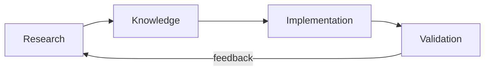
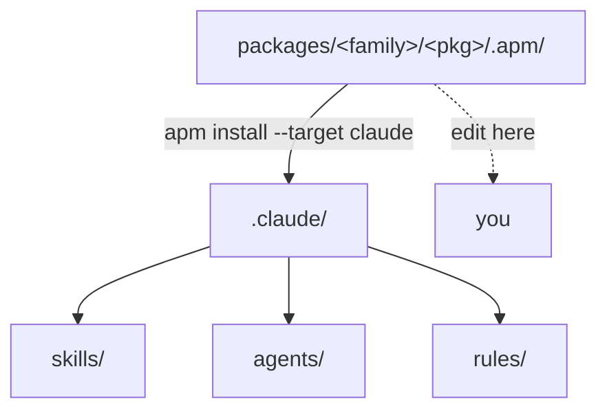

# Overview

The Agents Factory gives Claude Code a set of ready-made **skills**, **subagents** and **rules**.
They help an AI agent do real engineering work (research a technology, write Terraform, build a
Quarkus service, audit an architecture) without making up facts.

## The mental model

1. **Research:** collect facts from official sources, with dates and versions.
2. **Knowledge:** store them as versioned skills with clear do and don't rules.
3. **Implementation:** agents use those skills to write code or infrastructure.
4. **Validation:** reviewers and validators check the result against the same rules.

## Where things live

- **`packages/`** is the source. Each package has an `apm.yml` and its content under `.apm/`.
- **`.claude/`** is generated from `packages/` and committed, so the commands work even without the
  `apm` CLI.
- **`scripts/`** holds the post-install fixups that run after `apm install`, the bundle exporter and
  the documentation generator.

## Three kinds of entry point

| Kind | How you start it | What happens |
|---|---|---|
| **Command** | Type `/name` | Runs in a fresh context and routes to one subagent, which loads its skills. |
| **Inline orchestrator** | Type `/name` | Runs in your session, asks you questions, and starts worker subagents as needed. |
| **Knowledge skill** | Describe the task | Claude loads it automatically when the request matches its description. Nothing to type. |

The full trigger rules are in [Agent architecture](agents/architecture.md).

## Principles

- **Version absolutism:** one skill is one version.
- **Source hierarchy:** official docs first; old or unofficial sources are rejected.
- **Executable truth:** each claim links to a dated source, or it is marked *unverified*.
- **Three tiers:** ✅ always do, ⚠️ ask first, 🚫 never do.
- **P0–P5 workflow:** verify docs, analyze, consult, propose, implement, validate.

See [Conventions](reference/conventions.md) for the details.

## Where to go next

- Run your first commands: [Getting started](getting-started.md).
- Find what is available: [Packages](packages/README.md) and [Entry points](entry-points/README.md).
