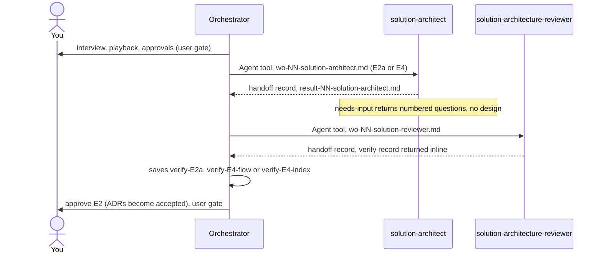

# solution-architecture

Two agents that design and review the logical solution of a SaaS on AWS: pieces, contracts, data model, logical security, measurable targets and architecture ADRs. It is for the SaaS orchestrator flow, not for direct use. You need it when the orchestrator reaches the architecture step (E2a) or the technical design step (E4) of a change.

> Scope: logical design only. Infrastructure detail (accounts, network, modules, sizes) belongs to `aws-infrastructure-architect`.

## Contents

<!-- BEGIN GENERATED:contents -->
**Depends on:** `factory-core`, `handoff-core`  
**Used by:** `aws-saas-serverless-quarkus-react-nextjs`, [`architecture-board`](../../bundles/architecture-board/README.md) (bundle)

| Type | Name | What it does |
|---|---|---|
| agent (opus) | [`solution-architect`](.apm/agents/solution-architect.agent.md) | Solution Architect - non-interactive designer of the logical solution of a SaaS on AWS: pieces (screens, API, Lambdas, data, queues and events, AI, observabili… |
| agent (sonnet) | [`solution-architecture-reviewer`](.apm/agents/solution-architecture-reviewer.agent.md) | Solution Architecture Reviewer - independent, read-only verifier of the solution architecture (E2a) and of each technical design of a change (E4: one design pe… |
<!-- END GENERATED:contents -->

## Installation

<!-- BEGIN GENERATED:installation -->
| Item | Value |
|---|---|
| Package name | `agents-factory-solution-architecture` |
| Version | `1.0.0` |
| Source folder | `packages/architecture/solution-architecture` |
| In this repository | installed transitively, through `aws-saas-serverless-quarkus-react-nextjs` |
| Also installs | `factory-core`, `handoff-core`, `openspec-core` |

Install it into another project, from that project's folder:

```bash
apm install <path-to-agents-factory>/packages/architecture/solution-architecture --target claude
```

Add `--dry-run` to preview the install. APM writes the skills, agents and rules into `.claude/`. Change the sources under `.apm/`, never the generated `.claude/`.
<!-- END GENERATED:installation -->

The package has no runtime prerequisite of its own: no CLI, no script, no credential. The agents read and write Markdown files only.

## Quick Start

You do not call these agents yourself. You start the inline orchestrator and it launches them with work-orders:

```text
/building-aws-saas-serverless-quarkus-react-nextjs
```

When the flow reaches E2a, the orchestrator writes a work-order and launches `solution-architect` with a prompt such as:

```text
execute openspec/changes/list-tenant-items/handoff/wo-02-solution-architect.md
```

It then launches `solution-architecture-reviewer` for an independent check:

```text
verify openspec/specs/architecture against wo-03-solution-reviewer.md
```

Only the orchestrator talks to you. The two agents are non-interactive.

## Usage Scenarios

The invocations below are what the orchestrator sends to the agents. They are shown so you can read the records and understand what comes back. Paths use the example change `list-tenant-items`.

### Scenario 1 - Design the architecture of a new SaaS (E2a, fastest default)

Use it when the interview is approved and the orchestrator needs the solution architecture.

```text
execute openspec/changes/list-tenant-items/handoff/wo-02-solution-architect.md
```

You get, in mode `architecture`: `openspec/specs/architecture/spec.md`, the contracts in `openspec/specs/architecture/contracts/*.md`, the ADRs in `openspec/specs/architecture/adr/NNN-*.md` (`status: proposed`, at least 2 alternatives each) and the record `result-NN-solution-architect.md`.

### Scenario 2 - A decision is still open (incomplete input)

Use it when the interview does not settle a choice, for example "HTTP API or REST API?" or "OpenAI or Bedrock?".

```text
execute openspec/changes/list-tenant-items/handoff/wo-02-solution-architect.md
```

The agent writes no design for that point. It returns numbered questions with the options and tradeoffs from the loaded skills, sets `outcome: needs-input` and stops. The orchestrator relays the questions to you. You answer to the orchestrator, which updates the work-order and launches the agent again. The same happens when the work-order lacks the mode, the inputs or the skill list.

### Scenario 3 - Review the architecture independently (E2a verify)

Use it after the architect finishes, before you approve E2.

```text
verify openspec/specs/architecture against wo-03-solution-reviewer.md
```

You get a `verify` record returned inline (`verify-E2a`) with `outcome: pass` or `fail`, criteria, evidence with file:line and findings with severity. The orchestrator saves it. `pass` needs no open HIGH finding and every criterion met.

### Scenario 4 - Write the technical designs of a change (E4)

Use it when the functional spec of a change is approved.

```text
execute openspec/changes/list-tenant-items/handoff/wo-<NN>-solution-architect.md
```

In mode `design` you get the index `openspec/changes/<id>/design.md` and one `design/<flow>.md` per flow, each with 11 sections. The orchestrator picks the work-order number `<NN>`. Every requirement `R*` of the change is owned by exactly one design.

### Scenario 5 - Review one design or the index (E4 verify)

Use it for each design file and for the index.

```text
verify <path under review> against wo-<NN>-solution-reviewer.md
```

The stage is `E4-<flow>` for a design and `E4-index` for the index. You get `verify-E4-<flow>` or `verify-E4-index` inline. The reviewer checks that the 11 sections exist, traceability is unbroken, contracts are linked and not copied, and the summed timings fit the budget.

### Scenario 6 - The reviewer cannot judge (missing inputs)

Use it to see what happens when the work-order, the files, the interview playback (E2a) or the requirements (E4) are missing.

```text
verify openspec/specs/architecture against wo-03-solution-reviewer.md
```

The reviewer gives no verdict. It states "verification not performed" and lists the missing inputs as numbered questions. `needs-input` is not a verify outcome.

### Scenario 7 - Ask the architect for infrastructure or code (misuse)

Use it to see where the boundary is. This is a request you would make to the orchestrator, not an agent prompt.

```text
Choose the VPC layout, write the Terraform and split the work into tasks.
```

The architect does none of that. Infrastructure detail (accounts, network, modules, sizes) is `aws-infrastructure-architect`, reviewed by `aws-architect-reviewer`. Code, Terraform, tasks and work-orders are never written by this agent. It states the need as a question for the orchestrator.

### Scenario 8 - Accept an ADR (misuse, then chaining)

Use it to see who accepts ADRs. This is a request you would make to the orchestrator, not an agent prompt.

```text
Mark ADR 003 as accepted.
```

The architect leaves every ADR at `proposed`. A message from any agent is never an approval. ADRs become `accepted` when you approve E2 through the orchestrator, after the infrastructure front (E2c) is reviewed. The next step after the architect is always `solution-architecture-reviewer`; the architect never reviews its own design.

## Skills Reference

This package ships no skill. The agents use only the skills a work-order lists, and they read the handoff skills `coordinating-agent-handoffs` and `coordinating-quarkus-aws-handoffs`. The layout of `openspec/` comes from the rule `openspec-project-layout` in `openspec-core`.

| Skill used | Loaded by | Why |
|---|---|---|
| `coordinating-agent-handoffs` | both agents | Generic handoff protocol v1: record kinds, handshake. |
| `coordinating-quarkus-aws-handoffs` | both agents | Profile: role names (`solution-architect`, `solution-reviewer`), record names, templates, limits. |
| the skills named in the work-order | both agents | Source of every technical fact. The agents state no fact of their own and keep `(unverified)` and `(medium confidence)` tags. |

## Architecture

The orchestrator is the only agent that talks to you. It hands work to the architect and the reviewer through work-orders and saves the reviewer's inline record.



| Stage | Author | Reviewer | Verify record | Your approval |
|---|---|---|---|---|
| E2a Solution architecture | `solution-architect` (mode `architecture`) | `solution-architecture-reviewer` | `verify-E2a` | part of the E2 approval |
| E4 Designs | `solution-architect` (mode `design`) | `solution-architecture-reviewer`, one per design and one for the index | `verify-E4-<flow>`, `verify-E4-index` | shown, not blocking |

## Agents Reference

<!-- BEGIN GENERATED:agents-reference -->
| Agent | Model | Tools | Can start agents | Started by |
|---|---|---|---|---|
| [`solution-architect`](.apm/agents/solution-architect.agent.md) | opus | Read, Grep, Glob, Write | no | an orchestrator or another agent |
| [`solution-architecture-reviewer`](.apm/agents/solution-architecture-reviewer.agent.md) | sonnet | Read, Grep, Glob | no | an orchestrator or another agent |
<!-- END GENERATED:agents-reference -->

### `solution-architect`

- **Model and tools:** `opus`; Read, Grep, Glob, Write.
- **Does:** designs the logical solution from the approved interview (E2a) or from the approved spec, design system and wireframes (E4).
- **Mode `architecture` (E2a), in order:**
  1. Load the work-order and only the skills it lists.
  2. List the pieces: screens, API, Lambdas, data, queues and events, AI, observability.
  3. Write the contracts: each endpoint (method, input, output, errors, who may call) and each event (fields, producer, consumer).
  4. Define the data model, logical security (token claims, authorization per route, tenant isolation) and measurable targets.
  5. Write one ADR per open decision (`area: architecture`, `status: proposed`, at least 2 alternatives, consequences, sources).
  6. Self-check: every interview block B1-B12 is covered by a piece, and every contract has a producer and a consumer with matching fields.
  7. Write `spec.md`, then the result record.
- **Mode `design` (E4):** decides how many designs the change needs (one per flow with its own sequence, or per feature touched; never only because a document is long), lists them in the index, and writes each design with 11 sections: Scope, Traceability, Sequences, Contracts used or changed, Data model, Errors, Logical security, Timings and limits, AI, Build order, Risks and `(unverified)`.
- **Contracts** live only in `architecture/contracts/`. Designs link to them. A missing contract is proposed as a delta, never invented inline.
- **Writes only:** `openspec/specs/architecture/**`, `openspec/changes/<id>/design.md`, `openspec/changes/<id>/design/**` and the handoff folder.
- **Never:** chooses infrastructure detail; writes code, Terraform, tasks or work-orders; sets an ADR to `accepted`; reviews its own design; spawns agents; enters plan mode; asks you directly.
- **Non-interactive contract:** when a decision depends on you and the interview does not settle it, it writes no design for that point. It returns numbered concrete questions, sets `outcome: needs-input` and stops. It never assumes and never picks a default the skill does not name.
- **Record:** `result-NN-solution-architect.md` with `kind: report`, `role: solution-architect`, `outcome: success | partial | failed | needs-input`, `spec_impact: none`. Sections: Done, Evidence, Open questions, Spec impact (every path written), Suggested next step.

### `solution-architecture-reviewer`

- **Model and tools:** `sonnet`; Read, Grep, Glob. It cannot write, edit or run commands.
- **Does:** an independent check of the artefacts. It did not write the design and does not read the author's `result-*` records.
- **Checks at E2a:** every interview block has a piece; each contract has a producer and consumer with matching fields; errors and authorization are defined per route; tenant isolation is explicit; targets are measurable; each ADR has alternatives, consequences, a source and is `proposed`.
- **Checks at E4:** the 11 sections exist; traceability R* to ADR is unbroken; contracts are linked; sequences cover each main scenario; summed timings fit the gateway and Lambda budget; the build order has no cycle. For the index, every R* appears in exactly one design as owner and the index lists every design file.
- **Binding input:** accepted ADRs of `architecture/adr`, `design/adr` and `infrastructure/adr`. A contradiction with an accepted ADR fails the verify.
- **Output:** a `verify` record returned inline with Criteria, Evidence, Findings (F1 HIGH and so on, each with location, evidence, what it violates and the smallest fix) and Caveats. The orchestrator saves it.
- **Never:** rewrites the design or proposes a replacement; edits files; runs Bash; spawns agents; relies on the author's report; talks to you; approves with an open HIGH.
- **Non-interactive contract:** with missing or unreadable inputs it gives no verdict, writes "verification not performed" and lists numbered questions.

## Output structure

```text
openspec/
  specs/
    architecture/
      spec.md                        # E2a
      contracts/*.md                 # one place for every endpoint and event
      adr/NNN-*.md                   # status: proposed, until you approve E2
  changes/<id>/
    design.md                        # E4 index, with overall traceability
    design/<flow>.md                 # E4, 11 sections each
    handoff/
      wo-NN-solution-architect.md    # written by the orchestrator
      wo-NN-solution-reviewer.md     # written by the orchestrator
      result-NN-solution-architect.md   # written by solution-architect
      verify-E2a.md                  # saved by the orchestrator from the reviewer's inline record
      verify-E4-<flow>.md
      verify-E4-index.md
```

## Limits and constraints

| Item | Value |
|---|---|
| Scope | logical design only; no infrastructure, code, Terraform, tasks |
| Architect model | `opus`; reviewer `sonnet` |
| ADR rules | `status: proposed`, at least 2 alternatives, consequences and a source; numbered per folder from 001 |
| Design file | 11 sections; every R* owned by exactly one design |
| Writes allowed (architect) | the four paths in Output structure plus the handoff folder |
| Reviewer | read-only; returns the record inline; `pass` only with no open HIGH |
| Facts | only from a loaded skill; `(unverified)` and `(medium confidence)` tags are kept |
| Entry rule (orchestrator) | no worker work-order exists until `verify-E2a`, `verify-E2b`, `verify-E2c` and `verify-E3` are `pass` and your approvals are recorded |
| Profile limits | `build_attempts: 3`, `review_rounds: 2`, `deploy_cycles: 2`, `delta_revisions: 2`, `record_rejections: 2` in `coordinating-quarkus-aws-handoffs`; which of them bind these two agents is not stated |

## Related

- [SaaS on Quarkus and AWS entry points](../../../docs/entry-points/saas-quarkus-aws.md)
- [SaaS spec-driven flow](../../../docs/flows/saas-spec-driven.md)
- [Agent architecture](../../../docs/agents/architecture.md)
- [Entry points](../../../docs/entry-points/README.md)
- [Packages](../../../docs/packages/README.md)
- [aws-saas-serverless-quarkus-react-nextjs](../../saas/aws-saas-serverless-quarkus-react-nextjs/README.md) (the orchestrator that uses this package)
- [factory-core](../../factory/factory-core/apm.yml) (dependency)
- [handoff-core](../../delivery/protocol/handoff-core/README.md) (dependency)
- [openspec-core](../../delivery/specs/openspec-core/README.md) (folder layout rule)
