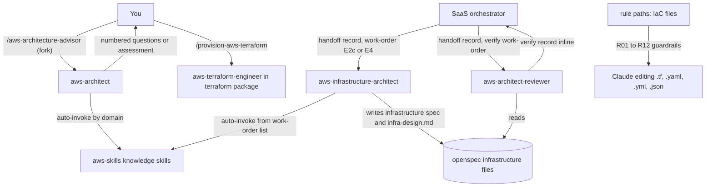

# aws-architect

This package gives you an advisory agent for AWS architecture, plus two agents that design and verify the AWS infrastructure of a SaaS. It is for people who want AWS design or review guidance grounded in sourced, version-dated skills, and for the SaaS orchestrator that needs an infrastructure design and an independent check of it. Install it to get `/aws-architecture-advisor`, the two agents and two guardrail rules for infrastructure-as-code files.

## Contents

<!-- BEGIN GENERATED:contents -->
**Depends on:** `aws-skills`, `factory-core`, `handoff-core`  
**Used by:** `aws-saas-serverless-quarkus-react-nextjs`, [`architecture-board`](../../../../bundles/architecture-board/README.md) (bundle), [`aws-well-architected-reviewer`](../../../../bundles/aws-well-architected-reviewer/README.md) (bundle)

| Type | Name | What it does |
|---|---|---|
| command | [`/aws-architecture-advisor`](.apm/skills/aws-architecture-advisor/SKILL.md) | Routes an AWS architecture question, design request, or review to the aws-architect advisory agent. |
| agent (sonnet) | [`aws-architect-reviewer`](.apm/agents/aws-architect-reviewer.agent.md) | AWS Architect Reviewer - independent, read-only verifier of the infrastructure design (infrastructure/spec.md at E2c, infra-design.md of a change at E4). |
| agent (sonnet) | [`aws-architect`](.apm/agents/aws-architect.agent.md) | AWS Architecture Advisor — reviews, designs, and evaluates AWS architectures using the 40 aws-skills knowledge base (WAF six pillars, security, networking, ser… |
| agent (opus) | [`aws-infrastructure-architect`](.apm/agents/aws-infrastructure-architect.agent.md) | AWS Infrastructure Architect - non-interactive designer of the AWS infrastructure where the pieces of an already reviewed solution architecture run, before any… |
| rule | [`aws-iac-reliability-cost.instructions`](.apm/instructions/aws-iac-reliability-cost.instructions.md) | AWS reliability, networking, and cost guardrails for IaC artifacts (Terraform, CloudFormation, SAM, CDK). |
| rule | [`aws-security-baseline.instructions`](.apm/instructions/aws-security-baseline.instructions.md) | AWS security baseline guardrails for IaC artifacts (Terraform, CloudFormation, SAM, CDK). |
<!-- END GENERATED:contents -->

## Installation

<!-- BEGIN GENERATED:installation -->
| Item | Value |
|---|---|
| Package name | `agents-factory-aws-architect` |
| Version | `1.0.0` |
| Source folder | `packages/cloud/provider/aws/aws-architect` |
| In this repository | installed transitively, through `aws-saas-serverless-quarkus-react-nextjs` |
| Also installs | `aws-skills`, `factory-core`, `handoff-core`, `openspec-core` |

Install it into another project, from that project's folder:

```bash
apm install <path-to-agents-factory>/packages/cloud/provider/aws/aws-architect --target claude
```

Add `--dry-run` to preview the install. APM writes the skills, agents and rules into `.claude/`. Change the sources under `.apm/`, never the generated `.claude/`.
<!-- END GENERATED:installation -->

No runtime tools are needed. The advisor only reads files and the AWS skills from [aws-skills](../aws-skills/). It runs no commands.

## Quick Start

```
/aws-architecture-advisor review my VPC design
```

The command forks to the `aws-architect` agent. It loads the matching AWS skills, and returns an assessment with sourced findings, or numbered questions if it lacks context.

## Usage Scenarios

### Scenario 1 — Fastest default run: a WAF Security Pillar review

You have a short description of the architecture and want a review against one pillar.

```
/aws-architecture-advisor Review my AWS architecture for WAF Security Pillar compliance. We have a Lambda-based API behind API Gateway with DynamoDB, all in a single AWS account. Our team uses IAM users with long-term access keys.
```

You get a pillar assessment with the critical gaps flagged (single account, long-term access keys), an ADR recommending a multi-account setup and IAM Identity Center, and delegation lines that name the skills to load next, such as `architecting-aws-multi-account-organizations` and `securing-aws-iam-serverless`. It writes no CloudFormation or Terraform code.

### Scenario 2 — Incomplete input: questions come back

Your request has no domain, no RTO/RPO, no auth model and no account structure.

```
/aws-architecture-advisor Design a serverless API for us.
```

The agent stops and returns a numbered question list. Example questions from the evaluation scenario: is this a new account or an existing multi-account environment, who calls the API, what request volume to expect, what compliance requirements apply, what cold-start latency is acceptable. It produces no design and assumes no defaults. Answer the numbers and run the command again with the answers in the request.

### Scenario 3 — Assess an existing landing zone

You have several accounts and gaps in audit and detection.

```
/aws-architecture-advisor We have 3 AWS accounts: dev, staging, production. We use CloudTrail in the production account only. GuardDuty is not enabled. We have no Control Tower. Assess against WAF.
```

The agent loads the multi-account, CloudTrail audit and security pillar skills. It ranks the findings (for example an organization-level trail and GuardDuty as critical). It asks whether you have an existing DIY setup before it recommends Control Tower.

### Scenario 4 — Catch an anti-pattern

You paste a design and ask if it is fine.

```
/aws-architecture-advisor Here is our VPC Terraform: one NAT Gateway in us-east-1a, shared across all private subnets in us-east-1a, us-east-1b, and us-east-1c. Is this OK?
```

The agent loads `designing-aws-vpc-networks`, flags the shared NAT gateway as a high-risk anti-pattern (one NAT gateway per AZ), and asks whether S3 and DynamoDB gateway endpoints are in place. It does not write Terraform.

### Scenario 5 — Out of scope: you want the code written

You ask the advisor for HCL.

```
/aws-architecture-advisor write the Terraform for a private S3 bucket with KMS
```

The advisor is advisory only and generates no IaC. Use `/provision-aws-terraform` from [terraform](../../../terraform/terraform/) to write and check the HCL.

### Scenario 6 — Chain: advice, then code

You take an advisory recommendation (for example one NAT gateway per AZ) and implement it.

```
/aws-architecture-advisor review my three-tier VPC design for WAF Reliability and Security
/provision-aws-terraform "VPC with public and private subnets and one NAT gateway per AZ, root module, eu-west-1, tags team=platform, no backend, no test" ./infra/net
```

The first command gives sourced findings. The second writes and checks HCL from a closed requirement.

### Scenario 7 — Inside the SaaS flow: design and verify infrastructure

You do not call these two agents yourself. The orchestrator `building-aws-saas-serverless-quarkus-react-nextjs` launches them from work-orders:

```
execute openspec/changes/list-tenant-items/handoff/wo-04-infrastructure-architect.md
verify openspec/specs/infrastructure against wo-05-infrastructure-reviewer.md
```

The first writes `openspec/specs/infrastructure/**` or `infra-design.md`. The second returns a pass or fail verify record.

## Commands Reference

### `/aws-architecture-advisor`

*Route an AWS architecture question, design request or review to the `aws-architect` agent.*

**Syntax**

```
/aws-architecture-advisor <question or scope>
```

**Parameters**

| Parameter | Required | Default | Description |
|---|---|---|---|
| `<question or scope>` | Yes | none | The question, or the scope to review or design. Examples from the hint: `review my VPC design`, `design serverless event-driven API`, `assess WAF security posture`. |

**Prerequisites**

- Give as much context as you can: scope, environment, account structure, RTO/RPO, compliance. Missing context comes back as numbered questions.
- The AWS knowledge skills from [aws-skills](../aws-skills/) must be installed (they are a dependency).

**What it does**

The `aws-architect` agent follows a P0-P5 workflow.

1. P0: classifies the request by domain (WAF review, security, serverless, data, observability, networking, multi-account, cost, SaaS) and loads the primary skills.
2. P1: scans any IaC, diagram or prose you give and compares it with each skill's Always-Do list.
3. P2: reads the skills fully and extracts patterns, anti-patterns and decision criteria. Each open Ask-First item gets a tradeoff and a recommendation.
4. P3: presents an architecture overview, a pillar-by-pillar assessment (Pass, Warn or Fail with evidence), the resolved decisions, recommendations ordered by risk, and delegation to the skill or agent for each change. If context is missing it stops and returns numbered questions.
5. P4: delivers ADRs, text or Mermaid diagrams, an implementation roadmap and a verification checklist from the skills.
6. P5: validates against the six pillars, checks recurring anti-patterns (shared IAM roles, long-term access keys, single-AZ production, shared NAT gateway, missing gateway endpoints, no IaC for production) and lists every `(unverified)` and `(medium confidence)` item relied on under Questions / Limitations.

**What is updated and what is not**

| Changes | Does not change |
|---|---|
| Nothing. The agent has only read tools (Read, Grep, Glob). | Files, IaC, AWS resources. It generates no CloudFormation, Terraform or CDK, and does not spawn agents. |

**Output files**: none. The answer is returned in the reply.

**Examples**

```
/aws-architecture-advisor review my three-tier VPC design for WAF Reliability and Security
/aws-architecture-advisor design a serverless event-driven order processing system
/aws-architecture-advisor assess our multi-account landing zone against WAF Security Pillar
```

**Next**: the answer names the skills to load for each change. For HCL, run `/provision-aws-terraform`.

## Architecture



## Agents Reference

<!-- BEGIN GENERATED:agents-reference -->
| Agent | Model | Tools | Can start agents | Started by |
|---|---|---|---|---|
| [`aws-architect-reviewer`](.apm/agents/aws-architect-reviewer.agent.md) | sonnet | Read, Grep, Glob | no | an orchestrator or another agent |
| [`aws-architect`](.apm/agents/aws-architect.agent.md) | sonnet | Read, Grep, Glob | no | `/aws-architecture-advisor` |
| [`aws-infrastructure-architect`](.apm/agents/aws-infrastructure-architect.agent.md) | opus | Read, Grep, Glob, Write | no | an orchestrator or another agent |
<!-- END GENERATED:agents-reference -->

All three agents are non-interactive: when context is missing they return numbered questions and stop. None states AWS facts of its own; every claim comes from a loaded skill, and `(unverified)` and `(medium confidence)` tags are kept.

- **aws-architect** is launched by `/aws-architecture-advisor`. It is advisory only. It never researches AWS services, implements code, edits files, spawns sub-agents or enters plan mode. Its tools are Read, Grep and Glob. Its P3 step says "wait for user feedback", but as a subagent it cannot wait: it either answers or returns questions.
- **aws-infrastructure-architect** (model opus) has no command. It runs at stage E2c, where it writes the 12 sections of `openspec/specs/infrastructure/spec.md` (environments and accounts, piece-to-service map, network, edge, identity, secrets, data, observability, Terraform layout, CI/CD, cost, risks) and one ADR per open decision in `openspec/specs/infrastructure/adr/`, and at stage E4, where it writes `openspec/changes/<id>/infra-design.md`. It also writes one record `result-NN-infrastructure-architect.md`. ADRs stay `proposed`. It returns `needs-input` with numbered questions for missing context such as account count, region, budget, GitHub plan, who releases prod, or RTO/RPO. It never changes pieces or contracts, writes Terraform, code or tasks, reviews its own design, accepts ADRs, spawns agents, enters plan mode or asks the user. It writes only under `openspec/specs/infrastructure/**`, `openspec/changes/<id>/infra-design.md` and the handoff folder.
- **aws-architect-reviewer** has no command. It checks the design (E2c, or E4-infra) against the Well-Architected pillars, the serverless lens and the SaaS lens. It also checks eight observability items (SLOs, log fields, retention, sampling, alarm list, dashboards, cardinality, API type), recording each as OK, GAP or UNVERIFIED. It returns a verify record inline with outcome `pass` or `fail`, and passes only with no open HIGH finding and every criterion met. Without readable inputs it gives no verdict. It never edits files, runs commands, proposes a full alternative design, writes Terraform, accepts ADRs or spawns agents. It never reads the author's `result-*` records.

## Rules

Two guardrail rules ship with the package. The source files declare their scope with `applyTo: "**/*.tf,**/*.yaml,**/*.yml,**/*.json"`. They apply when you edit or review IaC files (Terraform, CloudFormation, SAM, CDK). They point to skills for facts and carry the tags of those skills.

| Rule | Always (summary) | Ask first | Never |
|---|---|---|---|
| `aws-security-baseline` | R01 one IAM role per compute resource; R02 no long-term static access keys; R03 no hardcoded credentials; R04 encryption at rest; R05 encryption in transit; R06 confused-deputy conditions | KMS CMK or AWS-managed key; WAF rule group selection; Shield Advanced | wildcard IAM actions or resources without Deny conditions; `0.0.0.0/0` on port 22 or 3389; internet-facing ALB or CloudFront without WAF; AWS credentials in Lambda environment variables |
| `aws-iac-reliability-cost` | R07 one account per workload and environment; R08 all production in IaC; R09 multi-AZ for production compute; R10 one NAT gateway per AZ; R11 S3 and DynamoDB gateway endpoints; R12 mandatory tags | DR tier (RTO/RPO); Savings Plans vs On-Demand vs Spot; Control Tower vs DIY Organizations | single-AZ production for stateful services; shared NAT gateway across AZs; NAT or internet gateway for S3 or DynamoDB traffic; 100% On-Demand for a stable baseline |

## Output structure

The advisor writes no files. The infrastructure architect writes:

```
openspec/
├── specs/infrastructure/
│   ├── spec.md                              E2c
│   └── adr/NNN-*.md                         one per open decision, status proposed
└── changes/<id>/
    ├── infra-design.md                      E4
    └── handoff/result-NN-infrastructure-architect.md
```

## Limits and constraints

| Item | Value | Source |
|---|---|---|
| `aws-architect` scope | advisory only; no IaC, no file edits, no sub-agents | agent |
| `aws-infrastructure-architect` write scope | `openspec/specs/infrastructure/**`, `openspec/changes/<id>/infra-design.md`, handoff folder | agent |
| ADR status written by the architect | `proposed`, at least 2 alternatives, consequences, sources | agent |
| Reviewer verdict | `pass` only with no open HIGH and every criterion met | agent |
| Reviewer observability items | 8 items; any GAP fails the verify | agent |
| Facts | only from loaded skills; tags `(unverified)` and `(medium confidence)` are kept and surfaced | agents |
| Terraform | not written here; use [terraform](../../../terraform/terraform/) | agent |

## Related

- [AWS commands](../../../../../docs/entry-points/aws.md) and [Terraform commands](../../../../../docs/entry-points/terraform.md)
- [Agent architecture](../../../../../docs/agents/architecture.md)
- [Packages](../../../../../docs/packages/README.md)
- [aws-skills](../aws-skills/) is the knowledge base (dependency).
- [factory-core](../../../../factory/factory-core/) and [handoff-core](../../../../delivery/protocol/handoff-core/) are dependencies.
- [terraform](../../../terraform/terraform/) writes the HCL for what the architects design.
- [aws-observability](../aws-observability/) covers observability work.
