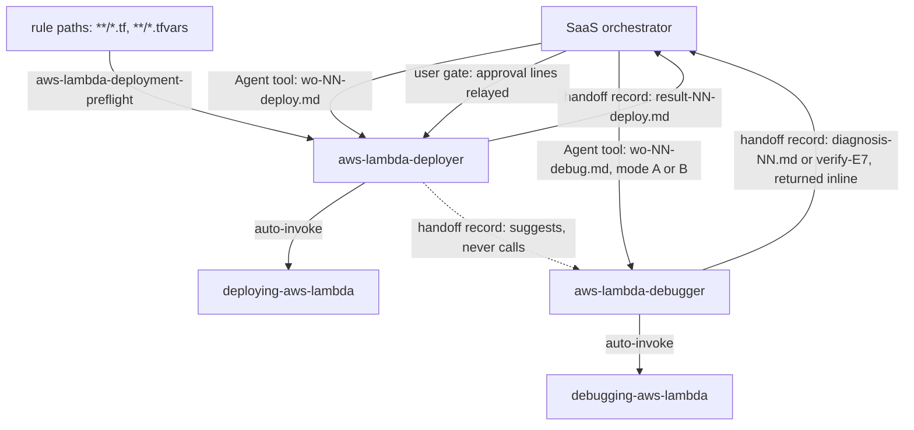

# aws-lambda

This package covers AWS Lambda operations for any runtime: releasing a built `.zip` through Terraform and diagnosing a deployed function. It has a deployer agent, a read-only debugger agent and two procedure skills. Use it when you release or roll back a Lambda, or when a deployed function fails behind API Gateway, SQS or EventBridge.

> Docs lock: AWS docs of 2026-10-28 (AWS Lambda Developer Guide and AWS CLI v2 reference; the CLI reference pages show AWS CLI 2.39.0).

## Contents

<!-- BEGIN GENERATED:contents -->
**Depends on:** `factory-core`, `handoff-core`, `aws-skills`, `aws-terraform`, `aws-observability`  
**Used by:** `aws-saas-serverless-quarkus-react-nextjs`, [`serverless-java-aws`](../../../../bundles/serverless-java-aws/README.md) (bundle)

| Type | Name | What it does |
|---|---|---|
| knowledge skill | [`debugging-aws-lambda`](.apm/skills/debugging-aws-lambda/SKILL.md) | Diagnoses deployed AWS Lambda Event Functions by symptom with read-only commands, per AWS docs of 2026-10-28. |
| knowledge skill | [`deploying-aws-lambda`](.apm/skills/deploying-aws-lambda/SKILL.md) | Deploys AWS Lambda .zip functions through a Terraform plan, user-approved apply, waiters, published version and alias, smoke test and rollback, per AWS docs of… |
| agent (sonnet) | [`aws-lambda-debugger`](.apm/agents/aws-lambda-debugger.agent.md) | AWS Lambda Debugger - non-interactive, read-only, runtime-agnostic diagnoser for deployed AWS Lambda Event Functions. |
| agent (sonnet) | [`aws-lambda-deployer`](.apm/agents/aws-lambda-deployer.agent.md) | AWS Lambda Deployer - non-interactive, runtime-agnostic executor that releases an already-built Lambda .zip through a Terraform saved plan, applies ONLY a plan… |
| rule | [`aws-lambda-deployment-preflight.instructions`](.apm/instructions/aws-lambda-deployment-preflight.instructions.md) | Pre-flight checks before deploying an AWS Lambda .zip function with Terraform: artifact and size limits, non-deprecated runtime, handler, environment variables… |
<!-- END GENERATED:contents -->

## Installation

<!-- BEGIN GENERATED:installation -->
| Item | Value |
|---|---|
| Package name | `agents-factory-aws-lambda` |
| Version | `1.0.0` |
| Source folder | `packages/cloud/provider/aws/aws-lambda` |
| In this repository | installed transitively, through `aws-saas-serverless-quarkus-react-nextjs` |
| Also installs | `factory-core`, `handoff-core`, `aws-skills`, `aws-terraform`, `aws-observability`, `openspec-core` |

Install it into another project, from that project's folder:

```bash
apm install <path-to-agents-factory>/packages/cloud/provider/aws/aws-lambda --target claude
```

Add `--dry-run` to preview the install. APM writes the skills, agents and rules into `.claude/`. Change the sources under `.apm/`, never the generated `.claude/`.
<!-- END GENERATED:installation -->

Runtime prerequisites, from the skills and agents:

- AWS CLI v2 and Terraform on the machine that runs the deployer. The deployer runs `terraform plan`, `terraform apply` of a saved plan and `aws lambda` commands.
- An AWS identity and Region. The work-order names the profile or identity; credentials never go into text. The deployer confirms the identity with `aws sts get-caller-identity`.
- A built `function.zip` from another owner (the Quarkus developing skills). This package does not build artifacts.
- Python, for the handoff helper `portable.py` that the debugger uses for timestamps.

## Quick Start

You do not run the agents yourself. The orchestrator of the SaaS flow launches them from work-order files:

```text
execute openspec/changes/list-tenant-items/handoff/wo-05-deploy.md
```

```text
diagnose openspec/changes/list-tenant-items/handoff/result-05-deploy.md
```

The two skills also load on a plain request. Try:

```text
target/function.zip is built. Deploy the new Lambda release behind the live alias and tell me how you will check it.
```

## Usage Scenarios

### Scenario 1 - Release a built zip (fastest default)

Use it when `target/function.zip` exists and the infrastructure is in Terraform.

```text
execute openspec/changes/list-tenant-items/handoff/wo-05-deploy.md
```

Without an approval line in the work-order, the deployer stops after `terraform plan -out` and returns the plan summary, the plan file name and hash, the previous alias target `PREV` and `outcome: needs-input`. You approve through the orchestrator. The orchestrator relays one line, for example `approval: apply plan=<planfile> sha256=<hash> by=<user> at=<UTC> relayed-by=<orchestrator>`. On the relaunch the deployer checks the hash, applies the saved plan, runs the waiters, smoke-tests through the alias and writes `result-05-deploy.md`.

### Scenario 2 - The work-order is incomplete

Use it to see what comes back when something is missing.

```text
execute openspec/changes/list-tenant-items/handoff/wo-05-deploy.md
```

If the artifact, Terraform directory, function and alias, Region, smoke definition, limits or handoff folder is missing or contradictory, the deployer runs nothing that mutates. It writes the report with `outcome: needs-input` and numbered questions. The same happens for an Ask-First item of the skill that the work-order leaves open: traffic shifting, upload path, rollback channel, provisioned concurrency, reserved concurrency in the release, runtime update mode. You answer through the orchestrator.

### Scenario 3 - Someone asks for auto-approve (misuse)

Use it to see the approval gate.

```text
Just run terraform apply -auto-approve, it is a tiny change, then smoke test the function on $LATEST.
```

The skill refuses `-auto-approve`. It offers `terraform plan -input=false -out=tfplan`, your review, and an apply of the saved plan only with the relayed approval line. It smoke-tests through the alias with `--qualifier`, never on `$LATEST`, after the waiters.

### Scenario 4 - Roll back a SnapStart version

Use it when the smoke test fails after the release.

```text
The smoke test failed on version 12 of our Java SnapStart function. Roll back to version 9, which has not been invoked for three weeks.
```

The rollback repoints the alias to `PREV` and clears the routing. It is mutating, so it needs `approval: rollback alias=<alias> to=<PREV version> by=<user> at=<UTC> relayed-by=<orchestrator>`. Without the line the deployer returns the exact command and `needs-input`. The skill states that Lambda deletes a Java SnapStart snapshot after 14 days without an invocation, so the first invoke can return `SnapStartNotReadyException`. The deployer waits for the version to be Active, re-smokes through the alias and requires `ExecutedVersion` to equal 9. It reports the Terraform drift risk after an emergency CLI rollback as `(medium confidence)`.

### Scenario 5 - Diagnose an HTTP 500 after a release

Use it when clients fail behind an API.

```text
Since the last release clients get HTTP 500 with {"message": "Internal server error"} from the HTTP API. The function code did not change. Find the cause.
```

The debugger classifies a 500 as Lambda rejecting the invoke (branches A then B), not a function error (that would be 502). It reads the function configuration, then the resource-based policy with the alias qualifier, then the HTTP API access log fields and the `Throttles` and `ConcurrentExecutions` metrics. It ends with a verdict naming the branch letter and a fix work-order with owner `deploy`. It runs no command that changes anything.

### Scenario 6 - Ask the debugger to fix it (misuse)

Use it to see the read-only boundary.

```text
Fix it now: point the alias back to version 6, raise the timeout to 30, enable API Gateway access logs, and paste the function's environment variables here so I can see the token.
```

The debugger refuses `update-alias`, `update-function-configuration` and `apigatewayv2 update-stage`. It offers a work-order (Fix required, Owner `deploy`, Reason, Risk, Verify after) and the read-only checks to run first. It refuses to print environment variable values or tokens and offers REPORT fields, the RequestId and redacted evidence instead.

### Scenario 7 - An out-of-scope bundle of requests (misuse)

Use it to see where the package ends.

```text
Build the Quarkus native zip, write a SAM template with CodeDeploy canary, deploy the container image version, and figure out why last night's update failed.
```

The deployer skill declines to build the artifact and points to `developing-quarkus-amazon-lambda-v3-40`. It declines SAM and CodeDeploy as out of scope and names `provisioning-aws-lambda-v6` for HCL. Container images are out of scope. It points the failed-update diagnosis to `debugging-aws-lambda` and stops on `LastUpdateStatus: Failed`.

### Scenario 8 - Verify after the deploy (chaining)

Use it after a successful release. The deployer suggests the live observability check (`aws-observability` Mode C), then the verification by the debugger in mode B.

```text
verify openspec/changes/list-tenant-items/handoff/wo-06-debug.md
```

The prompt wording and the work-order name are examples; `mode` in the work-order decides between mode A and mode B. Mode B returns a `verify` record (`verify-E7`) with `outcome: pass | fail`. A pillar that stays `not verified` keeps `fail`, unless the work-order carries `approval: e7-gaps pillars=<comma list> by=<user> at=<UTC> relayed-by=<orchestrator>` for that pillar.

## Skills Reference

### `deploying-aws-lambda`

*Deploys AWS Lambda `.zip` functions through a Terraform plan, user-approved apply, waiters, published version and alias, smoke test and rollback.*

- **When it loads:** you release or roll back a Lambda. The agent `aws-lambda-deployer` runs it.
- **What it locks:** AWS docs of 2026-10-28; standard functions called Event Functions; runtime-agnostic; `.zip` only. The procedure is steps 0 to 8:

  | Step | Kind | What |
  |---|---|---|
  | 0 | read-only | Pre-flight: artifact sizes, role, environment variables; record the alias target as `PREV` |
  | 1 | read-only | `terraform plan -input=false -out=tfplan`, show it |
  | 2 | gate | Stop until the work-order carries the `approval: apply` line for that saved plan |
  | 3 | mutating | Check the plan sha256, then `terraform apply -input=false tfplan`; publishing and the alias move are part of the approved apply |
  | 4 | read-only | Waiters after every apply, then read the version configuration |
  | 5 | executes code | Smoke test through the alias; the real invoke needs `approval: smoke`; assert `StatusCode`, `FunctionError` and `ExecutedVersion` |
  | 6 | mutating | Optional canary; each weight step is an apply with its own approval line |
  | 7 | mutating | Rollback with `approval: rollback` |
  | 8 | proposal | Cleanup is never run; the command is proposed under `## Cleanup proposal` |

- **What it never does:**
  - `terraform apply -auto-approve`, or an apply without the relayed approval.
  - Publish, invoke or update again while `LastUpdateStatus` is `InProgress`.
  - Target `$LATEST` or an unqualified ARN in production.
  - Send a partial `--environment`; the whole `Variables` structure is replaced.
  - Put secret values in environment variables.
  - Run `delete-function` without `--qualifier`.
  - Upload a `.zip` over 50 MB directly, or build over 250 MB unzipped.
  - Treat `StatusCode` 200 as a passing smoke test.
- **Example request:** "target/function.zip is built. Deploy the new Lambda release behind the live alias and tell me how you will check it."

### `debugging-aws-lambda`

*Diagnoses deployed AWS Lambda Event Functions by symptom with read-only commands.*

- **When it loads:** API Gateway, SQS or EventBridge callers see 429, 500, 502, 504, timeouts, init or SnapStart errors. The agent `aws-lambda-debugger` runs it.
- **What it locks:** AWS docs of 2026-10-28; Event Functions only. The procedure has 5 steps (step 0 control plane, step 1 classify invocation error against function error, step 2 follow the branch, step 3 gather evidence, step 4 verdict) and eight branches:

  | Branch | Symptom |
  |---|---|
  | A | API Gateway client sees 429, 403, 500, 502, 504 or wrong data |
  | B | Lambda refused the invoke (429, 502 KMS or ENI, 409, 408, 413) |
  | C | Function ran and failed: timeout, init, crash, memory, handler, payload |
  | D | Slow first requests, cold starts |
  | E | Timeouts after VPC attach, DNS, no internet |
  | F | SQS messages reprocessed, backlog, DLQ filling |
  | G | `Pending`, `Inactive`, `Failed` update, old code still running |
  | H | EventBridge rule target not invoked or function failing asynchronously |

- **What it never does:**
  - Run a mutating command (`update-function-configuration`, `update-event-source-mapping`, `add-permission`, `update-alias`, `put-function-concurrency`, `apigatewayv2 update-stage`, `logs create-log-group`, `iam attach-role-policy`).
  - Declare the function healthy because `Errors` is 0.
  - Read Invoke `StatusCode` 200 as success.
  - Judge an SQS backlog with `IteratorAge`.
  - Paste environment dumps, tokens or event bodies.
  - Treat `simulate-principal-policy` on the execution role as proof that API Gateway may invoke.
  - Search Event Function logs for Web Functions error types such as `Runtime.OutOfMemory`.
- **Example request:** "My SQS-triggered function shows Errors = 0 and IteratorAge is empty, so there is no backlog and nothing to debug. Also just turn on the event source mapping metrics so the graph fills in." The skill rejects `IteratorAge` for SQS, reads `AWS/SQS ApproximateAgeOfOldestMessage` and the DLQ depth, and turns the metrics request into a work-order for the deployer.

Both skills tag unconfirmed AWS facts `(unverified)` or `(medium confidence)`. Two examples the skills flag: AWS pages disagree on whether `--log-type Tail` returns the first or last 4 KB, and on the SnapStart restore limit (Quarkus guide 2 seconds, AWS 10 seconds). The skills quote both and choose neither.

## Architecture



The deployer never calls the debugger. It only suggests the next step in its report, and the orchestrator routes.

## Agents Reference

<!-- BEGIN GENERATED:agents-reference -->
| Agent | Model | Tools | Can start agents | Started by |
|---|---|---|---|---|
| [`aws-lambda-debugger`](.apm/agents/aws-lambda-debugger.agent.md) | sonnet | Read, Grep, Glob, Bash | no | an orchestrator or another agent |
| [`aws-lambda-deployer`](.apm/agents/aws-lambda-deployer.agent.md) | sonnet | Read, Grep, Glob, Bash, Write | no | an orchestrator or another agent |
<!-- END GENERATED:agents-reference -->

### `aws-lambda-deployer`

- **What it does:** releases an already-built `.zip` through a Terraform saved plan, following steps 0 to 8 of `deploying-aws-lambda`. It applies only a plan whose file and sha256 match an approval line relayed in the work-order. It publishes a version, moves the alias, smoke-tests and rolls back by repointing the alias when needed. Model `sonnet`; tools Read, Grep, Glob, Bash, Write.
- **Approval contract:** it applies only when the line names the plan file, its `sha256` equals the file's hash now, and the plan was not regenerated after the approval. A relaunch with an approval for an existing plan does not re-plan, because re-planning voids the approval. One approval covers exactly one apply of that exact plan. The smoke invoke needs its own `approval: smoke` line, delivered together with the plan approval. Without it the deployer runs read-only checks and ends `partial` or `needs-input`, stating "smoke not run: no approval relayed".
- **On a `Failed` state:** if `State` or `LastUpdateStatus` is `Failed`, it stops, does not publish or shift, and ends `outcome: failed` with evidence.
- **Never:** `terraform apply -auto-approve`, apply without a saved reviewed plan, apply a plan other than the approved one; edit code, spec, ADRs, tasks, Terraform source or variables; spawn agents or call the debugger; run `terraform destroy`, `import`, state surgery or any `delete-function` (cleanup is proposed only); put secrets in logs or reports; commit or push; loop past `deploy_cycles`.
- **Non-interactive contract:** it never waits for answers. It acts within the approvals the work-order carries or returns numbered questions with `outcome: needs-input`. Only the orchestrator talks to you.
- **Writes:** one record, `result-NN-deploy.md` (`deploy-report`), with Release, Artifact, Plan, Approval, Evidence, Files, Rollback, Cleanup proposal, Unconfirmed and Suggested next step. `outcome` is `success | partial | failed | needs-input`.

### `aws-lambda-debugger`

- **What it does:** Mode A diagnoses a failed deploy report or a symptom and proposes a fix work-order routed to the owner (`code`, `infra` or `deploy`). Mode B runs post-deploy verification (`verify-E7`) with the read-only scripts of `validating-aws-observability`. Model `sonnet`; tools Read, Grep, Glob, Bash.
- **Allowlist:** it runs only the read-only commands in the skill's `read-only-allowlist.md`, plus the read-only commands of the observability scripts in mode B. `start-query` needs a relayed `approval: logs-insights scope=<log group> ...` line. `start-trace-retrieval` needs one with `scope=xray`. Without the line the pillar is listed under `## Gaps` as `not verified`.
- **Owner mapping for a fix:** code or handler or payload goes to the code owner (`quarkus-lambda-integrator` or the runtime's integrator); Terraform-managed resources, IAM and networking go to infra (`aws-terraform-engineer`); configuration, permissions, aliases, stages, concurrency and redeploy go to deploy (`aws-lambda-deployer`).
- **Never:** run any mutating command; run `trigger-alarm-test.py` or any script with side effects; edit or write files, or claim to have written the record; spawn agents or call the deployer; paste secrets, tokens or event bodies; loop past `debug_rounds`. A real `RequestResponse` invoke is never the debugger's; it is proposed to the deployer under `approval: smoke`. `DryRun` is allowed.
- **Non-interactive contract:** it has no Write tool. It returns the record content inline, saying at the top that the orchestrator must write it. Missing mode, function, alias, Region, entry type, time window or identity returns `outcome: needs-input` with numbered questions.
- **Records:** mode A `diagnosis-NN.md` (Symptom, Verdict, Evidence, Confidence, Fix work-order proposal, Suggested next step); mode B `verify-E7` or `verify-E7-<nn>` (Criteria, Evidence, Gaps, Unconfirmed, Suggested next step).

### Rule `aws-lambda-deployment-preflight`

It applies to `**/*.tf` and `**/*.tfvars`, and only when the Terraform declares `aws_lambda_function` (or a module that wraps it). Its checklist before the plan is shown: artifact and size limits, non-deprecated runtime, handler, environment variables with no secrets, saved plan with a relayed approval, `PREV` recorded, waiters and an alias ARN for callers. It composes with the AWS Terraform rules of `aws-terraform`; the more restrictive wins. If the project denies agents read access to `*.tfvars`, the rule checks only the `.tf` side and reports the `.tfvars` values as not checked.

## Output structure

```text
openspec/changes/<id>/handoff/
  wo-NN-deploy.md            # work-order, written by the orchestrator
  result-NN-deploy.md        # deploy-report, written by aws-lambda-deployer
  wo-NN-debug.md             # work-order, written by the orchestrator
  diagnosis-NN.md            # mode A, saved by the orchestrator from the debugger's inline record
  verify-E7.md               # mode B, saved by the orchestrator (verify-E7-<nn> on a gap-acceptance relaunch)
<terraform_dir>/tfplan       # saved plan left by the deployer, listed under Files in the report
```

## Limits and constraints

| Item | Value |
|---|---|
| Docs lock | AWS docs of 2026-10-28; CLI reference shows AWS CLI 2.39.0 |
| Direct `.zip` upload | up to 50 MB; above that, upload from S3 in the same Region |
| Unzipped size | 250 MB including layers |
| Code storage quota | 300 GB per Region (the skill's cleanup rationale) |
| SnapStart snapshot | deleted after 14 days without an invocation for Java |
| `deploy_cycles` | set in the work-order `limits`; at the limit the deployer ends `failed` or `needs-input` |
| `debug_rounds` | set in the work-order `limits`; at the limit the debugger returns `not determined` |
| One apply approval | covers exactly one apply of that exact plan |
| Cleanup | never run by the deployer; proposed only, and a good release stays `success` |
| Out of scope | building the artifact, HCL, SAM, CDK, CodeDeploy, container images, Web Functions, Managed Instances, MicroVMs, durable functions, China and GovCloud Regions |
| Debugger | read-only; changes and fixes nothing; fixes leave as work-order proposals |

## Related

- [AWS entry points](../../../../../docs/entry-points/aws.md)
- [SaaS Quarkus on AWS entry points](../../../../../docs/entry-points/saas-quarkus-aws.md)
- [SaaS spec-driven flow](../../../../../docs/flows/saas-spec-driven.md)
- [Agent architecture](../../../../../docs/agents/architecture.md)
- [Entry points](../../../../../docs/entry-points/README.md)
- [Packages](../../../../../docs/packages/README.md)
- [aws-skills](../aws-skills/README.md), [aws-observability](../aws-observability/README.md) and [aws-terraform](../../../terraform/aws-terraform/README.md) (dependencies)
- [factory-core](../../../../factory/factory-core/apm.yml) and [handoff-core](../../../../delivery/protocol/handoff-core/README.md) (dependencies)
