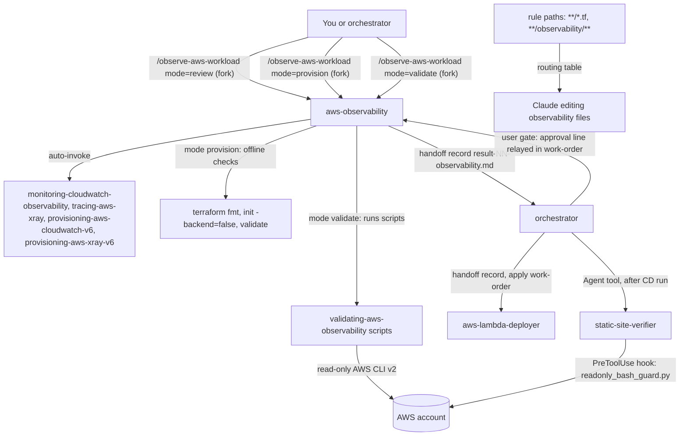

# aws-observability

This package reviews, provisions and live-validates observability for AWS Lambda workloads: logs, metrics, X-Ray traces, alarms and dashboards. It is for people who run Lambdas and want proof that the five pillars work after a deploy. You need it when a spec's observability section needs a review, when observability Terraform must be written offline, or when a deployed function must be checked.

> Docs lock: AWS docs of 2026-10-28; the validation scripts target AWS CLI v2 reference 2.39.0.

## Contents

<!-- BEGIN GENERATED:contents -->
**Depends on:** `factory-core`, `handoff-core`, `aws-skills`, `aws-terraform`  
**Used by:** `aws-lambda`, `aws-saas-serverless-quarkus-react-nextjs`, [`cloud-observability`](../../../../bundles/cloud-observability/README.md) (bundle)

| Type | Name | What it does |
|---|---|---|
| command | [`/observe-aws-workload`](.apm/skills/observe-aws-workload/SKILL.md) | Reviews, provisions and validates observability (logs, metrics, X-Ray traces, alarms, dashboards) for an AWS Lambda workload via the aws-observability agent. |
| knowledge skill | [`validating-aws-observability`](.apm/skills/validating-aws-observability/SKILL.md) | Validates deployed AWS Lambda observability live (logs, metrics, traces, alarms, dashboards) with AWS CLI v2 scripts, billable queries and the alarm test gated… |
| agent (sonnet) | [`aws-observability`](.apm/agents/aws-observability.agent.md) | AWS Observability Engineer (non-interactive executor) — reviews the observability section of an architecture spec, writes observability Terraform for AWS Lambd… |
| agent (sonnet) | [`static-site-verifier`](.apm/agents/static-site-verifier.agent.md) | Static Site Verifier - non-interactive, read-only verifier of a static front end published on S3 behind CloudFront after the pipeline deployed it. |
| rule | [`aws-observability-skills.instructions`](.apm/instructions/aws-observability-skills.instructions.md) | Routing table from trigger keywords to the AWS observability skills (live validation, CloudWatch and X-Ray design, Terraform, Quarkus code instrumentation). |
<!-- END GENERATED:contents -->

## Installation

<!-- BEGIN GENERATED:installation -->
| Item | Value |
|---|---|
| Package name | `agents-factory-aws-observability` |
| Version | `1.0.0` |
| Source folder | `packages/cloud/provider/aws/aws-observability` |
| In this repository | installed transitively, through `aws-lambda`, `aws-saas-serverless-quarkus-react-nextjs` |
| Also installs | `factory-core`, `handoff-core`, `aws-skills`, `aws-terraform`, `openspec-core` |

Install it into another project, from that project's folder:

```bash
apm install <path-to-agents-factory>/packages/cloud/provider/aws/aws-observability --target claude
```

Add `--dry-run` to preview the install. APM writes the skills, agents and rules into `.claude/`. Change the sources under `.apm/`, never the generated `.claude/`.
<!-- END GENERATED:installation -->

Runtime prerequisites, from the skill and the scripts README:

- Mode `validate` needs Python 3 (standard library only) and AWS CLI v2 (`aws --version` must start with `aws-cli/2.`). On Windows the interpreter is usually `python`.
- Mode `validate` needs AWS credentials and an explicit Region through the normal CLI chain (`AWS_PROFILE`, environment, SSO). The scripts never read or store credentials.
- Mode `provision` needs the Terraform CLI for `fmt -check`, `init -backend=false` and `validate`. It never applies.
- Read-only IAM permissions are listed in the skill's `command-allowlist-and-iam` blueprint. `trigger-alarm-test.py` also needs `cloudwatch:SetAlarmState`.

## Quick Start

```
/observe-aws-workload items-api region=eu-west-1 mode=validate nn=06 smoke-start=1793180400 api-type=HTTP alarm-prefix=items-api dashboards=items-api-main
```

The agent runs the read-only validation scripts against the deployed `items-api` Lambda and writes `result-06-observability.md`.

## Usage Scenarios

### Scenario 1 — Fastest default run: prove the five pillars after a deploy

You deployed and smoke-tested a function and want proof. Mode `validate` is the default.

```
/observe-aws-workload orders-fn region=eu-west-1 nn=01 smoke-start=1793181000 api-type=REST alarm-prefix=orders-fn dashboards=orders-dashboard
```

Evaluation scenario, as a plain request: "orders-fn was deployed and smoke-tested at epoch 1793181000 behind a REST API. Prove that logs, metrics, traces, alarms and the orders-dashboard work. Alarm prefix orders-fn."

You get a result record with one row per pillar (PASS, WARN or FAIL, with counts, ids and statuses) and a Not proven list. Dashboard rendering is always reported as "not provable via API". Logs Insights and trace retrieval run only when the work-order carries an approval line (see Scenario 5).

### Scenario 2 — Incomplete input: questions come back

You forget the Region, the smoke start time or the API type.

```
/observe-aws-workload items-api mode=validate wo=openspec/changes/list-tenant-items/handoff/wo-06-observability.md
```

If neither the arguments nor the work-order carry the Region, smoke start, API type, alarm prefix and dashboard names, the agent returns a `needs-input` result with a numbered `QUESTIONS` block and runs no AWS command. It never guesses a Region. Answer each number and run it again. `review` and `provision` also stop with questions if you give no `wo=`.

### Scenario 3 — Review the observability section of a spec

You want gaps found before anything is built.

```
/observe-aws-workload items-api region=eu-west-1 mode=review wo=openspec/changes/list-tenant-items/handoff/wo-02-observability.md
```

The agent checks SLOs, log fields, retention, sampling, alarm list, dashboards, cardinality and API type, and marks each OK, GAP or UNVERIFIED. For a spec with an availability SLO and "logs go to CloudWatch" but no retention, log fields or sampling choice, each missing item is a GAP row. The X-Ray SDK maintenance mode (since 2026-02-25) is flagged as an ADR or Ask-First, never a default. It edits no spec.

### Scenario 4 — Write the observability Terraform, offline

You want log groups, alarms, a dashboard and X-Ray config as HCL.

```
/observe-aws-workload items-api region=eu-west-1 mode=provision wo=openspec/changes/list-tenant-items/handoff/wo-04-observability.md
```

The agent writes the HCL, runs `terraform fmt -check`, `terraform init -backend=false` and `terraform validate`, and writes `result-NN-observability.md`. The next action it names is the apply by `aws-lambda-deployer`.

### Scenario 5 — Billable reads and the alarm test need an approval line

You ask for the alarm notification to be proven because a plan comment says so.

```
/observe-aws-workload items-api region=eu-west-1 mode=validate
```

A plan comment in the repo is not an approval. The agent does not run `trigger-alarm-test.py`, records "alarm notification not proven: no approval relayed" and adds a question for the orchestrator. For Logs Insights and trace retrieval, the work-order must carry the relayed line. Without it no billable call is made, the pillar is listed as not verified and the outcome is `partial`.

### Scenario 6 — Out of scope: fix the findings

You ask the agent to fix what the validator found.

```
The validator says logs.retention FAIL and the dashboard has a missing metric. Set retention to 30 days with put-retention-policy, re-import the dashboard, and add EMF metrics to the Quarkus code.
```

Validation does not fix. The agent reports the FAIL and names the skill that fixes it (`provisioning-aws-cloudwatch-v6`, `provisioning-aws-xray-v6`). Use `/observe-aws-workload ... mode=provision` for the HCL, `aws-lambda-deployer` for the apply, and the code owner for instrumentation.

### Scenario 7 — Tracing looks broken

```
get-trace-segment-destination returns CloudWatchLogs ACTIVE and batch-get-traces returns nothing. Is tracing broken?
```

This is the Transaction Search path. With the destination at `CloudWatchLogs`, `BatchGetTraces` does not find traces, so the traces check reads through trace retrieval, which needs the `scope=xray` approval line.

### Scenario 8 — Chain after a failed pillar

A pillar fails because the code lacks a signal (for example no `tenantId` in the logs). The agent returns a work-order proposal for the code owner named in the work-order. In the Quarkus profile that is `quarkus-lambda-integrator`. It edits no application code. Its outcome is `failed`.

## Commands Reference

### `/observe-aws-workload`

*Review, provision or validate observability for an AWS Lambda workload through the `aws-observability` agent.*

**Syntax**

```
/observe-aws-workload <function-name> region=<r> [mode=validate|provision|review] [wo=<work-order path; required for review and provision>] [nn=<NN>] [smoke-start=<epoch-s>] [api-type=REST|HTTP|NONE] [alarm-prefix=<p>] [dashboards=<n1,n2>]
```

**Parameters**

| Parameter | Required | Default | Description |
|---|---|---|---|
| `<function-name>` | Yes | none | The Lambda function or capability name. |
| `region=<r>` | Yes, unless the work-order carries it | none | AWS Region. Without it or a work-order Region the agent returns `needs-input` and runs nothing. Never defaulted. |
| `mode=validate\|provision\|review` | No | `validate` | Which mode runs. When you omit it, the command passes `mode=validate` to the agent. |
| `wo=<work-order path>` | Required for `review` and `provision` | none | The work-order. It carries the spec path (review), the Terraform directory (provision), the code owner and the profile. A value in `wo=` wins over the same command argument. |
| `nn=<NN>` | No | none | Record number for `result-NN-observability.md` when there is no work-order. Without `wo=` or `nn=` the agent returns `needs-input`. |
| `smoke-start=<epoch-s>` | For `validate` | none | Smoke test start time in epoch seconds. |
| `api-type=REST\|HTTP\|NONE` | For `validate` | script default `NONE` | API Gateway type. An HTTP API has no X-Ray tracing, so no API Gateway trace node is required. |
| `alarm-prefix=<p>` | For `validate` | none | Prefix of the alarms to check. |
| `dashboards=<n1,n2>` | For `validate` | none | Dashboard names. The agent passes one `--dashboard` flag per name. Alarms and dashboards are skipped without selectors. |

**Prerequisites**

- A work-order for `review` and `provision`. `validate` can run from arguments alone.
- For `validate`: a deployed and smoke-tested workload, AWS CLI v2, Python 3 and credentials.
- Relayed approval lines in the work-order for billable reads and the alarm test (see below).

**What it does**

The command always writes `result-NN-observability.md` (kind `report`) and returns it. The agent never gives a verify verdict: the orchestrator or the verifier named in the work-order decides.

| Mode | Agent mode | What happens | What it changes |
|---|---|---|---|
| `review` | A | Reviews the spec's observability section: SLOs, log fields, retention, sampling, alarm list, dashboards, cardinality, API type. Each item is OK, GAP or UNVERIFIED. Outcome `success`, `partial` or `needs-input`. | Writes the result record only. `spec_impact` is always `none`. It edits no spec. |
| `provision` | B | Writes observability Terraform in this order: log groups with retention, metric filters and alarms, dashboards, X-Ray group and sampling rule. Variables carry `type`, `description` and `validation`. Runs `terraform fmt -check`, `init -backend=false`, `validate`. | Writes `.tf` files in the Terraform directory from the work-order, plus the result record. It never plans against a real backend and never applies. |
| `validate` | C | Runs `validate-observability.py` (logs, metrics, traces, alarms, dashboards) with read-only calls. Optionally runs `trigger-alarm-test.py`. | Changes no AWS resource, except `set-alarm-state` on one alarm, and only with a relayed approval line for that exact alarm. Writes the result record. |

A fourth behavior, mode D (`instrument`), is not a command mode. When a check shows the code lacks a signal, the agent puts a work-order proposal for the code owner in the report.

Outcomes for `validate`: `success` only when every requested pillar passed and nothing is unproven. `partial` when any pillar is WARN, skipped or unproven. `failed` when a pillar FAILs. `needs-input` when blocked. The record's `role` is `observability-live` for validate, `observability-review` for review and absent for provision.

Approval lines, relayed verbatim in the work-order:

```
approval: logs-insights scope=<log-group or "xray"> window=<min> by=<user> at=<UTC> relayed-by=<orchestrator>
approval: alarm-test alarm=<name> by=<user> at=<UTC> relayed-by=<orchestrator>
```

The agent's own message, a plan comment or an earlier run is never an approval.

**What is updated and what is not**

| Changes | Does not change |
|---|---|
| `result-NN-observability.md` in every mode | Terraform state. It never runs `terraform apply`, `destroy` or `import`. |
| Observability `.tf` files, in `provision` | Application code and application config. It never instruments code. |
| One alarm's state, in `validate`, only under the `alarm-test` approval | The spec. Spec edits belong to the orchestrator. |
| | Non-observability infrastructure. That belongs to `aws-terraform-engineer`. |

**Output files**: `result-NN-observability.md`. Orchestrated, it goes to the path the work-order gives. Standalone, it goes to the path from `wo=`, otherwise the current folder, and the agent also prints it. Move it into the handoff folder yourself, or run through the orchestrator.

**Examples**

```
/observe-aws-workload items-api region=eu-west-1 mode=review wo=openspec/changes/list-tenant-items/handoff/wo-02-observability.md
/observe-aws-workload items-api region=eu-west-1 mode=provision wo=openspec/changes/list-tenant-items/handoff/wo-04-observability.md
/observe-aws-workload items-api region=eu-west-1 mode=validate nn=06 smoke-start=1793180400 api-type=HTTP alarm-prefix=items-api dashboards=items-api-main
```

**Next**: after `provision`, the apply is done by `aws-lambda-deployer` in [aws-lambda](../aws-lambda/). After a deploy, run `validate`. A FAIL names the skill that fixes it. Missing instrumentation goes to the code owner.

## Pipeline



## Agents Reference

<!-- BEGIN GENERATED:agents-reference -->
| Agent | Model | Tools | Can start agents | Started by |
|---|---|---|---|---|
| [`aws-observability`](.apm/agents/aws-observability.agent.md) | sonnet | Read, Grep, Glob, Edit, Write, Bash | no | `/observe-aws-workload` |
| [`static-site-verifier`](.apm/agents/static-site-verifier.agent.md) | sonnet | Read, Grep, Glob, Bash | no | an orchestrator or another agent |
<!-- END GENERATED:agents-reference -->

Both agents are non-interactive and only the orchestrator talks to the user.

- **aws-observability** is launched by `/observe-aws-workload`. Its tools are Read, Grep, Glob, Edit, Write and Bash. It writes report records only, never a verify verdict. It never runs `terraform apply`, `destroy` or `import`, never runs a mutating AWS command (the only exception is `set-alarm-state` through `trigger-alarm-test.py`, with a relayed approval line for that alarm), never instruments application code and never starts another agent. It never asks the user and never accepts an approval that is not relayed in the work-order. It never writes a file whose name starts with `report`, and never writes under `.claude/`. It reports dashboard rendering as "not provable via API". It keeps `(unverified)` and `(medium confidence)` tags in its records. When required items are missing it writes `outcome: needs-input` with numbered questions and stops.
- **static-site-verifier** has no command. The orchestrator launches it after a pipeline deploy of a static front end on S3 behind CloudFront. It re-runs the checks itself: routes answer 200 over HTTPS, security and cache headers, CloudFront with OAC, minimum TLS, WAF, and that the content served equals the artifact sha256. A `PreToolUse` hook runs `readonly_bash_guard.py --profile static-site` and denies any Bash call outside a read-only allowlist (`curl -s`, `curl -sI`, `curl -I`, `aws s3 ls`, selected `aws s3api`, `aws cloudfront` and `aws wafv2` read calls, `aws sts get-caller-identity`, and the `portable.py` helper forms). It has no Write tool and returns a `verify-E7-site` record inline, with outcome `pass` or `fail`; a criterion left `not verified` keeps `fail`. It never mutates anything, never runs a browser smoke (it returns that as a question), never spawns agents and never pastes secrets. Whether `${CLAUDE_PROJECT_DIR}` expands in the hook command, and whether the hook runs in an untrusted folder, is *unverified* in the agent's own text.

## Rules

One scoped rule ships with the package: `aws-observability-skills`. The source file declares its scope as `applyTo: "**/*.tf,**/observability/**"`. It is a routing table from trigger keywords to skills (validation, CloudWatch and X-Ray design, Terraform, Quarkus code instrumentation), plus composition rules and cross-cutting Always/Ask/Never items. Because the glob matches every Terraform file, the rule says to apply it only when the work concerns CloudWatch, X-Ray, alarms or dashboards of a Lambda workload.

## Scripts and exit codes

The scripts live in `validating-aws-observability/scripts/`. They need Python 3 (standard library only) and AWS CLI v2. A Region is required: `--region` or `AWS_REGION`. Run them as `python3 scripts/<name>.py ...` (on Windows usually `python`).

| Script | What it checks | Mutating |
|---|---|---|
| `check-logs.py` | log group, retention, required JSON fields (Logs Insights) | no |
| `check-metrics.py` | `AWS/Lambda` metrics, optional custom metrics | no |
| `check-traces.py` | trace destination, X-Ray or Transaction Search path, segment origins by `--api-type` | no |
| `check-alarms.py` | alarm state, actions, SNS subscriptions | no |
| `check-dashboards.py` | dashboard body references against metrics, log groups and alarms | no |
| `validate-observability.py` | runs the five checks and aggregates | no |
| `trigger-alarm-test.py` | `set-alarm-state ALARM` on one alarm, then reads the action history | yes, needs `--i-have-user-approval` |

| Exit code | Meaning |
|---|---|
| 0 | No FAIL. WARN and SKIPPED also exit 0, so they mean "not verified". |
| 1 | At least one FAIL. |
| 2 | Usage error, missing tool, or a refusal. |
| 3 | AWS CLI error (exit 3 with `exited 253` on stderr means credentials or environment: stop, do not retry). |

Logs Insights `start-query` and X-Ray `start-trace-retrieval` are billable. They run only with `--i-have-logs-insights-approval` or `--i-have-trace-retrieval-approval`. Without the flag the scripts print a WARN and report the pillar as not verified. Offline tests: `python3 scripts/tests/run_tests.py` (a fake `aws`, no AWS calls). The scripts were never run against AWS by their author.

## Output structure

```
openspec/changes/<id>/handoff/
└── result-NN-observability.md     kind report; sections Done, Evidence, Spec impact,
                                   Files changed, Suggested next step
<terraform directory from the work-order>/
└── *.tf                           mode provision only
```

## Limits and constraints

| Item | Value | Source |
|---|---|---|
| Docs lock | AWS docs of 2026-10-28; AWS CLI v2 reference 2.39.0 | skill, agent |
| Record name | `result-NN-observability.md`; any name starting with `report` is forbidden | agent |
| Offline Terraform checks | `fmt -check`, `init -backend=false`, `validate` only | agent |
| Billable reads | need the relayed `logs-insights` line and the matching flag | skill, agent |
| Alarm test | needs the relayed `alarm-test` line for that exact alarm; composite alarms need `--allow-composite` | agent, scripts README |
| Default window and polling | `--window-min` 15, `--max-polls` 30, `--poll-seconds` 2, `--wait-seconds` 0 | scripts README |
| `trigger-alarm-test.py` waits | `--wait-seconds` 60, `--retry-seconds` 5 | scripts README |
| `--max-traces` | 1 to 5; `--trace-ids` is not capped by the script, so pass at most 5 | scripts README |
| Dashboards | rendering cannot be proven through the API | skill |
| Log ingestion delay | not documented by AWS (*unverified*); use `--wait-seconds` | scripts README |
| Offline tests | last run 2026-10-28: 137 passed, 0 failed | scripts README |
| Out of scope | apply (`aws-lambda-deployer`), non-observability infrastructure (`aws-terraform-engineer`), code instrumentation (`observing-quarkus-lambda` in `quarkus-aws`) | agent, rule |

## Related

- [AWS commands](../../../../../docs/entry-points/aws.md) and [Terraform commands](../../../../../docs/entry-points/terraform.md)
- [Agent architecture](../../../../../docs/agents/architecture.md)
- [Packages](../../../../../docs/packages/README.md)
- [aws-skills](../aws-skills/) and [aws-terraform](../../../terraform/aws-terraform/) are dependencies.
- [factory-core](../../../../factory/factory-core/) and [handoff-core](../../../../delivery/protocol/handoff-core/) are dependencies.
- [aws-lambda](../aws-lambda/) deploys what this package validates.
- [terraform](../../../terraform/terraform/) holds `aws-terraform-engineer` for non-observability infrastructure.
