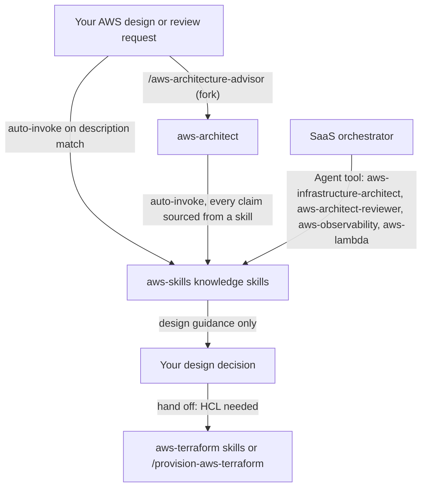

# aws-skills

This package holds knowledge skills for AWS cloud architecture, each built from a dated, official-source research base. It is for anyone designing or reviewing AWS workloads, and it is the knowledge base the `aws-architect` agent reasons over. You do not call it by command; Claude loads a skill when your request matches it.

> Editions: AWS service guidance of 2026 and the AWS Well-Architected Framework November 2024 edition. Two exceptions are dated: the Serverless Applications Lens content is dated 2022-07-14, and the Cost Optimization pillar whitepaper is dated 2024-06-27.

## Contents

<!-- BEGIN GENERATED:contents -->
**Depends on:** `factory-core`  
**Used by:** `aws-architect`, `aws-lambda`, `aws-observability`, `quarkus-aws`

| Type | Name | What it does |
|---|---|---|
| knowledge skill | [`applying-aws-operational-excellence`](.apm/skills/applying-aws-operational-excellence/SKILL.md) | Applies AWS Well-Architected Framework Operational Excellence pillar patterns to multi-account production workloads. |
| knowledge skill | [`applying-aws-performance-efficiency`](.apm/skills/applying-aws-performance-efficiency/SKILL.md) | Applies AWS Well-Architected Framework Performance Efficiency Pillar best practices to multi-account production workloads. |
| knowledge skill | [`applying-aws-reliability-pillar`](.apm/skills/applying-aws-reliability-pillar/SKILL.md) | Architects multi-account AWS workloads using the Well-Architected Framework Reliability Pillar (November 2024 edition). |
| knowledge skill | [`applying-aws-serverless-well-architected-lens`](.apm/skills/applying-aws-serverless-well-architected-lens/SKILL.md) | Applies the AWS Well-Architected Serverless Applications Lens (2022-07-14 content) to production serverless workloads on Lambda, API Gateway, Step Functions, D… |
| knowledge skill | [`applying-aws-sustainability-pillar`](.apm/skills/applying-aws-sustainability-pillar/SKILL.md) | Applies AWS Well-Architected Sustainability Pillar guidance (Nov 2024 edition) to multi-account production workloads on AWS. |
| knowledge skill | [`applying-aws-well-architected`](.apm/skills/applying-aws-well-architected/SKILL.md) | Applies AWS Well-Architected Framework (Nov 2024 edition, six pillars) patterns to evaluate and design production AWS workloads. |
| knowledge skill | [`applying-waf-cost-optimization`](.apm/skills/applying-waf-cost-optimization/SKILL.md) | Applies AWS Well-Architected Framework Cost Optimization Pillar patterns to cloud architecture design and review. |
| knowledge skill | [`applying-waf-operational-excellence-pillar`](.apm/skills/applying-waf-operational-excellence-pillar/SKILL.md) | Applies the AWS Well-Architected Framework Operational Excellence pillar (OPS 1–11) to production workloads using the four best-practice areas: Organization, P… |
| knowledge skill | [`applying-waf-reliability-pillar`](.apm/skills/applying-waf-reliability-pillar/SKILL.md) | Applies AWS Well-Architected Framework Reliability Pillar (Nov 2024 edition) patterns for multi-account production workloads on AWS. |
| knowledge skill | [`applying-waf-sustainability-pillar`](.apm/skills/applying-waf-sustainability-pillar/SKILL.md) | Applies the AWS Well-Architected Framework Sustainability Pillar (2024-11-06 revision, 29 best practices across SUS 1-6) to production AWS workloads. |
| knowledge skill | [`architecting-aws-multi-account-organizations`](.apm/skills/architecting-aws-multi-account-organizations/SKILL.md) | Designs and governs enterprise AWS multi-account strategies using AWS Organizations 2026. |
| knowledge skill | [`architecting-aws-s3-storage`](.apm/skills/architecting-aws-s3-storage/SKILL.md) | Architects AWS S3 object storage for web applications including bucket security hardening, storage class selection, presigned URL upload patterns, CloudFront O… |
| knowledge skill | [`architecting-aws-saas-multitenant`](.apm/skills/architecting-aws-saas-multitenant/SKILL.md) | Designs and validates multi-tenant B2B SaaS architectures on AWS using the Well-Architected Framework (6 pillars) and SaaS Lens. |
| knowledge skill | [`architecting-aws-security-pillar`](.apm/skills/architecting-aws-security-pillar/SKILL.md) | Applies the AWS Well-Architected Framework Security Pillar to multi-account production workloads on AWS. |
| knowledge skill | [`architecting-aws-ses-email`](.apm/skills/architecting-aws-ses-email/SKILL.md) | Designs and implements AWS SES email sending architecture with sender authentication, deliverability, reputation management, and IAM least-privilege. |
| knowledge skill | [`architecting-aws-sns-pubsub`](.apm/skills/architecting-aws-sns-pubsub/SKILL.md) | Architects AWS SNS pub/sub messaging for event-driven web applications using fan-out, filter policies, DLQs, and FIFO ordering (AWS SNS 2026). |
| knowledge skill | [`architecting-aws-sqs-messaging`](.apm/skills/architecting-aws-sqs-messaging/SKILL.md) | Designs and implements AWS SQS queue-based messaging architectures for web applications. |
| knowledge skill | [`architecting-cloudtrail-audit-logging`](.apm/skills/architecting-cloudtrail-audit-logging/SKILL.md) | Architects tamper-evident AWS CloudTrail audit-logging for AWS Organizations production workloads (2026 edition). |
| knowledge skill | [`architecting-eventbridge-eda`](.apm/skills/architecting-eventbridge-eda/SKILL.md) | Designs and implements AWS EventBridge event-driven architectures covering event buses, Pipes, Scheduler, and Schema Registry. |
| knowledge skill | [`architecting-lambda-serverless-patterns`](.apm/skills/architecting-lambda-serverless-patterns/SKILL.md) | Architects AWS Lambda serverless solutions with production-grade guardrails covering security, reliability, and performance. |
| knowledge skill | [`architecting-sam-serverless-patterns`](.apm/skills/architecting-sam-serverless-patterns/SKILL.md) | Architects and deploys serverless web applications on AWS using SAM 2026 (AWS::Serverless-2016-10-31 transform). |
| knowledge skill | [`auditing-aws-cloudtrail`](.apm/skills/auditing-aws-cloudtrail/SKILL.md) | Configures AWS CloudTrail audit logging for security-critical, multi-account AWS environments. |
| knowledge skill | [`configuring-aws-route53-dns`](.apm/skills/configuring-aws-route53-dns/SKILL.md) | Configures Amazon Route 53 DNS for web applications on AWS, covering hosted zones, routing policies, health checks, DNSSEC signing, DNS Firewall, VPC/Global Re… |
| knowledge skill | [`delivering-cloudfront-cdn`](.apm/skills/delivering-cloudfront-cdn/SKILL.md) | Designs and implements secure, high-performance AWS CloudFront CDN distributions for production workloads. |
| knowledge skill | [`designing-aws-api-gateway-serverless`](.apm/skills/designing-aws-api-gateway-serverless/SKILL.md) | Architects AWS API Gateway serverless patterns (REST, HTTP, WebSocket) for Lambda-backed APIs. |
| knowledge skill | [`designing-aws-vpc-networks`](.apm/skills/designing-aws-vpc-networks/SKILL.md) | Designs production-grade AWS VPC networking architectures for web applications. |
| knowledge skill | [`designing-dynamodb-nosql`](.apm/skills/designing-dynamodb-nosql/SKILL.md) | Designs and validates DynamoDB NoSQL schemas, capacity models, and security controls for AWS cloud-native applications. |
| knowledge skill | [`designing-multi-cloud-network-topology`](.apm/skills/designing-multi-cloud-network-topology/SKILL.md) | Designs and evaluates multi-cloud network topology (hub-spoke vs mesh) across AWS, Azure, and Google Cloud using managed transit services (Transit Gateway, Vir… |
| knowledge skill | [`implementing-lambda-powertools-java`](.apm/skills/implementing-lambda-powertools-java/SKILL.md) | Instruments AWS Lambda Java functions with Lambda Powertools v2 (v2.10.0) following the AWS Well-Architected Serverless Lens. |
| knowledge skill | [`managing-aws-costs`](.apm/skills/managing-aws-costs/SKILL.md) | Governs AWS cost management using Cost Explorer, Budgets, Cost Anomaly Detection, Data Exports (CUR 2.0), and Cost Optimization Hub for production AWS workload… |
| knowledge skill | [`monitoring-cloudwatch-observability`](.apm/skills/monitoring-cloudwatch-observability/SKILL.md) | Implements AWS CloudWatch full-stack observability for web applications using metrics, logs, traces, alarms, and Application Signals. |
| knowledge skill | [`optimizing-aws-costs`](.apm/skills/optimizing-aws-costs/SKILL.md) | Applies AWS Well-Architected Framework Cost Optimization Pillar patterns for multi-account production workloads. |
| knowledge skill | [`orchestrating-aws-step-functions`](.apm/skills/orchestrating-aws-step-functions/SKILL.md) | Orchestrates serverless workflows with AWS Step Functions 2026. |
| knowledge skill | [`protecting-workloads-ddos-shield`](.apm/skills/protecting-workloads-ddos-shield/SKILL.md) | Architects DDoS protection for internet-facing AWS workloads using AWS Shield Standard, Shield Advanced, and the AWS WAF Anti-DDoS Managed Rule Group (2026 edi… |
| knowledge skill | [`securing-aws-cognito`](.apm/skills/securing-aws-cognito/SKILL.md) | Architects and audits AWS Cognito CIAM security for user pools and identity pools following AWS Well-Architected Security pillar. |
| knowledge skill | [`securing-aws-iam-serverless`](.apm/skills/securing-aws-iam-serverless/SKILL.md) | Applies AWS IAM security architecture patterns for serverless workloads (Lambda, API Gateway, EventBridge, Step Functions) targeting AWS IAM 2026. |
| knowledge skill | [`securing-aws-secrets-certificates`](.apm/skills/securing-aws-secrets-certificates/SKILL.md) | Architects AWS secrets and certificate management using KMS, Secrets Manager, Parameter Store, and ACM. |
| knowledge skill | [`securing-aws-waf-web-acls`](.apm/skills/securing-aws-waf-web-acls/SKILL.md) | Configures and architects AWS WAF (WAFv2) web ACLs for internet-facing production workloads on AWS. |
| knowledge skill | [`securing-vpc-network-access`](.apm/skills/securing-vpc-network-access/SKILL.md) | Secures AWS VPC network access using Security Groups and Network ACLs with defense-in-depth layering. |
| knowledge skill | [`tracing-aws-xray`](.apm/skills/tracing-aws-xray/SKILL.md) | Instruments AWS X-Ray distributed tracing with ADOT across Lambda, ECS, API Gateway, and DynamoDB. |
<!-- END GENERATED:contents -->

## Installation

<!-- BEGIN GENERATED:installation -->
| Item | Value |
|---|---|
| Package name | `agents-factory-aws-skills` |
| Version | `1.0.0` |
| Source folder | `packages/cloud/provider/aws/aws-skills` |
| In this repository | installed transitively, through `aws-architect`, `aws-lambda`, `aws-observability`, `quarkus-aws` |
| Also installs | `factory-core` |

Install it into another project, from that project's folder:

```bash
apm install <path-to-agents-factory>/packages/cloud/provider/aws/aws-skills --target claude
```

Add `--dry-run` to preview the install. APM writes the skills, agents and rules into `.claude/`. Change the sources under `.apm/`, never the generated `.claude/`.
<!-- END GENERATED:installation -->

The package has no runtime prerequisite. The skills describe design guidance and give AWS CLI commands to detect problems (for example `aws s3api get-bucket-policy-status` or `aws autoscaling describe-auto-scaling-groups`). Running those commands needs the AWS CLI and read access to your account; the skills do not require you to run them.

## Quick Start

This package has no command. Describe the workload and name the AWS service or the concern. Try one of these requests, copied from the skills' evaluation scenarios:

```text
Design a highly available web application on AWS for a production e-commerce workload. The business requires less than 1 hour of downtime per year. Recommend the architecture.
```

```text
Our business has defined RTO of 15 minutes and RPO of 5 minutes for our critical order management service. Which DR strategy should we use and why?
```

```text
We are building a B2B SaaS with 50 tenants, browser + mobile clients, and our own REST API. Design the Cognito architecture.
```

For a guided entry point with the advisory agent, use `/aws-architecture-advisor <question or scope>` from [aws-architect](../aws-architect/README.md).

## Usage Scenarios

All scenarios are plain-text requests. The skill named in each responds.

### Scenario 1 - Design a highly available workload (fastest default)

Use it for a new production design.

```text
Design a highly available web application on AWS for a production e-commerce workload. The business requires less than 1 hour of downtime per year. Recommend the architecture.
```

`applying-aws-reliability-pillar` and `applying-waf-reliability-pillar` respond. You get a design checked against the Reliability Pillar (November 2024 edition): AZ resilience, fault isolation, backup and recovery. A single-AZ production deployment of stateful workloads is a CRITICAL anti-pattern in both skills.

### Scenario 2 - The RTO and RPO are not stated (incomplete input)

Use it when a review flags disaster recovery but gives no targets.

```text
Our architecture review flagged REL13. We need to add a DR strategy. What should we pick?
```

`applying-aws-well-architected` does not pick a tier. It asks about the business cost of 1 hour of downtime and 1 hour of data loss, then presents the four DR tiers (Backup and Restore, Pilot Light, Warm Standby, Multi-Site Active/Active) with their cost profile (1x, 1.5x, 2x, 3-5x). It requires quarterly DR testing whatever the tier. Answer with your RTO, RPO and the cost of an outage.

### Scenario 3 - One account for all environments (misuse)

Use it to see an anti-pattern rejected.

```text
Our team wants to use a single AWS account for all environments (dev, staging, prod) and use IAM permission boundaries to isolate them. Is this acceptable?
```

`applying-aws-well-architected` flags a CRITICAL anti-pattern. IAM permission boundaries cannot replace account-level blast-radius isolation. It requires separate accounts under AWS Organizations as a prerequisite, not an option, and recommends Control Tower Account Factory for account vending. It offers no single-account workaround for production isolation.

### Scenario 4 - Constraints that conflict (edge case)

Use it when a pillar goal clashes with a hard requirement.

```text
We run a financial trading platform in eu-west-1 due to GDPR residency rules and strict sub-10ms latency SLA. The sustainability team wants us to move to the lowest-carbon-intensity AWS region. What do we do?
```

`applying-waf-sustainability-pillar` treats Region choice as an Ask-First decision (SUS01-BP01). Data residency and the latency SLA override carbon intensity, so it does not mandate a move. It documents the trade-off as an ADR and points to levers that remain: Graviton right-sizing, Auto Scaling, S3 lifecycle and idle-asset cleanup.

### Scenario 5 - A narrow service question

Use it for a single service.

```text
I need to create an S3 bucket to store static frontend assets (HTML, CSS, JS) for a production web application. Walk me through the mandatory security configuration steps.
```

`architecting-aws-s3-storage` responds with bucket hardening: Block Public Access, default encryption and a CloudFront Origin Access Control in front. Public buckets and `"Principal": "*"` without a restricting condition are CRITICAL Never-Do items.

### Scenario 6 - You asked for Terraform (out of scope)

Use it to see where this package stops. This request is not taken from an evaluation scenario.

```text
Write the Terraform for this VPC with one NAT gateway per AZ.
```

These skills give design guidance and do not write infrastructure code. `designing-aws-vpc-networks` states the design (one NAT gateway per AZ, not a single shared one). HCL belongs to `provisioning-aws-vpc-v6` in [aws-terraform](../../../terraform/aws-terraform/README.md), or to `/provision-aws-terraform`.

### Scenario 7 - Serverless review with an old lens (edge case)

Use it for a serverless API review.

```text
I am designing a serverless REST API on AWS using API Gateway and Lambda backed by DynamoDB. What are the minimum Well-Architected requirements I must meet before going to production?
```

`applying-aws-serverless-well-architected-lens` responds. Its content is dated 2022-07-14, so it ships a `post-2022-gaps.md` blueprint and tells you to supplement it with the current Lambda Developer Guide for newer capabilities (SnapStart, arm64, response streaming).

### Scenario 8 - Multi-tenant SaaS (chaining to the advisor)

Use it when the question spans several services.

```text
We are building a B2B SaaS platform on AWS. Most customers are SMBs sharing infrastructure, but we have a handful of enterprise customers requiring dedicated resources for compliance. What tenant isolation model should we use and how should we enforce it?
```

`architecting-aws-saas-multitenant` responds. Tenant isolation enforced only in application code is a Never-Do item. For a full design across services, continue with `/aws-architecture-advisor`.

## Skills Reference

All skills are knowledge skills. Each has `SKILL.md` with Always Do, Ask First and Never Do tiers and `blueprints/` with detail and evaluation scenarios. Items tagged `(unverified)` or `(medium confidence)` inside a skill are not confirmed facts. Some topics ship as more than one skill and are flagged for a later merge: the Well-Architected pillars appear under both `applying-aws-*` and `applying-waf-*` names, cost has three skills, and CloudTrail has two.

### Well-Architected

| Skill | Loads when | Locks | Never |
|---|---|---|---|
| `applying-aws-well-architected` | Designing, reviewing or improving architectures across the six pillars | Nov 6, 2024 edition | Long-term static access keys for humans (use IAM Identity Center and STS) |
| `architecting-aws-security-pillar` | Designing, auditing or hardening against the seven security areas | Nov 6, 2024 edition | Long-term static access keys for human users (SEC-ND-1) |
| `applying-aws-reliability-pillar` | AZ resilience, DR strategy by RTO and RPO, REL review | Nov 6, 2024 edition | Single-AZ production; no DR plan; control-plane dependency during recovery |
| `applying-waf-reliability-pillar` | Same area, second skill: reliability, DR, fault isolation, resilience testing | Nov 6, 2024 edition | Single-AZ production for stateful workloads; no or untested DR plan |
| `applying-aws-operational-excellence` | Deployment safety, observability, incident management, governance | Nov 6, 2024 edition | Manual "click-ops" production changes (OE-N1) |
| `applying-waf-operational-excellence-pillar` | OPS 1 to 11 across Organization, Prepare, Operate, Evolve | Nov 6, 2024 edition | Launch without an operational readiness review; add monitoring only after an incident |
| `applying-aws-performance-efficiency` | Compute selection, right-sizing, data stores, Graviton5 candidates | Whitepaper Nov 6, 2024; verified 2026-08-28 | Lift-and-shift of on-premises compute unchanged (PE-ND-1) |
| `applying-aws-sustainability-pillar` | Environmental impact, per-unit KPIs | Nov 6, 2024 edition | Static over-provisioning; idle and orphaned resources |
| `applying-waf-sustainability-pillar` | Sustainability review, 29 best practices across SUS 1 to 6 | Revision 2024-11-06 | Sustainability claims without a baseline and KPIs; a fixed 24/7 fleet at low utilization |
| `applying-waf-cost-optimization` | FinOps governance, compute and pricing models | Cost pillar whitepaper 2024-06-27 | Persistent over-provisioning; no budgets, tags or alerts |
| `optimizing-aws-costs` | Cost pillar for multi-account workloads | June 27, 2024 | A 100% On-Demand fleet with no commitment analysis; dev and test running 24/7 |
| `managing-aws-costs` | Cost Explorer, Budgets, Anomaly Detection, Data Exports (CUR 2.0), Optimization Hub | AWS Cost Management 2026 | A new billing pipeline on legacy CUR; polling Cost Explorer over 100 times a day |
| `applying-aws-serverless-well-architected-lens` | Serverless pillar alignment, IAM, API authorization, idempotency, DLQ, saga, tracing | Lens content dated 2022-07-14 | One IAM role shared across Lambdas; API keys as the sole authorization; chaining Lambdas with `lambda.invoke` |
| `architecting-aws-saas-multitenant` | Tenant isolation model, per-tenant cost and observability | Six pillars and the SaaS Lens (2023-04-04) | Tenant isolation enforced only in application code; hardcoded shared secrets |
| `architecting-aws-multi-account-organizations` | OU design, SCP and RCP guardrails, landing zone choice, data perimeter | AWS Organizations 2026 | See its `never-do-patterns.md` blueprint |

### Serverless and orchestration

| Skill | Loads when | Locks | Never |
|---|---|---|---|
| `architecting-lambda-serverless-patterns` | Invocation models, cold starts, concurrency, failure handling | Lambda 2026 (research dated 2026-08-28) | Wildcard IAM permissions in an execution role; no DLQ or on-failure destination for async functions |
| `architecting-sam-serverless-patterns` | SAM templates, safe deployments, least-privilege IAM | SAM 2026, AL2023 runtimes | Wildcard IAM policies; secrets hardcoded in template environment variables; no on-failure destination on async invocations |
| `designing-aws-api-gateway-serverless` | REST, HTTP and WebSocket API design, authorization, throttling, WAF | API Gateway 2026 | A public production endpoint with `authorizationType: NONE`, default throttle and no WAF |
| `orchestrating-aws-step-functions` | Workflow design, ASL, service integrations, error handling | Step Functions 2026 | A Task state with no `Retry` or `Catch`; no `TimeoutSeconds` |
| `architecting-eventbridge-eda` | Event buses, Pipes, Scheduler, Schema Registry | EventBridge 2026 | A production target with no DLQ |
| `implementing-lambda-powertools-java` | Logging, tracing, metrics, idempotency, batch processing in Java Lambdas | Lambda Powertools v2.10.0 | `System.out.println` or unstructured logs |

### Networking and edge

| Skill | Loads when | Locks | Never |
|---|---|---|---|
| `designing-aws-vpc-networks` | VPC topology, subnet tiers, NAT HA, hybrid connectivity | AWS 2026 | A single NAT gateway shared across all AZs; public IPs on application or database resources |
| `securing-vpc-network-access` | Security groups and network ACLs, defense in depth | 2026 edition (VPC User Guide, 2026-08-26) | Inbound TCP 22 or 3389 from `0.0.0.0/0`; the default security group for workload ENIs |
| `configuring-aws-route53-dns` | Hosted zones, routing policies, health checks, DNSSEC, ARC disaster recovery | Route 53, Global Resolver GA 2026 | A CNAME at the zone apex; `ChangeResourceRecordSets` as the DR failover mechanism |
| `delivering-cloudfront-cdn` | Distributions, origin security, TLS, WAF, cache keys, edge functions | CloudFront 2026 | A publicly reachable origin behind CloudFront |
| `designing-multi-cloud-network-topology` | Hub-spoke against mesh across AWS, Azure and Google Cloud | WAF 2024, Azure CAF Nov 2024, Google Cloud Architecture Framework 2024 | Assuming spoke-to-spoke reachability through plain peering to a hub |

### Security

| Skill | Loads when | Locks | Never |
|---|---|---|---|
| `securing-aws-cognito` | User pool and identity pool security, JWT validation, MFA, tenant isolation | Cognito 2026 (Lite, Essentials, Plus tiers) | Decoding a JWT without full validation (`iss`, `aud`, `exp`, `token_use`, signature) |
| `securing-aws-iam-serverless` | IAM for Lambda, API Gateway, EventBridge, Step Functions | IAM 2026 | A wildcard action and resource in a Lambda execution role |
| `securing-aws-secrets-certificates` | KMS, Secrets Manager, Parameter Store, ACM | AWS security services 2026 | Hardcoded credentials in source; plaintext secrets in ECS or Lambda environment variables |
| `securing-aws-waf-web-acls` | WAFv2 web ACLs for internet-facing workloads | WAF 2026 | A new rule group straight in Block without Count-mode validation; a CLOUDFRONT-scope web ACL outside us-east-1 |
| `protecting-workloads-ddos-shield` | Shield Standard, Shield Advanced, the Anti-DDoS managed rule group | Shield 2026 | Raw EC2 or Elastic IP origins exposed to the internet; subscribing to Shield Advanced but leaving resources un-enrolled |

### Data, messaging and storage

| Skill | Loads when | Locks | Never |
|---|---|---|---|
| `designing-dynamodb-nosql` | Schemas, access patterns, capacity mode, global tables, Streams against Kinesis | DynamoDB 2026 | A low-cardinality partition key (hot partition) |
| `architecting-aws-s3-storage` | Bucket security, storage classes, presigned upload, CloudFront OAC, lifecycle | S3 2026 | Public bucket or Block Public Access disabled; unencrypted objects; `Principal "*"` without a restricting condition |
| `architecting-aws-sns-pubsub` | Fan-out, filter policies, DLQs, FIFO ordering | SNS 2026 | Subscribing without a DLQ |
| `architecting-aws-sqs-messaging` | Standard against FIFO, DLQ strategy, Lambda event source mapping | SQS 2026 | No DLQ on a queue; `"Principal": "*"` in a queue resource policy |
| `architecting-aws-ses-email` | Sender authentication, deliverability, reputation, least-privilege IAM | SES 2026 (API v2 `2019-09-27`) | Embedding SMTP credentials in code or environment variables; sending without a configuration set |

### Observability and audit

| Skill | Loads when | Locks | Never |
|---|---|---|---|
| `monitoring-cloudwatch-observability` | Metrics, logs, traces, alarms, Application Signals | Not stated in the description | A log group left at Never-Expire retention |
| `tracing-aws-xray` | X-Ray tracing with ADOT across Lambda, ECS, API Gateway, DynamoDB | 2026 edition; X-Ray SDK in maintenance mode | Instrumenting a net-new service with the legacy X-Ray SDK (dead end at 2027-02-25) |
| `architecting-cloudtrail-audit-logging` | Tamper-evident audit logging for AWS Organizations | 2026 edition | Relying on Event history instead of a trail |
| `auditing-aws-cloudtrail` | Trails, log integrity, S3 hardening, KMS, Security Hub controls | CloudTrail 2026 | Recommending CloudTrail Lake for new architectures (closed to new customers since 2026-05-31); a public S3 bucket for logs |

## Architecture



The package is a dependency of `aws-architect`, `aws-lambda`, `aws-observability` and `quarkus-aws`. They load these skills when their work needs AWS facts.

## Agents Reference

This package ships no agent. The advisory agent `aws-architect` lives in [aws-architect](../aws-architect/README.md) and reasons over these skills.

<!-- BEGIN GENERATED:agents-reference -->
This package has no subagents. Claude loads its skills by description, and agents of other packages can load them too.
<!-- END GENERATED:agents-reference -->

## Output structure

The package writes no files. Each skill answers in the conversation. Detail and sources are in each skill's `blueprints/` folder, which holds the Always-Do, Ask-First and Never-Do patterns, reference architectures where they exist, and the `evaluation-scenarios.md` used for testing.

## Limits and constraints

| Item | Value |
|---|---|
| Well-Architected edition | November 6, 2024 for the pillar skills; Cost Optimization whitepaper 2024-06-27 |
| Serverless Applications Lens | content dated 2022-07-14; the "2026" in the PDF title is a copyright artifact; supplement with the current Lambda Developer Guide |
| Service skills | AWS 2026 guidance, research dated around 2026-08 |
| Lambda Powertools | v2.10.0 |
| Code | these skills give guidance and do not write infrastructure code; Terraform is in `aws-terraform` |
| Overlap | pillars under `applying-aws-*` and `applying-waf-*`, three cost skills and two CloudTrail skills, flagged for a later merge |
| Tags | `(unverified)` and `(medium confidence)` items are not confirmed facts |
| Currency | sources older than 12 months are rejected unless they are the current stable edition |

## Related

- [AWS entry points](../../../../../docs/entry-points/aws.md)
- [Agent architecture](../../../../../docs/agents/architecture.md)
- [Entry points](../../../../../docs/entry-points/README.md)
- [Packages](../../../../../docs/packages/README.md)
- [aws-architect](../aws-architect/README.md) is the advisory agent that consumes these skills.
- [aws-terraform](../../../terraform/aws-terraform/README.md) writes the HCL for these designs.
- [factory-core](../../../../factory/factory-core/apm.yml) is the dependency.
