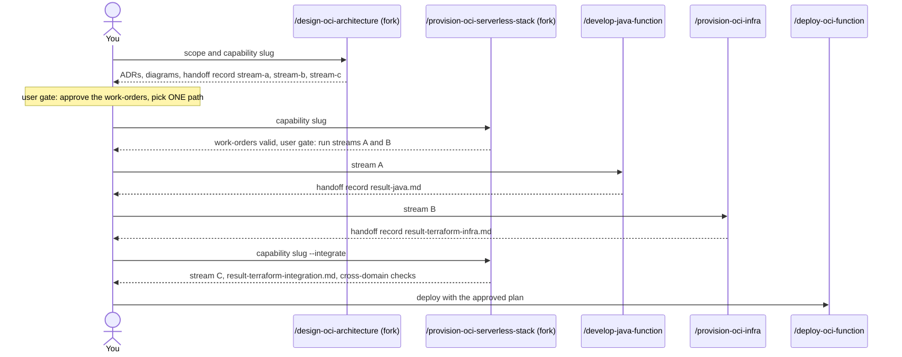

# oci-architecture

Architecture skills, two agents and two guardrail rules for OCI serverless: Functions, API Gateway, IAM, networking, Vault, Object Storage and event-driven pub/sub with Streaming. It is for architects and developers who design a capability before they build it. You need it when you design or review a serverless architecture, or when you turn an approved design into work-orders for the Java and Terraform streams.

> Scope: OCI serverless. Advisory design plus hand-off of work-orders. In design mode the package writes no `.tf` or `.java` code.

## Contents

<!-- BEGIN GENERATED:contents -->
**Depends on:** `factory-core`, `oci-core`  
**Used by:** [`architecture-board`](../../../../bundles/architecture-board/README.md) (bundle), [`oci-serverless-complete`](../../../../bundles/oci-serverless-complete/README.md) (bundle)

| Type | Name | What it does |
|---|---|---|
| command | [`/design-oci-architecture`](.apm/skills/design-oci-architecture/SKILL.md) | Routes to the OCI Serverless Architect for designing and reviewing OCI serverless architectures (advisory only — produces ADRs, diagrams, and handoff work-orde… |
| command | [`/provision-oci-serverless-stack`](.apm/skills/provision-oci-serverless-stack/SKILL.md) | Routes to the OCI Serverless Stack deployer for end-to-end creation of a serverless capability (Java function code + Terraform infrastructure + API Gateway rou… |
| knowledge skill | [`architecting-oci-serverless`](.apm/skills/architecting-oci-serverless/SKILL.md) | Architects serverless API backends with OCI Functions and API Gateway. |
| knowledge skill | [`designing-oci-api-gateway`](.apm/skills/designing-oci-api-gateway/SKILL.md) | Designs, secures, and operates REST APIs with OCI API Gateway for serverless architectures. |
| knowledge skill | [`designing-oci-event-driven-pubsub`](.apm/skills/designing-oci-event-driven-pubsub/SKILL.md) | Designs end-to-end event-driven pub/sub architectures on OCI using Functions + Streaming + Service Connector Hub. |
| knowledge skill | [`designing-oci-networking`](.apm/skills/designing-oci-networking/SKILL.md) | Designs and troubleshoots OCI networking (VCN, Subnets, NSGs, Gateways, DRG) for serverless architectures. |
| knowledge skill | [`designing-oci-object-storage`](.apm/skills/designing-oci-object-storage/SKILL.md) | Designs OCI Object Storage architecture (bucket topology, storage-tier/lifecycle strategy, encryption and access-control decisions, event-driven and data-lake… |
| knowledge skill | [`designing-oci-vault-security`](.apm/skills/designing-oci-vault-security/SKILL.md) | Designs and manages OCI Vault security architecture (Keys, Secrets, Rotation, Encryption) for serverless architectures. |
| agent (sonnet) | [`oci-serverless-architect`](.apm/agents/oci-serverless-architect.agent.md) | OCI Serverless Solution Architect — designs and reviews OCI serverless architectures (Functions, API Gateway, networking, Vault/IAM, Object Storage, Streaming… |
| agent (sonnet) | [`oci-serverless-stack`](.apm/agents/oci-serverless-stack.agent.md) | Full-Stack Serverless Deployer — validates the three work-orders of an end-to-end OCI serverless capability (Java function + Terraform infra + API Gateway rout… |
| rule | [`oci-architecture-data-events-guardrails.instructions`](.apm/instructions/oci-architecture-data-events-guardrails.instructions.md) | OCI Object Storage and event-driven pub/sub architecture guardrails (rules OCI-R55 to OCI-R64, R72, R82 to R85, R89 to R92, R104 to R106, R111 to R115). |
| rule | [`oci-architecture-guardrails.instructions`](.apm/instructions/oci-architecture-guardrails.instructions.md) | OCI serverless architecture guardrails for platform, API Gateway, networking and Vault/IAM design (rules OCI-R34 to OCI-R54, R65 to R71, R73 to R81, R86 to R88… |
<!-- END GENERATED:contents -->

## Installation

<!-- BEGIN GENERATED:installation -->
| Item | Value |
|---|---|
| Package name | `agents-factory-oci-architecture` |
| Version | `1.0.0` |
| Source folder | `packages/cloud/provider/oci/oci-architecture` |
| In this repository | listed directly in the root `apm.yml` |
| Also installs | `factory-core`, `oci-core`, `handoff-core`, `openspec-core` |

Install it into another project, from that project's folder:

```bash
apm install <path-to-agents-factory>/packages/cloud/provider/oci/oci-architecture --target claude
```

Add `--dry-run` to preview the install. APM writes the skills, agents and rules into `.claude/`. Change the sources under `.apm/`, never the generated `.claude/`.
<!-- END GENERATED:installation -->

Runtime prerequisites:

- `/design-oci-architecture`: none stated. The agent has Read, Grep, Glob and Write only. No CLI.
- `/provision-oci-serverless-stack --integrate`: Maven (`mvn compile`), Terraform (`terraform fmt -check`, `terraform validate`) and `scripts/preflight.sh` in the project. The agent never runs `terraform apply`.

## Quick Start

```
/design-oci-architecture full-stack func-orders
```

The architect returns a design with ADRs and diagrams. When all context is present and you gave a capability slug, it also writes the work-orders under `docs/handoff/func-orders/`. Approve them, then run `/provision-oci-serverless-stack func-orders`.

## Usage Scenarios

### Scenario 1 — Full-stack design with work-orders (fastest default run)

Use it when you start a new capability.

```
/design-oci-architecture full-stack store-data-api
```

Quote the context in the same request, as the evaluation scenario does: "We are building a new serverless capability: a REST API for managing store data that authenticates users via OCI IAM Identity Domains and needs to store results in Object Storage. Design the full stack. Capability slug: store-data-api. Environments: dev and prod. Consumers: internal web app."

You get: an architecture overview (API Gateway in a public subnet, Function in a private subnet, Object Storage through a Service Gateway), IAM design, JWT authentication at the gateway, rate limiting per route, CORS with explicit origins, ADRs and work-orders. No `.tf` and no `.java`.

### Scenario 2 — Incomplete request returns questions

Use it to see what the architect does when context is missing.

```
/design-oci-architecture Design the architecture for our new serverless API.
```

The agent finds scope, consumers, environment and capability slug missing. It returns numbered questions (for example who consumes the API, which identity provider, the latency SLA, the environments), writes no file and ends with `Status: NEEDS-INPUT`. Answer the questions and relaunch with the answers in the request.

### Scenario 3 — Only the capability slug is missing

Use it when you want the design first and name the capability later.

```
/design-oci-architecture full-stack Design a REST API on one public API Gateway with JWT auth and one Java function in a private subnet reading a Vault secret via Resource Principal. Environments: dev and prod. Consumers: internal web app. Latency SLA: P99 under 1 s.
```

You get the full design (architecture overview, review by area, ADRs, roadmap, verification checklist). The agent writes no file and ends with one numbered question for the slug and `Status: NEEDS-INPUT`. Relaunch with the slug to get the work-orders.

### Scenario 4 — Review the security model of an existing design

Use it to review what exists.

```
/design-oci-architecture security-model orders-api
```

With the request "Review the security model of our existing OCI serverless architecture. Functions config has DB_PASSWORD as a plaintext environment variable. Capability slug: orders-api. Environment: prod. Consumers: internal web app." the agent flags the plaintext password, recommends a `DB_SECRET_OCID` that points to a Vault secret and the policy `Allow dynamic-group <fn-dg> to read secret-bundles in compartment <name>`, writes a remediation ADR and writes work-orders. It does not change the code.

### Scenario 5 — Misuse: ask the architect to write Terraform

Use it to see the boundary.

```
/design-oci-architecture network-topology edge-network-api
```

With the request "Design the architecture and also write the Terraform for the VCN, subnets, and API Gateway." the agent produces the design and the work-order `stream-b-terraform-infra.md`. It does not write `.tf` files. Run `/provision-oci-infra` (see [oci-terraform](../../../terraform/oci-terraform/README.md)) for the Terraform.

### Scenario 6 — Execute the plan in one path

Use it when the work-orders are approved.

```
/provision-oci-serverless-stack func-api-facade
```

The agent validates the three work-orders and ends with the hand-off: run `/develop-java-function` and `/provision-oci-infra` for streams A and B, then `/provision-oci-serverless-stack func-api-facade --integrate`.

### Scenario 7 — Integrate after both streams finished

```
/provision-oci-serverless-stack func-api-facade --integrate
```

If `result-java.md` and `result-terraform-infra.md` both report `outcome: success`, the agent writes stream C (Function resource and API Gateway route) and runs the cross-domain checks. It then tells you to run `/deploy-oci-function`.

### Scenario 8 — Stream A failed: the agent stops

Use it to see the gate. The evaluation scenario: "Stream A (Java function) failed to compile during func-rr-rest-proxy provisioning. Stream B (Terraform infra) completed successfully. Should we proceed with Stream C?"

```
/provision-oci-serverless-stack func-rr-rest-proxy --integrate
```

The agent reads `result-java.md`, sees `failed` or `partial`, stops before stream C, shows the open issues and names the command that produces the missing record.

### Scenario 9 — Misuse: no work-orders exist

The evaluation scenario: "Provision a new OCI serverless capability for payment processing. No handoff files exist yet."

```
/provision-oci-serverless-stack payment-processing
```

The agent finds no work-orders and does not implement. It tells you to run `/design-oci-architecture` first.

### Scenario 10 — Add a function to an existing Application

Use it for an incremental addition ("Stream D"). The evaluation scenario: "We already have func-api-facade running in a Functions Application. We need to add func-rr-rest-proxy as a second function to the same Application and API Gateway."

```
/provision-oci-serverless-stack func-rr-rest-proxy
```

The agent checks the existing `function-app` module and the API Gateway module, then hands Stream D-Java to `/develop-java-function` and Stream D-Terraform to `/provision-oci-infra`. The plan must show only create operations and no destroy.

## Commands Reference

### `/design-oci-architecture`

*Design or review an OCI serverless architecture and write the work-orders.*

Routes to `oci-serverless-architect` in a fork. Advisory only.

**Syntax**

```
/design-oci-architecture <scope: full-stack | api-surface | security-model | network-topology | object-storage | event-driven-pubsub> [capability-slug]
```

**Parameters**

| Parameter | Required | Default | Description |
|---|---|---|---|
| `scope` | Yes | none | One of `full-stack` (Functions, API Gateway, IAM, networking), `api-surface` (routes, auth, throttling, CORS), `security-model` (Vault, encryption, least-privilege IAM), `network-topology` (VCN, subnets, NSGs, Service Gateway), `object-storage` (buckets, tiers, data protection, object events), `event-driven-pubsub` (Streaming, Service Connector Hub, consumers, fan-out). |
| `capability-slug` | No | none | Kebab-case `[a-z0-9-]+`. Required only to write work-orders. A slug with `/`, `\` or `..` is rejected. |

**Prerequisites**

- Context in the request: scope, environments, consumers; plus compliance framework, latency SLA and RTO/RPO where they matter. Missing context returns questions.
- Optional: existing `.tf`, `.java`, `func.yaml` and `pom.xml` in the workspace. The agent scans them.

**What it does**

| Step | Action |
|---|---|
| P0 | Classifies the request into domains. Loads the primary skill by name. Returns `NEEDS-INPUT` now if context is missing. |
| P1 | Verifies on disk before claiming (lists `infra/modules/*`, reads `variables.tf`). Maps existing components against the skills' checklists. |
| P2 | Extracts patterns and anti-patterns. Resolves each Ask-First item as `[Decision]: ... -> Recommendation: ...`, or turns it into a numbered question. |
| P3 | Presents the architecture overview, responsibilities and security boundaries, a Pass/Warn/Fail review by area (Security, Reliability, Performance, Cost, Operations), recommendations ordered CRITICAL to LOW, and the delegation commands. |
| P4 | Delivers ADRs, component diagrams (Mermaid preferred), an implementation roadmap and a verification checklist. |
| P5 | Validates against the Always-Do patterns and the family anti-patterns (rules `oci-architecture-guardrails` and `oci-architecture-data-events-guardrails`). Lists every `(unverified)` and `(medium confidence)` item in a final Questions / Limitations section. |
| P6 | Only when the design is complete: writes the work-orders under `docs/handoff/<capability>/`. |

**What is updated and what is not**

| Updated | Not touched |
|---|---|
| `docs/handoff/<capability>/stream-a-java.md`, `stream-b-terraform-infra.md`, `stream-c-terraform-integration.md` (only those the scope needs) | Any `.tf`, `.java` or other file; the flat `docs/handoff/` root; any other directory |

**Output files**

Work-order records with this front matter. Fixed values per stream:

| File | `to` | `dependsOn` | Executed with |
|---|---|---|---|
| `stream-a-java.md` | `"@oci-functions-java"` | `none` | `/develop-java-function` |
| `stream-b-terraform-infra.md` | `"@oci-terraform"` | `none` | `/provision-oci-infra` |
| `stream-c-terraform-integration.md` | `"@oci-terraform"` | `[stream-a, stream-b]` | `/provision-oci-infra` |

`status: pending`; `createdAt: <pending>` (the agent has no Bash tool). The response states that you must approve before any command runs. The response ends with `Status: COMPLETE` or `Status: NEEDS-INPUT`.

**Examples**

```
/design-oci-architecture full-stack func-orders
/design-oci-architecture event-driven-pubsub order-events
/design-oci-architecture api-surface store-gateway
```

**Next**

Run ONE path, never both, or the streams run twice: `/provision-oci-serverless-stack <capability-slug>`, or per stream `/develop-java-function` and `/provision-oci-infra` (infrastructure-only scope: only `/provision-oci-infra`; Java-only: only `/develop-java-function`).

### `/provision-oci-serverless-stack`

*Validate the work-orders, hand off streams A and B, then do stream C.*

Routes to `oci-serverless-stack` in a fork. The flow is user-mediated: the agent never spawns a sub-agent.

**Syntax**

```
/provision-oci-serverless-stack <capability-slug> [--integrate]
```

**Parameters**

| Parameter | Required | Default | Description |
|---|---|---|---|
| `capability-slug` | Yes | none | Matches the `docs/handoff/<capability>/` directory, for example `func-api-facade`. |
| `--integrate` | No | off | Run after `result-java.md` and `result-terraform-infra.md` exist. Does stream C and the cross-domain checks. |

**Prerequisites**

- Default mode: `docs/handoff/<capability>/` holds `stream-a-java.md`, `stream-b-terraform-infra.md` and `stream-c-terraform-integration.md` (from `/design-oci-architecture`).
- `--integrate`: `result-java.md` and `result-terraform-infra.md`, both with `outcome: success`.

**What it does**

| Mode | Action |
|---|---|
| Default | Reads and validates the three work-orders: front matter present, `dependsOn` consistent (A and B independent, C depends on A and B), acceptance criteria stated, no file-domain conflict (A touches `services/`, B touches `infra/`). A missing or inconsistent record stops it with `outcome: needs-input` and numbered questions. Otherwise it ends with the hand-off line for streams A and B. It writes no application code. |
| `--integrate` | Reads the two result records. If either is missing, `partial` or `failed`, it stops with `needs-input` and the open issues. Otherwise: marks streams A and B `status: completed`, writes stream C (Function resource, API Gateway route) under `infra/`, writes `result-terraform-integration.md`, and runs `mvn compile`, `terraform fmt -check`, `terraform validate`, `scripts/preflight.sh` and the consistency checks (config keys, IAM, route). It ends with the hand-off to `/deploy-oci-function`. |

**What is updated and what is not**

| Updated | Not touched |
|---|---|
| `infra/` (stream C, `--integrate` only); `status` of the three work-orders; result record | Java code (stream A), networking and IAM Terraform (stream B), `terraform apply` (never run) |

**Output files**

- Default mode: none beyond the response and the hand-off line.
- `--integrate`: `docs/handoff/<capability>/result-terraform-integration.md` (resources, OCIDs, validation, `outcome`, real `createdAt`).

**Examples**

```
/provision-oci-serverless-stack func-api-facade
/provision-oci-serverless-stack func-api-facade --integrate
```

**Next**

Default mode ends with: run `/develop-java-function` and `/provision-oci-infra`, then `/provision-oci-serverless-stack <slug> --integrate`. `--integrate` ends with: run `/deploy-oci-function`.

## Pipeline



Skills load by `auto-invoke` when the architect classifies the request (one primary skill per domain). The two guardrail rules load by `rule paths`.

## Agents Reference

<!-- BEGIN GENERATED:agents-reference -->
| Agent | Model | Tools | Can start agents | Started by |
|---|---|---|---|---|
| [`oci-serverless-architect`](.apm/agents/oci-serverless-architect.agent.md) | sonnet | Read, Grep, Glob, Write | no | `/design-oci-architecture` |
| [`oci-serverless-stack`](.apm/agents/oci-serverless-stack.agent.md) | sonnet | Read, Edit, Write, Bash, Grep, Glob | no | `/provision-oci-serverless-stack` |
<!-- END GENERATED:agents-reference -->

Both agents are non-interactive.

**`oci-serverless-architect`**

- Does: designs and reviews architectures from the architecture skills. States no OCI facts of its own, keeps `(unverified)` and `(medium confidence)` tags and lists them in the final Questions / Limitations section. Cites skills by name and does not copy their content.
- Never: generates `.tf` or `.java`, runs commands, researches OCI services, spawns sub-agents, writes any file outside `docs/handoff/<capability>/`. That write limit is an instruction, not a sandbox.
- Contract: when context is missing it returns numbered questions with `Status: NEEDS-INPUT` and writes no file. A complete response ends with `Status: COMPLETE`. If only the slug is missing, it delivers the full design, skips the work-orders and asks for the slug.

**`oci-serverless-stack`**

- Does: validates the work-orders, hands streams A and B to their agents, and in `--integrate` mode does stream C and the cross-domain checks.
- Never: spawns sub-agents (it has no Agent tool), waits for you mid-run, writes Java code or stream B Terraform, runs `terraform apply`, does deep architecture design, skips the P0 to P5 workflow. It never creates a separate Functions Application for an added function, never destroys or recreates an existing function.
- Contract: ends at its plan with numbered Ask-First questions (outcome `needs-input`) when something is missing. In `--integrate` mode it stops with `needs-input` if `result-java.md` or `result-terraform-infra.md` is missing, partial or failed.

## Output structure

```
docs/handoff/<capability>/
├── stream-a-java.md                      work-order, to @oci-functions-java
├── stream-b-terraform-infra.md           work-order, to @oci-terraform
├── stream-c-terraform-integration.md     work-order, to @oci-terraform, dependsOn stream-a and stream-b
└── result-terraform-integration.md       written by /provision-oci-serverless-stack --integrate

infra/                                    stream C (--integrate only)
```

## Limits and constraints

| Constraint | Value |
|---|---|
| Design mode writes | Work-orders only, under `docs/handoff/<capability>/`; no `.tf`, no `.java` |
| Capability slug | `[a-z0-9-]+`; `/`, `\` and `..` rejected |
| Work-order status values | `pending`, `in-progress`, `completed` (the architect writes `pending`) |
| Execution paths | One-shot or per-stream, never both for the same work-orders |
| `terraform apply` | Never run by `oci-serverless-stack` |
| Stream C gate | Needs `result-java.md` and `result-terraform-infra.md` with `outcome: success` |
| Incremental addition | Additive only: the plan shows only create operations, no destroy; no new Application |
| Deploying | Not here: use `/deploy-oci-function` |
| Dependencies outside this package | The skills link to `provisioning-oci-*` skills (for example `provisioning-oci-api-gateway`, `provisioning-oci-streaming`) from [oci-terraform](../../../terraform/oci-terraform/README.md). Those links do not resolve when this package is installed alone |
| PoC examples | `architecting-oci-serverless`, `designing-oci-api-gateway` and `designing-oci-event-driven-pubsub` carry `blueprints/poc-worked-examples.md` from the reference PoC; the PoC code is not packaged |

The two rules apply to `**/oci/**/*.tf`, `**/*oci*/**/*.tf` and `docs/handoff/**`. They cite family rule IDs and point to the governing skill:

| Rule | IDs | Covers |
|---|---|---|
| `oci-architecture-guardrails` | OCI-R34 to R54, R65 to R71, R73 to R81, R86 to R88, R93 to R103, R107 to R110 | Platform, API Gateway, networking, Vault and IAM. |
| `oci-architecture-data-events-guardrails` | OCI-R55 to R64, R72, R82 to R85, R89 to R92, R104 to R106, R111 to R115 | Object Storage, event-driven pub/sub. |

Knowledge skills have no command. Claude loads one when your request matches. Example requests from `architecting-oci-serverless/blueprints/evaluation-scenarios.md`:

- "I'm designing a new OCI serverless stack for a retail API. Where should the API Gateway and the Functions Application go in the VCN?"
- "Our Java function currently has 8–12 second cold starts. The SLA requires P99 < 200ms. How should we address this?"
- "To simplify setup, grant the functions Dynamic Group 'manage all-resources in tenancy' so it can access everything it needs."

## Related

- [OCI serverless commands](../../../../../docs/entry-points/oci-serverless.md) (family guide page)
- [Flow: an OCI serverless capability](../../../../../docs/flows/oci-serverless-delivery.md)
- [Agents architecture](../../../../../docs/agents/architecture.md)
- [Packages](../../../../../docs/packages/README.md)
- [oci-core](../oci-core/README.md) (dependency: handoff protocol)
- [factory-core](../../../../factory/factory-core/apm.yml) (dependency)
- [oci-functions-java](../oci-functions-java/README.md) (stream A and deploy)
- [oci-terraform](../../../terraform/oci-terraform/README.md) (streams B and C)
