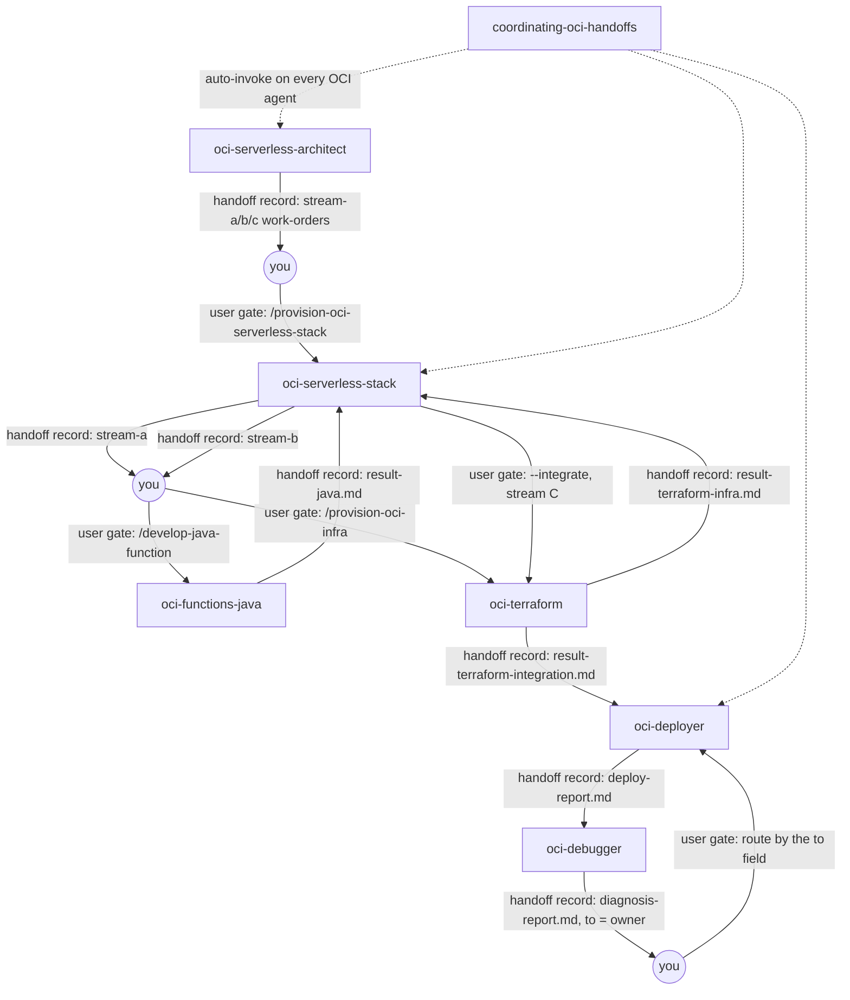

# oci-core

The shared core of the OCI agent family. It holds one skill, `coordinating-oci-handoffs`, which is the OCI profile of the generic handoff protocol v1. You need it when OCI agents pass work to each other through records: the other OCI packages depend on it so they share one protocol.

> Protocol: `coordinating-agent-handoffs` v1. Profile: `oci`, mode `user-mediated`, scope key `capability`, no OpenSpec (`spec.kind: none`).

## Contents

<!-- BEGIN GENERATED:contents -->
**Depends on:** `factory-core`, `handoff-core`  
**Used by:** `oci-architecture`, `oci-functions-java`, `oci-observability`, `oci-terraform`

| Type | Name | What it does |
|---|---|---|
| knowledge skill | [`coordinating-oci-handoffs`](.apm/skills/coordinating-oci-handoffs/SKILL.md) | OCI profile of the generic handoff protocol v1 for the OCI agent family: roster, record file names in per-capability folders under docs/handoff/ and user-media… |
| - | (no skills, agents or rules; see the package notes) | - |
<!-- END GENERATED:contents -->

## Installation

<!-- BEGIN GENERATED:installation -->
| Item | Value |
|---|---|
| Package name | `agents-factory-oci-core` |
| Version | `1.0.0` |
| Source folder | `packages/cloud/provider/oci/oci-core` |
| In this repository | installed transitively, through `oci-architecture`, `oci-functions-java`, `oci-observability`, `oci-terraform` |
| Also installs | `factory-core`, `handoff-core`, `openspec-core` |

Install it into another project, from that project's folder:

```bash
apm install <path-to-agents-factory>/packages/cloud/provider/oci/oci-core --target claude
```

Add `--dry-run` to preview the install. APM writes the skills, agents and rules into `.claude/`. Change the sources under `.apm/`, never the generated `.claude/`.
<!-- END GENERATED:installation -->

The package has no runtime prerequisite of its own. The optional validation script `check_records.py` comes from `coordinating-agent-handoffs` (package `handoff-core`) and needs Python (the sources do not state a minimum version).

## Quick Start

This package has no command. Claude loads the skill when your request is about reading, writing or routing OCI handoff records. Try one of these requests, copied from the skill's evaluation scenarios:

```text
oci-functions-java finished func-orders. How does it record the result and what does it say last?
```

```text
oci-observability and oci-terraform both ran for func-orders. Where does each write, and the diagnosis-report names @oci-terraform as owner: who runs next?
```

The first answer is: the agent writes `docs/handoff/func-orders/result-java.md`, then ends with one line `Hand off: run /<command> (@<agent>) - <why>. Context: <path>`.

## Usage Scenarios

You do not run these yourself; the OCI agents (`oci-serverless-architect`, `oci-serverless-stack`, `oci-functions-java`, `oci-terraform`, `oci-deployer`, `oci-debugger`, `oci-observability`) load the skill when they work. The scenarios show what the skill makes them do, so you know what to expect and what to correct.

### Scenario 1 - Record a result and hand off (fastest default)

Use it when a stream agent has finished its work for a capability.

```text
oci-functions-java finished func-orders. How does it record the result and what does it say last?
```

You get: a result record `docs/handoff/func-orders/result-java.md` (`kind: report`), then exactly one closing line `Hand off: run /<command> (@<agent>) - <why>. Context: <path>`. You run the next command. The agent does not start it.

### Scenario 2 - The capability is not clear (incomplete input)

Use it when an agent cannot tell which capability folder to use.

```text
Write the result of this function to the handoff folder.
```

The skill's Ask First table tells the agent to ask: "Which capability (function name) is this for?" Answer with the function name, for example `func-orders`. That name is the folder under `docs/handoff/`. The same Ask First table covers an earlier record that is still open: the agent asks "Overwrite the previous record or keep it under another capability slug?"

### Scenario 3 - A bad record name (misuse)

Use it to see how the skill treats a name outside the convention.

```text
Save the terraform result as docs/handoff/func-orders/report-terraform.md, that reads nicely.
```

The skill rejects the name. Result records are `result-<role>.md`, so Terraform results are `result-terraform-infra.md` and `result-terraform-integration.md`. `deploy-report.md` and `diagnosis-report.md` keep their names. No record file name starts with `report`, because a subagent write guard on such names was observed (`(unverified)`). `kind: report` stays inside the frontmatter.

### Scenario 4 - Asking an agent to chain to the next one (misuse)

Use it to see why the agents never call each other.

```text
After oci-terraform writes its result, call oci-deployer yourself so I do not have to run /deploy-oci-function.
```

The skill refuses to auto-chain. The agent writes its record and ends with the hand-off line. You run `/deploy-oci-function` yourself. No exception exists, including for `oci-serverless-stack`, which hands off per stream.

### Scenario 5 - The deployer failed again (attempt limits)

Use it when an agent has retried several times.

```text
oci-deployer failed a third time on func-orders. The board shows no limit reached. May it try again?
```

The skill says not to trust `build_attempts` (limit 3) or `deploy_cycles` (limit 2) as counters, because records are overwritten each cycle. The agent keeps the attempt number in the record body and asks you at the limit: "This is attempt N by my own count; continue or stop?" You decide.

### Scenario 6 - Route a diagnosis (chaining)

Use it when the debugger has written a diagnosis and more than one agent has run.

```text
oci-observability and oci-terraform both ran for func-orders. Where does each write, and the diagnosis-report names @oci-terraform as owner: who runs next?
```

`oci-observability` writes `result-observability.md`. `oci-terraform` writes `result-terraform-infra.md` (and `result-terraform-integration.md` for stream C). Each role writes only its own file. You follow the `to` field of `diagnosis-report.md`, so `@oci-terraform` runs next. The profile's `next:` rule is advisory.

### Scenario 7 - Validate a capability folder

Use it to check that the records of a capability are well formed.

```bash
python <coordinating-agent-handoffs>/scripts/check_records.py docs/handoff/func-orders --profile <coordinating-oci-handoffs>/assets/handoff-profile.yaml
```

Expect `OK: N record(s) valid`. Running the script is optional in user-mediated mode.

## Skills Reference

### `coordinating-oci-handoffs`

*OCI profile of the generic handoff protocol v1 for the OCI agent family.*

- **When it loads:** an OCI agent must read prior handoff context, write a result record or route work to a sibling agent.
- **What it locks:** protocol `coordinating-agent-handoffs` v1; profile `oci`; mode `user-mediated`; scope key `capability`; record folder `docs/handoff/{capability}`; limits `build_attempts: 3` and `deploy_cycles: 2`. Authored 2026-10-28.
- **What it never does:**
  - Name a result record outside the convention.
  - Auto-chain to the next agent.
  - Write another role's record file.
  - Treat `build_attempts` or `deploy_cycles` as reliable counters.
  - Write records into a package or into the agent factory; they go to `docs/handoff/<capability>/` of the target project.
- **Example request:** "oci-deployer failed a third time on func-orders. The board shows no limit reached. May it try again?"

Which agent reads and writes what:

| Agent | Reads | Writes |
|---|---|---|
| `oci-serverless-architect` | requirements | `stream-a-java.md`, `stream-b-terraform-infra.md`, `stream-c-terraform-integration.md` (work-orders) |
| `oci-serverless-stack` | the 3 work-orders; with `--integrate` the stream A and B results | hands off streams A and B, then does stream C with `--integrate`; consumes `result-*.md` |
| `oci-functions-java` | work-order or diagnosis-report | `result-java.md` |
| `oci-terraform` | work-order, result or diagnosis-report | `result-terraform-infra.md`, `result-terraform-integration.md` |
| `oci-deployer` | result or diagnosis-report | `deploy-report.md` |
| `oci-debugger` | deploy-report | `diagnosis-report.md` |
| `oci-observability` | result or diagnosis-report | `result-observability.md` |

Required sections per record kind, from the profile: work-order has Scope, Components, Constraints, Dependencies, Acceptance Criteria. A result (`report`) has What changed, Validation, Acceptance status, Next action. A `deploy-report` has What changed, Validation, Next action. A `diagnosis-report` has Root cause, Evidence, Exact fix, Next action.

## Architecture

The protocol is user-mediated. Every arrow below is a hand-off line that you run as a command; no agent starts another.



Stream C does not start until the stream A and stream B results both carry `outcome: success`. The generic protocol, scripts and templates live in `coordinating-agent-handoffs`.

## Agents Reference

This package ships no agent. The skill is loaded by the agents of the other OCI packages.

<!-- BEGIN GENERATED:agents-reference -->
This package has no subagents. Claude loads its skills by description, and agents of other packages can load them too.
<!-- END GENERATED:agents-reference -->

## Output structure

Records go to the target project, never to a package.

```text
docs/handoff/<capability-slug>/        # for example func-api-facade/
  stream-a-java.md                     # architect -> java        (work-order)
  stream-b-terraform-infra.md          # architect -> terraform   (work-order)
  stream-c-terraform-integration.md    # architect -> terraform   (work-order)
  result-java.md                       # java -> stack            (kind: report)
  result-terraform-infra.md            # terraform -> stack       (kind: report)
  result-terraform-integration.md      # terraform -> stack       (kind: report)
  result-observability.md              # observability -> user    (kind: report)
  deploy-report.md                     # deployer -> debugger or user
  diagnosis-report.md                  # debugger -> deployer, terraform, java or observability
```

The skill ships templates in `assets/`: `work-order.template.md`, `result.template.md`, `deploy-report.template.md`, `diagnosis-report.template.md` and the profile `handoff-profile.yaml`.

## Limits and constraints

| Item | Value |
|---|---|
| Protocol version | v1. A protocol v2 would need a new profile version. |
| Mode | `user-mediated`: every transition is a hand-off line |
| Capability folder | `docs/handoff/{capability}` of the target project |
| `build_attempts` limit | 3, but not a reliable counter (records are overwritten each cycle) |
| `deploy_cycles` limit | 2, but not a reliable counter |
| Work-order `status` values | `pending`, `in-progress`, `completed` |
| Spec side | none (`spec.kind: none`) |
| Record names | `result-<role>.md`; `deploy-report.md` and `diagnosis-report.md` keep their names; none starts with `report` (rests on an observed write guard marked `(unverified)`) |
| Record patterns | guidance, not enforced: role `terraform` writes two files that `result-{role}.md` does not match literally |
| `createdAt` | must be a real ISO 8601 UTC timestamp; `check_records.py` rejects a placeholder |

## Related

- [OCI serverless entry points](../../../../../docs/entry-points/oci-serverless.md)
- [OCI serverless delivery flow](../../../../../docs/flows/oci-serverless-delivery.md)
- [Agent architecture](../../../../../docs/agents/architecture.md)
- [Entry points](../../../../../docs/entry-points/README.md)
- [Packages](../../../../../docs/packages/README.md)
- [factory-core](../../../../factory/factory-core/apm.yml) (dependency)
- [handoff-core](../../../../delivery/protocol/handoff-core/README.md) (dependency: generic protocol, scripts, `spec-synchronizer`)
