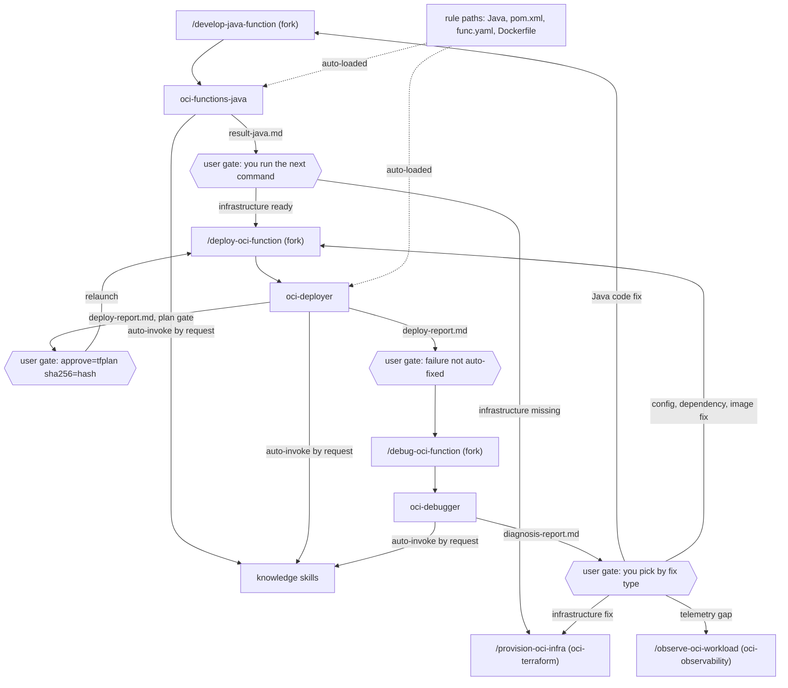

# oci-functions-java

Skills, agents and rules for the full lifecycle of a Java function on OCI Functions: write it, test it, deploy it and debug it. It is for developers who build serverless Java on OCI. You need it when you create or change a function handler, deploy a new image version, or find out why a deployed function fails.

> Version lock: FDK 1.1.x, Java 17 (build JVM: Java 21 recommended), OCI Java SDK 3.x. Rules pin FDK v1.1.11, OCI SDK BOM 3.86.1, JUnit 4.13.2 and Mockito 5.12.0.

## Contents

<!-- BEGIN GENERATED:contents -->
**Depends on:** `factory-core`, `oci-core`, `clean-code-oci`  
**Used by:** [`oci-serverless-complete`](../../../../bundles/oci-serverless-complete/README.md) (bundle)

| Type | Name | What it does |
|---|---|---|
| command | [`/debug-oci-function`](.apm/skills/debug-oci-function/SKILL.md) | Debugs a deployed OCI Function via the oci-debugger agent (P0-P4 diagnostic workflow: classify symptom, investigate infra, query logs, systematic elimination,… |
| command | [`/deploy-oci-function`](.apm/skills/deploy-oci-function/SKILL.md) | Deploys an OCI Function via the oci-deployer agent (P0-P6 workflow: preflight, build, push to OCIR, Terraform apply, smoke test, auto-fix, rollback). |
| command | [`/develop-java-function`](.apm/skills/develop-java-function/SKILL.md) | Develops Java OCI Functions via the oci-functions-java agent (P0-P5 workflow: classify, scaffold, implement, compile, validate). |
| knowledge skill | [`debugging-deployed-functions`](.apm/skills/debugging-deployed-functions/SKILL.md) | Diagnoses runtime issues in deployed OCI Functions using systematic elimination by HTTP status code, OCI CLI investigation, and common root cause database. |
| knowledge skill | [`deploying-oci-functions`](.apm/skills/deploying-oci-functions/SKILL.md) | Builds, pushes, deploys, and validates OCI Function images to existing infrastructure using Docker, OCIR, and Terraform. |
| knowledge skill | [`developing-oci-functions-java`](.apm/skills/developing-oci-functions-java/SKILL.md) | Develops, tests, and deploys serverless Java functions with OCI Functions Java FDK (Fn Project) v1.0.x/1.1.x. |
| knowledge skill | [`implementing-oci-functions-events`](.apm/skills/implementing-oci-functions-events/SKILL.md) | Implements event-driven OCI Functions with typed abstractions (API Gateway, Service Connector Hub, Notifications) using fn-events v1.1.x. |
| knowledge skill | [`integrating-oci-functions-objectstorage`](.apm/skills/integrating-oci-functions-objectstorage/SKILL.md) | Reads, writes, and manages files in OCI Object Storage from OCI Functions with Java FDK and OCI SDK v3.x+. |
| knowledge skill | [`integrating-oracle-rms-webhooks`](.apm/skills/integrating-oracle-rms-webhooks/SKILL.md) | Integrates OCI Functions with Oracle Retail Merchandising Foundation Cloud (MFCS/RMS) Publish APIs via webhook: webhook registration (webhooks/manage), EVENT v… |
| knowledge skill | [`invoking-rest-apis-from-oci-functions`](.apm/skills/invoking-rest-apis-from-oci-functions/SKILL.md) | Invokes REST APIs (OCI services, other Functions, or external third-party APIs) from OCI Functions written in Java with OCI SDK v3.x+ and Java 17. |
| knowledge skill | [`publishing-events-from-oci-functions`](.apm/skills/publishing-events-from-oci-functions/SKILL.md) | Publishes events and messages from OCI Functions (Java) to OCI Streaming, Notifications, Queue, Monitoring, and Logging using OCI Java SDK v3.x+. |
| knowledge skill | [`scaffolding-oci-function`](.apm/skills/scaffolding-oci-function/SKILL.md) | Generates a complete, deploy-ready OCI Function project scaffold with all mandatory patterns pre-applied (initError, CMD, httpclient-jersey, observability, tim… |
| knowledge skill | [`testing-oci-functions-java`](.apm/skills/testing-oci-functions-java/SKILL.md) | Tests OCI Functions Java handlers with FDK v1.1.x testing framework (FnTestingRule, APIGatewayTestFeature, Mockito). |
| agent (sonnet) | [`oci-debugger`](.apm/agents/oci-debugger.agent.md) | OCI Function Debugger — diagnoses runtime issues in deployed functions using systematic elimination by HTTP status code (P0-P4 diagnostic workflow). |
| agent (sonnet) | [`oci-deployer`](.apm/agents/oci-deployer.agent.md) | OCI Function Deployer — orchestrates build, push, deploy, and validation of OCI Functions on existing infrastructure following a P0-P6 workflow. |
| agent (sonnet) | [`oci-functions-java`](.apm/agents/oci-functions-java.agent.md) | OCI Functions Java Developer — orchestrates Java function development with FDK v1.1.x following a 6-step workflow (P0-P5) with skill-driven patterns. |
| rule | [`deployment-preflight-checks.instructions`](.apm/instructions/deployment-preflight-checks.instructions.md) | Pre-flight validation checklist for OCI Functions deployment (Dockerfile CMD, HTTP provider, no secrets in func.yaml, Docker running, .env present). |
| rule | [`java-environment-validation.instructions`](.apm/instructions/java-environment-validation.instructions.md) | Pre-build environment validation rules for OCI Functions Java (Java version, Maven version, Docker, OCIR credentials). |
| rule | [`java-functions-api-gateway.instructions`](.apm/instructions/java-functions-api-gateway.instructions.md) | API Gateway integration patterns for OCI Functions Java (APIGatewayFunction, request routing, response building). |
| rule | [`java-functions-error-handling.instructions`](.apm/instructions/java-functions-error-handling.instructions.md) | Error handling and resilience rules for OCI Functions Java (BmcException, timeout budget, initError, fallback patterns). |
| rule | [`java-functions-event-driven.instructions`](.apm/instructions/java-functions-event-driven.instructions.md) | Event-driven patterns for OCI Functions (ConnectorHubFunction, SCH, Notifications, idempotency). |
| rule | [`java-functions-external-apis.instructions`](.apm/instructions/java-functions-external-apis.instructions.md) | External API integration rules for OCI Functions Java (HttpClient, OAuth2, Vault secrets, retry). |
| rule | [`java-functions-fdk.instructions`](.apm/instructions/java-functions-fdk.instructions.md) | FDK v1.1.x lifecycle rules for OCI Functions Java (cold-start, hot function model, @FnConfiguration, initError pattern). |
| rule | [`java-functions-object-storage.instructions`](.apm/instructions/java-functions-object-storage.instructions.md) | OCI Object Storage integration rules for Java Functions (read/write, OOM prevention, stream management). |
| rule | [`java-functions-observability.instructions`](.apm/instructions/java-functions-observability.instructions.md) | Observability rules for OCI Functions Java (structured logging, OCI Monitoring metrics, APM tracing, MDC). |
| rule | [`java-functions-project-config.instructions`](.apm/instructions/java-functions-project-config.instructions.md) | Project configuration rules for OCI Functions (Maven pom.xml, func.yaml, Dockerfile, skill routing). |
| rule | [`java-functions-project-structure.instructions`](.apm/instructions/java-functions-project-structure.instructions.md) | Directory layout and package naming conventions for OCI Functions Java projects. |
| rule | [`java-functions-runtime-debugging.instructions`](.apm/instructions/java-functions-runtime-debugging.instructions.md) | Runtime error reporting patterns for OCI Functions Java (structured error responses, initError field, detalhe field). |
| rule | [`java-functions-sdk-integration.instructions`](.apm/instructions/java-functions-sdk-integration.instructions.md) | OCI Java SDK integration rules for Functions (Resource Principal auth, retry config, HTTP provider, timeout budget). |
| rule | [`java-functions-skills.instructions`](.apm/instructions/java-functions-skills.instructions.md) | Skill and command routing guide for OCI Functions Java. |
| rule | [`java-functions-standards.instructions`](.apm/instructions/java-functions-standards.instructions.md) | Java 17 coding standards for OCI Functions: naming, security, style, and production-readiness. |
| rule | [`java-functions-testing.instructions`](.apm/instructions/java-functions-testing.instructions.md) | Testing rules for OCI Functions Java (FnTestingRule, Mockito, E2E testing patterns). |
<!-- END GENERATED:contents -->

## Installation

<!-- BEGIN GENERATED:installation -->
| Item | Value |
|---|---|
| Package name | `agents-factory-oci-functions-java` |
| Version | `1.0.0` |
| Source folder | `packages/cloud/provider/oci/oci-functions-java` |
| In this repository | listed directly in the root `apm.yml` |
| Also installs | `factory-core`, `oci-core`, `clean-code-oci`, `handoff-core`, `openspec-core` |

Install it into another project, from that project's folder:

```bash
apm install <path-to-agents-factory>/packages/cloud/provider/oci/oci-functions-java --target claude
```

Add `--dry-run` to preview the install. APM writes the skills, agents and rules into `.claude/`. Change the sources under `.apm/`, never the generated `.claude/`.
<!-- END GENERATED:installation -->

Runtime prerequisites, as the agents state them:

- `/develop-java-function`: a JDK and Maven. Run `java -version` and `mvn -version` first; both must report the same major version. Target is Java 17, tested on Java 21, not supported on Java 25+.
- `/deploy-oci-function`: Docker running, `services/.env` with OCIR credentials (`OCIR_REGION`, `OCIR_NAMESPACE`, `OCIR_REPO`, `OCIR_USERNAME`, `OCIR_PASSWORD`), a valid OCI CLI session (the agent checks `oci session validate --profile poc --auth security_token`), Terraform and Python 3.8+.
- `/debug-oci-function`: the OCI CLI with a valid session, and `curl`.

## Quick Start

Write a function, then deploy it:

```
/develop-java-function event-producer
/deploy-oci-function event-producer
```

The first run stops at a plan with numbered questions. Answer them and relaunch. The deploy run stops at a saved Terraform plan and prints the relaunch line you need.

## Usage Scenarios

Scenarios 1 to 4 use the evaluation scenarios of each command. The `query:` lines quoted below are from the blueprints.

### Scenario 1 — Create a new API Gateway function (fastest default run)

Use it when you start a function from scratch.

```
/develop-java-function Create a new function called `func-order-status` that receives a GET request with a store_id query param, reads from OCI Vault for a secret, and returns JSON
```

You get: a classification (API Gateway handler), a plan (class structure, handler signature, `pom.xml` and `func.yaml` changes, Ask-First questions) and no code yet. After you answer, relaunch: the agent writes an `APIGatewayFunction` class with the `initError` pattern and Resource Principal auth, then runs `mvn compile` and the deploy-readiness checks. It writes `docs/handoff/func-order-status/result-java.md`.

### Scenario 2 — Add a capability to an existing function

Use it when the function already exists and you add an integration.

```
/develop-java-function Add OCI Streaming publish capability to `func-api-facade` — emit a DomainEvent after each successful object storage write
```

You get: a plan that adds a stream publisher initialized in `configure()` (not in the handler), a new `pom.xml` dependency and error handling that maps publish errors to 503.

### Scenario 3 — Refactor a god-class handler

Use it when a handler grew too large.

```
/develop-java-function The `RestProxyFunction` is 600 lines. Refactor it using Extract Method and package decomposition
```

You get: a plan that names the extracted classes, then a behavior-preserving refactor checked with `mvn compile` and `mvn test`. The agent loads `refactoring-oci-java`.

### Scenario 4 — Out of scope: Terraform in the develop command

Use this to see where infrastructure requests go.

```
/develop-java-function Create the OCI Application and subnet in Terraform for my new function
```

The agent declines, writes no Terraform and points you to `/provision-oci-infra` (`@oci-terraform`). Use [oci-terraform](../../../terraform/oci-terraform/README.md) for that work.

### Scenario 5 — Deploy a new version with a version bump

Use it when the infrastructure exists and you have a new image.

```
/deploy-oci-function Deploy the new version of func-event-producer with tag 0.0.5
```

First launch: prerequisite check, pre-flight checks, build, push to OCIR, `terraform plan -input=false -out=tfplan`, `sha256sum tfplan`, then a stop. `deploy-report.md` holds the plan summary, the hash and the relaunch line. After your own yes:

```
/deploy-oci-function func-event-producer approve=tfplan sha256=<hash>
```

The agent checks the hash, runs `terraform apply -input=false tfplan` without re-planning, then smoke-tests the endpoint. HTTP 200 or 400 means the function runs.

### Scenario 6 — Incomplete input: the plan gate and the hash mismatch

Use it to know what happens when the approval line is missing or wrong.

```
/deploy-oci-function func-api-facade approve=tfplan sha256=<wrong-hash>
```

The agent applies nothing. It stops with `outcome: needs-input` and returns a new plan and a new hash. A rollback and every auto-fix re-apply each need their own plan and their own `approve=` line.

### Scenario 7 — Deploy fails with 502 and the agent auto-fixes

Use it to see the auto-fix loop.

```
/deploy-oci-function Deploy func-api-facade 0.0.3
```

If the smoke test returns 502 with an empty body and the Dockerfile has no `CMD`, the agent adds the `CMD`, raises the tag, and builds and plans again. It stops at a new plan gate. It tries at most 2 auto-fix cycles. After that it writes `deploy-report.md` and tells you to run `/debug-oci-function` or approve a rollback.

### Scenario 8 — Diagnose a 502

Use it when a deployed function returns 502, 503, 504 or 500.

```
/debug-oci-function func-api-facade is returning 502 — container crash, no logs
```

You get: the symptom classified as a container crash, a structural check (`grep "^CMD" Dockerfile`), the root cause with the exact fix (file and change), and `docs/handoff/func-api-facade/diagnosis-report.md`. The agent ends with one next command.

### Scenario 9 — Diagnose a 503 from OAuth

```
/debug-oci-function func-rr-rest-proxy returns 503 — 'OAuth2 token request failed with status: 401'
```

The agent reads the response `detalhe`, checks the Vault secret state and the application config with the OCI CLI, and classifies the fix as config or infrastructure.

### Scenario 10 — Misuse: telemetry gap on a healthy function

Use it when the function returns 2xx but metrics, logs or traces are missing.

```
/debug-oci-function func-event-producer returns 202 but no metrics appear in OCI Monitoring
```

The agent states that a 2xx response is not a runtime error and does not run the diagnostic. It points to `validating-oci-observability` (see [oci-observability](../oci-observability/README.md)).

## Commands Reference

### `/develop-java-function`

*Develop or change a Java OCI Function.*

Routes to the `oci-functions-java` agent in a fork. The agent runs a 6-step workflow (P0 to P5) and ends at P3 with a plan until you approve.

**Syntax**

```
/develop-java-function <capability name or description>
```

**Parameters**

| Parameter | Required | Default | Description |
|---|---|---|---|
| `<capability name or description>` | Yes | none | A capability name (for example `event-producer`) or a request (for example `add Object Storage write to func-api-facade`). |

**Prerequisites**

- A JDK and Maven with matching versions (see Installation).
- For an existing function: its `pom.xml`, `func.yaml` and Java sources in the workspace.
- Optional: a work-order `docs/handoff/<capability>/stream-a-java.md` (from `/design-oci-architecture`) or a `diagnosis-report.md` (from `/debug-oci-function`). The agent reads them first.

**What it does**

| Step | Action |
|---|---|
| P0 | Reads handoff records. Classifies the function: API Gateway handler, event-driven or scheduled. Identifies the integrations. Loads `developing-oci-functions-java` plus the matching skills. |
| P1 | Scans `pom.xml`, `func.yaml` and existing classes. For a new project it reuses the FDK and SDK versions of an existing project in `services/`. |
| P2 | Extracts the Always-Do, Never-Do and Ask-First items of the loaded skills. |
| P3 | Proposes class structure, handler signature, dependencies, `func.yaml` changes, error handling and the Ask-First questions. It ends here (outcome `needs-input`). |
| P4 | After your answers: writes the Java classes, updates `pom.xml` and `func.yaml`, writes tests if you asked for them. |
| P5 | Runs `mvn compile` and `mvn test` (if tests exist). Checks the code against the rules and the deploy-readiness checks (Dockerfile `CMD` matches `func.yaml`, `httpclient-jersey` present, `initError` pattern, no credentials in `func.yaml`). Writes the result record. |

Skills the agent loads by trigger: any function `developing-oci-functions-java`; Object Storage `integrating-oci-functions-objectstorage`; REST calls `invoking-rest-apis-from-oci-functions`; event publishing `publishing-events-from-oci-functions`; event consuming `implementing-oci-functions-events`; refactor `refactoring-oci-java`; RMS or webhook `integrating-oracle-rms-webhooks`.

**What is updated and what is not**

| Updated | Not touched |
|---|---|
| `src/main/java`, `src/test/java`, `pom.xml`, `func.yaml`, `Dockerfile` of the function | Terraform and any infrastructure file |
| `docs/handoff/<capability>/result-java.md` | The architecture or the work-orders (except filling a `<pending>` timestamp) |

**Output files**

- Java sources, `pom.xml`, `func.yaml`, `Dockerfile` in the function project.
- `docs/handoff/<capability>/result-java.md`: files changed, validation results, acceptance status, `outcome`.

**Examples**

```
/develop-java-function event-producer
/develop-java-function add Object Storage write to func-api-facade
/develop-java-function The `RestProxyFunction` is 600 lines. Refactor it using Extract Method and package decomposition
```

**Next**

If the infrastructure is missing, the agent tells you to run `/provision-oci-infra`. If it is ready, it tells you to run `/deploy-oci-function`.

### `/deploy-oci-function`

*Build, push, deploy and smoke-test an OCI Function on existing infrastructure.*

Routes to the `oci-deployer` agent in a fork. The agent runs a 7-step workflow (P0 to P6). It is non-interactive, so every `terraform apply` goes through a plan gate and a relaunch.

**Syntax**

```
/deploy-oci-function <function name or description> [approve=tfplan sha256=<hash>]
```

**Parameters**

| Parameter | Required | Default | Description |
|---|---|---|---|
| `<function name or description>` | Yes | none | The function (for example `func-rr-rest-proxy`) or a request (for example `deploy new version of event-producer with tag 0.0.5`). |
| `approve=` | No | not set | Set to `tfplan` on the relaunch. It relays your own yes for exactly one apply of that plan. |
| `sha256=` | No | not set | The hash printed by the first run (`sha256sum tfplan`). The agent applies only if the existing `tfplan` has this hash. |

Without `approve=` the agent never applies. Both `approve=` and `sha256=` go together.

**Prerequisites**

- Docker running; `services/.env` present; a valid OCI CLI session.
- Existing infrastructure. The agent does not create Terraform modules.
- The function directory (`services/<function-name>/`) with `func.yaml` and `Dockerfile`.

**What it does**

| Step | Action |
|---|---|
| P0 | Reads an existing `diagnosis-report.md`. Checks Docker, `services/.env` and the OCI session. A Java code fix in the report is not yours: the agent tells you to run `/develop-java-function` and stops. |
| P1 | Identifies the target function and confirms `func.yaml` and `Dockerfile` exist. |
| P2 | Runs the mandatory pre-flight checks (`deployment-preflight-checks`): Dockerfile `CMD`, HTTP provider in `pom.xml`, no secrets in `func.yaml`, `services/.env`, Docker. It fixes a failing check and re-runs. |
| P3 | Picks the version tag (yours, or the current one incremented). Runs `python3 build-push.py <version>` and expects exit 0 and the `Done! Image URI:` line. |
| P4 | Updates `infra/environments/dev/terraform.tfvars`. Runs `terraform plan -input=false -out=tfplan`. The plan must show one change (the function `image`). Computes `sha256sum tfplan` and stops with `outcome: needs-input`. On the relaunch it checks the hash and runs `terraform apply -input=false tfplan`. |
| P5 | Waits 5 seconds, then smoke-tests the endpoint. 200 or 400 is success. 502, 503, 504 or 500 with "init failed" is a failure. Optional: observability validation with the `validating-oci-observability` scripts. |
| P5.5 | On failure, matches the error against known patterns and fixes Dockerfile, `pom.xml` or config. Maximum 2 auto-fix cycles. Each re-apply needs a new plan and a new `approve=` line. |
| P6 | On unresolved failure: reverts `terraform.tfvars`, plans the rollback and stops. A relaunch with its own `approve=` line applies it, then a smoke test verifies it. |

**What is updated and what is not**

| Updated | Not touched |
|---|---|
| Image tag in `terraform.tfvars`; Dockerfile, `pom.xml` and config during auto-fix | Java code (handed to `/develop-java-function`), Terraform modules, IAM, networking |
| `docs/handoff/<capability>/deploy-report.md` | Any version tag already used (never reused) |

**Output files**

- `docs/handoff/<capability>/deploy-report.md`: image tag, `tfvars` diff, plan summary, plan file and sha256, the approval line used (or "none - stopped at plan gate"), smoke status and body, auto-fix cycles, OCIDs, `outcome`.
- `tfplan` in `infra/environments/dev/`.

**Examples**

```
/deploy-oci-function func-rr-rest-proxy
/deploy-oci-function func-rr-rest-proxy approve=tfplan sha256=<hash>
/deploy-oci-function Deploy the new version of func-event-producer with tag 0.0.5
```

**Next**

Success: the deploy is complete, the agent reports the endpoint and the HTTP status. Unresolved failure: run `/debug-oci-function`. Java code fix: run `/develop-java-function`.

### `/debug-oci-function`

*Diagnose a deployed OCI Function by HTTP status.*

Routes to the `oci-debugger` agent in a fork. The agent runs a diagnostic workflow (P0 to P4) and changes no code.

**Syntax**

```
/debug-oci-function <function name and symptom>
```

**Parameters**

| Parameter | Required | Default | Description |
|---|---|---|---|
| `<function name and symptom>` | Yes | none | The function and what you see, for example `func-rr-rest-proxy returns 502` or `event-producer 503 OAuth 401`. |

**Prerequisites**

- A deployed function with a reachable endpoint.
- The OCI CLI with a valid session (the agent runs `oci fn`, `oci vault` and `oci logging-search` commands).
- Optional: `docs/handoff/<capability>/deploy-report.md`. If it exists, the agent skips re-invoking the endpoint and goes to elimination.

**What it does**

| Step | Action |
|---|---|
| P0 | Reads `deploy-report.md` if present. Otherwise invokes the endpoint with `curl`. Classifies: 502 container crash, 503 dependency unavailable, 504 timeout, 500 plus "init failed" initialization error, 500 plus exception code error. |
| P1 | Reads the application config, function details (image, timeout, memory) and Vault secret state with the OCI CLI. |
| P1.5 | Queries OCI Logging when the response body is empty or unhelpful. No result suggests the container crashed before output. |
| P2 | Parses the response (`erro`, `detalhe`, `elapsed_ms`). |
| P3 | Follows the elimination path for the status: 502 Dockerfile `CMD`, `httpclient-jersey`, `configure()` name, fatal init; 503 response body, null credentials, network; 504 timeout budget; 500 `detalhe`. One hypothesis at a time, cheapest check first. |
| P4 | Proposes the exact fix and writes `diagnosis-report.md`. |

**What is updated and what is not**

| Updated | Not touched |
|---|---|
| `docs/handoff/<capability>/diagnosis-report.md` | Java code, `pom.xml`, Dockerfile, Terraform, the function itself |

**Output files**

- `docs/handoff/<capability>/diagnosis-report.md`: symptom, root cause, evidence (the CLI output), exact fix (file and change), classification (code, config or infra) and the `to` target.

**Examples**

```
/debug-oci-function func-rr-rest-proxy returns 502
/debug-oci-function event-producer 503 OAuth 401
/debug-oci-function func-evt-consumer-notify times out exactly at 60 seconds every time
```

**Next**

The agent file names one next command by fix type:

| Fix type | Next command |
|---|---|
| Java code | `/develop-java-function` |
| Configuration, dependency or image | `/deploy-oci-function` |
| Terraform or infrastructure (network, IAM, service policy) | `/provision-oci-infra` |
| Telemetry only (function is 2xx) | `/observe-oci-workload` |

Note: the `debug-oci-function` SKILL.md says the command "delegates code changes to `/deploy-oci-function`". That contradicts the agent file, which sends Java code fixes to `/develop-java-function`. This manual follows the agent file, because the agent runs it.

## Pipeline

The agents do not call each other. Each ends by telling you the next command, and you start it. Records in `docs/handoff/<capability>/` carry the context.



## Agents Reference

<!-- BEGIN GENERATED:agents-reference -->
| Agent | Model | Tools | Can start agents | Started by |
|---|---|---|---|---|
| [`oci-debugger`](.apm/agents/oci-debugger.agent.md) | sonnet | Read, Write, Bash, Grep, Glob | no | `/debug-oci-function` |
| [`oci-deployer`](.apm/agents/oci-deployer.agent.md) | sonnet | Read, Edit, Write, Bash, Grep, Glob | no | `/deploy-oci-function` |
| [`oci-functions-java`](.apm/agents/oci-functions-java.agent.md) | sonnet | Read, Edit, Write, Bash, Grep, Glob | no | `/develop-java-function` |
<!-- END GENERATED:agents-reference -->

All three agents hand work over through records in `docs/handoff/<capability>/` (protocol: the skill `coordinating-oci-handoffs` in [oci-core](../oci-core/README.md)). None of them can ask you a question mid-run: when something is missing they stop with `outcome: needs-input` and numbered questions.

**`oci-functions-java`**

- Does: develops or changes function code in P0 to P5. Ends at P3 with a plan and numbered Ask-First questions; the relaunch carries your answers.
- Never: writes Terraform (hands off to `/provision-oci-infra`), makes architecture decisions without the design skills, generates code before you approve the plan, skips a step.
- Contract: writes `result-java.md` before it finishes. `/provision-oci-serverless-stack <slug> --integrate` reads it.

**`oci-deployer`**

- Does: pre-flight, build, push, deploy on existing infrastructure, smoke test, auto-fix or rollback.
- Never: creates Terraform modules, skips pre-flight, reuses a version tag, uses `-auto-approve`, applies without a saved plan whose hash matches your `approve=` line, edits Java code. Auto-fix covers only Dockerfile, `pom.xml` and config.
- Contract: forked and non-interactive. It always writes `deploy-report.md`, success or failure.

**`oci-debugger`**

- Does: diagnoses 502, 503, 504 and 500 by elimination, with evidence from the OCI CLI.
- Never: guesses, changes code directly, tests two hypotheses at once.
- Contract: writes `diagnosis-report.md` with the exact fix before it hands off.

## Output structure

```
<function project>/                      (for example services/func-orders/)
├── pom.xml
├── func.yaml
├── Dockerfile
└── src/
    ├── main/java/<org>/functions/<domain>/   handler at the package root; model/, service/, client/ when > 4 classes
    └── test/java/...                          mirrors main/

infra/environments/dev/
├── terraform.tfvars                     image tag updated by /deploy-oci-function
└── tfplan                               saved plan, applied only with a matching approve= line

docs/handoff/<capability>/
├── result-java.md                       from /develop-java-function
├── deploy-report.md                     from /deploy-oci-function
└── diagnosis-report.md                  from /debug-oci-function
```

## Scripts and assets

- `scaffolding-oci-function/assets/build-push.py`: template to copy to `services/<function-name>/build-push.py`. Run `python3 build-push.py [TAG]`. The tag defaults to `version:` in `func.yaml`. It reads `OCIR_REGION`, `OCIR_NAMESPACE`, `OCIR_REPO`, `OCIR_USERNAME` and `OCIR_PASSWORD` from `services/.env`. Python 3.8+, standard library only.
- `scaffolding-oci-function/templates/pom.xml`: pom template. Offline tests: `scaffolding-oci-function/tests/run_tests.py`.
- `integrating-oracle-rms-webhooks/scripts/`: Python 3.8+ CLIs for Oracle RMS/MFCS: `rms-token.py` (prints an OAuth2 token), `rms-get.py` (`--entity`, `--id`, `--since`, `--before`), `register-webhook.py` (`--action`, `--service`, `--listener`; changes state) and `simulate-webhook.py` (`--listener`, `--mode`). Offline tests: `python3 ../tests/run_tests.py` from `scripts/`. Exit codes: unverified.

## Limits and constraints

| Constraint | Value |
|---|---|
| Version scope | FDK 1.1.x, Java 17; tested on Java 21; Java 25+ not supported for tests |
| Pinned versions in the rules | FDK 1.1.11, OCI SDK BOM 3.86.1, JUnit 4.13.2, Mockito 5.12.0 |
| Auto-fix cycles per deploy | 2 |
| Apply | Only a saved `tfplan` whose sha256 matches `approve=tfplan sha256=<hash>`; one apply per approval; never `-auto-approve` |
| Version tags | Always incremented, never reused |
| Expected plan in a deploy | One change (the function `image`); more than one: the agent stops and explains |
| Smoke test | 200 or 400 is success; the agent waits 5 seconds first |
| Function timeout guidance | SDK read timeout default 60s exceeds the 30s function default; rules recommend a 60s function timeout and a 15s SDK read timeout |
| Not covered by `/debug-oci-function` | Missing telemetry when the function returns 2xx; use `validating-oci-observability` |
| Not covered by `/deploy-oci-function` | Creating infrastructure; use `/provision-oci-infra` |
| Sources cite PoC paths | `services/`, `services/.templates/`, `../../scripts/preflight.sh`, `libs/obs-commons` are not packaged |
| CLI profile | The deployer and debugger commands use the OCI CLI profile `poc` with `--auth security_token` |

The rules (path-scoped instruction files) enforce, by theme:

| Theme | What they enforce |
|---|---|
| Runtime and lifecycle (`java-functions-fdk`, `java-functions-runtime-debugging`, `java-functions-observability`) | One-time init in `@FnConfiguration`; the method must be named `configure` and call `super.configure(ctx)`; capture failures in `initError` and report them from the handler; log cold start, invocation and timing; never strip exception messages. |
| Integrations (`java-functions-api-gateway`, `-event-driven`, `-external-apis`, `-object-storage`, `-sdk-integration`, `-error-handling`) | `::handler` for fn-events classes, `::handleRequest` for direct POJO handlers (the wrong one fails silently); Resource Principal only; classify `BmcException` by status; close every Object Storage stream; idempotent event handlers; `telemetry-ingestion` endpoint for metrics. |
| Project files (`java-functions-project-config`, `-project-structure`, `-standards`) | Pin all versions; multi-stage Dockerfile; secrets in OCI Vault, never in `func.yaml`; `func-<domain>` directory and `<org>.functions.<domain>` package naming. |
| Build and deploy (`deployment-preflight-checks`, `java-environment-validation`) | `CMD` in the Dockerfile and matching `func.yaml` `cmd`; `oci-java-sdk-common-httpclient-jersey` in `pom.xml`; matching `java` and `mvn` versions before any Maven command. |
| Testing (`java-functions-testing`) | `FnTestingRule`, mocked OCI clients, no override of the ByteBuddy version bundled with Mockito, `"handler"` in `thenRun()` for fn-events classes. |
| Skill routing (`java-functions-skills`) | Check commands first, then load skills by trigger keyword. |

The clean-code rule `java-functions-clean-code` and the skill `refactoring-oci-java` come from [clean-code-oci](../../../../java/clean-code/clean-code-oci/README.md), a dependency.

Knowledge skills have no command. Claude loads one when your request matches. Example requests from `developing-oci-functions-java` (`blueprints/evaluation-scenarios.md`):

- "Write a Java function that reads a JSON request containing an objectName, retrieves that object from OCI Object Storage, and returns its content as a string. Use best practices."
- "My Java function has a 12-second cold start. It initializes three OCI SDK clients and fetches two Vault secrets on every invocation. How do I fix this?"
- "My function returns HTTP 502 immediately on every invocation with no useful error in OCI Logging. How do I diagnose an initError?"

## Related

- [OCI serverless commands](../../../../../docs/entry-points/oci-serverless.md) (family guide page)
- [Flow: an OCI serverless capability](../../../../../docs/flows/oci-serverless-delivery.md)
- [Agents architecture](../../../../../docs/agents/architecture.md)
- [Packages](../../../../../docs/packages/README.md)
- [oci-core](../oci-core/README.md) (dependency: handoff protocol)
- [clean-code-oci](../../../../java/clean-code/clean-code-oci/README.md) (dependency)
- [factory-core](../../../../factory/factory-core/apm.yml) (dependency)
- [oci-architecture](../oci-architecture/README.md) (designs the work-orders; `/provision-oci-serverless-stack`)
- [oci-terraform](../../../terraform/oci-terraform/README.md) (infrastructure)
- [oci-observability](../oci-observability/README.md) (telemetry gaps)
