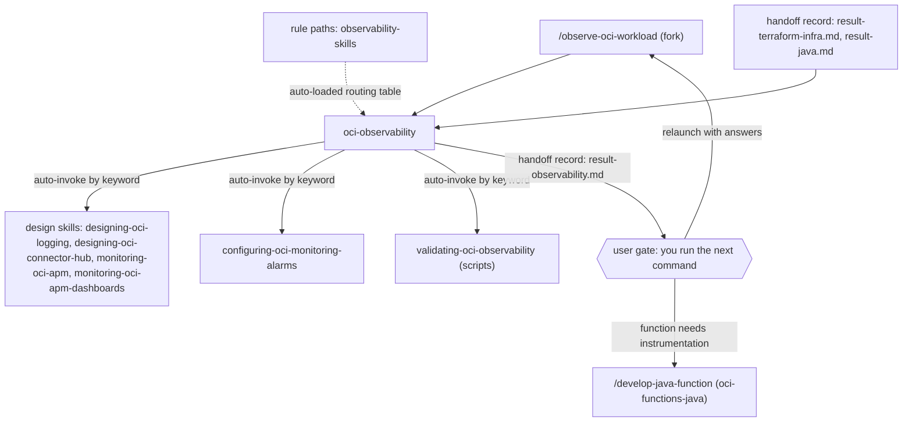

# oci-observability

Skills, one agent and one rule for the observability of OCI serverless workloads: APM and distributed tracing, Logging, Monitoring alarms, Connector Hub pipelines and Management Dashboards. It is for engineers who set up or check the telemetry of OCI Functions. You need it when you design or provision observability infrastructure, build APM or custom dashboards, wire metrics, logs and traces into Java functions, or prove live that telemetry flows.

> Scope: OCI serverless (Functions). Version facts from `validating-oci-observability`: OCI CLI 3.x, Python 3.8+ for the scripts. Java function-level instrumentation is covered by knowledge skills here; the agent hands code changes to `oci-functions-java`.

## Contents

<!-- BEGIN GENERATED:contents -->
**Depends on:** `factory-core`, `oci-core`  
**Used by:** [`cloud-observability`](../../../../bundles/cloud-observability/README.md) (bundle), [`oci-serverless-complete`](../../../../bundles/oci-serverless-complete/README.md) (bundle)

| Type | Name | What it does |
|---|---|---|
| command | [`/observe-oci-workload`](.apm/skills/observe-oci-workload/SKILL.md) | Designs, provisions, and validates end-to-end observability for OCI serverless workloads (APM & distributed tracing, Logging, Monitoring alarms, Connector Hub,… |
| knowledge skill | [`configuring-oci-monitoring-alarms`](.apm/skills/configuring-oci-monitoring-alarms/SKILL.md) | Designs and implements OCI Monitoring alarms, suppressions, custom metric ingestion, and IAM authorization following OCI Monitoring API v20180401 best practice… |
| knowledge skill | [`designing-oci-connector-hub`](.apm/skills/designing-oci-connector-hub/SKILL.md) | Designs OCI Connector Hub data pipelines (source/target topology, routing rules, log-derived metrics, SIEM/worker integration) following Oracle Cloud best prac… |
| knowledge skill | [`designing-oci-logging`](.apm/skills/designing-oci-logging/SKILL.md) | Designs OCI Logging architecture (log group topology, retention strategy, service-vs-custom log decisions, archival/alerting pipelines) following Oracle Cloud… |
| knowledge skill | [`logging-oci-java-functions`](.apm/skills/logging-oci-java-functions/SKILL.md) | Configures and troubleshoots structured logging for OCI Java Functions: Java framework selection (SLF4J/Logback/Log4j2), stdout capture via OCI Log resources,… |
| knowledge skill | [`monitoring-oci-apm`](.apm/skills/monitoring-oci-apm/SKILL.md) | Instruments, configures, and governs OCI Application Performance Monitoring (APM) for distributed tracing, RUM, synthetic monitoring, and OpenTelemetry integra… |
| knowledge skill | [`monitoring-oci-apm-dashboards`](.apm/skills/monitoring-oci-apm-dashboards/SKILL.md) | Configures OCI Management Dashboards with Application Performance Monitoring (APM) for unified observability across Java microservices, browser RUM, and synthe… |
| knowledge skill | [`monitoring-oci-java-functions`](.apm/skills/monitoring-oci-java-functions/SKILL.md) | Instruments OCI Java Functions with custom metrics and alarms using OCI Monitoring API v20180401, FDK Java 1.1.12, and OCI SDK 3.87.0. |
| knowledge skill | [`observing-oci-java-functions`](.apm/skills/observing-oci-java-functions/SKILL.md) | Instruments OCI Java Functions with structured logging, custom metrics, and distributed tracing using OCI Logging, OCI Monitoring, and OCI APM. |
| knowledge skill | [`validating-oci-observability`](.apm/skills/validating-oci-observability/SKILL.md) | Validates LIVE observability of OCI serverless workloads across 5 pillars (Logging, Metrics, APM Traces, Alarms, Dashboards render-readiness) via OCI CLI and e… |
| agent (sonnet) | [`oci-observability`](.apm/agents/oci-observability.agent.md) | OCI Observability Engineer — designs, provisions, and validates infra-level observability for OCI serverless (APM & distributed tracing, Logging, Monitoring al… |
| rule | [`observability-skills.instructions`](.apm/instructions/observability-skills.instructions.md) | OCI Observability skills routing table — maps trigger keywords to skill files (APM, Logging, Monitoring alarms, Connector Hub, Dashboards, Validation) for the… |
<!-- END GENERATED:contents -->

## Installation

<!-- BEGIN GENERATED:installation -->
| Item | Value |
|---|---|
| Package name | `agents-factory-oci-observability` |
| Version | `1.0.0` |
| Source folder | `packages/cloud/provider/oci/oci-observability` |
| In this repository | listed directly in the root `apm.yml` |
| Also installs | `factory-core`, `oci-core`, `handoff-core`, `openspec-core` |

Install it into another project, from that project's folder:

```bash
apm install <path-to-agents-factory>/packages/cloud/provider/oci/oci-observability --target claude
```

Add `--dry-run` to preview the install. APM writes the skills, agents and rules into `.claude/`. Change the sources under `.apm/`, never the generated `.claude/`.
<!-- END GENERATED:installation -->

Runtime prerequisites, from `validating-oci-observability`:

- An active OCI CLI session. The token lives about one hour: renew it before long tests such as the alarm test. Example: `oci session authenticate --profile poc --region sa-saopaulo-1`.
- Python 3.8+ (standard library only), `git` (locates the repository root) and `terraform` (reads outputs from `infra/environments/dev`).
- For `.tf` work: Terraform and the `oracle/oci` provider.

## Quick Start

```
/observe-oci-workload api-handler
```

The agent reads the handoff records of `api-handler`, proposes the observability resources and stops with numbered questions. Answer them and relaunch.

## Usage Scenarios

### Scenario 1 — Full stack for a new workload (fastest default run)

Use it when a function is deployed and no observability exists yet.

```
/observe-oci-workload api-handler pillar:all
```

The agent reads `docs/handoff/api-handler/result-terraform-infra.md` for the application and function OCIDs, loads the integrated skill `provisioning-custom-dashboard-oci-observability` (a superset) and `monitoring-oci-apm`, and stops at P3 with a plan: APM domain, log group, alarms, connector hub and dashboard, naming, file structure and Ask-First items (for example paid or free APM tier, dashboard IAM scope). After you approve it writes the `.tf` files, runs `terraform fmt -check` and `terraform validate`, and writes `result-observability.md`.

### Scenario 2 — One pillar only

Use it when only one pillar is missing.

```
/observe-oci-workload event-producer pillar:apm
```

```
/observe-oci-workload audit-consumer pillar:logging
```

The agent scopes the work to that pillar and loads only its skills.

### Scenario 3 — Dashboard widget is blank

The evaluation scenario: `func-rr-rest-proxy` is deployed and emitting metrics, but the Management Dashboard widget shows "internal error while adding widget". The dashboard was imported by Terraform last week.

```
/observe-oci-workload rr-rest-proxy pillar:dashboards
```

The agent reads the dashboard `.tf`, notes the gotchas (a `monitoringDataSource` widget must declare the `regionName` parameter; `providerId` must be `management-dashboard`), proposes a corrected widget JSON applied with `terraform apply -replace=`, and tells you to run `generate-dashboard-traffic.py` before `check-dashboards.py`.

### Scenario 4 — Alarm never fires

The evaluation scenario: an alarm `FunctionErrorCount[1m]{functionId="ocid1.fnfunc..."}` never leaves OK even when the function throws.

```
/observe-oci-workload event-producer pillar:alarms
```

The agent finds the invalid `functionId` dimension, proposes `resourceId` (Function OCID) or `applicationId` (Application OCID), shows the corrected query, waits for your approval and points to `check-alarms.py` and an `oci monitoring metric-data summarize-metrics-data` check.

### Scenario 5 — Incomplete input: answering the Ask-First questions

Use it to know how the relaunch works. The agent ends at P3 with numbered questions. Relaunch the same command and put your answers in the request text, for example:

```
/observe-oci-workload api-handler pillar:apm Use the free APM tier. Dashboard IAM scope: the observability compartment only.
```

The agent then runs P4 and P5.

### Scenario 6 — Out of scope: write the Java instrumentation

Use it to see the boundary. A request such as "add a custom metric to my handler" is function code. The agent does not write it and tells you to run `/develop-java-function` (see [oci-functions-java](../oci-functions-java/README.md)). The knowledge skills `observing-oci-java-functions`, `logging-oci-java-functions` and `monitoring-oci-java-functions` answer how to do it when you ask in plain text.

### Scenario 7 — Out of scope: provision Functions or API Gateway

A request to create the Functions application, API Gateway, networking or Vault goes to `/provision-oci-infra` (see [oci-terraform](../../../terraform/oci-terraform/README.md)).

### Scenario 8 — Prove the telemetry live and chain to the next step

Use it after the infrastructure is applied. Run the scripts of `validating-oci-observability` (see Scripts and assets):

```
python validate-observability.py
```

The agent's P5 offers this live validation. The result record `result-observability.md` ends with one hand-off line: `/develop-java-function` to instrument the function, or the live validation.

## Commands Reference

### `/observe-oci-workload`

*Design, provision and validate observability for an OCI Functions workload.*

Routes to the `oci-observability` agent in a fork. The agent runs a 6-step workflow (P0 to P5) and ends at P3 until you approve.

**Syntax**

```
/observe-oci-workload <capability-slug> [pillar: apm|logging|alarms|connector-hub|dashboards|all]
```

**Parameters**

| Parameter | Required | Default | Description |
|---|---|---|---|
| `capability-slug` | Yes | none | The capability (function name), for example `api-handler`. The agent reads `docs/handoff/<capability>/`. |
| `pillar` | No | not stated | One of `apm`, `logging`, `alarms`, `connector-hub`, `dashboards`, `all`. The examples write it as `pillar:apm`. `all` is the full stack: design, provision and validate. |

**Prerequisites**

- Optional but useful: `docs/handoff/<capability>/result-terraform-infra.md` or `result-java.md` for the application, function, subnet and bucket OCIDs.
- For live validation: an OCI CLI session (see Installation).

**What it does**

| Step | Action |
|---|---|
| P0 | Reads the handoff records. Reads the routing table of the `observability-skills` rule and loads the matching skills. For a full stack it prefers `provisioning-custom-dashboard-oci-observability` and does not also load `provisioning-oci-apm`, `provisioning-oci-logging` or `configuring-oci-monitoring-alarms`. |
| P1 | Scans existing `.tf` for provider version and source, APM domain, log groups, alarms, connector hubs, dashboards, compartments and naming. |
| P2 | Extracts Always-Do, Never-Do and Ask-First items. Plans the composition order: design, logging, metrics and alarms, APM, connector hub, dashboards. |
| P3 | Proposes resources, naming, file structure, dependencies (IAM for metric and log ingestion, APM data keys, `telemetry-ingestion` endpoints) and Ask-First questions. It ends here (outcome `needs-input`). |
| P4 | After your answers: writes `.tf` files and dashboard JSON. Uses `freeform_tags` from `local.common_tags`, validation blocks on variables and `can(regex("^ocid1\\.", ...))` on OCIDs. |
| P5 | Runs `terraform fmt -check` and `terraform validate`. Checks the rules. Optional live validation with the scripts. Writes the result record. |

**What is updated and what is not**

| Updated | Not touched |
|---|---|
| Observability `.tf` files and dashboard JSON; `docs/handoff/<capability>/result-observability.md` | Java function code; Functions, API Gateway, networking and Vault infrastructure |

**Output files**

- Observability `.tf` files and Management Dashboard JSON.
- `docs/handoff/<capability>/result-observability.md`: files changed, resources and OCIDs (APM domain, log groups, alarms, dashboards, data upload endpoint), validation result, acceptance status, `outcome`.

**Examples**

```
/observe-oci-workload api-handler
/observe-oci-workload event-producer pillar:apm
/observe-oci-workload rr-rest-proxy pillar:all
```

**Next**

The record ends with one line: run `/develop-java-function` if the function needs custom metrics, logs or tracing wired in. The agent file also lists a second option for proving the result end to end: it names `/observe-oci-workload` again, the same command, which runs the validation scripts.

## Pipeline



The Java instrumentation skills (`observing-oci-java-functions`, `logging-oci-java-functions`, `monitoring-oci-java-functions`) load by `auto-invoke` when you ask about instrumentation in plain text.

## Agents Reference

<!-- BEGIN GENERATED:agents-reference -->
| Agent | Model | Tools | Can start agents | Started by |
|---|---|---|---|---|
| [`oci-observability`](.apm/agents/oci-observability.agent.md) | sonnet | Read, Edit, Write, Bash, Grep, Glob | no | `/observe-oci-workload` |
<!-- END GENERATED:agents-reference -->

**`oci-observability`**

- Does: designs observability architecture (advisory), provisions it in Terraform, builds APM and custom Management Dashboards (widgets, APM QL, global filters, dashboard IAM) and validates live with the bundled scripts. Owns all five pillars.
- Never: writes Java function code or function-level instrumentation (hands off to `/develop-java-function`); provisions Functions, API Gateway, Networking or Vault (hands off to `/provision-oci-infra`); generates code before you approve the plan; skips a step.
- Contract: forked and non-interactive. It ends at P3 with the plan and numbered Ask-First questions (outcome `needs-input`). The relaunch carries your answers. It writes `result-observability.md` with a real `createdAt` before it finishes.

## Output structure

```
docs/handoff/<capability>/
└── result-observability.md      from /observe-oci-workload

<terraform project>/             observability .tf files (APM, logging, alarms, connector hub, dashboards) and dashboard JSON
```

## Scripts and assets

`validating-oci-observability/scripts/` holds Python 3.8+ scripts (standard library only) that call the real OCI CLI. Settings come from environment variables: `OCI_PROFILE` (default `poc`), `OCI_REGION` (default `sa-saopaulo-1`), `TF_DIR`, `LOOKBACK_MIN` (default 15). The scripts' own README is in Portuguese. On Windows run `python <script>.py`.

| Script | What it does |
|---|---|
| `validate-observability.py [--no-smoke] [--wait S]` | Runs everything and prints a PASS/FAIL table. `--no-smoke` revalidates without generating load. |
| `smoke-invoke.py [N]` | Calls the public routes to generate traffic. |
| `check-logs.py` | Checks service log entries and structured fields. |
| `check-metrics.py` | Checks `oci_faas` and custom metrics. Diagnoses the alarm dimension. |
| `check-traces.py` | Checks APM ingestion (`IngestedBytes`, `PayloadRejections`). |
| `check-alarms.py` | Checks alarms are enabled, their status and a confirmed ONS subscription. |
| `check-dashboards.py [--name-filter X]` | Checks dashboards are ACTIVE and render-ready. |
| `generate-dashboard-traffic.py [--rounds N] [--sleep S] [--url U]` | Generates load so dashboards have data. Run it before `check-dashboards.py`. |
| `trigger-alarm-test.py --i-have-user-approval [N] [MIN]` | Injects errors and polls until the alarm fires. Without the flag it exits 2 and sends nothing. Run it only with your explicit approval. |
| `deploy-and-validate.py [--skip-build] [--plan-only]` | Build, push, plan, apply (only after a yes at the prompt) and validate. |
| `lib_common.py` | Shared module. Do not run it. |

Exit codes: `0` OK. `1` a check failed or a tool is missing. `2` invalid OCI session or unknown argument. `127` an option has no value. `validate-observability.py` exits with the number of failed pillars. Offline tests (fake OCI CLI, no network): `python tests/run_tests.py` from `scripts/`.

## Limits and constraints

| Constraint | Value |
|---|---|
| OCI session token | About 1 hour; renew before long tests (the alarm test takes about 8 minutes) |
| `oci_faas` alarm dimensions | `applicationId` or `resourceId`; `functionId` does not exist |
| 5xx in MQL | `httpStatusCode =~ "5.."` does not match; use `httpStatusCategory = "5xx"` or an exact code |
| APM OTLP ingestion path | `/20200101/opentelemetry/private/v1/traces`, not `/20200101/observations/private` |
| Metric ingestion | `MonitoringClient` needs the `telemetry-ingestion` endpoint or `PostMetricData` fails silently |
| Dashboard widgets | A `monitoringDataSource` widget must declare `regionName` or it renders blank; JSON is validated only server-side at apply; the resource is write-once, so change it with `terraform apply -replace=`; `terraform destroy` does not delete the imported dashboard |
| Provider | `oracle/oci`, never `hashicorp/oci` |
| `trigger-alarm-test.py` | Needs `--i-have-user-approval` and your explicit approval for the run |
| Provisioning skills named in the agent routing table | `provisioning-oci-apm`, `provisioning-oci-logging`, `provisioning-oci-connector-hub` and `provisioning-custom-dashboard-oci-observability` are not in this package; they live in [oci-terraform](../../../terraform/oci-terraform/README.md), which this package does not depend on |
| Out of scope | Java code and Functions, API Gateway, networking, Vault infrastructure |
| PoC examples | Blueprints cite Java examples from `libs/obs-commons`; that code is not packaged |

The rule `observability-skills` applies to `**/*.java`, `**/*.tf`, `**/observability/**/*.tf`, `**/*dashboard*.tf` and `**/*apm*.tf`. It routes by keyword, fixes the composition order, requires `oracle/oci`, forbids hardcoded credentials and states the alarm and ingestion gotchas above.

Knowledge skills have no command. Claude loads one when your request matches. Example requests from `observing-oci-java-functions/evaluation-scenarios.json`:

- "I need to add observability to a new OCI Java function — it should post a custom metric for each successful and failed order, and log all events as structured JSON."
- "We have three OCI Java Functions that call each other in a chain. We want to see end-to-end traces in OCI APM. Cold-start must stay under 1 second. We don't need portability to other backends."
- "My OCI Java Function is deployed and invoked successfully, but custom metrics don't appear in OCI Monitoring and APM Trace Explorer is empty. No errors in function logs. What's wrong?"

## Related

- [OCI serverless commands](../../../../../docs/entry-points/oci-serverless.md) (family guide page)
- [Flow: an OCI serverless capability](../../../../../docs/flows/oci-serverless-delivery.md)
- [Agents architecture](../../../../../docs/agents/architecture.md)
- [Packages](../../../../../docs/packages/README.md)
- [oci-core](../oci-core/README.md) (dependency: handoff protocol)
- [factory-core](../../../../factory/factory-core/apm.yml) (dependency)
- [oci-functions-java](../oci-functions-java/README.md) (receives the instrumentation hand-off)
- [oci-terraform](../../../terraform/oci-terraform/README.md) (non-observability infrastructure)
