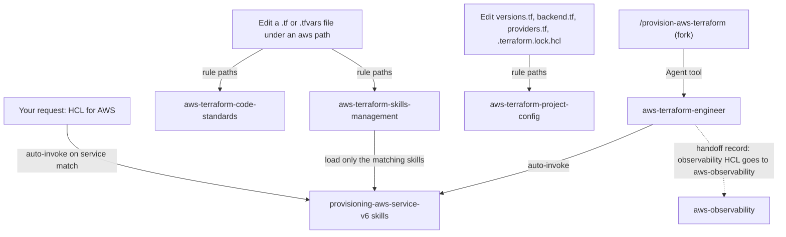

# aws-terraform

This package holds the knowledge skills for writing AWS infrastructure in Terraform, plus scoped rules for AWS Terraform files. It is for people writing HCL for AWS, and it supplies the skills that `aws-terraform-engineer` loads. You do not call it by command; Claude loads a skill when your request matches it.

> Version lock: hashicorp/aws 6.x, Terraform `~> 1.16`. Root modules use provider `~> 6.69`; reusable modules declare a minimum only. Never use provider 6.57.0 (withdrawn). A v7 provider needs new `-v7` skills.

## Contents

<!-- BEGIN GENERATED:contents -->
**Depends on:** `factory-core`  
**Used by:** `aws-lambda`, `aws-observability`, `terraform`

| Type | Name | What it does |
|---|---|---|
| knowledge skill | [`provisioning-aws-acm-v6`](.apm/skills/provisioning-aws-acm-v6/SKILL.md) | ACM Terraform (aws 6.x): certificates, DNS validation, imports, private CA, us-east-1 certs for CloudFront. |
| knowledge skill | [`provisioning-aws-api-gateway-v6`](.apm/skills/provisioning-aws-api-gateway-v6/SKILL.md) | API Gateway Terraform (aws 6.x): REST (aws_api_gateway_*) and HTTP/WebSocket (aws_apigatewayv2_*) APIs. |
| knowledge skill | [`provisioning-aws-cloudfront-v6`](.apm/skills/provisioning-aws-cloudfront-v6/SKILL.md) | CloudFront Terraform (aws 6.x, global): distributions, OAC, cache/response headers policies, functions, logging v2. |
| knowledge skill | [`provisioning-aws-cloudtrail-v6`](.apm/skills/provisioning-aws-cloudtrail-v6/SKILL.md) | CloudTrail Terraform (aws 6.x): trails, log bucket and KMS policies, event data stores, delegated admin. |
| knowledge skill | [`provisioning-aws-cloudwatch-v6`](.apm/skills/provisioning-aws-cloudwatch-v6/SKILL.md) | CloudWatch Terraform (aws 6.x): log groups, metric and subscription filters, alarms, dashboards. |
| knowledge skill | [`provisioning-aws-cognito-v6`](.apm/skills/provisioning-aws-cognito-v6/SKILL.md) | Cognito Terraform (aws 6.x): user pools, app clients, domains, identity pools. |
| knowledge skill | [`provisioning-aws-cost-management-v6`](.apm/skills/provisioning-aws-cost-management-v6/SKILL.md) | Cost Management Terraform (aws 6.x, global): budgets, Cost Anomaly Detection, cost categories, CUR, Data Exports. |
| knowledge skill | [`provisioning-aws-dynamodb-v6`](.apm/skills/provisioning-aws-dynamodb-v6/SKILL.md) | DynamoDB Terraform (aws 6.x): tables, indexes, PITR, encryption, autoscaling, global tables. |
| knowledge skill | [`provisioning-aws-eventbridge-v6`](.apm/skills/provisioning-aws-eventbridge-v6/SKILL.md) | EventBridge Terraform (aws 6.x): buses, rules, targets, archives, API destinations, Scheduler, pipes. |
| knowledge skill | [`provisioning-aws-iam-v6`](.apm/skills/provisioning-aws-iam-v6/SKILL.md) | IAM Terraform (aws 6.x, global): roles, policies, OIDC providers, users, groups, password policy, trust policies. |
| knowledge skill | [`provisioning-aws-kms-v6`](.apm/skills/provisioning-aws-kms-v6/SKILL.md) | KMS Terraform (aws 6.x): customer managed keys, aliases, key policies, grants, multi-Region and external keys. |
| knowledge skill | [`provisioning-aws-lambda-v6`](.apm/skills/provisioning-aws-lambda-v6/SKILL.md) | Lambda Terraform (aws 6.x): functions, aliases, permissions, URLs, event sources, layers, concurrency. |
| knowledge skill | [`provisioning-aws-organizations-v6`](.apm/skills/provisioning-aws-organizations-v6/SKILL.md) | Organizations Terraform (aws 6.x, global): org, OUs, accounts, SCPs, attachments, delegated admins. |
| knowledge skill | [`provisioning-aws-parameter-store-v6`](.apm/skills/provisioning-aws-parameter-store-v6/SKILL.md) | Parameter Store Terraform (aws 6.x): aws_ssm_parameter, SecureString write-only values, reads, hierarchies, tiers. |
| knowledge skill | [`provisioning-aws-route53-v6`](.apm/skills/provisioning-aws-route53-v6/SKILL.md) | Route 53 Terraform (aws 6.x, global): zones, records, routing policies, health checks, query logging, DNSSEC, Resolver. |
| knowledge skill | [`provisioning-aws-s3-v6`](.apm/skills/provisioning-aws-s3-v6/SKILL.md) | S3 Terraform (aws 6.x): buckets, ownership, BPA, SSE, TLS policy, versioning, lifecycle, access logging, objects. |
| knowledge skill | [`provisioning-aws-sam-v6`](.apm/skills/provisioning-aws-sam-v6/SKILL.md) | SAM with Terraform (aws 6.x): SAM CLI with Terraform projects, SAR, CloudFormation-deployed SAM transform; not a provider resource. |
| knowledge skill | [`provisioning-aws-secrets-manager-v6`](.apm/skills/provisioning-aws-secrets-manager-v6/SKILL.md) | Secrets Manager Terraform (aws 6.x): secrets, versions, write-only values, rotation, policies, replicas. |
| knowledge skill | [`provisioning-aws-ses-v6`](.apm/skills/provisioning-aws-ses-v6/SKILL.md) | SES Terraform (aws 6.x): SESv2 identities, DKIM, MAIL FROM, configuration sets, event destinations, pools. |
| knowledge skill | [`provisioning-aws-shield-v6`](.apm/skills/provisioning-aws-shield-v6/SKILL.md) | Shield Advanced Terraform (aws 6.x, global): subscription, protections, groups, health checks, SRT access. |
| knowledge skill | [`provisioning-aws-sns-v6`](.apm/skills/provisioning-aws-sns-v6/SKILL.md) | SNS Terraform (aws 6.x): topics, FIFO, KMS, topic policies, subscriptions, DLQs. |
| knowledge skill | [`provisioning-aws-sqs-v6`](.apm/skills/provisioning-aws-sqs-v6/SKILL.md) | SQS Terraform (aws 6.x): queues, FIFO, encryption, queue policies, dead-letter queues and redrive. |
| knowledge skill | [`provisioning-aws-step-functions-v6`](.apm/skills/provisioning-aws-step-functions-v6/SKILL.md) | Step Functions Terraform (aws 6.x): state machines, aliases, activities, logging, KMS, IAM role. |
| knowledge skill | [`provisioning-aws-vpc-v6`](.apm/skills/provisioning-aws-vpc-v6/SKILL.md) | VPC Terraform (aws 6.x): VPC, subnets, IGW, NAT, route tables, security groups, NACLs, endpoints, flow logs. |
| knowledge skill | [`provisioning-aws-waf-v6`](.apm/skills/provisioning-aws-waf-v6/SKILL.md) | WAFv2 Terraform (aws 6.x): web ACLs, rule groups, IP sets, associations, logging. |
| knowledge skill | [`provisioning-aws-xray-v6`](.apm/skills/provisioning-aws-xray-v6/SKILL.md) | X-Ray Terraform (aws 6.x): sampling rules, groups, encryption config. |
| rule | [`aws-terraform-code-standards.instructions`](.apm/instructions/aws-terraform-code-standards.instructions.md) | AWS Terraform code standards for hashicorp/aws 6.x: version constraints, per-resource region, global services, data.aws_region, identity import, terraform test. |
| rule | [`aws-terraform-project-config.instructions`](.apm/instructions/aws-terraform-project-config.instructions.md) | AWS Terraform project configuration: Terraform and provider constraints, S3 backend locking, dependency lock file, upgrade path from provider 5.x. |
| rule | [`aws-terraform-skills-management.instructions`](.apm/instructions/aws-terraform-skills-management.instructions.md) | How to pick and refresh the provisioning-aws-*-v6 skills. |
<!-- END GENERATED:contents -->

## Installation

<!-- BEGIN GENERATED:installation -->
| Item | Value |
|---|---|
| Package name | `agents-factory-aws-terraform` |
| Version | `1.0.0` |
| Source folder | `packages/cloud/terraform/aws-terraform` |
| In this repository | installed transitively, through `aws-lambda`, `aws-observability`, `terraform` |
| Also installs | `factory-core` |

Install it into another project, from that project's folder:

```bash
apm install <path-to-agents-factory>/packages/cloud/terraform/aws-terraform --target claude
```

Add `--dry-run` to preview the install. APM writes the skills, agents and rules into `.claude/`. Change the sources under `.apm/`, never the generated `.claude/`.
<!-- END GENERATED:installation -->

Runtime prerequisites, from the rules:

- Terraform `~> 1.16` (at least 1.16 and below 2.0). Terraform 1.17.0 has been stable since 2026-10-21 and the constraint admits it, but the skills have not been verified against 1.17 or later. The newest 1.16.x named in the rules is 1.16.7 (2026-10-22).
- The `hashicorp/aws` provider `~> 6.69`. The latest named in the rules is 6.70.0 (2026-10-21). No 7.x exists.
- Identity-based import (`identity` block) needs Terraform 1.12.0 or newer. Mocked tests (`mock_provider`, `override_resource`) need 1.7 or newer.

## Quick Start

This package has no command. Ask for HCL in plain text and name the service and the version lock. Try one of these requests, copied from the skills' evaluation scenarios:

```text
Generate Terraform for a secure S3 bucket with versioning, SSE-KMS, public access blocked at bucket and account level, TLS enforcement, and a lifecycle rule to expire noncurrent versions after 30 days. Use hashicorp/aws 6.x and Terraform 1.16.
```

```text
Generate Terraform for an SQS standard queue with a dead-letter queue, encryption at rest and a policy that lets one SNS topic send to it. Use hashicorp/aws 6.x and Terraform 1.16.
```

For a closed requirement that must be written and checked offline without more dialogue, use `/provision-aws-terraform` from the [terraform](../terraform/README.md) package.

## Usage Scenarios

These are plain-text requests. The skill named in each scenario responds.

### Scenario 1 - A secure S3 bucket (fastest default)

Use it for a bucket that must pass the usual Security Hub controls.

```text
Generate Terraform for a secure S3 bucket with versioning, SSE-KMS, public access blocked at bucket and account level, TLS enforcement, and a lifecycle rule to expire noncurrent versions after 30 days. Use hashicorp/aws 6.x and Terraform 1.16.
```

`provisioning-aws-s3-v6` responds. You get HCL with the standalone satellite resources (not deprecated inline blocks) and one `aws_s3_bucket_policy` and one lifecycle configuration per bucket.

### Scenario 2 - A detail you may not know (incomplete input)

Use it when the request depends on a naming or region rule.

```text
I want to create a bucket in the account-regional namespace to prevent name squatting. Show me the correct Terraform configuration.
```

`provisioning-aws-s3-v6` sets `bucket_namespace = "account-regional"` and a name ending in `-<account-id>-<region>-an`. It takes the account ID from `data.aws_caller_identity.current.account_id` and the Region from `data.aws_region.current.region` (not the deprecated `.name`). It notes that the namespace is not available in Bahrain (`me-south-1`) and UAE (`me-central-1`) and that the suffix counts toward the 63-character name limit.

### Scenario 3 - Two requirements that conflict (misuse)

Use it to see how a skill handles a conflict between controls.

```text
Can I enable MFA delete and also configure lifecycle rules on the same S3 bucket to satisfy both S3.20 and S3.10 Security Hub controls?
```

The skill rejects the combination. AWS documentation prohibits MFA delete with a lifecycle configuration, so S3.20 and S3.10/S3.13 conflict and you choose one. It notes that only the root user can enable MFA delete and asks which requirement takes priority.

### Scenario 4 - Review a snippet that mixes 5.x habits

Use it to check old HCL against provider 6.x.

```text
Review this Terraform snippet: aws_iam_role with region = "us-east-1", data.aws_region.current.name used in an ARN, and S3 backend with dynamodb_table. Is this correct for hashicorp/aws 6.x?
```

`provisioning-aws-iam-v6` and the rules respond. IAM is a global service, so `region` is not allowed on `aws_iam_*`. `data.aws_region.<name>.region` replaces the deprecated `name`. The S3 backend uses `use_lockfile = true`, not `dynamodb_table`.

### Scenario 5 - A service that has no skill (out of scope)

Use it to see the boundary. This request is not taken from an evaluation scenario.

```text
Write the Terraform for an EKS cluster with managed node groups.
```

No skill covers EKS. The rule `aws-terraform-skills-management` says not to improvise for a service without a skill and to tell you the limitation. The same applies to RDS, ECS, ALB and Transit Gateway.

### Scenario 6 - Test Terraform-defined Lambdas locally

Use it when Lambda and API Gateway are already in Terraform.

```text
My Lambda functions and API Gateway are defined in Terraform (hashicorp/aws 6.x, Terraform 1.16). How do I test them locally with the SAM CLI?
```

`provisioning-aws-sam-v6` responds. It covers the SAM CLI with Terraform projects (`--hook-name terraform`). SAM is not a provider resource.

### Scenario 7 - From requirement to checked HCL (chaining)

Use it when the requirement is closed and you want files written and checked.

```text
/provision-aws-terraform "private S3 bucket with KMS and access logging, with mocked test" ./infra
```

The command routes to `aws-terraform-engineer`, which loads the matching `provisioning-aws-<service>-v6` skills and runs only offline checks. The invocation shape follows the command's `argument-hint`: a requirement summary and a Terraform directory. Alarms, dashboards and X-Ray belong to `aws-observability`, not to the engineer.

## Skills Reference

All 26 skills lock hashicorp/aws 6.x and Terraform `~> 1.16`. The column Locks adds what is specific to the skill: whether the service is global (never set `region`) or regional. Every skill has Always Do, Ask First and Never Do tiers. The Never column lists the first rows of each skill's Never-Do table. Items tagged `(unverified)` or `(medium confidence)` in a skill are not rules.

### Identity, secrets and certificates

| Skill | Loads when | Locks | Never |
|---|---|---|---|
| `provisioning-aws-iam-v6` | Writing HCL for roles, policies, OIDC providers, users, groups, password policy, trust policies. Not KMS key policies, SCPs, Cognito. | Global: no `region`, no `id@region` import | Set `region` on an `aws_iam_*` resource; use `id@region` import IDs |
| `provisioning-aws-kms-v6` | Writing HCL for customer managed keys, aliases, key policies, grants, multi-Region and external keys. | Regional | Set `policy` on `aws_kms_key` and also use `aws_kms_key_policy` for the same key; omit the root-account principal |
| `provisioning-aws-secrets-manager-v6` | Writing HCL for secrets, versions, write-only values, rotation, policies, replicas. | Regional | Use an ISO-8601 rotation `duration` such as `P7D`; put values in `secret_string` and call state safe |
| `provisioning-aws-parameter-store-v6` | Writing HCL for `aws_ssm_parameter`, SecureString write-only values, hierarchies, tiers. | Regional | Set `insecure_value` on a SecureString; write a SecureString with `value` expecting no plaintext in state |
| `provisioning-aws-cognito-v6` | Writing HCL for user pools, app clients, domains, identity pools. | Regional | Set `username_attributes` and `alias_attributes` together; remove `sms_configuration` expecting an in-place update |
| `provisioning-aws-acm-v6` | Writing HCL for certificates, DNS validation, imports, private CA, us-east-1 certificates for CloudFront. | Regional | Set `private_key` on an imported certificate (stored in state); pin ACM certificates |
| `provisioning-aws-waf-v6` | Writing HCL for WAFv2 web ACLs, rule groups, IP sets, associations, logging. | Regional | Mix inline `rule` blocks with `aws_wafv2_web_acl_rule` without `ignore_changes`; put `web_acl_id` and `scope` on `aws_wafv2_web_acl_rule` |
| `provisioning-aws-shield-v6` | Writing `aws_shield_*` HCL: subscription, protections, groups, health checks. | Global: no `region` | Add `region` to an `aws_shield_*` resource; put an NLB ARN in `aws_shield_protection.resource_arn` |
| `provisioning-aws-organizations-v6` | Writing HCL for an organization, OUs, accounts, SCPs, attachments, delegated admins. | Global: no `region`, no `@region` import | Set `region` or an `@region` import ID; remove `FullAWSAccess` without modifying or replacing it |

### Compute, API and messaging

| Skill | Loads when | Locks | Never |
|---|---|---|---|
| `provisioning-aws-lambda-v6` | Writing HCL for functions, aliases, permissions, URLs, event sources, layers, concurrency. Not SAM, API Gateway, EventBridge, SQS, SNS. | Regional | Combine `filename`, `s3_bucket` and `image_uri` on one function; set `source_kms_key_arn` with `image_uri` |
| `provisioning-aws-api-gateway-v6` | Writing HCL for REST (`aws_api_gateway_*`) and HTTP or WebSocket (`aws_apigatewayv2_*`) APIs. | Regional; arguments removed in 6.0 are listed | Set `stage_name`, `stage_description` or `canary_settings` on `aws_api_gateway_deployment` or read its `invoke_url`; set `reset_on_delete` on `aws_api_gateway_account` |
| `provisioning-aws-step-functions-v6` | Writing HCL for state machines, aliases, activities, logging, KMS, IAM role. | Regional | Set `log_destination` to a log group ARN without `:*`; set `name` and `name_prefix` together |
| `provisioning-aws-eventbridge-v6` | Writing HCL for buses, rules, targets, archives, API destinations, Scheduler, pipes. | Regional | Manage one bus with both `aws_cloudwatch_event_bus_policy` and `aws_cloudwatch_event_permission`; set `schedule_expression` on a rule of a non-default bus |
| `provisioning-aws-sns-v6` | Writing HCL for topics, FIFO, KMS, topic policies, subscriptions, DLQs. | Regional | Use a bare account ID as a topic-policy Principal; use `alias/aws/sns` for a topic that AWS services publish to |
| `provisioning-aws-sqs-v6` | Writing HCL for queues, FIFO, encryption, queue policies, dead-letter queues and redrive. | Regional | Omit `Version` in a queue policy; allow Principal `"*"` without a restricting condition |
| `provisioning-aws-ses-v6` | Writing HCL for SESv2 identities, DKIM, MAIL FROM, configuration sets, event destinations, pools. | Regional | Set `behavior_on_mx_failure = "REJECT_MESSAGE"` without `mail_from_domain`; publish several MX records on the MAIL FROM domain |
| `provisioning-aws-sam-v6` | Mixing SAM and Terraform: SAM CLI with Terraform projects, SAR, CloudFormation-deployed SAM transform. Not plain Lambda or API Gateway. | SAM is not a provider resource | Combine `sam build --hook-name` with `--build-in-source`, `--parameter-overrides` or `--template-file`; use `--terraform-project-root-path` or `--terraform-plan-file` without `--hook-name terraform` |

### Data, network and edge

| Skill | Loads when | Locks | Never |
|---|---|---|---|
| `provisioning-aws-s3-v6` | Writing HCL for buckets, ownership, block public access, SSE, TLS policy, versioning, lifecycle, access logging, objects. | Regional; `bucket_region` is the bucket location, `region` means Enhanced Region Support | Mix a deprecated inline block with its standalone satellite resource; keep more than one policy, lifecycle, notification or CORS resource per bucket |
| `provisioning-aws-dynamodb-v6` | Writing HCL for tables, indexes, PITR, encryption, autoscaling, global tables. | Regional | Add `attribute` blocks for non-key attributes (infinite plan loop); mix inline `global_secondary_index` blocks with `aws_dynamodb_global_secondary_index` |
| `provisioning-aws-vpc-v6` | Writing HCL for VPC, subnets, IGW, NAT, route tables, security groups, NACLs, endpoints, flow logs. Not Transit Gateway. | Regional | Mix inline `route` blocks with separate `aws_route` resources; mix inline and standalone security group rules on one group |
| `provisioning-aws-cloudfront-v6` | Writing HCL for distributions, OAC, cache and response headers policies, functions, logging v2. | Global: no `region` | Omit `minimum_protocol_version` (the provider default is `TLSv1`); use `allow-all` or `http-only` origins or `SSLv3` |
| `provisioning-aws-route53-v6` | Writing HCL for zones, records, routing policies, health checks, query logging, DNSSEC, Resolver. | Global: no `region` | Set `region` on a Route 53 resource; mix inline `vpc` blocks with `aws_route53_zone_association` |

### Observability, audit and cost

| Skill | Loads when | Locks | Never |
|---|---|---|---|
| `provisioning-aws-cloudwatch-v6` | Writing HCL for log groups, metric and subscription filters, alarms, dashboards. Not X-Ray, CloudTrail, VPC flow logs. | Regional | Leave `alarm_actions = []` on child alarms expecting a composite to cover CloudWatch.15; use a heredoc for `alarm_rule` |
| `provisioning-aws-cloudtrail-v6` | Writing HCL for trails, log bucket and KMS policies, event data stores, delegated admin. | Regional | Set `event_selector` and `advanced_event_selector` on one trail; write `cloud_watch_logs_group_arn` without `:*` |
| `provisioning-aws-xray-v6` | Writing HCL for sampling rules, groups, encryption config. | Regional | Pin provider `6.57.0` (withdrawn); remove `aws_xray_encryption_config` expecting to change X-Ray encryption |
| `provisioning-aws-cost-management-v6` | Writing HCL for budgets, Cost Anomaly Detection, cost categories, CUR, Data Exports. | Global: no `region` | Set `region` on a Cost Management resource; combine `cost_filter` with `filter_expression`, or `metrics` with `cost_types`, on `aws_budgets_budget` |

## Architecture



The command and the engineer live in the [terraform](../terraform/README.md) package, which depends on this one.

## Agents Reference

This package ships no agent. `aws-terraform-engineer`, `terraform-code-reviewer` and `aws-observability` (other packages) load these skills.

<!-- BEGIN GENERATED:agents-reference -->
This package has no subagents. Claude loads its skills by description, and agents of other packages can load them too.
<!-- END GENERATED:agents-reference -->

### Rules

| Rule | Applies to | What it enforces |
|---|---|---|
| `aws-terraform-code-standards` | `**/aws/**/*.tf`, `**/aws/**/*.tf.json`, `**/aws/**/*.tfvars`, `**/aws/**/*.tftest.hcl`, `**/*aws*/**/*.tf`, `**/*aws*/**/*.tftest.hcl` (set with `applyTo`) | Version constraints, per-resource `region`, global services, `data.aws_region.<name>.region`, identity import, `.tftest.hcl` tests and mocks. |
| `aws-terraform-project-config` | `**/versions.tf`, `**/backend.tf`, `**/providers.tf`, `**/terraform.tf`, `**/.terraform.lock.hcl` (set with `applyTo`) | Terraform and provider constraints, S3 backend with `use_lockfile = true`, committed lock file, upgrade path from provider 5.x. |
| `aws-terraform-skills-management` | `**/aws/**/*.tf`, `**/*aws*/**/*.tf` (set with `applyTo`) | Load only the matching skills; re-read version sources before new work; never improvise for services without a skill. |

Facts the rules fix:

- Root modules set `required_version = "~> 1.16"` and provider `version = "~> 6.69"`. Reusable modules declare a minimum (`>=`) only.
- Set `region` on a regional resource only to override the provider region. Import it with `id@region` when the region differs.
- Never set `region` on a global-service resource. The global list in the rule includes all IAM resources, CloudFront, Route 53, Organizations, Shield Advanced, WAF Classic and Budgets and Billing.
- Read the Region with `data.aws_region.<name>.region`. On `aws_s3_bucket`, use `bucket_region` for the bucket location.
- Write tests as `.tftest.hcl` files in `tests/` with `run` blocks and `assert { condition, error_message }`. Use `mock_provider` or `override_resource` for tests that must not reach AWS.
- S3 backend: `use_lockfile = true`. Commit `.terraform.lock.hcl`. Run `terraform init -backend=false` before `terraform validate` in CI. Read `terraform plan -detailed-exitcode` as 0 no changes, 1 error, 2 changes.
- Upgrading from provider 5.x: first move to the latest 5.x with a clean plan, then allow the 6.x series and run `terraform init -upgrade`.
- Never use `dynamodb_table` in the S3 backend (deprecated).
- Never rely on memory for AWS or provider facts, never improvise for services without a skill, and never use an item tagged `(unverified)` or `(medium confidence)` as a rule; surface it.

## Output structure

The package writes no files. The skills guide the HCL you or `aws-terraform-engineer` write in your project. Each skill keeps its sources and unconfirmed items in its own `blueprints/` folder.

## Limits and constraints

| Item | Value |
|---|---|
| Provider | `hashicorp/aws` 6.x; root modules `~> 6.69`; reusable modules a minimum only |
| Withdrawn version | 6.57.0; never pin it |
| Terraform | `~> 1.16`; 1.17.0 stable since 2026-10-21 but the skills are not verified against 1.17 or later |
| Provider 7.x | none exists; it would need new `-v7` skills |
| Services without a skill | EKS, RDS, ECS, ALB, Transit Gateway: not covered |
| SAM | `provisioning-aws-sam-v6` covers the SAM CLI with Terraform and SAM-transform stacks; SAM is not a provider resource |
| Observability | `aws-terraform-engineer` does not write CloudWatch alarms, dashboards or retention policy, nor X-Ray groups or sampling; those belong to `aws-observability`. The engineer may create only the log group a Lambda needs. |
| State locking | `use_lockfile = true`; never `dynamodb_table` |
| Tags | `(unverified)` and `(medium confidence)` items in a skill are not rules |

## Related

- [AWS entry points](../../../../docs/entry-points/aws.md)
- [Terraform entry points](../../../../docs/entry-points/terraform.md)
- [Agent architecture](../../../../docs/agents/architecture.md)
- [Entry points](../../../../docs/entry-points/README.md)
- [Packages](../../../../docs/packages/README.md)
- [terraform](../terraform/README.md) has the `aws-terraform-engineer` agent and `/provision-aws-terraform`. It depends on this package.
- [factory-core](../../../factory/factory-core/apm.yml) (dependency)
