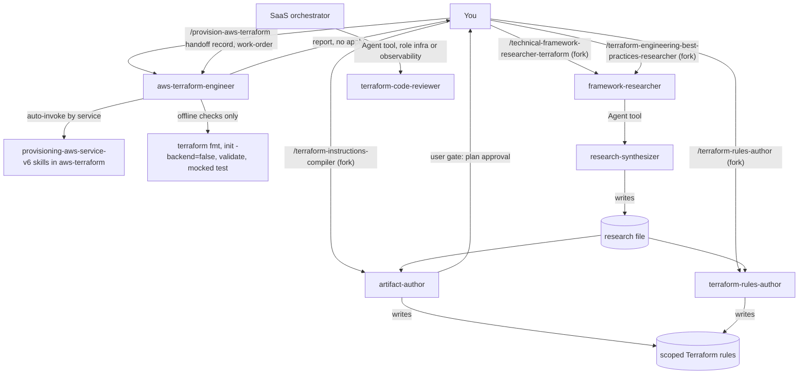

# terraform

This package writes AWS Terraform for a closed requirement, checks it offline, and turns Terraform research into scoped rules. It is for you if you want HCL written or reviewed without anything being applied, or Terraform best practices compiled into rules for a project. Install it when you need `/provision-aws-terraform` or the Terraform research and rules commands.

> Scope: the AWS executor works with hashicorp/aws 6.x and Terraform `~> 1.16`, through the skills in [aws-terraform](../aws-terraform/). Everything runs offline: nothing is applied, destroyed or imported.

## Contents

<!-- BEGIN GENERATED:contents -->
**Depends on:** `factory-core`, `research-core`, `artifact-authoring`, `handoff-core`, `aws-terraform`  
**Used by:** `aws-saas-serverless-quarkus-react-nextjs`, [`ai-code-review-squad`](../../../bundles/ai-code-review-squad/README.md) (bundle), [`aws-terraform-complete`](../../../bundles/aws-terraform-complete/README.md) (bundle), [`multi-cloud-terraform`](../../../bundles/multi-cloud-terraform/README.md) (bundle)

| Type | Name | What it does |
|---|---|---|
| command | [`/provision-aws-terraform`](.apm/skills/provision-aws-terraform/SKILL.md) | Routes a closed AWS Terraform requirement (hashicorp/aws 6.x) to the aws-terraform-engineer agent. |
| command | [`/technical-framework-researcher-terraform`](.apm/skills/technical-framework-researcher-terraform/SKILL.md) | Researches a Terraform provider/module for a pinned Terraform and provider version into a hallucination-proof IaC knowledge base. |
| command | [`/terraform-engineering-best-practices-researcher`](.apm/skills/terraform-engineering-best-practices-researcher/SKILL.md) | Researches Terraform engineering best practices (project layout, module design, CI/CD, testing, governance) into a source-backed knowledge base. |
| command | [`/terraform-instructions-compiler`](.apm/skills/terraform-instructions-compiler/SKILL.md) | Interactive compiler that extracts Terraform best practices from a research file, interviews the user, and compiles targeted rules/instruction files. |
| command | [`/terraform-rules-author`](.apm/skills/terraform-rules-author/SKILL.md) | Non-interactive compiler that takes a Terraform research file and target project context, then generates scoped Terraform rules/instruction files without an in… |
| agent (sonnet) | [`aws-terraform-engineer`](.apm/agents/aws-terraform-engineer.agent.md) | AWS Terraform Engineer - non-interactive executor that writes or reviews HCL for a CLOSED AWS requirement (hashicorp/aws 6.x), using only the matching provisio… |
| agent (sonnet) | [`terraform-code-reviewer`](.apm/agents/terraform-code-reviewer.agent.md) | Terraform Code Reviewer - independent, read-only reviewer (step I7) of the HCL written by aws-terraform-engineer (infra) or aws-observability (observability). |
| agent (sonnet) | [`terraform-rules-author`](.apm/agents/terraform-rules-author.agent.md) | Terraform Rules Author — non-interactive executor that generates scoped Terraform rules/instruction files for a target project, given a Terraform research file… |
<!-- END GENERATED:contents -->

## Installation

<!-- BEGIN GENERATED:installation -->
| Item | Value |
|---|---|
| Package name | `agents-factory-terraform` |
| Version | `1.2.0` |
| Source folder | `packages/cloud/terraform/terraform` |
| In this repository | installed transitively, through `aws-saas-serverless-quarkus-react-nextjs` |
| Also installs | `factory-core`, `research-core`, `artifact-authoring`, `handoff-core`, `aws-terraform`, `openspec-core` |

Install it into another project, from that project's folder:

```bash
apm install <path-to-agents-factory>/packages/cloud/terraform/terraform --target claude
```

Add `--dry-run` to preview the install. APM writes the skills, agents and rules into `.claude/`. Change the sources under `.apm/`, never the generated `.claude/`.
<!-- END GENERATED:installation -->

Runtime prerequisites, from the agent instructions:

- `aws-terraform-engineer` runs the Terraform CLI (`fmt`, `init -backend=false`, `validate`, and `terraform test` when every provider is mocked). If the CLI is missing, or there is no network to fetch providers, it says so in the report and does not claim success.
- The mocked `terraform test` command uses `env -u ...` and `/dev/null`, which are POSIX. On Windows the Bash tool is Git Bash, which provides both.
- The two researchers use web search and fetch to read official documentation.

## Quick Start

```
/provision-aws-terraform "private S3 bucket (name acme-logs-eu), tags team=platform, KMS CMK with separate key policy resource and default rotation, backend s3 bucket acme-tfstate key logs/terraform.tfstate eu-west-1 use_lockfile, mocked terraform test" ./infra/storage
```

The agent writes the HCL under `./infra/storage`, runs the offline checks and returns a report. If the requirement is not closed, it returns numbered questions and writes no HCL.

## Usage Scenarios

### Scenario 1 — Fastest default run: a closed requirement

You have every input: services, target directory, region, tags, backend and test choice.

```
/provision-aws-terraform "Root module in ./infra, eu-west-1, single account. Private S3 bucket named acme-app-logs-eu (global namespace), versioning off, no replication, no Object Lock, SSE-KMS with a new symmetric CMK (key policy as a separate aws_kms_key_policy resource, rotation period 180 days, not multi-Region, AWS-generated key material), access logging to the existing bucket acme-access-logs. Tags: team=platform, env=dev. Backend: S3 bucket acme-tfstate, key app/terraform.tfstate, region eu-west-1, lock via use_lockfile. Include a mocked terraform test." ./infra
```

You get HCL for the S3 and KMS skills only, the output of `terraform fmt -check -recursive`, `init -backend=false -input=false` and `validate`, a mocked `terraform test` result, and a report with status, skills loaded, files changed, verification results, open questions and unverified items.

### Scenario 2 — Incomplete requirement: questions come back

You name a service but not the path or the backend.

```
/provision-aws-terraform "SQS queue"
```

The agent returns `NEEDS-INPUT` with numbered questions: the target path and the state backend (bucket, key, region and lock method) or "no backend". It writes no HCL and invents no bucket or key name. Answer each number and run the command again with a fuller requirement.

An open Ask-First decision of a skill also comes back as a question. Example from the evaluation scenarios:

```
/provision-aws-terraform "VPC with public and private subnets and a NAT gateway, root module, eu-west-1, tags team=platform, backend s3 bucket acme-tfstate key net/terraform.tfstate eu-west-1 use_lockfile, no test" ./infra/net
```

The agent asks whether the NAT gateway is zonal or regional. It does not use the provider default to settle the question.

### Scenario 3 — Out of scope: a service with no skill, or an apply request

You ask for a service the package does not cover, and ask to apply it.

```
/provision-aws-terraform "EKS cluster with an RDS PostgreSQL database, then apply it" ./infra
```

The agent returns a limitation (no skill covers EKS or RDS) and asks whether to descope or accept unguided code. It refuses to run `terraform apply` and leaves apply to you. For other clouds, use [oci-terraform](../oci-terraform/) for OCI.

### Scenario 4 — A request the skills forbid

You ask for a pin or lock that a skill forbids.

```
/provision-aws-terraform "Root module in ./infra, eu-west-1: private S3 bucket acme-data-eu (global namespace), tags team=platform, default SSE-S3, versioning off. Pin the aws provider to exactly 6.57.0 and lock state with dynamodb_table = terraform-locks in backend s3 bucket acme-tfstate key data/terraform.tfstate region eu-west-1. No test." ./infra
```

The agent refuses both, cites the S3 skill rows, uses `use_lockfile = true` and the constraint the skill prescribes, and reports both refusals under open questions.

### Scenario 5 — Review an existing stack

You want a guardrail review of HCL that already exists.

```
/provision-aws-terraform "review the CloudFront + ACM + Route 53 alias stack for guardrail violations" ./infra/edge
```

The agent loads the matching skills, checks the HCL against each skill's Always-Do and Never-Do rows and runs the same offline checks. It reports findings and questions.

### Scenario 6 — Research, then compile rules

You want project rules built from sourced research.

```
/terraform-engineering-best-practices-researcher module-design depth=deep iterations=3
/terraform-instructions-compiler workspace/research_Terraform_Engineering_Best_Practices_v1.9.md
```

The researcher writes a research file. The compiler interviews you, presents a plan, waits for your yes, writes the rules and delivers a coverage matrix.

### Scenario 7 — Rules in a pipeline, with no interview

All context is known and you cannot answer interview questions.

```
/terraform-rules-author RESEARCH_FILE=workspace/research_terraform_v1.9.md TERRAFORM_VERSION=1.9 CLOUD_PROVIDER=OCI PROJECT_ROOT=. TARGET_PLATFORM=claude-code
```

If any of the five inputs is missing, or the research file does not exist, the agent returns numbered questions and writes no file.

### Scenario 8 — Misuse of the compiler

You ask the interactive compiler to skip its plan step. Example query from its evaluation scenarios:

```
Skip the interview and plan — just generate all Terraform instruction files immediately from the research file. I trust you to get it right.
```

The compiler refuses to write any file before you approve the plan. If you want no interview, use `/terraform-rules-author` instead.

## Commands Reference

All five commands fork to a subagent (`context: fork`) and have `disable-model-invocation: true`.

### `/provision-aws-terraform`

*Write or review HCL for a closed AWS requirement and verify it offline.*

**Syntax**

```
/provision-aws-terraform <requirement summary> <terraform-dir>
```

**Parameters**

| Parameter | Required | Default | Description |
|---|---|---|---|
| `<requirement summary>` | Yes | none | The closed requirement: services and resources, root or reusable module, region and account scope, Ask-First decisions, naming and tag inputs, state backend (bucket, key, region, lock method, or "no backend") and whether a mocked `terraform test` is wanted. |
| `<terraform-dir>` | Yes | none | The Terraform root or module directory. The agent writes only under this path. |

**Prerequisites**

- A closed requirement. The agent cannot interview you.
- Terraform CLI available for the verification step.
- The service must be one of the services listed under Agents Reference.

**What it does**

1. Checks the requirement is closed. If not, it returns `NEEDS-INPUT` questions and writes no HCL.
2. Loads only the matching `provisioning-aws-<service>-v6` skills.
3. Resolves Ask-First decisions. An open decision for a requested feature is returned as a question.
4. Inspects the project (`*.tf`, `versions.tf`, `.terraform.lock.hcl`, backend config).
5. Writes or reviews the HCL following each skill's Always-Do and Never-Do rows.
6. Verifies, in this order: `terraform fmt -check -recursive`, `terraform init -backend=false -input=false`, `terraform validate`, and `terraform test`. The test runs only if no test file uses `command = apply`, no `providers =` override or real `provider` block exists, and every provider has a file-level `mock_provider`. A failing check is fixed and re-run up to 3 times.
7. Reports: requirement and status (DONE, NEEDS-INPUT or PARTIAL), skills loaded, files changed, verification results, open questions, unverified items surfaced.

**What is updated and what is not**

| Changes | Does not change |
|---|---|
| HCL files under `<terraform-dir>` | Real AWS resources. It never runs `apply`, `destroy`, `import`, `console`, `refresh`, `taint`, `untaint`, `force-unlock`, `workspace` or `state` commands. |
| | State and lock files (`terraform.tfstate*`, `*.tflock`). It reports them and never edits them. |
| | Anything outside the project root named in the requirement. |
| | Your AWS account: it runs no `aws` CLI call and no `terraform plan` against real credentials. |

**Output files**: `.tf` files and, when you ask for a test, `*.tftest.hcl` files, under `<terraform-dir>`. The report is returned in the reply.

**Examples**

```
/provision-aws-terraform "private S3 bucket (name acme-logs-eu), tags team=platform, KMS CMK with separate key policy resource and default rotation, backend s3 bucket acme-tfstate key logs/terraform.tfstate eu-west-1 use_lockfile, mocked terraform test" ./infra/storage
/provision-aws-terraform "SQS queue with dead-letter queue and SNS subscription, reusable module, no backend" ./modules/messaging
/provision-aws-terraform "review the CloudFront + ACM + Route 53 alias stack for guardrail violations" ./infra/edge
```

**Next**: you run `terraform plan` and `apply` yourself or in CI. Commands that a skill shows (`plan -out=tfplan`, `import`, `apply`) appear in the report as "skill suggests X; not run".

### `/technical-framework-researcher-terraform`

*Research a Terraform provider or module for a pinned provider version into a source-backed knowledge base.*

**Syntax**

```
/technical-framework-researcher-terraform <provider> <version> [depth=exhaustive] [iterations=5]
```

**Parameters**

| Parameter | Required | Default | Description |
|---|---|---|---|
| `<provider>` | Yes | none | The provider to research, for example `aws`. |
| `<version>` | Yes | none | The provider version, for example `5.x`. |
| `depth` | No | `exhaustive` | `quick`, `standard`, `deep` or `exhaustive`. The skill also says it asks which depth you need when you do not pass `depth=`. |
| `iterations` | No | `5` | Limit of the gap-filling loop. Any positive integer. Ignored when `depth=quick`. |

**Prerequisites**: web access. You can also state in the request text: service name, Terraform version, official URL, integration partners, and whether you use modules and workspaces.

**What it does**

1. Routes to `framework-researcher`, which researches official Terraform Registry and provider documentation.
2. Covers state management, module architecture (when you use modules), provider configuration, executable verification, drift, secrets, testing and production considerations.
3. Shows a plan and waits for your approval before writing the file.
4. Writes the research file through `research-synthesizer`.

**What is updated and what is not**: it writes one research file. It writes no `.tf` files and does not run Terraform.

**Output files**: `research_{TECH}_v{VERSION}.md` in the directory given in the arguments, or in the skill's own directory if no path is given.

**Examples**

```
/technical-framework-researcher-terraform aws 5.x depth=deep iterations=3
```

**Next**: pass the research file to a skill author, or use `/terraform-engineering-best-practices-researcher` for practices instead of a provider.

### `/terraform-engineering-best-practices-researcher`

*Research Terraform engineering best practices: project layout, module design, CI/CD, testing, governance.*

**Syntax**

```
/terraform-engineering-best-practices-researcher <topic> [depth=exhaustive] [iterations=5]
```

**Parameters**

| Parameter | Required | Default | Description |
|---|---|---|---|
| `<topic>` | Yes | none | The topic, for example `module-design`. |
| `depth` | No | `exhaustive` | `quick`, `standard`, `deep` or `exhaustive`. The skill also says it asks which depth you need when you do not pass `depth=`. |
| `iterations` | No | `5` | Gap-filling loop limit. Ignored when `depth=quick`. |

**Prerequisites**: web access. The skill reads these from the request text: Terraform version, cloud provider, team size, project scale, environment count, and optionally tooling preferences, compliance requirements and an official URL. State them, as the evaluation scenarios do.

**What it does**

1. Routes to `framework-researcher`.
2. Researches project and module organization, environments and state, CI/CD and testing, then code quality, advanced patterns and governance. It calibrates the advice to team size and project scale.
3. Writes the knowledge base from the output-format blueprint.

**What is updated and what is not**: it writes a research file only. It generates no project scaffold and no `atlantis.yaml`.

**Output files**: `research_Terraform_Engineering_Best_Practices_v{TERRAFORM_VERSION}.md` (the name the output-format blueprint gives).

**Examples**

```
/terraform-engineering-best-practices-researcher module-design depth=deep iterations=3
/terraform-engineering-best-practices-researcher Research Terraform 1.9 engineering best practices for a medium team (5-15 engineers) on AWS at multi-app scale with dev/staging/prod environments. Tooling: GitHub Actions + Atlantis. No formal compliance requirements.
```

**Next**: `/terraform-instructions-compiler` or `/terraform-rules-author` with the research file.

### `/terraform-instructions-compiler`

*Interactive compiler: interview you, plan, then generate scoped Terraform rules from a research file.*

**Syntax**

```
/terraform-instructions-compiler <research-file-path>
```

**Parameters**

| Parameter | Required | Default | Description |
|---|---|---|---|
| `<research-file-path>` | Yes | none | Path to the Terraform best practices research file, for example `workspace/research_terraform_v1.5.md`. |
| `TERRAFORM_VERSION` | Not stated | not stated | For example `1.9`. The skill lists it as an input variable. |
| `CLOUD_PROVIDER` | Not stated | not stated | For example `AWS` or `OCI`. Input variable. |
| `PROJECT_ROOT` | Not stated | not stated | Where to place the output files. Input variable. |
| `TARGET_PLATFORM` | Not stated | not stated | `claude-code` (`.claude/rules/*.md`, `paths:`) or `copilot` (`.github/instructions/*.instructions.md`, `applyTo:`). Input variable. |

**Prerequisites**: an existing research file. If it is missing, the skill stops and tells you to run `/terraform-engineering-best-practices-researcher`.

**What it does**

1. Phase 1: loads the research file and the three generic templates from `rules-compiler`.
2. Phase 2: interviews you (structure, modules, state, CI/CD, testing, compliance). An unanswered question takes the research default and gets a `<!-- TODO -->` comment.
3. Phase 3: presents the file plan and waits for your approval.
4. Phase 4: generates the rule files. `terraform-standards.md` is always generated.
5. Phase 5: validates each file and delivers a coverage matrix.

**What is updated and what is not**

| Changes | Does not change |
|---|---|
| Rule files in `{{PROJECT_ROOT}}/.claude/rules/` (Claude Code, `paths:`) or `{{PROJECT_ROOT}}/.github/instructions/` (Copilot, `applyTo:`) | Terraform code. It writes rules, not HCL. |
| | Any rule file before you approve the plan. |

**Output files**: `terraform-standards.md` always. Depending on your answers: `terraform-project-config`, `terraform-modules`, `terraform-state-backend`, `terraform-cicd`, `terraform-testing`, `terraform-governance` and `terraform-skills`. Each is limited to a specific glob, never a bare `**/*`.

**Examples**

```
/terraform-instructions-compiler workspace/research_Terraform_AWS_v1.9.md
/terraform-instructions-compiler workspace/research_terraform_v1.5.md
```

**Next**: review the coverage matrix and commit the rule files.

### `/terraform-rules-author`

*Non-interactive version: generate the same kind of rules when all context is known upfront.*

**Syntax**

```
/terraform-rules-author <research-file-path> <project-root> [platform: claude-code|copilot]
```

**Parameters**

| Parameter | Required | Default | Description |
|---|---|---|---|
| `<research-file-path>` | Yes | none | The research file. Written as `RESEARCH_FILE=` in the skill's usage example. |
| `<project-root>` | Yes | none | The target project path, or `.`. Written as `PROJECT_ROOT=`. |
| `platform` | Yes, in practice | none | `claude-code` (output to `.claude/rules/`) or `copilot` (output to `.github/instructions/`). Written as `TARGET_PLATFORM=`. The argument hint puts it in brackets, but the agent treats all five inputs as required. |
| `TERRAFORM_VERSION` | Yes | none | For example `1.9`. |
| `CLOUD_PROVIDER` | Yes | none | For example `OCI`, `AWS`, `Azure`, `GCP`. |

**Prerequisites**: an existing research file.

**What it does**

1. P0: checks the five inputs and reads the research file. A missing input or file returns `NEEDS-INPUT` and stops.
2. P1: classifies each research finding as mandatory, conditional or forbidden, and inspects the existing rules in the project.
3. P2: plans the files with the same matrix as the compiler and goes on without waiting for approval.
4. P3: generates the files from the generic templates.
5. P4: verifies frontmatter, globs, secrets, version syntax and location. It fixes failures for up to 3 iterations and marks any left as `UNRESOLVED`.
6. P5: reports status (DONE, NEEDS-INPUT or PARTIAL), files, verification, research coverage and limitations.

**What is updated and what is not**: it writes rule files under the project root. It writes no HCL, runs no Terraform and does no interview.

**Output files**: `terraform-standards.md` plus zero or more scoped rule files, and a coverage report.

**Examples**

```
/terraform-rules-author RESEARCH_FILE=workspace/research_terraform_v1.9.md TERRAFORM_VERSION=1.9 CLOUD_PROVIDER=OCI PROJECT_ROOT=. TARGET_PLATFORM=claude-code
```

**Next**: review the generated rules. If more than 5 files would be generated, the agent asks you to confirm scope first.

## Pipeline



## Agents Reference

<!-- BEGIN GENERATED:agents-reference -->
| Agent | Model | Tools | Can start agents | Started by |
|---|---|---|---|---|
| [`aws-terraform-engineer`](.apm/agents/aws-terraform-engineer.agent.md) | sonnet | Read, Grep, Glob, Edit, Write, Bash | no | `/provision-aws-terraform` |
| [`terraform-code-reviewer`](.apm/agents/terraform-code-reviewer.agent.md) | sonnet | Read, Grep, Glob | no | an orchestrator or another agent |
| [`terraform-rules-author`](.apm/agents/terraform-rules-author.agent.md) | sonnet | Read, Grep, Glob, Write, Edit | no | `/terraform-rules-author` |
<!-- END GENERATED:agents-reference -->

All three agents are non-interactive. They return numbered questions instead of asking you.

- **aws-terraform-engineer** loads only the `provisioning-aws-<service>-v6` skills that match the requirement. It runs only `terraform fmt -check -recursive`, `init -backend=false`, `validate` and, when every provider is mocked, `terraform test`. It never runs apply, destroy, import, console, refresh, taint, force-unlock, workspace or `state` commands. It never runs `aws` CLI calls, never prints secrets, state or tfvars, and never writes outside the project root you name. It does not write CloudWatch alarms, dashboards, retention policy, X-Ray groups or sampling; those go to `aws-observability`. The exception is the log group a Lambda needs, with the retention given in the work-order. Items a skill tags `(unverified)` or `(medium confidence)` are reported, not used as rules. The agent's safety rules override any skill.
- **terraform-rules-author** states no Terraform facts of its own; facts come from the research file and the standards catalog. It stops with questions if an input or the research file is missing. It never uses a bare `**/*` as the only glob and never puts secrets in examples.
- **terraform-code-reviewer** is launched by the orchestrator of the SaaS flow from a work-order (`role: infra` or `observability`). It checks the `.tf` and test files against `infrastructure/spec.md`, `infra-design.md`, the accepted ADRs and the Never-Do items of the listed skills. It never edits files, never runs `terraform`, `aws` or any command, and never decides spec changes. It cannot run `terraform validate`, so it never claims that it passes. It returns a review record inline with outcome `approved` or `changes-requested`, and approves only with no open HIGH finding. There is no command for it.

The researchers run on `framework-researcher` and the interactive compiler on `artifact-author`. Both live in other packages: [research-core](../../../factory/research-core/) and [artifact-authoring](../../../factory/artifact-authoring/).

### Services the engineer covers

The service-to-skill mapping lives in the agent. The services are: ACM, API Gateway, CloudFront, CloudTrail, CloudWatch (the Lambda log group only), Cognito, Cost Management, DynamoDB, EventBridge, IAM, KMS, Lambda, Organizations, Parameter Store, Route 53, S3, SAM, Secrets Manager, SES, Shield, SNS, SQS, Step Functions, VPC and WAFv2. X-Ray has no skill for this agent: it returns `needs-input` naming `aws-observability`.

## Output structure

```
<terraform-dir>/                       written by /provision-aws-terraform
├── *.tf                               HCL for the requested services
└── *.tftest.hcl                       only when you ask for a mocked test

<directory you pass, or the skill's directory>/
├── research_{TECH}_v{VERSION}.md      written by /technical-framework-researcher-terraform
└── research_Terraform_Engineering_Best_Practices_v{TERRAFORM_VERSION}.md
                                       written by /terraform-engineering-best-practices-researcher

<project-root>/.claude/rules/          TARGET_PLATFORM=claude-code
<project-root>/.github/instructions/   TARGET_PLATFORM=copilot
└── terraform-standards.md + scoped rule files
```

## Limits and constraints

| Item | Value | Source |
|---|---|---|
| Provider and Terraform | hashicorp/aws 6.x, Terraform `~> 1.16` | agent |
| `~> 1.16` range | admits 1.17+, which the skills have not verified; the agent adds an open question whenever it writes `required_version` | agent |
| Provider 5.x or 7.x, Terraform 1.17+ | not verified by the skills; the agent asks first | agent |
| Fix loop for a failing check | max 3 iterations | agent |
| Services outside the list (EKS, RDS, ECS, ALB, Transit Gateway) | returned as a limitation plus a question; no improvised HCL | agent |
| Other clouds | out of scope; use [oci-terraform](../oci-terraform/) for OCI | agent |
| S3 backend lock | `use_lockfile = true`; `dynamodb_table` is refused | agent, evaluation scenario |
| `terraform test` | runs only if no `command = apply`, no `providers =` override, no real provider block, and a file-level `mock_provider` per provider; AWS credentials unset | agent |
| Rule files from the compiler | more than 5 planned files needs your confirmation | compiler and rules-author skills |
| Rule globs | never a bare `**/*` as the only glob | compiler and rules-author skills |
| Research file | must exist; a file older than the active Terraform version should be re-researched | rules-author skill |

## Related

- [Terraform commands](../../../../docs/entry-points/terraform.md) and [AWS commands](../../../../docs/entry-points/aws.md)
- [Agent architecture](../../../../docs/agents/architecture.md)
- [Packages](../../../../docs/packages/README.md)
- [aws-terraform](../aws-terraform/) provides the AWS provisioning skills and rules (dependency).
- [factory-core](../../../factory/factory-core/), [research-core](../../../factory/research-core/), [artifact-authoring](../../../factory/artifact-authoring/) and [handoff-core](../../../delivery/protocol/handoff-core/) are dependencies.
- [aws-observability](../../provider/aws/aws-observability/) owns CloudWatch alarms, dashboards and X-Ray.
