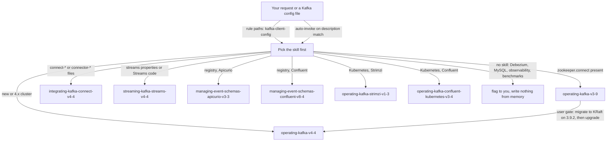

# kafka

Version-locked knowledge skills for running and building on self-managed Apache Kafka. It covers brokers, Kafka Connect, Kafka Streams, two schema registries and two Kubernetes operators. It is for engineers who run Kafka themselves and want answers tied to dated official sources, not model memory. You need it when you write or review Kafka configs, Compose files, Streams code, connectors or operator manifests.

> Version lock: Kafka 4.4.0 (KRaft) and 3.9.2 (ZooKeeper line), Kafka Connect and Streams 4.4.0, Apicurio Registry 3.3.x (pinned 3.3.4), Confluent Schema Registry 8.4.0, Strimzi 1.3.x, Confluent for Kubernetes 3.4.0. Research date 2026-11-04. One skill is one version: a new Kafka, registry or operator version needs a new skill.

## Contents

<!-- BEGIN GENERATED:contents -->
**Depends on:** `factory-core`  
**Used by:** none

| Type | Name | What it does |
|---|---|---|
| knowledge skill | [`integrating-kafka-connect-v4-4`](.apm/skills/integrating-kafka-connect-v4-4/SKILL.md) | Integrates Kafka Connect 4.4.0 distributed workers: internal topics, REST security, DLQ, exactly-once sources, plugins. |
| knowledge skill | [`managing-event-schemas-apicurio-v3-3`](.apm/skills/managing-event-schemas-apicurio-v3-3/SKILL.md) | Manages Kafka event schemas with Apicurio Registry 3.3.x (pinned 3.3.4): storage, rules, SerDes, security, upgrades. |
| knowledge skill | [`managing-event-schemas-confluent-v8-4`](.apm/skills/managing-event-schemas-confluent-v8-4/SKILL.md) | Manages Kafka schemas with Confluent Schema Registry 8.4.0: compatibility, _schemas topic, serdes, security, licensing. |
| knowledge skill | [`operating-kafka-confluent-kubernetes-v3-4`](.apm/skills/operating-kafka-confluent-kubernetes-v3-4/SKILL.md) | Operates Confluent for Kubernetes 3.4.0 (Confluent Platform 7.6-8.4): Helm, KRaft CRs, TLS, RBAC, storage, upgrades, licensing. |
| knowledge skill | [`operating-kafka-strimzi-v1-3`](.apm/skills/operating-kafka-strimzi-v1-3/SKILL.md) | Operates Kafka on Kubernetes with Strimzi 1.3.x (KRaft, v1 API): install, node pools, security, upgrades. |
| knowledge skill | [`operating-kafka-v3-9`](.apm/skills/operating-kafka-v3-9/SKILL.md) | Operates Apache Kafka 3.9.2 (last ZooKeeper line, ZK to KRaft migration) on Docker Compose. |
| knowledge skill | [`operating-kafka-v4-4`](.apm/skills/operating-kafka-v4-4/SKILL.md) | Operates Apache Kafka 4.4.0 (KRaft only) on Docker Compose: replication, security, upgrades incl. |
| knowledge skill | [`streaming-kafka-streams-v4-4`](.apm/skills/streaming-kafka-streams-v4-4/SKILL.md) | Builds Kafka Streams 4.4.0 applications in Java: topology, state stores, exactly_once_v2, error handlers, scaling, testing. |
| rule | [`kafka-client-config.instructions`](.apm/instructions/kafka-client-config.instructions.md) | Kafka config review checks: producer durability, listener security, authorizer/ACL, Connect errors and secrets, image pinning. |
<!-- END GENERATED:contents -->

## Installation

<!-- BEGIN GENERATED:installation -->
| Item | Value |
|---|---|
| Package name | `agents-factory-data-platform-kafka` |
| Version | `1.0.0` |
| Source folder | `packages/data-platform/streaming/kafka` |
| In this repository | listed directly in the root `apm.yml` |
| Also installs | `factory-core` |

Install it into another project, from that project's folder:

```bash
apm install <path-to-agents-factory>/packages/data-platform/streaming/kafka --target claude
```

Add `--dry-run` to preview the install. APM writes the skills, agents and rules into `.claude/`. Change the sources under `.apm/`, never the generated `.claude/`.
<!-- END GENERATED:installation -->

The package itself needs no runtime. The skills describe software you run yourself, so the sources state these prerequisites for that software, not for the package:

- Kafka 4.x brokers, Connect and tools need Java 17 or newer (17, 21 and 25 fully supported). Kafka 3.9 brokers support Java 8, 11, 17 and 21, with 25 best effort.
- Most skills assume Docker Compose (dev, CI, staging). The two operator skills assume Kubernetes: Strimzi 1.3.x needs Kubernetes 1.32 or newer, and Confluent for Kubernetes 3.4.0 supports Kubernetes 1.29 to 1.37.
- Kafka Streams uses the Maven coordinates `org.apache.kafka:kafka-streams:4.4.0` and, for tests, `org.apache.kafka:kafka-streams-test-utils:4.4.0`.

## Quick Start

This package has no command and no agent. Claude loads a skill when your request matches its description. A path-scoped rule, `kafka-client-config`, also loads when Claude reads a matching Kafka config file. Try one of these requests, copied from the skills' evaluation scenarios:

```text
Create an orders topic on our 3-broker Kafka 4.4 Compose cluster that must not lose acknowledged writes.
```

```text
Plan the ZooKeeper to KRaft migration of our 3.9 Compose cluster.
```

```text
Give me a production Kafka cluster on Strimzi 1.3.1 with dedicated controllers and brokers.
```

Name the version in your request. Each skill is locked to one version and refuses to answer for another.

## Usage Scenarios

### Scenario 1 - A durable topic on Kafka 4.4 (fastest default)

Use it for a new topic that must not lose acknowledged writes.

```text
Create an orders topic on our 3-broker Kafka 4.4 Compose cluster that must not lose acknowledged writes.
```

`operating-kafka-v4-4` answers. Its Never-Do tier forbids a topic with replication factor 3 and `min.insync.replicas=1`, so you get `min.insync.replicas=2`. It keeps `unclean.leader.election.enable` at `false`, the default. The rule `kafka-client-config` adds the producer side when you open a `producer.properties` file: it checks `acks` and idempotence against the skill's Always-Do tier.

### Scenario 2 - You did not say which registry or which Kafka (incomplete input)

Use it to see what comes back when the version or product is missing. This request is not taken from an evaluation scenario.

```text
Set the compatibility level for the orders-value schema.
```

The rule tells Claude to ask which registry you run, because `managing-event-schemas-apicurio-v3-3` and `managing-event-schemas-confluent-v8-4` are separate skills and each is out of scope for the other. Answer with the registry name, for example "Confluent Schema Registry 8.4". For a broker file, a `zookeeper.connect` line selects `operating-kafka-v3-9`; otherwise `operating-kafka-v4-4` applies.

### Scenario 3 - Malformed records in a Connect sink

Use it when a sink connector must keep running and you want the bad records kept.

```text
Some records in the orders topic are malformed. Keep the sink running and keep the bad ones.
```

`integrating-kafka-connect-v4-4` covers error handling: a deliberate error tolerance choice and a dead letter queue for bad records. It keeps `errors.log.include.messages=false` in production. Who owns the DLQ is an Ask-First item, so expect a question.

### Scenario 4 - Kafka 4.4 on Kubernetes (misuse of a skill)

Use it to see where the package stops.

```text
Run Kafka 4.4.0 on our Strimzi 1.3.1 operator by setting spec.kafka.version: 4.4.0.
```

`operating-kafka-strimzi-v1-3` refuses. Strimzi 1.3.0 supports Kafka 4.2.0 to 4.3.1 and 1.3.1 adds 4.3.2, not 4.4.0. You get 4.3.2 on 1.3.1. No skill establishes Kafka 4.4.0 on Kubernetes: Confluent for Kubernetes deploys Confluent Platform images, and which Kafka version Confluent Platform 8.4 bundles is `(unverified)`. `operating-kafka-v4-4` covers 4.4 on Docker Compose only.

### Scenario 5 - A product no skill covers (out of scope)

Use it to see the out-of-scope rule.

```text
Give me the Debezium PostgreSQL connector config for this worker.
```

Debezium is out of scope for `integrating-kafka-connect-v4-4`, and no other skill covers it. Claude flags the gap and does not write settings from memory. Ask for the worker config instead, or give Claude a Debezium source to work from. The same holds for MySQL, observability stacks and benchmarks.

### Scenario 6 - Quick fix that weakens security (misuse)

Use it to see the Never-Do tier at work.

```text
ACLs are blocking my team. Set allow.everyone.if.no.acl.found=true so it just works.
```

`operating-kafka-v4-4` keeps `StandardAuthorizer` with `super.users` on every node and `allow.everyone.if.no.acl.found` at `false` (one official page, medium confidence). The rule checks the same setting in broker files. Expect Claude to keep it `false` and ask whether ACL authorization should be enabled, not to flip the flag.

### Scenario 7 - Move off ZooKeeper (chaining)

Use it for a ZooKeeper cluster that must reach Kafka 4.x.

```text
Plan the ZooKeeper to KRaft migration of our 3.9 Compose cluster.
```

`operating-kafka-v3-9` plans the migration on 3.9.2, the bridge release. ZooKeeper was removed in 4.0.0, so a direct ZooKeeper-to-4.x upgrade is a Never-Do item. Once the cluster runs KRaft on 3.9, the upgrade to 4.4 is in `operating-kafka-v4-4`. Finalize is irreversible and the procedure rests on one official page (medium confidence), so expect the question "Is dual-write validated, and who signs off finalize?" before the finalize step.

### Scenario 8 - Old Streams configuration

Use it when you upgrade a Kafka Streams app to 4.4.

```text
Our old config has processing.guarantee=exactly_once_beta. Keep it and just bump to 4.4.
```

`streaming-kafka-streams-v4-4` refuses to keep `exactly_once` or `exactly_once_beta`, because EOS v1 was removed in 4.0. It uses `exactly_once_v2`. It also warns about APIs removed in 4.0 (`through`, `transform*`, old `process`, `branch`).

### Scenario 9 - Ship a very new registry release

Use it before a production rollout.

```text
Roll Schema Registry 8.4.0 into production this week.
```

`managing-event-schemas-confluent-v8-4` locks 8.4.0 (2026-10-27, medium confidence) and tells you to check for an 8.4.1 release before shipping, because unreleased 8.4.1 build tags already exist. It asks whether to ship now or wait, and checks that every client uses `kafka-schema-registry-client` 6.2 or later and that brokers are upgraded before Schema Registry (medium confidence). For Apicurio, the pinned version is 3.3.4 and the 3.4.x docs must not be mixed in.

## Skills Reference

Pick the skill by question:

| Question | Use | Why |
|---|---|---|
| ZooKeeper or KRaft? | A config with `zookeeper.connect`, or an existing ZooKeeper cluster: `operating-kafka-v3-9`. A new or 4.x cluster: `operating-kafka-v4-4`. | ZooKeeper was removed in 4.0.0. Migrate to KRaft on 3.9.2 first. |
| Apicurio or Confluent registry? | `managing-event-schemas-apicurio-v3-3` or `managing-event-schemas-confluent-v8-4` | Separate skills, each out of scope for the other. |
| Strimzi or Confluent for Kubernetes? | `operating-kafka-strimzi-v1-3` or `operating-kafka-confluent-kubernetes-v3-4` | Each is out of scope for the other. |
| Kafka 4.4.0 on Kubernetes? | No skill establishes it. | See Scenario 4. |
| Connect or Streams? | `integrating-kafka-connect-v4-4` (runtime) or `streaming-kafka-streams-v4-4` (Java library) | Neither covers broker operations. |

### `operating-kafka-v4-4`

*Operates Apache Kafka 4.4.0 (KRaft only) on Docker Compose.*

- **When it loads:** you run or upgrade Kafka 4.4 brokers: replication, security, upgrades including 3.9 to 4.4, disaster recovery.
- **What it locks:** Apache Kafka 4.4.0 (released 2026-10-22), KRaft only; Java 17+; images `apache/kafka:4.4.0` (JVM) and `apache/kafka-native:4.4.0` (dev and test only). `broker.id` and `kafka-broker-api-versions.sh` are deprecated for removal in 5.0. No official end-of-life table exists `(unverified)`.
- **What it never does:**
  - Apply the official Compose example defaults in production (RF 1, min ISR 1, logs in `/tmp`).
  - Create a topic with RF 3 and leave `min.insync.replicas=1`.
  - Enable `unclean.leader.election.enable`.
  - Stretch one cluster across datacenters.
  - Add ZooKeeper settings such as `zookeeper.connect`.
- **Example request:** "We run a static controller.quorum.voters quorum. Upgrade it to dynamic with no downtime."

### `operating-kafka-v3-9`

*Operates Apache Kafka 3.9.2, the last ZooKeeper line, and the ZooKeeper-to-KRaft migration on Docker Compose.*

- **When it loads:** you run or migrate 3.9 brokers, or a config contains `zookeeper.connect`.
- **What it locks:** Apache Kafka 3.9.2 (2026-02-21), listed as Archived; ZooKeeper 3.8.4 bundled; Java 8, 11, 17, 21 (25 best effort). ZooKeeper mode in the `apache/kafka:3.9.2` image needs a command override (medium confidence). Use it to migrate, not as a destination.
- **What it never does:**
  - Run production with `min.insync.replicas=1` and RF 1.
  - Copy the official Compose example's single-replica settings and `/tmp` log directory into a persistent cluster.
  - Enable `unclean.leader.election.enable` on durable topics.
  - Plan a direct ZooKeeper-to-4.x upgrade.
  - Plan to keep ZooKeeper mode as the destination.
- **Example request:** "We want to stay on Kafka 3.9 with ZooKeeper for the next two years. Is that supported?"

### `integrating-kafka-connect-v4-4`

*Integrates Kafka Connect 4.4.0 distributed workers.*

- **When it loads:** you run Connect workers: internal topics, REST security, DLQ, exactly-once sources, plugins.
- **What it locks:** Kafka Connect 4.4.0; Java 17+; Connect clients need protocol 2.1+ against 4.x brokers. New in 4.4.0: `internal.topics.automatic.creation.enable` and `connect-internal-topics.sh`. Running Connect from `apache/kafka:4.4.0` is not documented `(unverified)`. The `connect.protocol` default conflicts between two official pages `(medium confidence)`.
- **What it never does:**
  - Set `errors.log.include.messages=true` in production.
  - Inline a secret in a connector config (use a `${file:...}` config provider placeholder).
  - Open the REST port to untrusted networks without authentication.
  - Leave the override policy at `All` where untrusted users reach REST.
  - Use the deprecated `Principal` override policy (use `Allowlist`).
- **Example request:** "Write the worker config for a 4.4 Connect cluster on Compose that feeds a database sink."

### `streaming-kafka-streams-v4-4`

*Builds Kafka Streams 4.4.0 applications in Java.*

- **When it loads:** you write or review Streams code: topology, state stores, `exactly_once_v2`, error handlers, scaling, testing.
- **What it locks:** Kafka Streams 4.4.0 (client library, KRaft era); Java 17, 21, 25; `group.protocol=streams` needs brokers 4.2+ (static membership 4.4+); EOS v2 needs brokers 2.5+. Deprecated for removal in 5.0: `kafka-streams-scala`, headerless `StreamPartitioner#partitions`, `processing.exception.handler.global.enabled`. The 4.4 write-streams-app page shows a removed `Thread.UncaughtExceptionHandler` lambda.
- **What it never does:**
  - Set `processing.guarantee` to `exactly_once` or `exactly_once_beta`.
  - Leave a store iterator unclosed.
  - Rely on generated names, then roll out a changed topology.
  - Use APIs removed in 4.0 (`through`, `transform*`, old `process`, `branch`).
  - Call `KafkaStreams#cleanUp()` while the instance runs.
- **Example request:** "Write a Kafka Streams 4.4 app that counts orders per customer with exactly-once and exposes the count through an interactive query."

### `managing-event-schemas-apicurio-v3-3`

*Manages Kafka event schemas with Apicurio Registry 3.3.x.*

- **When it loads:** you run or review Apicurio Registry 3.3: storage, rules, SerDes, security, upgrades.
- **What it locks:** Apicurio Registry 3.3.x, pinned 3.3.4 (released 2026-11-03); images `apicurio/apicurio-registry:3.3.4` and `apicurio/apicurio-registry-ui:3.3.4`; Java SerDes `io.apicurio:apicurio-registry-avro-serde-kafka` 3.3.4; license Apache 2.0 read on `main`, not on the tag (medium confidence). Do not mix in 3.4.x docs. Compatibility with 3.9 brokers is not stated `(unverified)`.
- **What it never does:**
  - Put log compaction on KafkaSQL topics.
  - Run more than one replica on the default embedded H2.
  - Set a fixed KafkaSQL consumer group ID.
  - Use 2.x variable names (`REGISTRY_DATASOURCE_URL`, `AUTH_ENABLED`) on a 3.3 server.
  - Add an Avro field without a default under a BACKWARD-family rule.
- **Example request:** "Set up Apicurio Registry 3.3 for our shared staging environment with PostgreSQL and a login."

### `managing-event-schemas-confluent-v8-4`

*Manages Kafka schemas with Confluent Schema Registry 8.4.0.*

- **When it loads:** you run or review Confluent Schema Registry 8.4: compatibility, the `_schemas` topic, serdes, security, licensing.
- **What it locks:** Confluent Schema Registry 8.4.0 (2026-10-27, medium confidence); image `confluentinc/cp-schema-registry:8.4.0`; serdes `io.confluent:kafka-{avro,protobuf,json-schema}-serializer` 8.4.0 from `https://packages.confluent.io/maven/`; Java 25, 21, 17 with 21 recommended (medium confidence). Server under the Confluent Community License v1.0, listed client and serde modules under Apache 2.0 (medium confidence). Do not apply it to 8.5 or 7.x.
- **What it never does:**
  - Create `_schemas` with more than one partition or a delete cleanup policy.
  - Hard-delete (`?permanent=true`) without a soft delete first, or while the schema ID still occurs in topic data.
  - Configure ZooKeeper-based election with `kafkastore.connection.url`.
  - Assume RBAC, Schema Linking or Schema ID Validation work without a Confluent Enterprise license.
- **Example request:** "Give me a docker compose with Kafka and Confluent Schema Registry 8.4 for local development."

### `operating-kafka-strimzi-v1-3`

*Operates Kafka on Kubernetes with Strimzi 1.3.x (KRaft, v1 API).*

- **When it loads:** you deploy or review Strimzi 1.3: install, node pools, security, scaling, upgrades.
- **What it locks:** Strimzi 1.3.1 (tagged 2026-11-04, no versioned docs yet; docs evidence is 1.3.0 of 2026-10-12, so 1.3.1 defaults are inferred, `(unverified)`); Kubernetes 1.32 or newer; CRD API `kafka.strimzi.io/v1` only; KRaft only (ZooKeeper support removed in 0.46, medium confidence); Kafka 4.2.0 to 4.3.1 on 1.3.0, plus 4.3.2 on 1.3.1.
- **What it never does:**
  - Run or upgrade a ZooKeeper-based cluster with Strimzi 1.3.x.
  - Use `kafka.strimzi.io/v1beta2`, v1beta1 or v1alpha1.
  - Set `spec.kafka.version: 4.4.0` or any unsupported version.
  - Scale, rename or change the storage type of a controller pool.
  - Shrink a persistent volume or switch storage type after creation.
- **Example request:** "Scale the broker node pool from 4 to 3 replicas."

### `operating-kafka-confluent-kubernetes-v3-4`

*Operates Confluent for Kubernetes 3.4.0 (Confluent Platform 7.6 to 8.4).*

- **When it loads:** you deploy CFK or Confluent Platform 8.4 on Kubernetes: Helm, KRaft custom resources, TLS, RBAC, storage, upgrades, licensing.
- **What it locks:** CFK 3.4.0 (released 2026-10-28, standard support to 2028-10-28); Confluent Platform 7.6.x to 8.4.x; Kubernetes 1.29 to 1.37 (OpenShift 4.15 to 4.22); operator image `confluentinc/confluent-operator:0.2038.1` and init container `confluent-init-container:3.4.0`; KRaft required on 8.x. Source pages changed between 2026-10-27 and 2026-11-02. Cluster mode under CFK 3.4 is partly `(unverified)`. CFK 3.3.x supports CP 7.5 to 8.3 only.
- **What it never does:**
  - Upgrade a ZooKeeper-based deployment to Confluent Platform 8.x.
  - Upgrade CFK to 3.4.0 and leave the old init container image.
  - Upgrade to CFK 3.4.0 without checking broker and controller heap.
  - Run a one- or two-broker Kafka cluster under CFK (use `spec.replicas: 3` or more).
  - Keep deprecated pre-8.0 configurations when moving to CP 8.x.
- **Example request:** "We have no Confluent license key. Deploy with RBAC, Self-Balancing and Tiered Storage and assume everything works." CFK sits under the Confluent Platform subscription with a 30-day trial without a key (medium confidence), so the skill does not assume licensed features work.

### Rule `kafka-client-config`

It applies to `**/*kafka*.properties`, `**/server.properties`, `**/broker.properties`, `**/controller.properties`, `**/zookeeper.properties`, `**/producer.properties`, `**/consumer.properties`, `**/streams.properties`, `**/connect-*.properties`, `**/connect.properties`, `**/connect-*.json`, `**/connect.json` and `**/connector-*.json`.

- **Picks the skill first:** `zookeeper.connect` selects `operating-kafka-v3-9`, otherwise `operating-kafka-v4-4`; Connect files select the Connect skill; Streams properties select the Streams skill.
- **Always:** checks producer durability (`acks`, idempotence), replication factor and `min.insync.replicas`, encrypted listeners off-host, authorizer and ACL defaults, Connect REST exposure and override policy, Connect secrets as config-provider placeholders, Connect error handling and DLQ, Streams guarantees and exception handler keys, and pinned image tags.
- **Ask first:** anything a skill lists in its Ask First table, any `(unverified)` or `(medium confidence)` setting, moving a ZooKeeper config toward 4.x, Kafka version against operator support, registry choice and license-gated features.
- **Never:** copy official example defaults into a persistent or shared environment, inline a secret, turn on message logging for Connect errors in production, open the Connect REST port unauthenticated, mix ZooKeeper and KRaft-only settings, use removed or deprecated settings, write Debezium, MySQL, observability or benchmark settings from memory.
- **Verify:** it re-reads the skill's Always-Do and Never-Do tiers after editing and lists each check as pass, fail or unverified. It runs no cluster command on your behalf; it proposes the skill's verification command.
- **Not covered:** Kubernetes YAML custom resources, Compose files, Java code, registry config files with other names, and a Streams app that keeps settings in `application.properties` or in code. Ask for the skill directly in those cases.

## Architecture



## Agents Reference

This package ships no agent. The skills and the rule are used by whatever agent or session reads Kafka files.

<!-- BEGIN GENERATED:agents-reference -->
This package has no subagents. Claude loads its skills by description, and agents of other packages can load them too.
<!-- END GENERATED:agents-reference -->

## Output structure

The package writes no files. The skills and the rule produce configs, manifests and code in your project, as you request. Each skill keeps its unresolved source conflicts and unverified claims in its own `blueprints/unverified-and-risks.md`.

## Limits and constraints

| Item | Value |
|---|---|
| Research date | 2026-11-04 |
| Kafka 4.4.0 | released 2026-10-22; KRaft only; Java 17+ |
| Kafka 3.9.2 | released 2026-02-21; Archived; last ZooKeeper line; bridge release for the migration |
| Apicurio Registry | 3.3.x, pinned 3.3.4 (2026-11-03); 3.4.x docs exist and must not be mixed in |
| Confluent Schema Registry | 8.4.0 (2026-10-27, medium confidence); check for 8.4.1 before shipping |
| Strimzi | 1.3.x; 1.3.1 tagged 2026-11-04 with no versioned docs; supports Kafka 4.2.0 to 4.3.1, 1.3.1 adds 4.3.2; not 4.4.0 |
| Confluent for Kubernetes | 3.4.0 (2026-10-28); Confluent Platform 7.6.x to 8.4.x |
| Docker Compose files | inferred and unverified where a skill says so (Connect from `apache/kafka:4.4.0`, ZooKeeper mode from the stock 3.9.2 image, the Strimzi hardened overlay) |
| Out of scope | Debezium, MySQL, observability stacks, benchmarks; Kubernetes manifests beyond what the two operator skills cover |
| Very new versions | Kafka 4.4.0, Confluent Schema Registry 8.4.0, CFK 3.4.0, Apicurio 3.3.4 and Strimzi 1.3.1 are very new against the research date; re-check release notes |
| Licensing (medium confidence, not legal advice) | Confluent Schema Registry server: Confluent Community License v1.0; listed client and serde modules: Apache 2.0; RBAC plugins, Schema Linking and Schema ID Validation need a Confluent Enterprise license. CFK: Confluent Platform (Enterprise) subscription, 30-day trial without a key. Apicurio: Apache License 2.0, read on branch `main` |
| Support policy | best effort for the last 3 Kafka releases (medium confidence); no official end-of-life table `(unverified)` |

## Related

- [Platform software entry points](../../../../docs/entry-points/platform-software.md)
- [Knowledge base flow](../../../../docs/flows/knowledge-base.md)
- [Agent architecture](../../../../docs/agents/architecture.md)
- [Entry points](../../../../docs/entry-points/README.md)
- [Packages](../../../../docs/packages/README.md)
- [factory-core](../../../factory/factory-core/apm.yml) (dependency)
