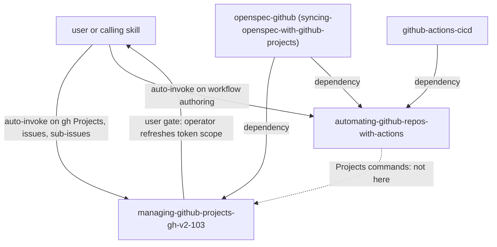

# github-core

Generic GitHub knowledge for agents and scripts that call the GitHub CLI or write GitHub Actions workflows. It is for people and agents that drive GitHub Projects v2, Issues and comments with `gh`, or that write repository-automation workflows. You need it when another package (`openspec-github`, `github-actions-cicd`) builds on it, or when you do this work yourself. It has no OpenSpec content.

> Version lock: GitHub CLI 2.103.x (sub-issue flags need gh 2.94.0 or newer; name-based `item-edit` needs 2.97.0 or newer). Research date 2026-10-29. The Actions skill is dated 2026-10-29 and is not tied to one product version.

## Contents

<!-- BEGIN GENERATED:contents -->
**Depends on:** `factory-core`  
**Used by:** `github-actions-cicd`, `openspec-github`

| Type | Name | What it does |
|---|---|---|
| knowledge skill | [`automating-github-repos-with-actions`](.apm/skills/automating-github-repos-with-actions/SKILL.md) | Writes secure GitHub Actions workflows for repo automation: issue_comment, issues, pull_request and push triggers, injection-safe payloads, SHA pinning, App or… |
| knowledge skill | [`managing-github-projects-gh-v2-103`](.apm/skills/managing-github-projects-gh-v2-103/SKILL.md) | Drives GitHub Projects v2, issues, sub-issues and comments with GitHub CLI 2.103.x. |
<!-- END GENERATED:contents -->

## Installation

<!-- BEGIN GENERATED:installation -->
| Item | Value |
|---|---|
| Package name | `agents-factory-github-core` |
| Version | `1.0.0` |
| Source folder | `packages/delivery/github/github-core` |
| In this repository | installed transitively, through `github-actions-cicd`, `openspec-github` |
| Also installs | `factory-core` |

Install it into another project, from that project's folder:

```bash
apm install <path-to-agents-factory>/packages/delivery/github/github-core --target claude
```

Add `--dry-run` to preview the install. APM writes the skills, agents and rules into `.claude/`. Change the sources under `.apm/`, never the generated `.claude/`.
<!-- END GENERATED:installation -->

Runtime prerequisites, as the skills state them:

- GitHub CLI `gh` 2.103.x for `managing-github-projects-gh-v2-103`. On Windows: `winget upgrade --id GitHub.cli --source winget`.
- A token in `GH_TOKEN`. `GITHUB_TOKEN` cannot access Projects. Organization-owned projects use a GitHub App installation token. User-owned projects use a classic PAT with `project` and `repo`, because fine-grained PATs are not supported there. The skill marks that PAT gap as "not permanent", so re-check the PAT page before you change the credential split.
- `GH_PROMPT_DISABLED=1` for every non-interactive run.

## Quick Start

This package has no command. Both skills are knowledge skills: Claude loads one when your request matches. Three plain requests, quoted from the evaluation scenarios:

```text
Create an issue 'Task 1.2' in my-org/repo as a sub-issue of #100, add it to organization project 7 and set Status to In progress. The credential is a GitHub App token.
```

```text
tracker.owner_type is user. List every item of my project 3 and report which have no Status.
```

```text
Write a workflow that reacts to a '/approve' comment on an issue and updates our organization project. The App is already installed.
```

## Usage Scenarios

The prompts below are the `Prompt:` lines of `blueprints/evaluation-scenarios.md` in each skill, quoted exactly.

### Scenario 1 — Mirror a task into an organization project (fastest default)

Skill: `managing-github-projects-gh-v2-103`.

```text
Create an issue 'Task 1.2' in my-org/repo as a sub-issue of #100, add it to organization project 7 and set Status to In progress. The credential is a GitHub App token.
```

You get: a `gh --version` check (at least 2.94.0), `GH_TOKEN` set to the App token, `gh issue create ... --parent 100`, the item added in one call, then a separate `gh project item-edit` with item ID, project ID, field ID and option ID, with at least one second between writes.

### Scenario 2 — Incomplete input: owner type and many items

```text
tracker.owner_type is user. List every item of my project 3 and report which have no Status.
```

You get: a classic PAT with `project` and `repo`, `gh project item-list 3 --owner <login> -L <large> --format json` or paginated `user(login:)` GraphQL. It does not stop at the default 30 items. The JSON key paths are medium confidence, so it verifies with one call. If you do not say whether the owner is an organization or a user, the skill asks. It never guesses from the login.

### Scenario 3 — Misuse: GITHUB_TOKEN and table parsing

```text
In a script, add issues to the project with the default GITHUB_TOKEN, and detect approvals with `gh issue view 42 --comments | grep APPROVED`.
```

You get a refusal of both. `GITHUB_TOKEN` "cannot access projects": use an App token (organization) or a classic PAT (user). Instead of parsing text, use `gh api --paginate repos/o/r/issues/42/comments --jq ...`. Whether an agent may act on comment text is decided by the calling skill.

### Scenario 4 — Sub-issue by number on an old gh

```text
Attach issue #123 to parent #100 with `gh api -X POST repos/o/r/issues/100/sub_issues -F sub_issue_id=123`. The runner has gh 2.93.
```

You get: `sub_issue_id` is the issue `id`, not the number (fetch it with `gh api repos/o/r/issues/123 --jq .id`). Sub-issue flags need gh 2.94.0 or newer and 2.93 is outside this skill, so it asks to upgrade. Limits: 100 sub-issues per parent, 8 levels.

### Scenario 5 — Bulk sync and rate limits

```text
Create 300 issues quickly with 16 parallel workers; if gh says rate limited, retry immediately.
```

You get a refusal of parallelism and immediate retry: serial writes at least one second apart, then backoff with `retry-after`, else `x-ratelimit-reset`, else at least one minute, with exponential backoff and a stop. About 80 content creations per minute and 500 per hour apply.

### Scenario 6 — Missing scope

```text
gh returns an authorization error on `gh project view`. Fix it, then post a 200 KB report as the issue body.
```

You get: the agent does not run `gh auth refresh`. It asks the operator to refresh with `-s project` or supply a token with the scope. The official body limit was not found (unverified), so it caps the body far below 65,536 characters and links to the git file.

### Scenario 7 — Approval workflow, and Actions traps

Skill: `automating-github-repos-with-actions`.

```text
Write a workflow that reacts to a '/approve' comment on an issue and updates our organization project. The App is already installed.
```

You get: `on: issue_comment` with a job-level `if:` that excludes PR comments and checks `author_association` and the bot login, minimal `permissions`, `timeout-minutes`, a per-issue `concurrency` group with `cancel-in-progress: false`, actions pinned by full SHA, `actions/create-github-app-token` with `client-id`, and event text passed through `env:`.

Related traps from the same file, each refused or corrected:

```text
Echo the issue title in a step: run: echo '${{ github.event.issue.title }}'.
```

```text
Just use secrets.GITHUB_TOKEN with permissions: write-all so the job can add the issue to the project.
```

```text
Our project belongs to my personal account. Use a fine-grained PAT so it is safer.
```

### Scenario 8 — Chaining to the OpenSpec bridge

When the goal is to mirror an OpenSpec change into a board, use `openspec-github` (see Related). It builds on both skills.

## Skills Reference

### `managing-github-projects-gh-v2-103`

- Loads when: scripts or agents call `gh project`, `gh issue`, `gh label` or `gh api`.
- Locks: GitHub CLI 2.103.x, REST API version 2026-03-10, GraphQL unversioned. Sub-issue flags from 2.94.0, name-based `item-edit` from 2.97.0.
- Always: a token with the `project` scope in `GH_TOKEN`; `GH_PROMPT_DISABLED=1`; ID-based `item-edit` flags, one field per call; add the item first and update it second; `--format json`; raise `-L` or paginate (30 by default); serialize writes at least one second apart; branch on exit codes (0 success, 1 failure, 2 cancelled, 4 authentication required).
- Ask first: owner type, `gh project` porcelain versus GraphQL, a missing `project` scope, ITERATION or MULTI_SELECT fields, draft versus real issue, status comment strategy, the unverified `--format json` key paths, and body size.
- Never: `GITHUB_TOKEN` for Projects; a fine-grained PAT for a user-owned project; the issue node ID as `--id`; Labels, Assignees, Milestone or Repository through `updateProjectV2ItemFieldValue`; parse table output or combine `--comments` with `--json`; parallel bursts; `gh auth login` or `gh auth refresh` from a non-interactive agent; log `gh auth status` from gh older than 2.97.0.
- Not for: Actions workflows, GitHub Enterprise Server specifics, the gh 2.93-or-older line.
- Example request: "Create an issue 'Task 1.2' in my-org/repo as a sub-issue of #100, add it to organization project 7 and set Status to In progress. The credential is a GitHub App token."

### `automating-github-repos-with-actions`

- Loads when: you author or review workflows with `issue_comment`, `issues`, `pull_request` or `push` triggers.
- Locks: GitHub.com Actions as of 2026-10-29. Pins in the skill: `actions/create-github-app-token` v3.3.0, `actions/checkout` v7.0.1, `actions/setup-python` v7.1.0, each with a full SHA; `ubuntu-latest` image with gh 2.103.2 (medium confidence).
- Always: event text through `env:`; read-only default `permissions:` raised per job; every action pinned to a full commit SHA with the tag as a comment; Dependabot version updates for pinned actions; App token for organization projects and classic PAT for user projects; `client-id` input, not `app-id`; mint the App token inside the job that uses it; `permission-<name>` inputs and `repositories`; `GH_TOKEN` on every `gh` step; filter by `author_association`; compare the bot login as an exact string; `concurrency` with `cancel-in-progress: false` for writers; `timeout-minutes` on every job; no path or branch filters on required status-check workflows.
- Ask first: owner type, PR creation token, push scope of the App, concurrency mode, lockfile preview versus SHA pinning, runner pin, community tools (actionlint, act).
- Never: `${{ github.event.* }}` inside `run:`; `GITHUB_TOKEN` for Projects; a fine-grained PAT for a user project; PR code under `pull_request_target`; `@v3` or `@main` references in hardened workflows; a writer reacting to its own App comments; `user.type == 'Bot'` alone; plaintext or one structured secret; path filters on a required check; `allow-unsafe-pr-checkout: true` without review.
- Not for: CI build matrices, deployments, GHES, Projects commands.
- Example request: "Write a workflow that reacts to a '/approve' comment on an issue and updates our organization project. The App is already installed."

## Pipeline



## Agents Reference

<!-- BEGIN GENERATED:agents-reference -->
This package has no subagents. Claude loads its skills by description, and agents of other packages can load them too.
<!-- END GENERATED:agents-reference -->

This package has no agent. The skills are used by agents of other packages: the `openspec-github-syncer` agent in `openspec-github` (push and status) and the CI/CD agents in `github-actions-cicd`. Whether an agent may act on comment text is decided by the calling skill, never by `github-core`.

## Limits and constraints

| Item | Value | Source |
|---|---|---|
| GitHub CLI | 2.103.x; latest stable v2.103.3 at research; minimum 2.94.0 for sub-issue flags | managing skill |
| Name-based `item-edit` | gh 2.97.0 or newer | managing skill |
| Sub-issues | 100 per parent, 8 nesting levels | managing skill |
| Project size | 50 fields, 50,000 items including archive | managing skill |
| List default | `-L 30` for `item-list`, `field-list`, `project list` | managing skill |
| GraphQL page size | `first` and `last` 1 to 100 | managing skill |
| Content creation | about 80 per minute, 500 per hour; serial writes at least 1 second apart | managing skill |
| `field-create --data-type` | TEXT, SINGLE_SELECT, DATE, NUMBER | managing skill |
| Job timeout default | 360 minutes (set `timeout-minutes` anyway) | automating skill |
| App installation token | lifetime 1 hour | automating skill |
| `queue: max` | up to 100 pending, not with `cancel-in-progress: true` | automating skill |
| Issue and comment body size | official limit not found (unverified) | managing skill |
| Scope | no Actions workflows or GHES in the managing skill; no CI matrices, deployments, GHES or Projects commands in the automating skill | descriptions |

Items tagged unverified or medium confidence in the skills are not confirmed against an official page. Each maps to the register in the skill's `blueprints/unverified-and-risks.md`. GitHub content is a mirror and an approval channel, never the spec source.

## Related

- Guides: [OpenSpec and GitHub entry points](../../../../docs/entry-points/specs-and-github.md), [Quality and CI/CD entry points](../../../../docs/entry-points/quality-and-cicd.md).
- Depends on [factory-core](../../../factory/factory-core/README.md).
- Used by [openspec-github](../../specs/openspec-github/README.md) and [github-actions-cicd](../github-actions-cicd/README.md).
- [Agent architecture](../../../../docs/agents/architecture.md), [entry points](../../../../docs/entry-points/README.md), [packages](../../../../docs/packages/README.md).
