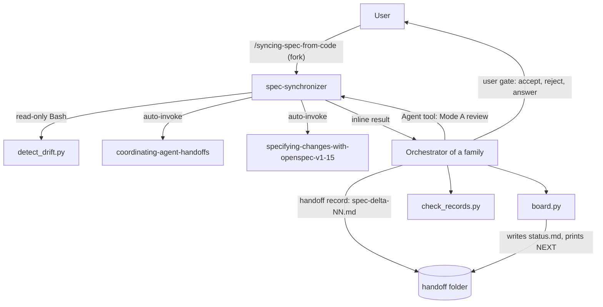

# handoff-core

The generic agent-handoff protocol v1, with its validating scripts and a spec-sync agent. Agents in a team never pass context through conversation history: every step is a typed record file in a handoff folder, and scripts do the mechanical work. You need this package when you build or run an agent family that exchanges work-orders, reports and reviews, or when you must bring an OpenSpec spec back in line with drifted code. The OCI and Quarkus/AWS families plug in as profiles of this protocol.

> Version lock: protocol v1 (set by `protocol_version` in the profile; a factory-own protocol, not an external standard). Scripts: Python standard library only (Python 3.8+ is unverified, register U1 of the skill).

## Contents

<!-- BEGIN GENERATED:contents -->
**Depends on:** `factory-core`, `openspec-core`  
**Used by:** `aws-architect`, `aws-lambda`, `aws-observability`, `aws-saas-serverless-quarkus-react-nextjs`, `nextjs-frontend`, `oci-core`, `openspec-github`, `openspec-poc`, `quarkus-aws`, `solution-architecture`, `terraform`, `ui-design`

| Type | Name | What it does |
|---|---|---|
| command | [`/syncing-spec-from-code`](.apm/skills/syncing-spec-from-code/SKILL.md) | Detects drift between code and the OpenSpec spec of a change and proposes a spec-delta plus open questions, without editing code or spec. |
| knowledge skill | [`coordinating-agent-handoffs`](.apm/skills/coordinating-agent-handoffs/SKILL.md) | File-based handoff protocol v1 for agent teams: typed records, handshake, parameterised retry limits with escalation, spec drift sync, validating scripts. |
| agent (sonnet) | [`spec-synchronizer`](.apm/agents/spec-synchronizer.agent.md) | Spec Synchronizer - reviews a spec (gaps, contradictions, testability, conflicts with accepted ADRs) and proposes OpenSpec spec-deltas when code has drifted fr… |
<!-- END GENERATED:contents -->

## Installation

<!-- BEGIN GENERATED:installation -->
| Item | Value |
|---|---|
| Package name | `agents-factory-handoff-core` |
| Version | `1.0.0` |
| Source folder | `packages/delivery/protocol/handoff-core` |
| In this repository | installed transitively, through `aws-architect`, `aws-lambda`, `aws-observability`, `aws-saas-serverless-quarkus-react-nextjs`, `nextjs-frontend`, `oci-core`, `openspec-github`, `openspec-poc`, `quarkus-aws`, `solution-architecture`, `terraform`, `ui-design` |
| Also installs | `factory-core`, `openspec-core` |

Install it into another project, from that project's folder:

```bash
apm install <path-to-agents-factory>/packages/delivery/protocol/handoff-core --target claude
```

Add `--dry-run` to preview the install. APM writes the skills, agents and rules into `.claude/`. Change the sources under `.apm/`, never the generated `.claude/`.
<!-- END GENERATED:installation -->

Runtime prerequisites:

- Python to run `check_records.py`, `board.py`, `detect_drift.py` and `portable.py` (standard library only).
- `git`, for `detect_drift.py`.
- Optional: the OpenSpec CLI. The agent runs `openspec validate` only when the CLI is present (Mode A).

## Quick Start

```
/syncing-spec-from-code list-tenant-items
```

The command resolves `openspec/changes/list-tenant-items/handoff`, looks for drift between the code and the spec, and returns a proposed spec-delta inline. It writes nothing. The orchestrator (or you) saves the result as `spec-delta-<nn>.md`.

## Usage Scenarios

### Scenario 1 — Drift in one requirement (fastest default run)

Code changed after the spec was written and you want a proposed fix for the spec.

```
/syncing-spec-from-code list-tenant-items
```

`detect_drift.py` exits 2 and lists the changed files. You get one `spec-delta-<nn>` record with `status: proposed`, a `## MODIFIED Requirements` entry that repeats the whole requirement block, and a `## Questions` section. The record ends with `Hand off: orchestrator - save spec-delta-<nn>.md ...`.

### Scenario 2 — Incomplete input: no baseline SHA, or no `status.md`

You run the command before the board has a synced commit, or on a folder without `status.md`.

```
/syncing-spec-from-code openspec/changes/list-tenant-items/handoff --repo ../saas-app
```

If `detect_drift.py` exits 1 because `lastSyncedSha` is missing, the agent returns the error with a hint: the orchestrator runs the baseline `board.py --sync-sha <sha>` first, then you re-run the command. If the handoff folder has no `status.md`, the agent returns a question (the right folder, or create it). Outside a git repository it asks for `--repo`. You answer the question and run the command again.

### Scenario 3 — No drift

The script exits 0 and every report with `spec_impact: divergence` or `ambiguity` is already listed in the `refs` of a `spec-delta`.

```
/syncing-spec-from-code list-tenant-items
```

The agent reports "no drift" and returns no delta. It scans the records as well as reading the script exit code.

### Scenario 4 — Drift hidden in a record (script exit 0)

`detect_drift.py` exits 0, but `result-03-code.md` has `spec_impact: divergence` and no `spec-delta` lists it in `refs`. The board counts this as drift.

```
/syncing-spec-from-code list-tenant-items
```

The agent does not stop at "no drift". It reads that report and the spec, and returns a `spec-delta-<nn>` whose `refs` include `result-03-code`.

### Scenario 5 — Delta conflicts with an accepted ADR

The drifted code polls, but an accepted ADR requires event-driven updates.

```
/syncing-spec-from-code list-tenant-items
```

The agent proposes the delta that describes the observed behavior. It names the ADR in `## Questions` and states that accepting the delta needs a new ADR. You decide; the agent never marks the delta accepted.

### Scenario 6 — Misuse: a family without a spec side

You point the command at an OCI capability. OCI profiles have `spec.kind: none`.

```
/syncing-spec-from-code func-api-facade --profile oci.yaml
```

The agent reads `spec.kind`, says the family has no spec side and stops. It runs no script and invents no spec. For OCI work, use the OCI handoff profile `coordinating-oci-handoffs` (in `oci-core`) instead of a spec sync.

### Scenario 7 — Hand-edited code, then archive

You changed code by hand and want to archive the change. Evaluation query: "I changed ItemsResource by hand and added a ?status=active filter. Archive the change."

```
/syncing-spec-from-code list-tenant-items
```

The orchestrator runs `detect_drift.py` with `--include-worktree` when the edit is not committed. Exit 2 lists the file as drift, so the board gets `drift=true`. The agent writes a delta, you accept, reject or answer it, and `board.py --sync-sha` records the new SHA. Only then are the gate checks run again. Do not edit the spec or archive before the delta is decided.

### Scenario 8 — Ask the protocol skill a question (no command)

You ask in plain text. The knowledge skill `coordinating-agent-handoffs` loads when your request matches its description. Queries from its evaluation scenarios:

```
Quarkus-style change: wo-01-code is done, result-01-code is success, review-01 is approved. What happens next and how do I record it?
```

```
review_rounds is 2 (profile default). Reviews 01 and 02 are changes-requested and the integrator just wrote a successful report. Who runs next?
```

```
OCI capability func-api-facade: deploy-report.md says failed. What does the deployer write and say?
```

The skill answers from the profile `next` rules and the board. A reached limit wins over a matching rule. In the OCI case (`user-mediated`, no spec) the deployer ends with one hand-off line naming the debugger; it does not launch it.

### Scenario 9 — Chaining

After the agent returns the delta, the orchestrator saves `spec-delta-<nn>.md`, runs `check_records.py`, then `board.py`, and acts on the `NEXT:` line. Once you accept the delta, `detect_drift.py` counts its `## Files` paths as covered.

## Commands Reference

### `/syncing-spec-from-code`

*Propose a spec-delta for code that drifted from the OpenSpec spec.*

The command forks (`context: fork`) to the `spec-synchronizer` agent and always runs its Mode B (sync). Mode A (spec review before approval) is the orchestrator's direct use of the agent, not this command. The command has `disable-model-invocation: true`, so you start it with `/syncing-spec-from-code`.

**Syntax:**

```
/syncing-spec-from-code <change-id or handoff dir> [--repo <path>] [--profile <yaml>]
```

**Parameters:**

| Parameter | Required | Default | Description |
|---|---|---|---|
| `<change-id or handoff dir>` | yes | none | A change id resolves to `openspec/changes/<change-id>/handoff` inside `--repo`. With `--profile`, the profile's `root` template resolves the id instead (for example `docs/handoff/{capability}`). A path that contains a `status.md` is used as the handoff directory. A relative path is resolved against `--repo`. |
| `--repo <path>` | no | the current working directory | Git repository root. |
| `--profile <yaml>` | no | not given | The family's `handoff-profile.yaml`. When given, the agent reads `spec.kind`; `none` means there is no spec side and the agent stops. When omitted, the agent cannot know `spec.kind` and relies on the orchestrator not routing `none` families here. |

**Prerequisites:**

- A git repository with history (`detect_drift.py` needs it).
- A handoff folder with a `status.md`. For code-drift detection, `status.md` must hold `lastSyncedSha`. The orchestrator sets it with the baseline `board.py --sync-sha <sha>`.
- The skills `coordinating-agent-handoffs` and `specifying-changes-with-openspec-v1-15` must be readable. If not, the agent stops and reports the failing path.

**What it does:**

1. **P0 Verify docs.** Reads the spec-sync blueprint of `coordinating-agent-handoffs` and the OpenSpec delta format skill.
2. **P1 Detect.** Two scans. Code drift: `detect_drift.py` (exit 0 none, 2 drift, 1 error). The agent adds `--include-worktree` while task code is uncommitted, or when the work-order says so, and states its choice in the output. Record drift: `report` and `diagnosis-report` records with `spec_impact` of `divergence` or `ambiguity` that no `spec-delta` lists in `refs`. If both are empty, it reports "no drift" and stops.
3. **P2 Analyse.** Reads the diff since `lastSyncedSha`, the spec, ADRs, reports (uncovered records first) and earlier deltas.
4. **P3 Propose.** Writes the delta in archive order: RENAMED, REMOVED (with Reason and Migration), MODIFIED (the whole requirement block), ADDED. Then `## Questions`. It puts the id of every uncovered record it resolves in `refs` and states `delta_revisions: <n>`.
5. **P4 Return.** Prints the full `spec-delta-<nn>` record inline with `status: proposed`.

**What is updated and what is not:**

- Updated: nothing on disk. The agent has no Write or Edit tool.
- Not touched: the live spec, the code, any record, `status.md`. The orchestrator saves the delta; you accept, reject or answer it.

**Output files:**

None written by the command. The returned record is saved by the orchestrator as `spec-delta-<nn>.md` in the handoff folder. It has frontmatter, the delta sections, `## Files` (recommended, not enforced by `check_records.py`; a delta without it covers no path) and `## Questions`. The last line is `Hand off: orchestrator - save spec-delta-<nn>.md and show it to the user. Context: <handoff dir>`.

**Examples:**

```
/syncing-spec-from-code list-tenant-items
```

```
/syncing-spec-from-code openspec/changes/list-tenant-items/handoff --repo ../saas-app
```

The second example runs `detect_drift.py ../saas-app --change ../saas-app/openspec/changes/list-tenant-items/handoff`.

```
/syncing-spec-from-code func-api-facade --profile oci.yaml
```

**Next:** the orchestrator saves the record, runs `check_records.py`, `board.py` and acts on `NEXT:`. After you accept the delta, `board.py --sync-sha <sha>` records the new baseline.

### Scripts (not commands)

The scripts live in `.apm/skills/coordinating-agent-handoffs/scripts/` and use only the standard library. None of them edits code or the spec. Run them with `python <script> ...`.

#### `check_records.py`

*Validates the records of a handoff folder against a family profile.*

```
python check_records.py <dir> --profile <yaml> [--override <yaml>]
```

| Parameter | Required | Default | Description |
|---|---|---|---|
| `dir` | yes | none | Handoff directory containing the records (`*.md`). |
| `--profile <yaml>` | yes | none | `handoff-profile.yaml` of the family. |
| `--override <yaml>` | no | none | Project override YAML (limits and quality only). |

Prints one `<file>: <message>` line per error. Exit 0 = all valid, 1 = at least one error.

#### `board.py`

*Computes counters, effective limits and the next action.*

```
python board.py <dir> --profile <yaml> [--override <yaml>] [--sync-sha <sha>] [--args k=v ...]
```

| Parameter | Required | Default | Description |
|---|---|---|---|
| `dir` | yes | none | Handoff directory containing the records. |
| `--profile <yaml>` | yes | none | `handoff-profile.yaml` of the family. |
| `--override <yaml>` | no | none | Project override YAML (limits and quality). |
| `--sync-sha <sha>` | no | none | Records this commit SHA as the last synced one. |
| `--args k=v ...` | no | none | Per-run parameters, for example `limits.review_rounds=4` or `drift=true`. Keep it last on the command line. |

Writes `<dir>/status.md` and prints one `NEXT:` line (`role=...`, `escalate`, `final-gate` or `none`). Exit 0 = ok, 1 = invalid profile, limits or directory. It has no dry-run mode.

#### `detect_drift.py`

*Lists files changed since the last synced SHA that no report or accepted spec-delta mentions.*

```
python detect_drift.py <repo> --change <handoff-dir> [--include-worktree]
```

| Parameter | Required | Default | Description |
|---|---|---|---|
| `repo` | yes | none | Git repository root. |
| `--change <handoff-dir>` | yes | none | Handoff directory holding `status.md` and the reports. |
| `--include-worktree` | no | off | Also checks uncommitted and untracked files. Without it only committed changes are seen. |

Prints one `DRIFT: <path>` line per file. Exit 0 = no drift, 2 = drift, 1 = error (git missing, no synced SHA, git failure). Before the baseline `board.py --sync-sha`, exit 1 is expected and does not mean "no drift".

#### `portable.py`

*Replaces `date -u` and `sha256sum` on any OS.*

```
python portable.py now | sha256 <file> | dirhash <dir>
```

Exit codes are not documented in the script.

Run order after each record: `check_records.py`, then `detect_drift.py`, then `board.py`, and act on `NEXT:`. Run `detect_drift.py` only for `spec.kind: openspec` families, after the baseline. Families with `spec.kind: none` (OCI) skip it. Tests: `python -m unittest discover -s scripts/tests` from the skill folder; two drift tests create a git repository in the temp directory and error out in sandboxes that forbid it.

## Architecture



The skill `coordinating-agent-handoffs` is the protocol. Families plug in through a profile (`handoff-profile.yaml`: roles, record names, `next` rules, limits, `spec.kind`).

### Protocol in short

- Record kinds: `work-order`, `report`, `review`, `deploy-report`, `diagnosis-report`, `spec-delta`, `escalation`, `verify`, `status`.
- Two modes: `user-mediated` (the user runs the next step) and `orchestrated` (the orchestrator follows the `NEXT:` line of `board.py`). Records are identical in both.
- Name report records `result-<nn>-<role>.md`. Do not start a record file name with `report` (a Claude Code write guard on such names was observed, unverified, register U2).
- Loops are bounded by parameters: `build_attempts`, `review_rounds`, `deploy_cycles`, `delta_revisions`, `record_rejections`.
- Precedence, most specific wins: profile default, then project `openspec/handoff-profile.yaml`, then run arguments such as `--args limits.review_rounds=4`. Values must be integers of at least 1. Setting a limit to `0` needs the user's explicit confirmation (`limits_zero_confirmed: true`).
- A reached limit gives `NEXT: escalate`. The orchestrator writes an `escalation` and records your reply verbatim.
- Each stage's `verify` comes from an agent other than the producer.

## Agents Reference

<!-- BEGIN GENERATED:agents-reference -->
| Agent | Model | Tools | Can start agents | Started by |
|---|---|---|---|---|
| [`spec-synchronizer`](.apm/agents/spec-synchronizer.agent.md) | sonnet | Read, Grep, Glob, Bash | no | `/syncing-spec-from-code` |
<!-- END GENERATED:agents-reference -->

### `spec-synchronizer`

- **Does:** reviews a spec (gaps, contradictions, testability, conflicts with accepted ADRs; Mode A, including a POC variant) and proposes spec-deltas when code drifted (Mode B).
- **Non-interactive contract:** returns its result inline; the orchestrator saves it. It has no Write or Edit tool on purpose. When input is missing it returns a question.
- **Never:** edit the spec or the code, decide acceptance, run `git add`, `commit`, `checkout` or `reset`, run `openspec archive`, `openspec init`, installers or any writing command, review work it authored in the same change, or launch other agents.
- **Bash limit:** read-only `git`, `portable.py`, `detect_drift.py` and `openspec validate`. This limit is an instruction in its prompt, not a tool restriction.
- **Mode A:** returns a `verify` record (`outcome: pass | fail`; `fail` when any HIGH finding exists).

## Output structure

The package writes no files on its own. In a family run, these files live in the handoff folder (`openspec/changes/<change-id>/handoff/` for the Quarkus/AWS family, `docs/handoff/{capability}` for OCI):

```
<handoff dir>/
├── wo-<nn>-<role>.md          work-orders
├── result-<nn>-<role>.md      reports
├── review-<nn>.md             reviews
├── verify-<...>.md            verify records
├── spec-delta-<nn>.md         saved by the orchestrator from the agent's inline output
├── escalation-<...>.md        written at a limit
└── status.md                  generated by board.py (only ## Approvals is hand-written)
```

File names follow the examples in the skill fixtures; the profile decides the exact names.

## Limits and constraints

| Item | Value |
|---|---|
| Protocol version | v1 (`protocol_version` in the profile) |
| Loop limits | `build_attempts`, `review_rounds`, `deploy_cycles`, `delta_revisions`, `record_rejections`; defaults come from the profile |
| Limit values | integers of at least 1; `0` behaves like `1` and needs `limits_zero_confirmed: true` after your confirmation |
| `check_records.py` exit | 0 valid, 1 errors |
| `board.py` exit | 0 ok, 1 invalid profile, limits or directory |
| `detect_drift.py` exit | 0 no drift, 2 drift, 1 error |
| Drift coverage | exact path match; only an accepted `spec-delta`'s `## Files` covers paths |
| Committed vs uncommitted | without `--include-worktree`, uncommitted edits are invisible |
| Scripts | standard library only; no dry-run mode |
| Stage ids E1-E9 in the skills | those of the Quarkus/AWS flow |
| Ask First | enabling the optional Stop drift hook; project-wide `--include-worktree` checks outside a run; accepting a delta that conflicts with an ADR |

## Related

- [Specs and GitHub entry points](../../../../docs/entry-points/specs-and-github.md)
- [Quality and CI/CD entry points](../../../../docs/entry-points/quality-and-cicd.md)
- [Spec from a POC flow](../../../../docs/flows/spec-from-poc.md)
- [Agent architecture](../../../../docs/agents/architecture.md)
- [Packages](../../../../docs/packages/README.md)
- Depends on [`factory-core`](../../../factory/factory-core/README.md) and [`openspec-core`](../../specs/openspec-core/README.md). The OpenSpec 1.15 skill lives there.
- Profiles plug in per family: `coordinating-oci-handoffs` (in `oci-core`) and `coordinating-quarkus-aws-handoffs` (in the SaaS package).
