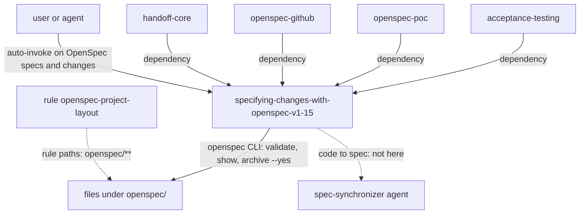

# openspec-core

Reusable OpenSpec 1.15.0 knowledge: the `openspec/` layout, the spec and delta format, `tasks.md` and the non-interactive `openspec` CLI. It is for agents and people who write or check OpenSpec specs and changes. You need it whenever another package works with OpenSpec, because those packages depend on it. It has no handoff or tracker content.

> Version lock: OpenSpec 1.15.0 (npm `@fission-ai/openspec`, repo `Fission-AI/OpenSpec` at tag `v1.15.0`), researched 2026-10-28. Node.js >= 20.19.0 for npm, pnpm, yarn and bun installs; the standalone binary needs no Node.js.

## Contents

<!-- BEGIN GENERATED:contents -->
**Depends on:** `factory-core`  
**Used by:** `acceptance-testing`, `handoff-core`, `openspec-github`, `openspec-poc`

| Type | Name | What it does |
|---|---|---|
| knowledge skill | [`specifying-changes-with-openspec-v1-15`](.apm/skills/specifying-changes-with-openspec-v1-15/SKILL.md) | Guides OpenSpec v1.15.0 spec-driven changes: openspec/ layout, spec and delta format, tasks.md and the openspec CLI (validate, show, archive) in non-interactiv… |
| rule | [`openspec-project-layout.instructions`](.apm/instructions/openspec-project-layout.instructions.md) | Layout of openspec/ for projects that also keep architecture, design and infrastructure decisions: what is official OpenSpec 1.15 and what is a factory convent… |
<!-- END GENERATED:contents -->

## Installation

<!-- BEGIN GENERATED:installation -->
| Item | Value |
|---|---|
| Package name | `agents-factory-openspec-core` |
| Version | `1.0.0` |
| Source folder | `packages/delivery/specs/openspec-core` |
| In this repository | installed transitively, through `acceptance-testing`, `handoff-core`, `openspec-github`, `openspec-poc` |
| Also installs | `factory-core` |

Install it into another project, from that project's folder:

```bash
apm install <path-to-agents-factory>/packages/delivery/specs/openspec-core --target claude
```

Add `--dry-run` to preview the install. APM writes the skills, agents and rules into `.claude/`. Change the sources under `.apm/`, never the generated `.claude/`.
<!-- END GENERATED:installation -->

Runtime prerequisite, as the skill states it: the `openspec` CLI at version 1.15.0. Channels are the standalone binary (checksum-verified, no Node.js), npm (Node.js 20.19.0 or newer) or a manual download. On Windows 10 and later the binaries are `openspec-windows-x64.exe` and `-arm64.exe`, plus a PowerShell installer. The skill never runs an installer without your explicit yes. Check the pin with `openspec --version` (medium confidence).

## Quick Start

This package has no command. The skill is a knowledge skill: Claude loads it when you write or check OpenSpec specs and changes. Two plain requests:

```text
Write an OpenSpec change add-2fa: rename Login to Password login, shorten the session timeout to 15 minutes, drop Legacy export and add a two-factor requirement. Then say how an agent validates and archives it.
```

```text
Review this delta: '## MODIFIED Requirements / ### Requirement: Session timeout / Change 30 minutes to 15 minutes.' and '## REMOVED Requirements / ### Requirement: Login' followed by '## ADDED Requirements / ### Requirement: Password login'.
```

## Usage Scenarios

The queries are the `query:` lines of `blueprints/evaluation-scenarios.md`, quoted exactly.

### Scenario 1 — A change with all delta types (fastest default)

```text
Write an OpenSpec change add-2fa: rename Login to Password login, shorten the session timeout to 15 minutes, drop Legacy export and add a two-factor requirement. Then say how an agent validates and archives it.
```

You get: `proposal.md` with `## Why` and `## What Changes`; a delta spec with RENAMED (FROM and TO lines), MODIFIED (the whole requirement with its scenarios), REMOVED (`**Reason**` and `**Migration**`) and ADDED sections; `tasks.md` with `- [ ] X.Y` checkboxes under `## N.` groups. Every requirement has SHALL or MUST and every scenario is `#### Scenario:` with bold WHEN and THEN bullets. The archive order is RENAMED, REMOVED, MODIFIED, ADDED (medium confidence). Validation runs as `openspec validate add-2fa --type change --strict --json --no-interactive` with the exit code as the gate (medium confidence), then `openspec archive add-2fa --yes`.

### Scenario 2 — Incomplete or conflicting sources

```text
The OpenSpec concepts page shows a proposal with Intent/Scope/Approach and plain WHEN/THEN bullets, and says SHOULD is fine. Which do I follow, and how do I read the validate --json result?
```

You get: the validator, schema and templates win, so use `## Why` and `## What Changes`, SHALL or MUST, and bold WHEN and THEN bullets. The skill says the `validate --json` shape differs between two doc pages (`results` and `summary` versus `items`, `summary` and `version`), so gate on the exit code, parse defensively, and offer to confirm against a 1.15.0 run (Ask First).

### Scenario 3 — Misuse: opsx commands and out-of-scope work

```text
Have the agent run /opsx:apply and /opsx:verify, install OpenSpec 1.9 for me, and also regenerate the specs from the Quarkus code.
```

You get a refusal. Agents in this factory use the OpenSpec format and the `openspec` CLI only. `/opsx:*` commands and the generated `openspec-*` skills are optional for a human. The skill is locked to 1.15.0, so OpenSpec 1.9 is out of scope. Code-to-spec work goes to the skill `syncing-spec-from-code` and the `spec-synchronizer` agent. No installer runs without your yes.

### Scenario 4 — Trap: partial MODIFIED and rename

```text
Review this delta: '## MODIFIED Requirements / ### Requirement: Session timeout / Change 30 minutes to 15 minutes.' and '## REMOVED Requirements / ### Requirement: Login' followed by '## ADDED Requirements / ### Requirement: Password login'.
```

You get: the MODIFIED body is flagged as partial, because archive replaces the whole requirement and "loses detail at archive time". It is rewritten with the SHALL sentence and the full scenario set. REMOVED plus ADDED becomes `## RENAMED Requirements` with FROM and TO lines, and content changes go under MODIFIED with the new header. REMOVED entries need `**Reason**` and `**Migration**`.

### Scenario 5 — Trap: archive in CI

```text
My CI job runs 'openspec archive' and 'openspec validate --all' and sometimes hangs. On Windows the archive sometimes fails to rename a folder. What should the script do?
```

You get: `openspec archive <id> --yes` with an explicit change name (without a terminal and `--yes`, archive "stops before changing anything" and exits 1); `openspec validate --all --strict --json --no-interactive`; `CI` or `OPEN_SPEC_INTERACTIVE=0`; decisions on exit codes 0 and 1 (medium confidence); the v1.13.2 Windows archive fix and the v1.14.3 `validate --all` hang fix (medium confidence); pin 1.15.0. After an `archive_error`, inspect the change, archive and specs before retrying.

### Scenario 6 — Unsettled behavior

```text
What exactly does 'openspec init --tools none' create, does 'openspec archive' take --json, does archive --yes proceed with unchecked tasks, and is OpenSpec 1.15 stable enough to pin for a year?
```

You get four `(unverified)` answers: what `--tools none` writes (a human runs `init` once and the script checks `openspec/specs` and `openspec/changes`); `archive --json` (read the exit code and the archive folder instead); `archive --yes` with incomplete tasks (check the tasks first); and no published stability policy, 8 releases in about 7 weeks, so pin 1.15.0 and re-check the releases page before an upgrade.

### Scenario 7 — Chaining

After the spec exists, derive acceptance tests with [acceptance-testing](../../../quality/acceptance-testing/README.md), mirror the change to a board with [openspec-github](../openspec-github/README.md), or draft specs from a POC with [openspec-poc](../openspec-poc/README.md).

## Skills Reference

### `specifying-changes-with-openspec-v1-15`

- Loads when: you write or check OpenSpec specs and changes, or run `openspec validate`, `show` or `archive`, including on Windows.
- Locks: OpenSpec 1.15.0 only. Scope is the format (layout, spec, delta, proposal, tasks) and the `openspec` CLI. No Quarkus or AWS content.
- Always: use the OpenSpec format and the `openspec` CLI only (never `/opsx:*`); where docs and validator conflict, follow `schema.yaml`, the templates and the validator; start every live spec with `## Purpose` and `## Requirements`; SHALL or MUST in every requirement; each scenario under `#### Scenario:` (four hashes); open every proposal with `## Why` and `## What Changes`; deltas under `## ADDED|MODIFIED|REMOVED|RENAMED Requirements`; MODIFIED is the whole block; tasks as `- [ ] X.Y` under `## N.`; archive with an explicit name and `--yes`; pin 1.15.0.
- Ask first: repo bootstrap (`openspec init`, `--tools none` versus `--tools claude`), install channel and pinning, sync during a change versus archive only, a change with no spec impact (a delta or `skip_specs: true`), the validate form and exit-code contract on first use, which result channel a script reads, and whether a human needs the expanded `/opsx` workflows.
- Never: a MODIFIED delta with only the changed words; rename with REMOVED plus ADDED; `openspec archive` in a script without a name or `--yes`; tell an agent to run `/opsx:archive` or any `/opsx:*` command; a requirement without SHALL or MUST; `## Intent`, `## Scope` or `## Approach` as proposal headings.
- Not for: `/opsx` commands, other OpenSpec versions, code-to-spec sync.
- Example request: "Review this delta: '## MODIFIED Requirements / ### Requirement: Session timeout / Change 30 minutes to 15 minutes.' and '## REMOVED Requirements / ### Requirement: Login' followed by '## ADDED Requirements / ### Requirement: Password login'."

### Rule `openspec-project-layout`

- Applies to (`applyTo`): `openspec/**`. The source file uses `applyTo:`. The installed `.claude/rules/` copy uses `paths:`.
- Enforces the factory convention for `openspec/`, kept apart from official OpenSpec 1.15: `specs/<capability>/spec.md` and the `architecture/`, `design/` and `infrastructure/` folders (each with its own `adr/`), `poc/<poc-id>/` as a draft area, and per change `design.md` as the index of `design/<flow>.md`, `infra-design.md` and `handoff/`.
- Each area has an author and an independent reviewer who is never the author. ADRs are numbered from `001` per folder, with front matter `id`, `title`, `area`, `status`, `author`, `reviewer`, and sections Context, Alternatives (at least 2), Decision, Consequences, Sources. Status flows `proposed`, `accepted` (only after the user approves; the coordinator records it), `superseded`. A violation of an accepted ADR, in any folder, is HIGH in reviews.
- Never: present the convention folders as official OpenSpec; read a `poc/<poc-id>/` draft as an approved requirement or an accepted ADR; number ADRs across folders or edit an `accepted` ADR in place (supersede it).
- Ask first: an ADR that conflicts with an accepted ADR in another folder; `openspec validate` rejecting a convention folder or extra file (the fallback is a minimal `spec.md` per folder).

## Architecture



## Agents Reference

<!-- BEGIN GENERATED:agents-reference -->
This package has no subagents. Claude loads its skills by description, and agents of other packages can load them too.
<!-- END GENERATED:agents-reference -->

This package has no agent. `spec-synchronizer` (in `handoff-core`) reviews specs and proposes spec-deltas, and `poc-spec-extractor` (in `openspec-poc`) drafts specs from a POC. Both use this skill's format.

## Output structure

The skill describes what the `openspec` CLI and the layout rule produce. The package writes nothing itself.

```text
openspec/
├── specs/
│   ├── <capability>/spec.md        live specs (official)
│   ├── architecture/               convention: spec.md, contracts/, adr/
│   ├── design/                     convention: design-system.md, navigation.md, wireframes/, adr/
│   └── infrastructure/             convention: spec.md, adr/
├── poc/<poc-id>/                   convention: draft area
└── changes/
    ├── <id>/                       proposal.md, design.md, tasks.md, specs/<capability>/spec.md,
    │                               optional .openspec.yaml; convention: design/, infra-design.md, handoff/
    └── archive/YYYY-MM-DD-<id>/    archive target (medium confidence)
```

## Limits and constraints

| Item | Value | Source |
|---|---|---|
| OpenSpec version | 1.15.0 only | skill |
| Node.js | >= 20.19.0 for npm, pnpm, yarn, bun installs | skill |
| Purpose minimum | 50 characters (warning) | skill |
| Why section | minimum 50 characters (error), maximum 1000 ("should not exceed") | skill |
| Requirement text | 500 characters, warning; `--strict` fails on it since v1.14.1 (medium confidence) | skill |
| Deltas per change | 10 ("Consider splitting"); severity unverified | skill |
| `validate --concurrency` | default 6, env `OPENSPEC_CONCURRENCY` (medium confidence) | skill |
| Exit codes | 0 success, 1 error, 130 for `config profile` cancelled (medium confidence) | skill |
| Non-interactive switches | `--no-interactive` on `show` and `validate`, `OPEN_SPEC_INTERACTIVE=0`, `CI` (medium confidence) | skill |
| Stability policy | none published (unverified); stores and worksets are beta | skill |
| Out of scope | `/opsx` commands, other versions, code-to-spec sync, Quarkus and AWS content | skill |

Items tagged `(unverified)` or `(medium confidence)` are listed in the skill's `blueprints/unverified-and-risks.md`.

## Related

- Guides: [OpenSpec and GitHub entry points](../../../../docs/entry-points/specs-and-github.md), [conventions](../../../../docs/reference/conventions.md).
- Depends on [factory-core](../../../factory/factory-core/README.md).
- Used by [handoff-core](../../protocol/handoff-core/README.md), [openspec-github](../openspec-github/README.md), [openspec-poc](../openspec-poc/README.md) and [acceptance-testing](../../../quality/acceptance-testing/README.md).
- [Agent architecture](../../../../docs/agents/architecture.md), [entry points](../../../../docs/entry-points/README.md), [packages](../../../../docs/packages/README.md).
