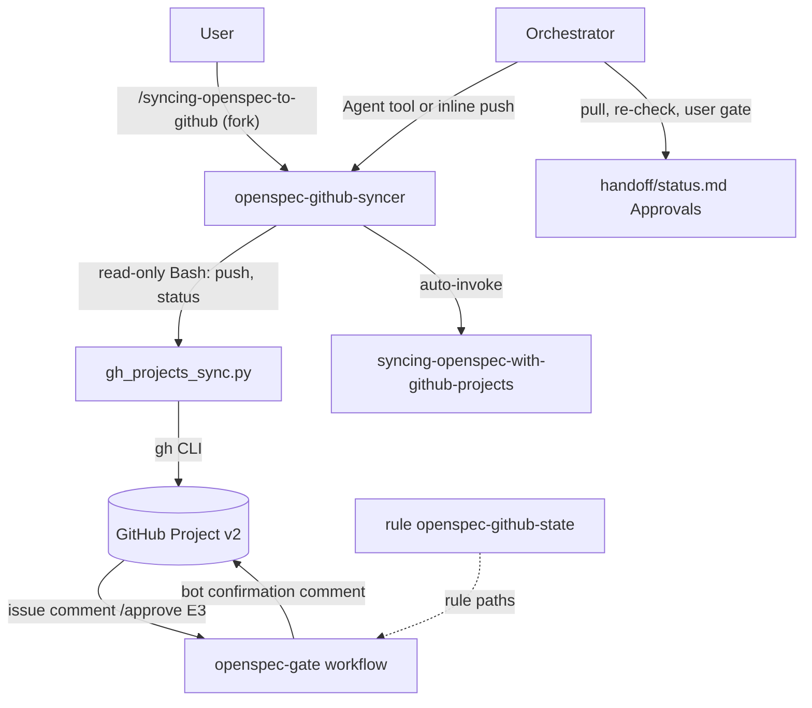

# openspec-github

The bridge between OpenSpec and GitHub Projects v2. It mirrors one OpenSpec change (issues, sub-issues, project fields, spec-delta comments) into a GitHub Project and can record gate approvals written as issue comments. It is for teams that want a board and an approval channel on GitHub while git stays the single source of truth. You need it when a change must be visible on a project board or approved from the browser. It is off by default (`tracker.kind: none`).

> Version lock: every claim applies to `gh` 2.103.x (minimum 2.94.0), GitHub Projects v2 and the workflow templates of the skill. Research date 2026-10-29. Items marked (unverified) or (medium confidence) in the skill's register are not confirmed against an official page.

## Contents

<!-- BEGIN GENERATED:contents -->
**Depends on:** `factory-core`, `openspec-core`, `handoff-core`, `github-core`  
**Used by:** `aws-saas-serverless-quarkus-react-nextjs`, [`spec-driven-delivery`](../../../bundles/spec-driven-delivery/README.md) (bundle)

| Type | Name | What it does |
|---|---|---|
| command | [`/syncing-openspec-to-github`](.apm/skills/syncing-openspec-to-github/SKILL.md) | Mirrors one OpenSpec change into its GitHub Project (issues, sub-issues, fields, delta comments) with a dry-run plan first and a status check. |
| knowledge skill | [`syncing-openspec-with-github-projects`](.apm/skills/syncing-openspec-with-github-projects/SKILL.md) | Mirrors an OpenSpec change into a GitHub Project v2 with gh 2.103.x (git stays canonical) and records gate approvals from issue comments checked by an Actions… |
| agent (sonnet) | [`openspec-github-syncer`](.apm/agents/openspec-github-syncer.agent.md) | OpenSpec GitHub Syncer - non-interactive executor that mirrors one OpenSpec change into its GitHub Project with gh_projects_sync.py (push and status only) and… |
| rule | [`openspec-github-state.instructions`](.apm/instructions/openspec-github-state.instructions.md) | Guardrails for the OpenSpec GitHub bridge files: the script-written github.yaml cache, the project tracker file and the openspec workflow files. |
<!-- END GENERATED:contents -->

## Installation

<!-- BEGIN GENERATED:installation -->
| Item | Value |
|---|---|
| Package name | `agents-factory-openspec-github` |
| Version | `1.0.0` |
| Source folder | `packages/delivery/specs/openspec-github` |
| In this repository | installed transitively, through `aws-saas-serverless-quarkus-react-nextjs` |
| Also installs | `factory-core`, `openspec-core`, `handoff-core`, `github-core` |

Install it into another project, from that project's folder:

```bash
apm install <path-to-agents-factory>/packages/delivery/specs/openspec-github --target claude
```

Add `--dry-run` to preview the install. APM writes the skills, agents and rules into `.claude/`. Change the sources under `.apm/`, never the generated `.claude/`.
<!-- END GENERATED:installation -->

Runtime prerequisites:

- Python (standard library only) to run `gh_projects_sync.py` and `gate_command.py`.
- The GitHub CLI `gh`, at least 2.94.0 (sub-issues); 2.103.x is the family pin. Use `OPENSPEC_GITHUB_GH` to point at another executable.
- A token in `GH_TOKEN` that matches the project owner type (see Credentials below). `GITHUB_TOKEN` cannot access projects.
- The handoff-core scripts (`_handoff_lib.py` and friends). The sync script finds them through `OPENSPEC_GITHUB_HANDOFF_SCRIPTS`, a vendored copy next to it, or the sibling skill `coordinating-agent-handoffs`. If none is found it exits 1 with the three fixes.
- A committed `openspec/github-tracker.yaml` (template: `assets/github.template.yaml`) or a `tracker:` block in the handoff profile.

## Quick Start

```
/syncing-openspec-to-github list-tenant-items --profile handoff-profile.yaml
```

This runs a dry-run `push` and a read-only `status` for the change `list-tenant-items`. Nothing is written to GitHub or to local files. You get `PLAN gh ...` lines, the planned write count and stage, and any `DIVERGE` lines.

## Usage Scenarios

### Scenario 1 — Safe default: dry-run plan

You want to see what the board refresh would change.

```
/syncing-openspec-to-github list-tenant-items --profile handoff-profile.yaml
```

The agent checks `gh --version` and `gh auth status`, runs `push` as a dry-run, runs `status`, and returns the `PLAN` lines, `planned N write(s); stage E<n>` and the divergence list. It ends with a `Hand off: orchestrator - ...` line. Without `--apply` it never writes.

### Scenario 2 — Apply the refresh

You reviewed the plan and want the writes.

```
/syncing-openspec-to-github list-tenant-items --profile handoff-profile.yaml --stage E3 --apply
```

A `--apply` typed by you counts as the relayed approval line. The agent still runs the dry-run first, then `push --apply`, then `status` (expect `IN SYNC`, exit 0). A second `push --apply` with no git change issues no write.

### Scenario 3 — Incomplete input: no profile, or a stage that differs

You leave out `--profile`, or you pass a `--stage` that is not the computed one.

```
/syncing-openspec-to-github list-tenant-items
```

The agent returns a question asking for the profile path. If your `--stage` differs from the computed stage, it returns that as a question too. Answer with the profile path or confirm the stage, then run the command again.

### Scenario 4 — Apply requested with no approval line

An agent-written brief asks for `push --apply` but carries no quoted user approval and no user-typed `--apply`.

The agent runs the dry-run only and returns a needs-input question asking the orchestrator for the relayed approval. It never grants itself approval.

### Scenario 5 — Misuse: read approvals or close the board

A brief says "run pull and record the E2 approval" (or "run pull --apply and tell me which gates were approved").

The agent refuses. `pull` is orchestrator-only because it turns GitHub comments into approvals. It offers `status` instead. `close` and `bootstrap` are also orchestrator-only. For generic Projects or Actions work, use `github-core` instead of this package.

### Scenario 6 — Tracker disabled

The profile has `tracker: {kind: none}`.

```
/syncing-openspec-to-github list-tenant-items --profile handoff-profile.yaml
```

The script prints `tracker disabled` and exits 3 before any `gh` call. The agent reports the exit code and stops. It does not try to enable the tracker.

### Scenario 7 — Approver's token, or an old `gh`

With `approval_source: github` and a `GH_TOKEN` whose login is in `approvers`, the script exits 1 ("the gh login ... is in tracker.approvers"). The agent returns the message and the fix (use a machine-user token locally and approve in the browser). It posts no comment. With `gh` 2.93.0 the preflight exits 1 (older than the required 2.94.0); upgrade to 2.103.x.

### Scenario 8 — Ask the knowledge skill (no command)

Plain-text requests load `syncing-openspec-with-github-projects`. Queries from its evaluation scenarios:

```
Mirror change list-tenant-items to the project
```

The skill explains that a dry-run `push` comes first, `--apply` needs the orchestrator's relayed approval line, and `status` should report `IN SYNC` afterwards.

Other cases it covers: a forged `/approve E3` from a login that is not in `approvers` (refused, nothing appended to `## Approvals`); `/approve E5` while the Stage field is E2 (refused as out of order); an approver who edits `/approve E2` into `/reject E2 no` after the confirmation (`pull` prints `REFUSED confirmation <id>` and writes nothing); a `bootstrap` request with `owner_type: user` (classic PAT with `project` and `repo`, risk warning, ask first).

### Scenario 9 — Chaining

The syncer agent runs `push` and `status`. The orchestrator runs `bootstrap` once, `pull` after an approver comments on GitHub, and `close` at the end. Workflows in the target repository validate gate comments, run spec CI, sync the board on push and archive by pull request.

## Commands Reference

### `/syncing-openspec-to-github`

*Mirror one OpenSpec change into its GitHub Project.*

The command forks (`context: fork`) to the `openspec-github-syncer` agent. It has `disable-model-invocation: true`, so you start it with `/syncing-openspec-to-github`. It runs `push` and `status` only. It suits a manual refresh or another orchestrator; the SaaS orchestrator `building-aws-saas-serverless-quarkus-react-nextjs` runs `push` inline.

**Syntax:**

```
/syncing-openspec-to-github <change-id> --profile <yaml> [--stage E<n>] [--apply]
```

**Parameters:**

| Parameter | Required | Default | Description |
|---|---|---|---|
| `<change-id>` | yes | none | The folder under `openspec/changes/`. |
| `--profile <yaml>` | yes | none | The family handoff profile. If missing, the agent asks. The repository root defaults to the current directory. |
| `--stage E<n>` | no | the computed Stage | Overrides the computed Stage (E1 to E9). If it differs from the computed one, the agent returns it as a question. |
| `--apply` | no | off (dry-run) | Applies the writes. Honored when the brief carries the orchestrator's relayed approval line; a `--apply` you type yourself counts as that line. Without either, the agent runs the dry-run and stops. |

**Prerequisites:**

- `tracker.kind` is not `none`, the project exists and `bootstrap` was run by the orchestrator (fields and labels exist).
- `gh` at least 2.94.0 and a valid `GH_TOKEN` for the owner type.
- With `approval_source` set to `github` or `both`, the token in `GH_TOKEN` must not belong to an approver (the script exits 1). App tokens work only inside Actions.
- The skill `syncing-openspec-with-github-projects` must be readable, or the agent stops.

**What it does:**

1. **P0.** Reads the skill (SKILL.md, CLI contract, approvals blueprint).
2. **P1.** `gh --version`, `gh auth status`, then `push` as a dry-run.
3. **P2.** With the relayed approval line (or your own `--apply`), runs `push --apply`. Otherwise it returns the plan.
4. **P3 Verify.** Runs `status`. After an apply, expect exit 0 (`IN SYNC`); otherwise it keeps every `DIVERGE` line.
5. **P4.** Returns the report and the `Hand off: orchestrator - ...` line.

Exit codes are returned as-is: 0 ok, 1 error, 2 divergence (a finding), 3 tracker disabled. It prints script `warning:` lines verbatim.

**What is updated and what is not:**

- Updated, only with `--apply`: the change issue, task, ADR and escalation sub-issues, project fields, spec-delta comments and the summary comment on GitHub, plus the local cache `openspec/changes/<id>/handoff/github.yaml` written by the script.
- Not touched: the spec, the code, `handoff/status.md` approvals, git history. The agent never runs `pull`, `close` or `bootstrap`, never edits files and never runs `git add`, `commit` or `push`.

**Output files:**

No file except the script's own `openspec/changes/<id>/handoff/github.yaml` on `--apply` (never edit it by hand). The reply lists the commands run with their exit codes, the `PLAN` or `APPLIED` lines (summarized when more than 20), the write count and stage, `DIVERGE` lines, warnings and needs-input questions.

**Examples:**

```
/syncing-openspec-to-github list-tenant-items --profile handoff-profile.yaml
```

```
/syncing-openspec-to-github list-tenant-items --profile handoff-profile.yaml --stage E3 --apply
```

**Next:** the orchestrator decides what to do with the divergence list, runs `pull` when approvals were given on GitHub, and `close` when the change is done.

### Script `gh_projects_sync.py`

*The engine behind the command. Dry-run by default.*

```
gh_projects_sync.py bootstrap [<repo-root>] --change <id> --profile <yaml> [--apply] [--install-workflows] [--vendor]
gh_projects_sync.py push      [<repo-root>] --change <id> --profile <yaml> [--stage E<n>] [--apply]
gh_projects_sync.py pull      [<repo-root>] --change <id> --profile <yaml> [--apply]
gh_projects_sync.py close     [<repo-root>] --change <id> --profile <yaml> [--apply]
gh_projects_sync.py status    [<repo-root>] --change <id> --profile <yaml>
```

| Command | Does | Who runs it |
|---|---|---|
| `bootstrap` | Creates missing Stage, Kind, Change and Gate fields and labels and caches their ids. `--vendor` copies the scripts. `--install-workflows` copies the four templates and also needs `--vendor`. | Orchestrator |
| `push` | Creates or updates the change issue, sub-issues, fields, spec-delta comments and the summary comment. | Agent (with the relayed approval line for `--apply`) or orchestrator |
| `pull` | Reads confirmations posted by `tracker.bot_login`, re-checks each user comment and, with `--apply`, appends gate approvals to `handoff/status.md` `## Approvals`. Delta and escalation decisions print as `DECISION <json>`. It refuses unless the profile and `openspec/github-tracker.yaml` are committed unchanged at HEAD. | Orchestrator only |
| `close` | Closes every mirrored issue and sets Status Done. | Orchestrator |
| `status` | Read-only. Prints `DIVERGE <key>: <what>` lines or `IN SYNC (stage E<n>)`. | Agent or orchestrator |

`<repo-root>` defaults to the current directory. `--profile` is required. Dry-run prints `PLAN gh ...` and writes nothing; `--apply` prints `APPLIED gh ...` and saves `handoff/github.yaml`. Exit 0 ok, 1 error, 2 divergence (`status`), 3 tracker disabled. Writes are serial with a pause after each (`OPENSPEC_GITHUB_WRITE_DELAY`, default 1.0 s).

### Script `gate_command.py`

*Evaluates gate commands from issue comments. Workflows run it, not you.*

Subcommands: `evaluate`, `recheck`, `check-patch`, `resolve-change` (see `--help`). The script's `--help` documents no exit codes. The first line of a comment is the command: `/approve E<n>`, `/reject E<n> <reason>`, `/accept delta-<nn>`, `/reject delta-<nn> <reason>`, `/revise delta-<nn> <answer>`, `/answer escalation-<nn> <text>`. Gates are E1, E2, E3, E5, E7 and E9. With `approval_source: chat` (the default) the workflow ignores commands and `pull` refuses.

### Credentials

| Project owner | Token | Notes |
|---|---|---|
| organization | GitHub App installation token (variable `OPENSPEC_APP_CLIENT_ID`, secret `OPENSPEC_APP_PRIVATE_KEY`) | Organization projects read and write. |
| user | Classic PAT with `project` and `repo` (secret `OPENSPEC_PROJECT_PAT`) | Broad scope: a risk warning prints on every run. Prefer an organization. |

Repository variables: `OPENSPEC_OWNER_TYPE`, `OPENSPEC_BOT_LOGIN`, optional `OPENSPEC_PROFILE`. `bot_login` must not be an approver. Details are in the skill's `blueprints/bootstrap-and-credentials.md`.

## Architecture



Git stays canonical. A GitHub comment is evidence, not approval: the gate workflow validates it, the orchestrator's `pull` re-validates it, and only the orchestrator writes the line into `handoff/status.md` `## Approvals`.

### What is mirrored

| Source in git | GitHub object |
|---|---|
| change `<id>` (`proposal.md`) | issue `change: <id>` plus project item |
| task (`tasks.md` group or work-order `task:` id) | sub-issue `task: <id> <title>` |
| ADR mentioned by the change | sub-issue |
| `escalation` record, or a report with `outcome: needs-input` | sub-issue (open: label `blocked`) |
| `spec-delta-NN` record | comment on the change issue |
| `handoff/status.md` | one summary comment on the change issue |

### Workflow templates

Installed by `bootstrap --install-workflows` from `assets/workflows/`:

| File | Trigger | Does |
|---|---|---|
| `openspec-gate.yml` | `issue_comment: created` | Validates gate commands, sets label, Gate field and a confirmation comment. |
| `openspec-ci.yml` | `pull_request` on `openspec/**` | `openspec validate`, `check_records.py`, `detect_drift.py` when `lastSyncedSha` is real. No secrets; never `pull_request_target`. |
| `openspec-board-sync.yml` | `push` on `openspec/**` (default branch only) | `push --apply` for each changed change. |
| `openspec-archive.yml` | `issues: labeled` with `gate:E9:approved` set by the bot | Authorizes, prepares and publishes an archive branch and pull request; never pushes the default branch. |

## Agents Reference

<!-- BEGIN GENERATED:agents-reference -->
| Agent | Model | Tools | Can start agents | Started by |
|---|---|---|---|---|
| [`openspec-github-syncer`](.apm/agents/openspec-github-syncer.agent.md) | sonnet | Read, Grep, Glob, Bash | no | `/syncing-openspec-to-github` |
<!-- END GENERATED:agents-reference -->

### `openspec-github-syncer`

- **Does:** runs `gh_projects_sync.py push` and `status` for one change and reports `PLAN` or `APPLIED` lines, exit codes and divergences.
- **Non-interactive contract:** it never talks to the user. It returns needs-input questions and a `Hand off: orchestrator - ...` line. Without a profile path it returns a question and stops.
- **Never:** run `pull`, `close` or `bootstrap`; apply without the relayed approval line; treat a GitHub comment as approval; edit files or run `git add`, `commit` or `push`; print tokens or use `gh auth status --show-token`; use `GITHUB_TOKEN` for Projects; launch other agents.
- **Bash limit:** an instruction in its prompt, not a tool restriction.

### Rule `openspec-github-state`

Applies to `**/openspec/**/github.yaml`, `**/openspec/github-tracker.yaml` and `**/workflows/openspec-*.yml`. `github.yaml` is written only by the script. Approvals reach `handoff/status.md` only through `pull`. `approval_source` stays `chat` until you choose otherwise. `bot_login` is never an approver. Workflows keep SHA pins, minimal `permissions:` and event text in `env:`. The source file uses `applyTo:`; the installed `.claude/rules/` copy uses `paths:`.

## Output structure

```
openspec/
├── github-tracker.yaml                      project values (from assets/github.template.yaml)
└── changes/<id>/handoff/
    ├── github.yaml                          cache written by the script on --apply
    └── status.md                            ## Approvals appended by the orchestrator's pull
.github/
├── workflows/openspec-*.yml                 installed by bootstrap --install-workflows
└── openspec-github/                         vendored scripts, installed by bootstrap --vendor
```

## Limits and constraints

| Item | Value |
|---|---|
| GitHub CLI | 2.103.x family pin; minimum 2.94.0 (sub-issues); 2.93.0 fails by design |
| Exit codes of `gh_projects_sync.py` | 0 ok, 1 error, 2 divergence (`status`), 3 tracker disabled |
| Mode | dry-run by default; `--apply` writes |
| Write pacing | `OPENSPEC_GITHUB_WRITE_DELAY`, default 1.0 s after each write |
| Rate-limit retries | at most 3 with exponential backoff (`OPENSPEC_GITHUB_BACKOFF_BASE`, default 60 s); text matching is unverified |
| Body length | truncated at 60,000 characters with a link to the file |
| Sub-issues per parent | up to 100 (GitHub docs) |
| Approval source | `chat` by default; `github` or `both` is Ask First |
| Gates | E1, E2, E3, E5, E7, E9 |
| `GITHUB_TOKEN` | cannot access Projects |
| Out of scope | generic Projects or Actions work (use `github-core`); the OCI family has no tracker support wired in (user-mediated, `spec.kind: none`) |
| Ask First | switching `owner_type` to `user`, changing `approval_source`, a workflow trigger or the credential path |
| Open items | a live smoke test on a sandbox repository is still open; see `blueprints/unverified-and-risks.md` |

## Related

- [Specs and GitHub entry points](../../../../docs/entry-points/specs-and-github.md)
- [Quality and CI/CD entry points](../../../../docs/entry-points/quality-and-cicd.md)
- [Spec from a POC flow](../../../../docs/flows/spec-from-poc.md)
- [Agent architecture](../../../../docs/agents/architecture.md)
- [Packages](../../../../docs/packages/README.md)
- Depends on [`factory-core`](../../../factory/factory-core/README.md), [`openspec-core`](../openspec-core/README.md), [`handoff-core`](../../protocol/handoff-core/README.md) and [`github-core`](../../github/github-core/README.md).
