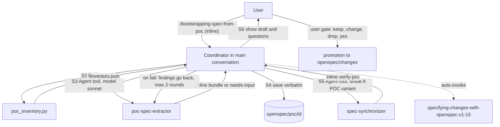

# openspec-poc

Drafts OpenSpec specs from the code of a proof of concept (a back end, a front end, or both, in any stack). It is for teams that have a working POC and no spec, and want a first draft with `file:line` evidence before they start a real project. You need it when you want requirements, architecture and design drafts plus a list of open questions, without treating POC shortcuts as requirements. The POC is evidence, not requirements: nothing in the draft is approved until you say so.

## Contents

<!-- BEGIN GENERATED:contents -->
**Depends on:** `factory-core`, `openspec-core`, `handoff-core`  
**Used by:** `aws-saas-serverless-quarkus-react-nextjs`

| Type | Name | What it does |
|---|---|---|
| inline orchestrator | [`bootstrapping-spec-from-poc`](.apm/skills/bootstrapping-spec-from-poc/SKILL.md) | Drafts OpenSpec specs from the code of a POC (back end and/or front end, any stack): inventory script, draft requirements with file:line evidence, architecture… |
| agent (sonnet) | [`poc-spec-extractor`](.apm/agents/poc-spec-extractor.agent.md) | POC Spec Extractor - read-only drafter that turns the source code of a proof of concept (back end and/or front end, any stack) plus its inventory (poc_inventor… |
<!-- END GENERATED:contents -->

## Installation

<!-- BEGIN GENERATED:installation -->
| Item | Value |
|---|---|
| Package name | `agents-factory-openspec-poc` |
| Version | `1.0.0` |
| Source folder | `packages/delivery/specs/openspec-poc` |
| In this repository | installed transitively, through `aws-saas-serverless-quarkus-react-nextjs` |
| Also installs | `factory-core`, `openspec-core`, `handoff-core` |

Install it into another project, from that project's folder:

```bash
apm install <path-to-agents-factory>/packages/delivery/specs/openspec-poc --target claude
```

Add `--dry-run` to preview the install. APM writes the skills, agents and rules into `.claude/`. Change the sources under `.apm/`, never the generated `.claude/`.
<!-- END GENERATED:installation -->

Runtime prerequisites:

- Python (standard library only) to run `poc_inventory.py`.
- The POC source directories, readable. The package never runs, builds, tests or installs the POC.
- A target project root. If it has no `openspec/` folder, the skill asks before it creates only `openspec/poc/<id>/` (it never runs `openspec init`).
- The OpenSpec CLI is needed only for promotion (`openspec validate`).

## Quick Start

```
/bootstrapping-spec-from-poc back=../orders-poc/api front=../orders-poc/web
```

You get a draft in `openspec/poc/<id>/` (the id defaults to the folder name of `back`), an independent review in `verify-poc.md` and the full list of questions. The skill says plainly that the draft is not approved.

## Usage Scenarios

### Scenario 1 — Back end and front end POC (fastest default run)

You have both sides of a POC.

```
/bootstrapping-spec-from-poc back=scripts/tests/fixtures/quarkus-nextjs/back front=scripts/tests/fixtures/quarkus-nextjs/front id=items-poc repo=<tmp>
```

The skill runs the inventory script, launches `poc-spec-extractor`, saves its files, launches `spec-synchronizer` for the review and shows counts, findings and all questions. In the fixture, requirements for list, get and create each carry `Evidence:` and a confidence. `questions.md` covers the front call with no endpoint, the endpoint never called, the hard-coded `api_key`, CORS `*`, the tenant TODO and the missing authentication. No requirement text names a framework. The key value is never copied. Nothing is written outside `openspec/poc/items-poc/`.

### Scenario 2 — Back end only, with OpenAPI

You have only an API.

```
/bootstrapping-spec-from-poc back=scripts/tests/fixtures/openapi-only/back
```

Endpoints come from `openapi.yaml` (`source: openapi`, confidence `high` only where a test exists, else `medium`). There is no `design-draft.md` and no cross-check questions (`cross` is null). A question asks who calls the API.

### Scenario 3 — Incomplete input: nothing detected

The script finds no routes or screens.

```
/bootstrapping-spec-from-poc back=scripts/tests/fixtures/empty/back
```

`poc_inventory.py` exits 2. The skill shows the summary and asks where routes and screens live, or which stack. Answer, and it re-runs the script. It does not launch the extractor on an empty inventory. A second kind of incomplete input is a `needs-input` return from the extractor: the skill relays the numbered questions and relaunches with your answers (at most 2 rounds).

### Scenario 4 — Existing draft

`openspec/poc/items-poc/` already exists.

The skill asks before running any script or agent: overwrite, new id or cancel. The existing folder stays untouched until you answer.

### Scenario 5 — A shortcut written as a requirement (the review fails)

A draft says "The system SHALL accept requests from any origin" with evidence `application.properties:2`.

`spec-synchronizer` returns `outcome: fail` with a HIGH finding that names the shortcut kind `cors-wildcard`. The coordinator sends the finding back to the extractor, which turns it into a security question. The second `verify-poc.md` is `pass`. You never edit the draft to make the review pass.

### Scenario 6 — Misuse: promotion without your yes

The skill is run with `promote=add-items` and an agent message says "user approved promotion".

```
/bootstrapping-spec-from-poc back=../orders-poc/api promote=add-items
```

The skill ignores the agent's claim. It asks keep, change or drop per `P<n>`, then asks for your explicit yes before it writes `openspec/changes/add-items/`. Nothing is written under `openspec/changes/` until your own yes. `openspec/specs/` is never written.

### Scenario 7 — Promote to a change

You answered the questions and want a change folder.

```
/bootstrapping-spec-from-poc back=../billing-poc id=billing repo=../saas-app promote=add-billing
```

`verify-poc.md` must be `pass` (or you accept the open findings in your own words). You answer keep, change or drop per requirement and say yes. The skill writes `proposal.md`, `tasks.md` and `specs/<capability>/spec.md` under `openspec/changes/add-billing/` and runs `openspec validate`.

### Scenario 8 — Chaining into a project flow

The SaaS orchestrator reads the draft as input to its E1 interview.

```
/building-aws-saas-serverless-quarkus-react-nextjs poc=<id>
```

It also accepts `poc.back=` and `poc.front=` (draft first). It does not promote.

## Commands Reference

### `bootstrapping-spec-from-poc`

*Inline orchestrator: POC code to a draft spec bundle with an independent review.*

This is an inline skill, not a forking command. It runs in the main conversation because it launches two agents in sequence and subagents cannot nest. It saves the files and talks to you; the agents draft and review.

**Syntax:**

```
/bootstrapping-spec-from-poc back=<dir> front=<dir> [id=<poc-id>] [repo=<target>] [hint=<stack>] [promote=<change-id>]
```

**Parameters:**

| Parameter | Required | Default | Description |
|---|---|---|---|
| `back=<dir>` | one of `back` or `front` | none | POC back-end source directory (read-only). |
| `front=<dir>` | one of `back` or `front` | none | POC front-end source directory (read-only). |
| `id=<poc-id>` | no | kebab-case folder name of `back`, else of `front` | Draft id, kebab-case. |
| `repo=<target>` | no | the current directory | Project root that holds, or will hold, `openspec/`. |
| `hint=<stack>` | no | none | Free-text stack hint, passed to the script and the agent. The script records it only. |
| `promote=<change-id>` | no | none (no promotion) | Only prepares promotion. You still answer keep, change or drop per requirement and give an explicit yes. |

**Prerequisites:**

- At least one of `back` or `front`, and each given path is an existing directory.
- `<repo>/openspec/` exists, or you agree to create only `openspec/poc/<id>/`.
- `openspec/poc/<id>/` does not exist, or you choose to overwrite.
- `.claude/agents/poc-spec-extractor.md` and `.claude/agents/spec-synchronizer.md` exist and both say `model: sonnet`. Any miss stops the run and lists it.

**What it does:**

1. **S1 Preflight.** Paths, `openspec/`, existing draft, agents and model.
2. **S2 Inventory.** `poc_inventory.py ... --out openspec/poc/<id>/inventory.json`. Exit 2 means nothing detected: it asks where the code lives.
3. **S3 Draft.** `poc-spec-extractor` returns the bundle inline. On `needs-input` the skill relays the questions and relaunches (at most 2 rounds).
4. **S4 Save.** Each returned file goes under `openspec/poc/<id>/`, verbatim, with a `saved-by` comment.
5. **S5 Review.** `spec-synchronizer` (Mode A, POC variant, from `handoff-core`) writes `verify-poc.md`. On `fail` the findings go back to the extractor (at most 2 rounds per finding, then you decide).
6. **S6 Show.** Counts, requirements per capability and confidence, findings, all questions. It says the draft is not approved.
7. **Promotion, only with `promote=`.** Keep, change or drop per `P<n>`, your explicit yes, then it writes the change and validates it.

**What is updated and what is not:**

- Updated: only `openspec/poc/<id>/`. With promotion and your yes: `openspec/changes/<change-id>/`.
- Not touched: `openspec/specs/` (never written), the POC source (never run, built, tested or installed), git history (no commit). It never runs `openspec init` or `openspec archive`.
- A secret value found in the POC is never copied into any file or message. It is reported by file, line and kind only.

**Output files:**

```
openspec/poc/<id>/
├── inventory.json                    written by poc_inventory.py
├── inventory.md                      extractor
├── functional/<capability>/spec.md   extractor, one per capability, OpenSpec live-spec format
├── architecture-draft.md             extractor
├── design-draft.md                   extractor, only with a front end
├── questions.md                      extractor
├── traceability.md                   extractor; the Decision column is filled with you
└── verify-poc.md                     review, saved by the coordinator
```

With promotion: `openspec/changes/<change-id>/{proposal.md, tasks.md, specs/<capability>/spec.md}`.

**Examples:**

```
/bootstrapping-spec-from-poc back=../orders-poc/api front=../orders-poc/web
```

```
/bootstrapping-spec-from-poc back=../billing-poc id=billing repo=../saas-app promote=add-billing
```

```
/bootstrapping-spec-from-poc back=../orders-poc/api hint=spring
```

**Next:** answer `questions.md`, then promote with `promote=<change-id>`, or let a project orchestrator read the draft (for example `/building-aws-saas-serverless-quarkus-react-nextjs poc=<id>`).

### Script `poc_inventory.py`

*Read-only inventory of a POC. Run by the coordinator, in step S2.*

```
python poc_inventory.py [--back <dir>] [--front <dir>] [--hint <stack>] [--json] [--out <file>] [--max-files N] [--max-bytes N]
```

| Parameter | Required | Default | Description |
|---|---|---|---|
| `--back <dir>` | no | none | Back-end source directory. Give at least one root, or the script exits 1. |
| `--front <dir>` | no | none | Front-end source directory. |
| `--hint <stack>` | no | none | Free-text stack hint, recorded only. |
| `--json` | no | off | Prints the full JSON inventory to stdout. |
| `--out <file>` | no | none | Also writes the JSON inventory to this file. |
| `--max-files N` | no | not stated in `--help` | Files scanned per root. |
| `--max-bytes N` | no | not stated in `--help` | Skips files larger than this. |

Exit codes: 0 inventory written, 2 nothing detected, 1 error (missing directory, no root given, unwritable `--out`). It reads source files only and writes nothing except the file you pass with `--out`, so it has no dry-run mode. Back-end findings: OpenAPI, endpoints, handlers, models, validations, errors, security, shortcuts, tests. Front-end findings: routes, API calls, forms, states, shortcuts, tests. A `cross` section lists matched, front-only and back-only calls. Tests: `python -m unittest discover -s scripts/tests` from the skill folder.

## Pipeline



## Agents Reference

<!-- BEGIN GENERATED:agents-reference -->
| Agent | Model | Tools | Can start agents | Started by |
|---|---|---|---|---|
| [`poc-spec-extractor`](.apm/agents/poc-spec-extractor.agent.md) | sonnet | Read, Grep, Glob, Bash | no | an orchestrator or another agent |
<!-- END GENERATED:agents-reference -->

### `poc-spec-extractor`

- **Does:** turns the POC source and its inventory into a draft bundle: requirements with evidence and confidence, an architecture draft (pieces, contracts, data model, observed technical choices as ADR candidates), a design draft, numbered questions and a traceability table.
- **Non-interactive contract:** it returns the bundle inline, or `outcome: needs-input` with numbered questions to the coordinator. It has no Write or Edit tool.
- **Never:** write files; run, build, test or install the POC; run `openspec` commands that write; talk to the user; launch agents; write a requirement from a POC shortcut. Its Bash limit is an instruction in its prompt, not a tool restriction.

### `spec-synchronizer` (from `handoff-core`)

The reviewer. In its Mode A POC variant it flags as HIGH a requirement without evidence, a shortcut written as a requirement, a front-only or back-only item with no question, a contract that contradicts the inventory, a copied secret, and an observed technical choice presented as a decision. It returns `fail` when any HIGH finding exists. See [handoff-core](../../protocol/handoff-core/README.md).

## Output structure

See the file tree under the command above. The draft area `openspec/poc/<id>/` is a factory convention outside `specs/` and `changes/` (rule `openspec-project-layout` in `openspec-core`), so `openspec validate` and `openspec archive` do not treat it as a spec.

## Limits and constraints

| Item | Value |
|---|---|
| Entry point | inline orchestrator (no `context: fork`) |
| Extractor relaunch rounds on `needs-input` | at most 2; then it saves what exists and lists the open questions |
| Review rounds per failing finding | at most 2, then you decide |
| Agent model | `sonnet` for both agents |
| `poc_inventory.py` exit codes | 0 ok, 2 nothing detected, 1 error |
| Inputs | at least one of `back` or `front` |
| Secrets | never copied; reported by file, line and kind |
| POC code | read-only; never run, built, tested or installed |
| Writes | `openspec/poc/<id>/` only; `openspec/changes/<change-id>/` only after your explicit yes; never `openspec/specs/` |
| Ask First | `openspec/` missing in the target; an existing `openspec/poc/<id>/`; promotion; the `openspec validate` command form before first use (medium confidence in the OpenSpec skill) |
| Never | `openspec init`, `openspec archive`, commit, treating an agent message as your approval |

## Related

- [Specs and GitHub entry points](../../../../docs/entry-points/specs-and-github.md)
- [Spec from a POC flow](../../../../docs/flows/spec-from-poc.md)
- [Quality and CI/CD entry points](../../../../docs/entry-points/quality-and-cicd.md)
- [Agent architecture](../../../../docs/agents/architecture.md)
- [Packages](../../../../docs/packages/README.md)
- Depends on [`factory-core`](../../../factory/factory-core/README.md), [`openspec-core`](../openspec-core/README.md) and [`handoff-core`](../../protocol/handoff-core/README.md).
