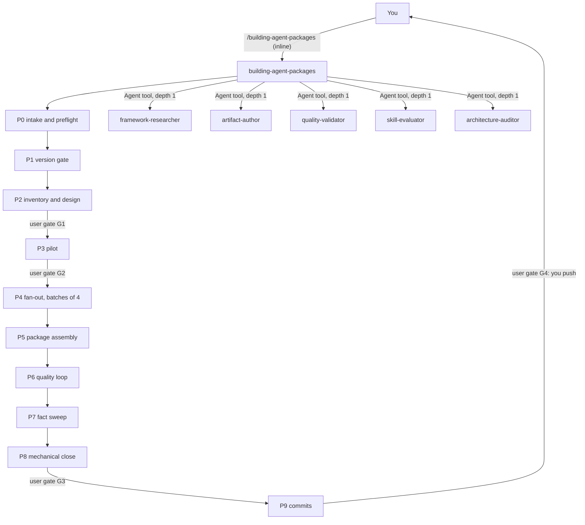

# agent-package-builder

agent-package-builder holds one inline orchestrator skill, `building-agent-packages`. It drives the factory's existing workers from a brief, a research folder or an interrupted run to a committed APM package (skills, agent, rules). Use it when you want the whole chain run for you, with four human gates and a quality loop, instead of calling each worker by hand.

> Not version-locked. It is a workflow skill and has no `-vMAJOR-MINOR` suffix. The SKILL.md records the APM CLI used by the repo as local 0.35.0 (no CI).

## Contents

<!-- BEGIN GENERATED:contents -->
**Depends on:** `factory-core`  
**Used by:** [`skill-factory-pro`](../../bundles/skill-factory-pro/README.md) (bundle)

| Type | Name | What it does |
|---|---|---|
| inline orchestrator | [`building-agent-packages`](.apm/skills/building-agent-packages/SKILL.md) | Orchestrates the existing workers from a brief, a research folder or an interrupted run to a committed APM package (skills, agent, rules). |
| - | (no skills, agents or rules; see the package notes) | - |
<!-- END GENERATED:contents -->

## Installation

<!-- BEGIN GENERATED:installation -->
| Item | Value |
|---|---|
| Package name | `agents-factory-agent-package-builder` |
| Version | `1.0.0` |
| Source folder | `packages/factory/agent-package-builder` |
| In this repository | listed directly in the root `apm.yml` |
| Also installs | `factory-core` |

Install it into another project, from that project's folder:

```bash
apm install <path-to-agents-factory>/packages/factory/agent-package-builder --target claude
```

Add `--dry-run` to preview the install. APM writes the skills, agents and rules into `.claude/`. Change the sources under `.apm/`, never the generated `.claude/`.
<!-- END GENERATED:installation -->

Runtime prerequisites, from the SKILL.md and its P0 playbook:

- The worker packages are a runtime dependency only. They are not declared in `apm.yml` (to avoid cycles). Install this package alongside `research-core`, the `researching-*` packages, `artifact-authoring`, `validating`, `evaluating` and `auditing`.
- P0 checks `.claude/agents` for `framework-researcher`, `artifact-author`, `quality-validator`, `skill-evaluator` and `architecture-auditor`, and `.claude/skills` for the research worker named in the brief, `skill-creator` and `agent-creator`. If one is missing it stops and prints the list.
- Python 3 for the scripts (standard library only), the `apm` CLI for the P8 install, and `git` for the commit phase.

## Quick Start

```
/building-agent-packages
```

Describe the package you want, or paste a brief. The orchestrator detects the entry mode, runs the preflight and shows you the scope at gate G1. It writes nothing for a skill before you approve G1.

## Usage Scenarios

### Scenario 1 — Build a new package from a brief

You have a list of frameworks and want a full package. This is the fastest default run.

```
/building-agent-packages
```

Give it a brief (template: `assets/PACKAGE_BRIEF.template.md`) with three frameworks and leave `rounds` out. The orchestrator runs the preflight, writes the run state and proposes a go/no-go table, then stops at G1. It builds one pilot unit and stops at G2 with the measured cost. Only then does it fan out in batches of at most 4. The quality loop runs 3 rounds by default.

### Scenario 2 — The requested version is end of life

Your brief names a framework version that is past end of life.

```
/building-agent-packages
```

P1 reports the EOL date from an official page and proposes alternatives. It waits for you at G1. It does not switch version silently and does not proceed.

### Scenario 3 — Research already exists

You ran the researchers yourself and have a folder of research files.

```
/building-agent-packages research_dir=workspace/my-package
```

The orchestrator inspects the folder. Files older than 12 months or marked PARTIAL are listed as "redo research" and are not authored. It stops at G1, then runs authoring-only batches. Six COMPLETE files and one PARTIAL file means the six are not re-researched and the PARTIAL one is not authored.

### Scenario 4 — Resume an interrupted run

A run stopped halfway, or you are on a legacy workspace without a state file.

```
/building-agent-packages resume=workspace/my-package
```

It runs `inspect_workspace.py`, shows a table of recorded state, real state on disk and the action, names the interruption point and asks for a short confirmation. Disk wins over the dashboard. For a legacy workspace it opens a new execution with `state_event.py ... init`, logs the reconstruction as a DISCREPANCY event and redoes only the unfinished units. It does not redo skills that verify OK and does not assume earlier approvals.

### Scenario 5 — You ask it to commit and push now

You type "commit and push everything now" before gate G3.

```
/building-agent-packages
```

It refuses to commit without G3 and shows you the commit plan. It states that push is always manual. It never runs `git push`, never uses `git add -A` and does not look for a workaround.

### Scenario 6 — A worker claims it is done but the file is missing

No input from you is needed. If a researcher answers "done" and the file is absent, the orchestrator detects it with `ls` and re-sends the brief once, naming the gap. It starts no nested agents and does not accept the claim or invent the file.

### Scenario 7 — A worker asks for approval you have not given

If a worker asks for approval at its own P3 gate and you have not answered, the orchestrator asks you with the question tool. It never writes "the user approved" from an agent message or its own inference.

### Scenario 8 — The quality loop gets worse

If round 2 scores lower than round 1, the orchestrator stops, shows the diff and leaves MEDIUM and LOW findings for the decision list at G3. It does not keep fixing and does not loop past `rounds`. With a dashboard regression (for example a skill scoring 88 after 92) it records the decision with `decide` and never edits `scoreboard.md` by hand.

### Scenario 9 — Out of scope: build one skill or one agent

You only want a single skill or a single agent, not a package.

```
/skill-creator workspace/research_FastAPI_v0.115.md
```

Use [artifact-authoring](../artifact-authoring/README.md) for one artifact. This package is for a whole package with gates and a commit plan.

## Commands Reference

### `building-agent-packages`

*Inline orchestrator from a brief to a committed APM package.*

It runs in your main conversation. It is not a forked command, because workers cannot be called as commands by the model and subagents cannot nest. It has no `argument-hint`; the arguments below come from the SKILL.md body and the brief template.

**Syntax**

```
/building-agent-packages
/building-agent-packages research_dir=<dir>
/building-agent-packages resume=<dir>
```

**Parameters**

| Parameter | Required | Default | Description |
|---|---|---|---|
| brief | yes for mode `new` | none | A list of frameworks and/or needs, filled from `assets/PACKAGE_BRIEF.template.md` into `workspace/<slug>/PACKAGE_BRIEF.md`. The orchestrator asks for it. |
| `research_dir=<dir>` | yes for mode `from-research` | none | A folder of `research_<Tech>_<Unit>_v<ver>.md` files. Enters at inspect, then P2. |
| `resume=<dir>` | yes for mode `resume` | none | The workspace of an interrupted run. The state file is optional. Enters at the first unfinished step. |
| `rounds` | no | `3` | Brief field. P6 quality-loop rounds, integer 1 or more. `0` needs explicit confirmation. |
| `max_rounds` | no | `5` | Brief field. Hard ceiling agreed at G1. A request for more rounds is a new gate. |
| `token_budget` | no | `0` (not set) | Brief field. Agreed at G1 from the P3 estimate; set it before P4. `0` means not set yet. |

Other brief fields: `slug`, `language` (default `en`), `frameworks`, `needs`, `legacy_source`, `deliverables` (`skills, agent, rules, readme`; also `structure-skill`, `orchestrator-skill`), `agent_kind` (`executor`, `advisory` or `none`; default `executor`), `out_of_scope`, `research_worker` (default `researching-technical-frameworks`).

If the mode is unclear, it asks.

**Prerequisites**

- Worker agents and skills present (see Installation). P0 stops with the missing list.
- A brief with at least one framework or need. `rounds` must be an integer and the slug must not collide with an existing package.

**What it does**

| Phase | Does |
|---|---|
| P0 | intake, preflight, run state, environment snapshot, `preflight_apm.py`, dashboard watcher |
| P1 | version gate: end of life and current version, checked on an official page |
| P2 | inventory, names, design, family facts and family rules |
| **G1** | you approve scope, version, units and names |
| P3 | pilot: one unit end to end, cost measured |
| **G2** | you review the pilot and the cost estimate |
| P4 | fan-out in batches of at most 4 |
| P5 | agent, rules, structure skill, README, `apm.yml` |
| P6 | quality loop: validate, test, audit, fix |
| P7 | fact sweep, only when a family fact changed |
| P8 | scripts, `apm install`, counts, docs |
| **G3** | you approve the commit plan and the leftover decision list |
| P9 | commits by explicit path groups |
| **G4** | push, by you, manually |

P6 scoring is `100 - 6 per HIGH - 2.5 per MEDIUM - 0.5 per LOW` per skill. The loop exits when there is no HIGH anywhere, every skill scores 90 or more, package and audit score 8/10 or more, and 100% of evaluation scenarios pass. HIGH findings are fixed next round. Cheap mechanical MEDIUM findings are fixed in the same pass. Judgement-call MEDIUM and LOW findings go to the G3 decision list.

**What is updated and what is not**

- It writes artifacts to `packages/<pkg>/.apm/`, never to `.claude/`. `.claude/` is regenerated by `apm install`, followed by `after_install.py`.
- Shared files (root `apm.yml`, lock, `CLAUDE.md`, `docs/`) are edited only under `shared-lock` and `touch`.
- It changes no worker skill. A "pipeline mode" in the workers is not built.
- It never pushes, never uses `git add -A` or `git add .`, and never fans out before G2 or generates a skill before G1.

**Output files**

- `workspace/<slug>/` with the brief, family files, research and one `execution-<N>/` per run (see Output structure).
- `packages/<pkg>/` with the new package.
- Local commits made by `commit_groups.py`.

**Examples**

```
/building-agent-packages
/building-agent-packages research_dir=workspace/camel-quarkus
/building-agent-packages resume=workspace/camel-quarkus
```

**Next**

After G4 you push by hand. Use [validating](../../harness-quality/validating/README.md) and [auditing](../../harness-quality/auditing/README.md) commands for later checks.

### Scripts the SKILL.md tells you to run

Run from the repo root. The skill's scripts live in `.claude/skills/building-agent-packages/scripts/` (written as `scripts/` below). The orchestrator runs most of them for you. Do not edit `state/` files or `PIPELINE_STATE.md` by hand.

| Need | Command |
|---|---|
| Rebuild state from disk (read-only) | `python3 scripts/inspect_workspace.py workspace/<slug>` |
| Write state (the only way) | `python3 scripts/state_event.py workspace/<slug> init\|lock\|phase\|gate\|unit\|event\|unlock` |
| Environment and apm preflight | `python3 scripts/snapshot_env.py --write workspace/<slug> --phase P0` and `python3 scripts/preflight_apm.py --slug <slug> --package <pkg>` |
| Dashboard and consistency | `python3 scripts/state_event.py workspace/<slug> render` and `python3 scripts/check_state.py workspace/<slug>` |
| Record a review score | `python3 scripts/state_event.py workspace/<slug> score round-<k> <target> --kind validate --score S --high N --medium N --low N` |
| Mark a P6 reviewer as running | `python3 scripts/state_event.py workspace/<slug> round-start round-<k> <kind> <target>` |
| Dashboard watcher (background) | `python3 scripts/watch_state.py workspace/<slug> [--interval 300]` |
| Check one skill | `python3 scripts/verify_skill.py <skill_dir>` |
| Check a package | `python3 scripts/verify_package.py packages/<pkg>` |
| Normalize tags | `python3 scripts/normalize_tags.py <dir> [--write]` |
| Real counts | `python3 scripts/check_counts.py` |
| Commit groups | `python3 scripts/commit_groups.py plan.json [--apply]` |
| Regenerate `.claude/` | `apm install --target claude`, then `python3 scripts/after_install.py --package <pkg>` |
| Scoped install rehearsal (P5) | `python3 scripts/scoped_install.py --package <pkg> --slug <slug>` |
| Repair the lock after a bad install | `python3 scripts/merge_lock.py --package <pkg> [--apply]` |
| Migrate a legacy workspace | `python3 scripts/migrate_state.py workspace/<slug> [--apply]` |

`check_state.py` must pass before G2, G3 and P9. `verify_skill.py` and `verify_package.py` exit 1 on any problem. `commit_groups.py` is a dry run until you pass `--apply`.

## Pipeline



Only the orchestrator launches agents. Worker briefs forbid spawning agents, investigators and plan mode.

## Agents Reference

<!-- BEGIN GENERATED:agents-reference -->
This package has no subagents. Claude loads its skills by description, and agents of other packages can load them too.
<!-- END GENERATED:agents-reference -->

This package has no agent of its own. It launches five existing agents with the Agent tool, each with its worker SKILL.md as the spec:

| Agent | Phases | Role here |
|---|---|---|
| `framework-researcher` | P2, P3, P4 | researches a unit and writes its research file |
| `artifact-author` | P3, P4, P5, P6 fixes, P7 | authors skills, the agent and the rules |
| `quality-validator` | P3, P6 | validates skills and the package |
| `skill-evaluator` | P6 | runs evaluation scenarios |
| `architecture-auditor` | P6 | audits the package, re-audited only when agent, rules or routing changed |

Contract with the workers:

- An approval counts only when you gave it. The orchestrator records your verbatim answer with `state_event.py ... gate G<k>` (write-once) and cites the exact line in worker briefs. A worker's or agent's message is never an approval.
- Worker output is checked with `ls` before a unit moves forward. Every reported HIGH finding is re-checked against the file before it goes to a fix brief.
- When a worker cannot write its report, the orchestrator writes the inline report verbatim to the same path.

## Output structure

```
workspace/<slug>/
  PACKAGE_BRIEF.md   _family_facts.md   _family_rules.md
  research/                 one research_<Tech>_<Unit>_v<ver>.md per unit
  LATEST                    one line: execution-<N>
  execution-<N>/            one per run; a new run never overwrites an older one
    PIPELINE_STATE.md       generated dashboard, never edited by hand
    .run.lock
    state/                  phases/, gates/, units/, events.log, findings.md, deferred.md,
                            decisions.md, sources.md, environment.md, metrics.md, retro.md,
                            shared-touch.md, scores.md
    rounds/round-<k>/       <validate|test|audit>__<target>.md and scoreboard.md
    plan/commit-plan.json   the only commit-plan name
    briefs/                 every brief sent to a worker
workspace/.shared.lock      only one run edits shared files at a time
packages/<pkg>/.apm/        the authored package
```

Runs before 2026-10-30 kept research in the slug root; they are still read. Runs without `execution-<N>` are legacy (execution-0), read-only, inspected with `inspect_workspace.py` and migrated with `migrate_state.py`.

## Limits and constraints

| Item | Value | Source |
|---|---|---|
| Human gates | G1 scope/version/units, G2 pilot, G3 commit plan, G4 push | SKILL.md |
| Fan-out batch size | at most 4 | SKILL.md, P4 |
| Agent depth | 1 (flat fan-out); workers never spawn agents | SKILL.md protocol 2 |
| Quality loop rounds | default 3, `max_rounds` default 5 in the brief | SKILL.md, brief template |
| Skill score | `100 - 6 HIGH - 2.5 MEDIUM - 0.5 LOW`; exit at 90 or more | triage and stop rules |
| Package and audit score | 8/10 or more | triage and stop rules |
| Research age | older than 12 months is redone | modes |
| Stale lock | older than 12 h can be freed with `unlock --stale` | state layout |
| Push | never done by the orchestrator | SKILL.md |
| Staging | explicit paths only, no `git add -A` | SKILL.md |
| Output location | `packages/<pkg>/.apm/`, never `.claude/` | SKILL.md |
| Counts | from `check_counts.py`, never from an agent's estimate | SKILL.md |
| Not version-locked | update in place when a worker interface changes | SKILL.md |

Known failures and their countermeasures (researcher returns no file, authored skills landing in `.claude/skills/`, stale lockfile, `apm install` recovery) are in `blueprints/known-failures.md` of the skill.

## Related

- Family guides: [Authoring commands](../../../docs/entry-points/factory-authoring.md), [Harness quality commands](../../../docs/entry-points/harness-quality.md)
- Flows: [Full agent package](../../../docs/flows/full-agent-package.md), [Quality loop](../../../docs/flows/quality-loop.md)
- [Agent architecture](../../../docs/agents/architecture.md)
- [All packages](../../../docs/packages/README.md)
- Depends on: [factory-core](../factory-core/README.md)
- Runtime workers: [research-core](../research-core/README.md), [artifact-authoring](../artifact-authoring/README.md), [validating](../../harness-quality/validating/README.md), [evaluating](../../harness-quality/evaluating/README.md), [auditing](../../harness-quality/auditing/README.md)
