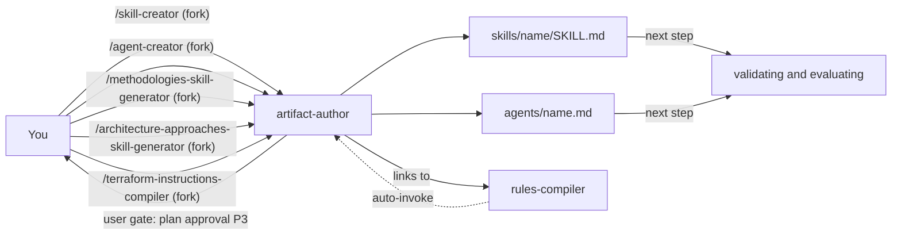

# artifact-authoring

artifact-authoring turns research into factory artifacts: skills, subagents and rules. It is for you if you add or change anything under a package's `.apm/`. You need it when you have a research file, a methodology or an agent idea and want a file that follows the house standard.

> Source of truth: you edit artifacts under `packages/**/.apm/`, never the generated `.claude/`. The `artifact-author` agent names `.claude/skills/<skill-name>/` as its output path, so move the result into the owning package before you commit.

## Contents

<!-- BEGIN GENERATED:contents -->
**Depends on:** `factory-core`  
**Used by:** `terraform`, [`skill-factory-pro`](../../bundles/skill-factory-pro/README.md) (bundle)

| Type | Name | What it does |
|---|---|---|
| command | [`/agent-creator`](.apm/skills/agent-creator/SKILL.md) | Creates a Claude Code subagent (.claude/agents/<name>.md) from a validated template — persona, P0–P5 workflow, tools whitelist, and model pin. |
| command | [`/architecture-approaches-skill-generator`](.apm/skills/architecture-approaches-skill-generator/SKILL.md) | Researches a system-architecture methodology/notation and generates an operational SKILL.md for producing correct architecture artifacts. |
| command | [`/methodologies-skill-generator`](.apm/skills/methodologies-skill-generator/SKILL.md) | Researches an engineering/process methodology and generates an operational SKILL.md for producing correct artifacts. |
| command | [`/skill-creator`](.apm/skills/skill-creator/SKILL.md) | Creates Agent Skills (SKILL.md) from a research_[TECH]_v[VERSION].md file following official Claude best practices and team conventions. |
| knowledge skill | [`rules-compiler`](.apm/skills/rules-compiler/SKILL.md) | Reference for the generic 5-phase workflow (load research → interview → plan → generate → validate) that a domain-specific `<domain>-instructions-compiler` ski… |
| agent (sonnet) | [`artifact-author`](.apm/agents/artifact-author.agent.md) | Skill & Instructions Author — turns validated research into production-ready SKILL.md and rules/instructions artifacts following official Claude best practices… |
<!-- END GENERATED:contents -->

## Installation

<!-- BEGIN GENERATED:installation -->
| Item | Value |
|---|---|
| Package name | `agents-factory-artifact-authoring` |
| Version | `1.0.0` |
| Source folder | `packages/factory/artifact-authoring` |
| In this repository | listed directly in the root `apm.yml` |
| Also installs | `factory-core` |

Install it into another project, from that project's folder:

```bash
apm install <path-to-agents-factory>/packages/factory/artifact-authoring --target claude
```

Add `--dry-run` to preview the install. APM writes the skills, agents and rules into `.claude/`. Change the sources under `.apm/`, never the generated `.claude/`.
<!-- END GENERATED:installation -->

No runtime prerequisites are stated in the sources. The commands read and write files only. Researching a technology needs web access, which belongs to [researching-frameworks](../researching-frameworks/README.md). `/methodologies-skill-generator` and `/architecture-approaches-skill-generator` research their subject themselves before they write.

## Quick Start

```
/skill-creator workspace/research_FastAPI_v0.115.md
```

The command forks into the `artifact-author` agent. It reads the research file, picks a skill template, shows you a plan and waits for your approval, then writes the `SKILL.md` and `blueprints/evaluation-scenarios.md`.

## Usage Scenarios

### Scenario 1 — Turn a finished research file into a skill

You have a `research_<Tech>_v<Version>.md` from a researcher command.

```
/skill-creator workspace/research_FastAPI_v0.104.1.md
```

You get `.claude/skills/fastapi-async-api/SKILL.md` and `.claude/skills/fastapi-async-api/blueprints/evaluation-scenarios.md`. The skill name, technology and version come from the research file path and metadata. The SKILL.md has all three tiers (Always Do, Ask First, Never Do), a Verification Loop and an External Resources section, and stays under 500 lines.

### Scenario 2 — The research file is incomplete

Your research file has no `Domain_Complexity` field, or no source bibliography.

```
/skill-creator workspace/research_Redis_v7.2.md
```

Without `Domain_Complexity`, the command assesses the tier (Foundational, Standard or Complex) from the content and sets the number of patterns by what the domain needs, not by a template minimum. If the `Source_Bibliography` section is missing, it names the gap and asks you to choose: pause and supply the bibliography, or create the skill with an External Resources section marked `UNVERIFIED — sources required`. It never invents URLs.

### Scenario 3 — Misuse: no research file, or an opinion source

You point the command at a file that does not exist, or you want a skill from one blog post.

```
/skill-creator workspace/research_NonExistent_v1.0.md
```

The command stops at step 1, names the missing path and tells you to run a researcher command first (for example `/researching-technical-frameworks`). It writes nothing. A request such as "I found a great Medium article about FastAPI best practices from 2022. Can you use it to create a FastAPI skill directly? No need for a formal research file." is declined for the same reason: a community blog is below official documentation in the source hierarchy, and a 2022 article may be older than 12 months. Run `/researching-technical-frameworks FastAPI <current version>` first, then `/skill-creator` on its output.

### Scenario 4 — Create a subagent

You want a new subagent for a domain role.

```
/agent-creator kubernetes-reviewer
```

The command reads the agent decision tree first, proposes `TEMPLATE.AGENT.md` (executes and writes) unless you signal advisory or orchestrator, and writes `.claude/agents/kubernetes-reviewer.md` with a minimal `tools:` list. It then checks that at least one skill carries `agent: kubernetes-reviewer`, or flags that none does yet.

### Scenario 5 — The agent shape is ambiguous, or you ask for too many tools

```
/agent-creator cost-analyzer
```

The command asks whether `cost-analyzer` should write output (standard template) or only recommend (advisory template). It does not default to the orchestrator template because the domain sounds complex. If you ask for a blanket tool list, as in `/agent-creator log-auditor — give it Read, Grep, Glob, Bash, WebSearch, WebFetch, Agent, Write, Edit, EnterPlanMode, ExitPlanMode just in case it needs them later`, it pushes back, cites the rule against declared-but-unused tools and proposes a minimal whitelist.

### Scenario 6 — Out of scope: a skill request sent to `/agent-creator`

```
/agent-creator create a new SKILL.md for researching GraphQL
```

The command declines. It creates `.claude/agents/<name>.md`, not a SKILL.md. Use `/skill-creator` instead, after a research step.

### Scenario 7 — Research and write a methodology skill in one step

You want a skill for an engineering or process methodology and have no research file.

```
/methodologies-skill-generator scrum
```

The command classifies the methodology, researches it against a source hierarchy, and generates the skill with its evaluation scenarios. If the edition is not stated, it asks first. The evaluation scenario for "Generate a SKILL.md for Scrum for a 6-person backend team." expects a question about Scrum Guide 2017 versus 2020 and a skill pinned to one edition, with no silent mixing.

### Scenario 8 — Research and write an architecture-approach skill

```
/architecture-approaches-skill-generator event-driven
```

The command classifies the subject (diagram notation, API specification, architecture decision, pattern catalog, framework, domain modeling or quality model), maps abstraction levels and produces the skill. For "Generate a SKILL.md for microservices event sourcing. My main source is this Medium blog post from 2019: https://medium.com/some-post. Use that as the basis." it rejects the blog as a Tier 5 source, names better sources and records the rejection under Research Gaps.

### Scenario 9 — Chain to validation

After any authoring command, check the output with commands from [validating](../../harness-quality/validating/README.md) and [evaluating](../../harness-quality/evaluating/README.md).

```
/skill-best-practices-validator .claude/skills/fastapi-async-api
/evaluating-skill-scenarios fastapi-async-api
```

## Commands Reference

All four commands use `context: fork` with `agent: artifact-author` and `disable-model-invocation: true`. You start them with `/name`; they never auto-invoke.

### `/skill-creator`

*Create an Agent Skill from a research file.*

**Syntax**

```
/skill-creator <research-file>
```

**Parameters**

| Parameter | Required | Default | Description |
|---|---|---|---|
| `research-file` | yes | none | Path to a `research_<Tech>_v<Version>.md` file, for example `workspace/research_FastAPI_v0.115.md`. The command receives it as `$ARGUMENTS`. |

**Prerequisites**

- A completed research file from a researcher command. The command stops if the file is missing or unreadable.

**What it does**

1. Loads the research file and maps its sections: Mandatory Patterns to Always Do, Conditional Patterns to Ask First, Forbidden Patterns to Never Do, Verification Commands to the Verification Loop, Source Bibliography to External Resources, target version to Version Context.
2. Chooses a template: `TEMPLATE.SKILL.md` for a `/command` skill, `TEMPLATE.KNOWLEDGE-SKILL.md` for a lean knowledge skill, `TEMPLATE.KNOWLEDGE-SKILL.HYBRID.md` for a version-locked, research-derived knowledge skill with `blueprints/`.
3. Generates the `SKILL.md` and fills every placeholder.
4. Creates `blueprints/evaluation-scenarios.md` for command skills and hybrid knowledge skills. Plain knowledge skills do not need it.
5. Runs the quality checklist and the six verification commands (line count, frontmatter, three tiers, scenarios file, blueprint links, no absolute paths).
6. Delivers the two artifacts.

The `artifact-author` agent adds a plan step (P3): it shows a plan table and does not write until you approve it.

**What is updated and what is not**

- Writes a new skill folder. It does not update the owning package's `apm.yml` or any generated `.claude/` mirror, and it does not run `apm install`.

**Output files**

- `.claude/skills/<skill-name>/SKILL.md`
- `.claude/skills/<skill-name>/blueprints/evaluation-scenarios.md`

**Examples**

```
/skill-creator workspace/research_FastAPI_v0.104.1.md
/skill-creator workspace/research_Redis_v7.2.md
```

**Next**

Run `/skill-best-practices-validator` on the skill, then `/evaluating-skill-scenarios <skill-name>`.

### `/agent-creator`

*Create a Claude Code subagent from one of three templates.*

**Syntax**

```
/agent-creator <domain-role> [advisory|orchestrator]
```

**Parameters**

| Parameter | Required | Default | Description |
|---|---|---|---|
| `domain-role` | yes | none | Agent name in `domain-role` form, for example `terraform-reviewer`. It is the filename and the `name:` field. |
| `advisory` or `orchestrator` | no | not stated | Picks the template shape. Without it the command uses the decision tree and asks you when the shape is ambiguous. |

**Prerequisites**

- None stated. The command reads `agent-decision-tree.md` before it writes anything.

**What it does**

1. Reads the decision tree and picks exactly one template: `TEMPLATE.AGENT.md` (executes and writes, P0-P5 workflow), `TEMPLATE.ADVISORY-AGENT.md` (analyzes and recommends, never writes) or `TEMPLATE.ORCHESTRATOR-AGENT.md` (coordinates 2 or more domains or fans out through the Agent tool).
2. Writes `.claude/agents/<domain-role>.md` with `name`, a minimal `tools:` whitelist, an explicit `model:` and a "Use when..." description.
3. Checks that at least one skill carries `agent: <name>` (`grep -rl "^agent: <name>$" .claude/skills/*/SKILL.md`).
4. Validates against `agent-frontmatter.md`: `name` matches the filename, `tools:` not `allowed-tools:`, `model:` from the allowed set.

**What is updated and what is not**

- It does not create the routing skill for you. If no skill points to the new agent, it is unreachable, so create or update one in the same change.
- Ask-First items: `Agent` in `tools:` (only for real fan-out), `EnterPlanMode` and `ExitPlanMode` (only if the workflow calls them), and a body approaching 300 lines.

**Output files**

- `.claude/agents/<domain-role>.md`

**Examples**

```
/agent-creator kubernetes-reviewer
/agent-creator terraform-reviewer advisory
/agent-creator cost-analyzer
```

**Next**

Run `/agent-router-pattern-validator` on the new agent. It is the last item of the skill's Verification Loop.

### `/methodologies-skill-generator`

*Research an engineering or process methodology and write its skill in one step.*

**Syntax**

```
/methodologies-skill-generator <methodology>
```

**Parameters**

| Parameter | Required | Default | Description |
|---|---|---|---|
| `methodology` | yes | none | Methodology name, for example `TDD`, `scrum`, `kanban`. |

The skill body works from four input variables: `METHODOLOGY_NAME`, `METHODOLOGY_EDITION`, `ENGINEERING_CONTEXT` and an optional `OFFICIAL_SOURCE`. The argument hint carries only the name. If the edition is missing or ambiguous, or the context is vague (team size, tooling, maturity), the generator asks you.

**Prerequisites**

- Web access for the research phase (unverified: the SKILL.md does not name the tools).

**What it does**

1. Phase 1: classifies the methodology (Flow and Delivery, Scaling Framework, Process Modeling, Engineering Practices, Organizational Design, Lean and Improvement) and lists its artifacts.
2. Phase 2: researches against a five-tier source hierarchy and tags findings `[HIGH]`, `[MEDIUM]`, `[LOW]` or `[REJECT]`.
3. Phase 3: generates the SKILL.md in 11 sections plus Quick Navigation, Verification Loop and External Resources. The Flow Metrics section appears only when the methodology defines measurable outcomes.
4. Phase 4: self-validates against a checklist and flags every failure.
5. Phase 5: outputs a classification summary, a research confidence report, the SKILL.md, `blueprints/evaluation-scenarios.md` (at least 3 scenarios), a validation report and research gaps.

**What is updated and what is not**

- It rejects Tier 5 sources (blogs, undated posts) and never mixes editions. It sets a review date 18 months after generation.

**Output files**

- `.claude/skills/<skill-name>/SKILL.md`
- `.claude/skills/<skill-name>/blueprints/evaluation-scenarios.md`

**Examples**

```
/methodologies-skill-generator TDD
/methodologies-skill-generator kanban
```

**Next**

Validate with `/skill-best-practices-validator`.

### `/architecture-approaches-skill-generator`

*Research a system-architecture approach or notation and write its skill in one step.*

**Syntax**

```
/architecture-approaches-skill-generator <approach>
```

**Parameters**

| Parameter | Required | Default | Description |
|---|---|---|---|
| `approach` | yes | none | Subject name, for example `event-driven` or `microservices`. |

The skill body works from `SUBJECT_NAME`, `SUBJECT_EDITION`, `ARCHITECTURE_CONTEXT` and an optional `OFFICIAL_SOURCE`. It asks when the category is ambiguous, the edition is missing or the context is vague (for example "enterprise system").

**Prerequisites**

- Web access for the research phase (unverified: the SKILL.md does not name the tools).

**What it does**

It runs the same five phases as `/methodologies-skill-generator`, with three differences. It classifies into seven categories (Diagram Notation, API Specification, Architecture Decision, Design Pattern Catalog, Architecture Framework, Domain Modeling, System Quality Model). It adds an abstraction-level map with the detail that must not appear at each level. It generates from the template in `blueprints/generated-skill-structure.md`.

**What is updated and what is not**

- The output rules and source rules match the methodology generator.

**Output files**

- `.claude/skills/<skill-name>/SKILL.md`
- `.claude/skills/<skill-name>/blueprints/evaluation-scenarios.md`

**Examples**

```
/architecture-approaches-skill-generator event-driven
/architecture-approaches-skill-generator microservices
```

**Next**

Validate with `/skill-best-practices-validator`.

## Skills Reference

### `rules-compiler`

*Knowledge skill, no command.*

- **When it loads:** Claude loads it by description when you author a new domain compiler (`<domain>-instructions-compiler`). A domain compiler such as `terraform-instructions-compiler` links into it.
- **What it holds:** the generic 5-phase workflow (load research and templates, interview, plan, generate, validate) and three templates in `assets/`: `TEMPLATE.STANDARDS.md`, `TEMPLATE.CONFIG.md`, `TEMPLATE.SKILLS.md`. The contract for a domain compiler is in `blueprints/domain-compiler-contract.md`.
- **What it locks:** it contains no domain-specific content. Phase 3 requires your approval of the file plan before anything is written. Phase 4 never uses `**/*` as the only glob and keeps one concern per file.
- **What it never does:** pick the target platform (`paths:` for a Claude Code rule, `applyTo:` for a Copilot instruction) or generate speculatively.
- **Evaluation scenarios:** none found, so there is no canonical example request (unverified).

## Architecture



The fifth route, `/terraform-instructions-compiler`, lives in another package. It forks into the same agent and links into `rules-compiler`.

## Agents Reference

<!-- BEGIN GENERATED:agents-reference -->
| Agent | Model | Tools | Can start agents | Started by |
|---|---|---|---|---|
| [`artifact-author`](.apm/agents/artifact-author.agent.md) | sonnet | Read, Grep, Glob, Write, Edit | no | `/terraform-instructions-compiler`, `/agent-creator`, `/architecture-approaches-skill-generator`, `/methodologies-skill-generator`, `/skill-creator` |
<!-- END GENERATED:agents-reference -->

**`artifact-author`**

- **Does:** converts validated, source-dated research into SKILL.md files, agents and scoped rules. It follows a P0-P5 workflow: load `skill-creator`, analyze the artifact type, read blueprints and the template, propose a plan, implement, then recommend validation. Tools: Read, Grep, Glob, Write, Edit.
- **Gates:** at P3 it presents a plan table and does not continue to P4 until you approve. If the standards file cannot be read, it halts and names the failing path.
- **Never does:** research technologies, audit architecture or validate quality. Those belong to `framework-researcher`, `architecture-auditor` and `quality-validator`. If a request matches no artifact type it states the mismatch and suggests the right command.
- **Non-interactive contract:** the agent file does not describe a numbered-questions mode. It asks questions in the Ask-First cases of the invoking skill (unverified as a formal contract).

## Output structure

```
.claude/
├── skills/<skill-name>/
│   ├── SKILL.md
│   └── blueprints/evaluation-scenarios.md
└── agents/<domain-role>.md
```

Templates live in each skill's `assets/`:

| Skill | Templates |
|---|---|
| `skill-creator/assets/` | `TEMPLATE.KNOWLEDGE-SKILL.md`, `TEMPLATE.KNOWLEDGE-SKILL.HYBRID.md`, `TEMPLATE.SKILL.md`, `TEMPLATE.EVALUATION-SCENARIOS.md` |
| `agent-creator/assets/` | `TEMPLATE.AGENT.md`, `TEMPLATE.ADVISORY-AGENT.md`, `TEMPLATE.ORCHESTRATOR-AGENT.md` |
| `rules-compiler/assets/` | `TEMPLATE.STANDARDS.md`, `TEMPLATE.CONFIG.md`, `TEMPLATE.SKILLS.md` |

## Limits and constraints

| Item | Value | Source |
|---|---|---|
| SKILL.md length | under 500 lines; move blocks over 30 lines to `blueprints/` | `skill-creator` |
| `name` | max 64 chars, lowercase, digits, hyphens, no `anthropic` or `claude` | `skill-creator` |
| `description` | max 1536 chars, third person, with "Use when..." | `skill-creator`, `artifact-author` |
| Evaluation scenarios | `skill-creator` says at least 4 in one place and at least 3 in its Quality Gates; the generators say at least 3 | `skill-creator`, generators |
| Plain knowledge skill body | under 150 lines, no `context: fork` | `skill-creator` |
| Generated skill review date | 18 months after generation (methodology generator) | `methodologies-skill-generator` |
| Agent `tools:` | minimal whitelist, never `*` | `agent-creator` |
| Agent `model:` | pinned explicitly | `agent-creator` |
| Rules plan | no files written before you approve the plan | `rules-compiler`, `artifact-author` |
| Scope | no technology research, no audit, no validation | `artifact-author` |

## Related

- Family guides: [Authoring commands](../../../docs/entry-points/factory-authoring.md), [Harness quality commands](../../../docs/entry-points/harness-quality.md)
- Flows: [Quality loop](../../../docs/flows/quality-loop.md), [Full agent package](../../../docs/flows/full-agent-package.md)
- [Agent architecture](../../../docs/agents/architecture.md)
- [All packages](../../../docs/packages/README.md)
- Depends on: [factory-core](../factory-core/README.md)
- Research input: [researching-frameworks](../researching-frameworks/README.md)
- Checks the output: [validating](../../harness-quality/validating/README.md), [evaluating](../../harness-quality/evaluating/README.md)
- Runs the whole chain: [agent-package-builder](../agent-package-builder/README.md)
