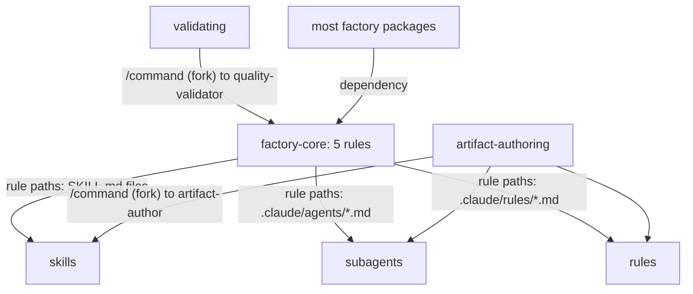

# factory-core

factory-core holds the five rules that define how every skill, subagent and rule in the factory is written: frontmatter schemas, naming and skill structure. It is for anyone who authors or edits a factory artifact, and for the agents that do it for them. You need it whenever you create or change a skill, an agent or a rule. Most other factory packages depend on it.

## Contents

<!-- BEGIN GENERATED:contents -->
**Depends on:** none  
**Used by:** `acceptance-testing`, `agent-package-builder`, `artifact-authoring`, `auditing`, `aws-architect`, `aws-lambda`, `aws-observability`, `aws-saas-serverless-quarkus-react-nextjs`, `aws-skills`, `aws-terraform`, `book-writing`, `camel-quarkus-integrator`, `camel-quarkus-skills`, `clean-code-oci`, `clean-code-quarkus`, `evaluating`, `github-actions-cicd`, `github-core`, `handoff-core`, `kafka`, `langchain4j`, `nextjs-frontend`, `oci-architecture`, `oci-core`, `oci-functions-java`, `oci-observability`, `oci-terraform`, `openspec-core`, `openspec-github`, `openspec-poc`, `quarkus-aws`, `quarkus-core`, `quarkus-langchain4j`, `research-core`, `researching-frameworks`, `researching-platform`, `solution-architecture`, `stripe-java`, `terraform`, `ui-design`, `validating`

| Type | Name | What it does |
|---|---|---|
| rule | [`agent-frontmatter.instructions`](.apm/instructions/agent-frontmatter.instructions.md) | Frontmatter schema for subagent files (.claude/agents/*.md). |
| rule | [`naming-conventions.instructions`](.apm/instructions/naming-conventions.instructions.md) | Naming convention rules for skills, agents, and rules in this factory. |
| rule | [`rules-frontmatter.instructions`](.apm/instructions/rules-frontmatter.instructions.md) | Frontmatter schema for rules/instructions files (.claude/rules/*.md). |
| rule | [`skill-frontmatter.instructions`](.apm/instructions/skill-frontmatter.instructions.md) | Frontmatter schema for skill files (.claude/skills/**/SKILL.md). |
| rule | [`skill-structure.instructions`](.apm/instructions/skill-structure.instructions.md) | Structure and completeness rules for SKILL.md files. |
<!-- END GENERATED:contents -->

## Installation

<!-- BEGIN GENERATED:installation -->
| Item | Value |
|---|---|
| Package name | `agents-factory-factory-core` |
| Version | `1.0.0` |
| Source folder | `packages/factory/factory-core` |
| In this repository | installed transitively, through `acceptance-testing`, `agent-package-builder`, `artifact-authoring`, `auditing`, `aws-architect`, `aws-lambda`, `aws-observability`, `aws-saas-serverless-quarkus-react-nextjs`, `aws-skills`, `aws-terraform`, `book-writing`, `camel-quarkus-integrator`, `camel-quarkus-skills`, `clean-code-oci`, `clean-code-quarkus`, `evaluating`, `github-actions-cicd`, `github-core`, `handoff-core`, `kafka`, `langchain4j`, `nextjs-frontend`, `oci-architecture`, `oci-core`, `oci-functions-java`, `oci-observability`, `oci-terraform`, `openspec-core`, `openspec-github`, `openspec-poc`, `quarkus-aws`, `quarkus-core`, `quarkus-langchain4j`, `research-core`, `researching-frameworks`, `researching-platform`, `solution-architecture`, `stripe-java`, `terraform`, `ui-design`, `validating` |
| Also installs | nothing |

Install it into another project, from that project's folder:

```bash
apm install <path-to-agents-factory>/packages/factory/factory-core --target claude
```

Add `--dry-run` to preview the install. APM writes the skills, agents and rules into `.claude/`. Change the sources under `.apm/`, never the generated `.claude/`.
<!-- END GENERATED:installation -->

No runtime prerequisites. The package has no skill, agent or command.

## Quick Start

You do not call anything. Claude Code loads each rule when you open or edit a file that matches its path pattern. Two plain requests that trigger rules:

```text
Create a new knowledge skill for Kafka consumers.
```

```text
Add a new subagent called framework-researcher.
```

The first loads `skill-frontmatter`, `skill-structure` and `naming-conventions` (the path patterns of those rules cover `SKILL.md` files). The second loads `agent-frontmatter` and `naming-conventions`. The requests are illustrations built from the rule path patterns. The package has no evaluation scenarios.

## Usage Scenarios

The package has no evaluation scenarios. The scenarios below apply the rules' own tables and examples.

### Scenario 1 — Write a knowledge skill

Use it when you add a skill that Claude should load by itself.

```text
Create a knowledge skill that explains X patterns for Y.
```

The frontmatter is only `name` and `description`. `name` is kebab-case and matches the folder. `description` is at most 1536 characters and has a "Use when..." trigger. The name follows `gerund-noun`, for example `researching-technical-frameworks`. A version-locked skill appends `-v<major>-<minor>` with hyphens, for example `developing-camel-quarkus-core-v3-40`.

### Scenario 2 — Write a command skill

Use it when you add a `/name` command that forks to a subagent.

```text
Create an action command that creates X from a research file and routes to artifact-author.
```

You need all four extra fields together: `argument-hint`, `context: fork`, `agent:` (a file in `.claude/agents/` without `.md`), and `disable-model-invocation: true`. Name it `action-noun` or `domain-role`, for example `skill-creator`. It also needs a `blueprints/` folder with at least `evaluation-scenarios.md`.

### Scenario 3 — Incomplete frontmatter

Use it when a skill has `context: fork` but no `disable-model-invocation: true`, or the reverse.

```text
Check this frontmatter: context: fork, no disable-model-invocation.
```

The rule `skill-frontmatter` says the two fields are always paired. With `context: fork` alone, the skill appears in auto-listing and costs tokens every session. With `disable-model-invocation: true` alone, the skill silently does nothing when invoked with `/name`. Add the missing field.

### Scenario 4 — Wrong name

Use it when you rename an artifact.

```text
Rename the skill technical-framework-researcher.
```

`technical-framework-researcher` breaks the rule: a skill name must start with a gerund (`researching-technical-frameworks`). An agent named `researcher-framework` should be `framework-researcher` (`domain-role`). A rule named `conventions-naming` should be `naming-conventions` (`scope-noun`). `MyNewSkill` must be `my-new-skill`.

### Scenario 5 — Agent frontmatter

Use it when you write a subagent.

```text
Write the frontmatter for an agent that only reads files.
```

Use `tools:` (comma-separated, least privilege), not `allowed-tools:`. `model` is optional: `opus`, `sonnet`, `haiku`, `fable` or a full model ID. Never old versions and never `*plan` suffixes. The `description` needs a "Use when..." trigger. A value that contains a colon needs quotes.

### Scenario 6 — Misuse: asking factory-core to create or validate

Use this as a guide to who does what.

```text
Generate this skill and validate it against the rules.
```

factory-core only holds the rules. Creating artifacts belongs to [artifact-authoring](../artifact-authoring/README.md). Checking them belongs to [validating](../../harness-quality/validating/README.md).

### Scenario 7 — Skill too long

Use it when a `SKILL.md` grows.

```text
My SKILL.md is 620 lines.
```

The rule `skill-structure` says it must not exceed 500 lines. Move detail to `blueprints/` and keep a summary and a link. Keep `## Quick Navigation` and `## Blueprints & Guardrails` (Always Do, Ask First, Never Do) at the top, before long sections.

## Skills Reference

This package ships no skill. Its content is the five rules in the next section. The templates that these rules point to (`skill-creator/assets/`, `agent-creator/assets/`, `rules-compiler/assets/`) live in `artifact-authoring`.

## Rules Reference

The source files declare the patterns under `applyTo:`. The installed `.claude/rules/` copy uses `paths:`.

| Rule | Applies to (`applyTo`) | Enforces |
|---|---|---|
| `agent-frontmatter` | `.claude/agents/*.md`, `.claude/skills/agent-creator/assets/*.md` | Subagent frontmatter: `name` is kebab-case and matches the filename; `description` up to 1536 characters with a "Use when..." trigger (the only field used for automatic delegation); `tools` comma-separated, least privilege; `model` optional. Agents use `tools:`, never `allowed-tools:`. |
| `naming-conventions` | `.claude/skills/**/SKILL.md`, `.claude/agents/*.md`, `.claude/rules/*.md` | Kebab-case for every artifact. Knowledge skill: `gerund-noun`. Command skill: `action-noun` or `domain-role`. Agent: `domain-role`. Rule: `scope-noun`. Version-locked skills append `-v<major>-<minor>`. |
| `rules-frontmatter` | `.claude/rules/*.md`, `.claude/skills/rules-compiler/assets/*.md` | Rule frontmatter: `name` kebab-case and unique across `.claude/rules/`; `paths` as a YAML list of globs; `description` optional per the schema but recommended. Rules have no `tools`, `model`, `context`, `agent` or `disable-model-invocation`. |
| `skill-frontmatter` | `.claude/skills/**/SKILL.md`, `.claude/skills/skill-creator/assets/*.md` | Skill frontmatter: `name` matches the folder, `description` up to 1536 characters with "Use when...". Command skills add `argument-hint`, `context: fork`, `agent:` and `disable-model-invocation: true` together. Optional `allowed-tools:` (not `tools:`). |
| `skill-structure` | `.claude/skills/**/SKILL.md` | `SKILL.md` at most 500 lines. Command skills need `blueprints/evaluation-scenarios.md`. Quick Navigation must link the evaluation scenarios and the guardrails section. `## Blueprints & Guardrails` comes right after Quick Navigation and is top-level. Hybrid knowledge skills keep `SKILL.md` lean (target 100 to 200 lines), cite a source or a confidence tag for every flat claim, and ship `unverified-and-risks.md` and at least 3 evaluation scenarios. |

### Frontmatter and naming conventions at a glance

| Field | Skill | Subagent | Rule |
|---|---|---|---|
| `name` | required, matches the folder | required, matches the file name | required, unique |
| `description` | required, at most 1536 characters, "Use when..." | required, at most 1536 characters, "Use when..." | optional, recommended |
| `tools` | no | required | no |
| `allowed-tools` | optional | no | no |
| `model` | no | optional | no |
| `paths` | no | no | required |
| `argument-hint`, `context: fork`, `agent`, `disable-model-invocation` | commands only, all four together | no | no |

YAML values that contain a colon need quotes. See the [frontmatter cheatsheet](../../../docs/reference/frontmatter-cheatsheet.md) and [conventions](../../../docs/reference/conventions.md).

## Architecture



## Agents Reference

<!-- BEGIN GENERATED:agents-reference -->
This package has no subagents. Claude loads its skills by description, and agents of other packages can load them too.
<!-- END GENERATED:agents-reference -->

This package has no agent. The agents that use these rules are `artifact-author` (in `artifact-authoring`) when it creates artifacts and `quality-validator` (in `validating`) when it checks them.

## Output structure

The package writes nothing. Installing it places its five rules in the project:

```text
.claude/rules/
├── agent-frontmatter.md
├── naming-conventions.md
├── rules-frontmatter.md
├── skill-frontmatter.md
└── skill-structure.md
```

## Limits and constraints

| Item | Value | Source |
|---|---|---|
| `description` length | at most 1536 characters, with a "Use when..." trigger | `skill-frontmatter`, `agent-frontmatter` |
| `SKILL.md` length | at most 500 lines | `skill-structure` |
| Hybrid knowledge skill `SKILL.md` | target 100 to 200 lines | `skill-structure` |
| Hybrid skill evaluation scenarios | at least 3 | `skill-structure` |
| Command skill fields | `argument-hint`, `context: fork`, `agent:`, `disable-model-invocation: true`, all together | `skill-frontmatter` |
| Agent `model` values | `opus`, `sonnet`, `haiku`, `fable` or a full model ID; no old versions, no `*plan` suffixes | `agent-frontmatter` |
| Scope | it ships rules only; it neither creates nor validates artifacts | package contents |
| Applicability | the rules describe this factory's conventions, not general Claude Code rules | package contents |

## Related

- Guides: [Frontmatter cheatsheet](../../../docs/reference/frontmatter-cheatsheet.md), [Conventions](../../../docs/reference/conventions.md).
- Depends on: nothing (`dependencies.apm` is empty).
- Create artifacts with [artifact-authoring](../artifact-authoring/README.md). Check them with [validating](../../harness-quality/validating/README.md).
- [Agent architecture](../../../docs/agents/architecture.md), [entry points](../../../docs/entry-points/README.md), [packages](../../../docs/packages/README.md).
