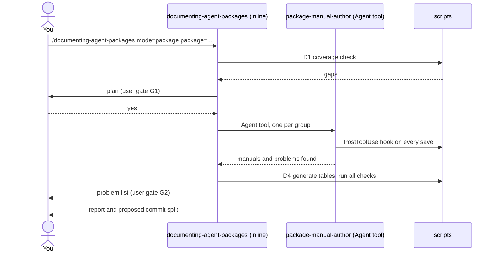

# package-docs

This package finds package and bundle manuals that are missing or incomplete in an APM repository, writes them with helper agents, and checks the result. It is for maintainers of a repository with many packages who want every package to have a usage manual of the same quality. You need it when you add a package, change a command, or want to know which manuals have gaps.

> Works in any repository that keeps packages under one folder. This repository's layout is the default; another layout is described in a `docs-catalog.json` file (see [Scripts](#scripts)).

## Contents

<!-- BEGIN GENERATED:contents -->
**Depends on:** `factory-core`  
**Used by:** [`skill-factory-pro`](../../bundles/skill-factory-pro/README.md) (bundle)

| Type | Name | What it does |
|---|---|---|
| inline orchestrator | [`documenting-agent-packages`](.apm/skills/documenting-agent-packages/SKILL.md) | Finds missing or incomplete package and bundle manuals in an APM repository, plans the work with the user, runs package-manual-author writers in parallel, then… |
| agent (sonnet) | [`package-manual-author`](.apm/agents/package-manual-author.agent.md) | Package Manual Author - non-interactive writer that turns the files of one or more APM packages into usage manuals (README.md): installation, quick start, usag… |
| rule | [`package-manuals.instructions`](.apm/instructions/package-manuals.instructions.md) | Rules for editing package and bundle README manuals: required sections, exact command headings, generated blocks, no typed counts. |
<!-- END GENERATED:contents -->

## Installation

<!-- BEGIN GENERATED:installation -->
| Item | Value |
|---|---|
| Package name | `agents-factory-package-docs` |
| Version | `1.0.0` |
| Source folder | `packages/factory/package-docs` |
| In this repository | listed directly in the root `apm.yml` |
| Also installs | `factory-core` |

Install it into another project, from that project's folder:

```bash
apm install <path-to-agents-factory>/packages/factory/package-docs --target claude
```

Add `--dry-run` to preview the install. APM writes the skills, agents and rules into `.claude/`. Change the sources under `.apm/`, never the generated `.claude/`.
<!-- END GENERATED:installation -->

Requirements:

- Python 3. Every script uses only the standard library, so there is nothing to install.
- `git`, for `mode=changed` and for the working-tree snapshot.
- Claude Code, to run the command and the writer agent.

The save-time check is installed with the package for every supported target; see [Hooks](#hooks).

## Quick Start

```text
/documenting-agent-packages mode=check
```

It prints which manuals are complete and which commands lack a section or a parameter table. It changes nothing. To fix what it finds, run it again with `mode=package package=<path>`.

## Usage Scenarios

### Scenario 1 - See what is missing

You want to know the state of the documentation before deciding anything.

```text
/documenting-agent-packages mode=check
```

You get a coverage table (how many packages have each required section, how many commands have a syntax block and a parameter table) and a list of gaps per package. Nothing is written.

### Scenario 2 - Document a new package

You just added `java/libs/stripe-java` and it has no manual.

```text
/documenting-agent-packages mode=package package=java/libs/stripe-java
```

The skill shows a plan (the writer, the one file it may write, the checks) and waits for your yes. Then one writer reads the package's files and writes the manual. When it returns, the skill fills the generated tables and runs every check. You get a report with coverage before and after and the problems the writer found in the package files.

### Scenario 3 - Update manuals after a change

You changed commands in several packages on a branch.

```text
/documenting-agent-packages mode=changed since=master
```

Only the packages with files changed since `master` are planned. Packages you did not touch are skipped, so a manual that was already out of date elsewhere is not part of this run. Run `mode=check` to find those.

### Scenario 4 - A package that does not exist, or a writer that needs an answer

You mistype a path, or a writer finds that its assignment is incomplete.

```text
/documenting-agent-packages mode=package package=java/libs/does-not-exist,cloud/terraform/terraform
```

The skill reports that `java/libs/does-not-exist` does not exist and does not guess a similar name. It continues with the valid package once you confirm. A writer cannot ask you anything, so if it returns numbered questions the skill shows them to you, relays your answers and starts the writer again.

### Scenario 5 - You ask for something this package does not do

You ask it to commit the result, push it, or create a new skill.

```text
/documenting-agent-packages create a new skill for Redis 7.2 and push it to origin
```

It declines: it writes and checks manuals, never commits or pushes, and does not create skills. It points you to `/researching-platform-software` for the research, `/skill-creator` for the skill, and `/building-agent-packages` for the whole chain.

### Scenario 6 - The save-time hook rejects a manual

A writer, or you through Claude, saves a package README with the Quick Start section removed.

```text
This manual has problems. Fix them before going on:
  - packages/java/libs/stripe-java/README.md: the section for 'Quick Start' is missing. Add a level-2 heading for it (see the manual template).
```

The `PostToolUse` hook runs `check_manual.py`, exits with code 2, and Claude sees the message and restores the section. Files that are not package or bundle READMEs pass at once.

### Scenario 7 - Use it in another repository

The repository keeps its packages in `units/` and its docs in `documentation/`.

```text
python .claude/skills/documenting-agent-packages/scripts/docs_catalog.py --root . --check-manuals
```

Put a `docs-catalog.json` at the repository root with the folder names, the inline orchestrators and the required pages. Without it the scripts use this repository's layout, find no `packages` folder, and report zero packages.

### Scenario 8 - Finish and hand over

The run is done and you want to commit.

The report ends with a proposed commit split (scripts, docs pages, package manuals, bundle READMEs) and the name of the snapshot ref. You decide what to commit. Use `/audit-cc-architecture-consensus` or the normal git flow for the rest.

## Commands Reference

### `documenting-agent-packages`

*Plan, write and check package and bundle manuals.*

**Syntax**

```text
/documenting-agent-packages mode=check|package|changed|all|bundles [package=<path>[,<path>]] [since=<git-ref>] [writers=<n>]
```

**Parameters**

| Parameter | Required | Default | Description |
|---|---|---|---|
| `mode` | No | `check` | `check` reports gaps and changes nothing. `package` documents the packages named in `package=`. `changed` documents packages with files changed since `since=`. `all` documents every package. `bundles` writes only the bundle READMEs. |
| `package` | With `mode=package` | none | One or more package paths relative to the packages folder, separated by commas, for example `java/libs/stripe-java`. |
| `since` | With `mode=changed` | none | A git ref (branch, tag or commit). Packages with files changed since it are selected. |
| `writers` | No | 6 | The most writer agents that run at the same time. |

**Prerequisites**

- A repository with packages under one folder, each with an `apm.yml`.
- A git repository (for `mode=changed` and the snapshot).
- For `mode=package`, `mode=changed`, `mode=all` and `mode=bundles`: the `package-manual-author` agent installed.

**What it does**

1. **D0 Preflight.** Detects the layout and records `git status`. Unless the mode is `check`, it also takes a snapshot of the working tree in a hidden ref, so nothing a writer does can lose uncommitted work.
2. **D1 Coverage.** Runs the manual coverage check and lists the gaps. `mode=check` ends here.
3. **D2 Plan.** Groups the packages per writer and lists the files each may write. You approve the plan (gate G1).
4. **D3 Fan-out.** Starts one `package-manual-author` per group, in parallel.
5. **D4 Generate and check.** After every writer has returned, fills the generated tables and runs `docs_catalog.py --check`, `check_manual.py --all` and `check_links.py`. A failure goes back to the owning writer, at most two rounds.
6. **D5 Consolidate.** Merges the problems the writers found in package files into a known-issues page. You review it (gate G2).
7. **D6 Report.** Coverage before and after, files changed, items left unverified, and a proposed commit split.

**What is updated and what is not**

| Changes | Does not change |
|---|---|
| Package and bundle `README.md` files named in the plan | `.apm/` sources, `.claude/`, `apm.yml` |
| Generated blocks in those READMEs and in the docs pages | Your other uncommitted work |
| The known-issues page, when you accept the list | Git history: it never commits, pushes or merges |

**Output files**

```text
packages/<family>/<package>/README.md     the manual of each documented package
packages/<bundles>/<bundle>/README.md     with mode=bundles or mode=all
docs/reference/known-source-issues.md     the consolidated problem list (after gate G2)
refs/backup/pre-docs-<date>               hidden snapshot of the working tree (a git ref, not a file)
```

**Examples**

```text
/documenting-agent-packages mode=check
/documenting-agent-packages mode=package package=java/libs/stripe-java,java/libs/langchain4j
/documenting-agent-packages mode=changed since=master writers=4
```

**Next**

Review the changed files, then commit them in the proposed groups.

## Scripts

All scripts are plain Python (standard library) and take `--root <repo>`.

### docs_catalog.py

Fills the generated tables and reports gaps.

| Command | What it does | Exit codes |
|---|---|---|
| `python docs_catalog.py --root <repo>` | Writes every generated block: counts, package tables, the command index, the agent list, and the Contents, Installation and Agents tables of each manual and bundle README. | 0 done |
| `... --check` | Reports any block that is out of date. Writes nothing. | 0 current, 1 stale |
| `... --check-manuals` | Prints the coverage table and the gaps. Writes nothing. | 0 complete, 1 gaps |

### check_manual.py

Checks one manual or all of them, and is the entry point of both hooks.

| Command | What it does | Exit codes |
|---|---|---|
| `python check_manual.py --root <repo> --file <README>` | Checks sections, command sections, parameter tables, generated markers, links and readability basics for one manual. | 0 fine, 2 problem |
| `... --all` | The same for every manual, plus the presence checks: every package and bundle has a README, every required page exists, every command is in the index and every package with commands is linked from a guide page, and no generated block is stale. | 0 fine, 2 problem |
| `... --hook post-edit` | Reads the hook JSON from stdin; checks the one README named in `tool_input.file_path`; any other file passes at once. | 0 or 2 |
| `... --hook stop` | Presence checks, then the manuals changed in the working tree. Exits 0 when `stop_hook_active` is set. | 0 or 2 |
| add `--skip-stale` | Does not fail on generated blocks that are out of date (used inside the writer, which must not run the generator). | |

Warnings (for example numbers typed in prose, or a scenario without a code block) are printed but never change the exit code.

### check_links.py

| Command | What it does | Exit codes |
|---|---|---|
| `python check_links.py --root <repo>` | Follows every relative link and `#anchor` in the root README, the docs folder and every package and bundle README. Code blocks and inline code are skipped. | 0 all fine, 1 broken |

### docs-catalog.json

An optional file at the repository root. Every key can be left out; the default is this repository's layout.

| Key | Default | Meaning |
|---|---|---|
| `packages_dir` | `packages` | Folder that holds the packages. |
| `bundles_dir` | `packages/bundles` | Folder that holds the bundles (excluded from the package list). |
| `docs_dir` | `docs` | Folder of the documentation pages. |
| `inline_orchestrators` | the orchestrators of this repository | Skills that run inline. Nothing in a skill's header marks them, so they are listed by name. |
| `generated_targets` | root README, packages, entry-points and agents pages | Which file holds which generated block ids. |
| `required_pages` | the four docs index pages | Pages that must exist. |
| `guide_pages_dir` | `docs/entry-points` | Folder whose pages must link every package that has commands. |

## Hooks

Two hooks run `check_manual.py` and explain each problem in plain words.

- **Every save of a README** (`PostToolUse`, matcher `Edit|Write`) is defined in APM's own hook format, in `.apm/hooks/check-manual.json`, so `apm install` sets it up for each target: it is merged into `.claude/settings.json` for Claude, written to `.github/hooks/package-docs-check-manual.json` for Copilot, and configured the same way for Codex and Gemini. A small shim, `manual_hook.py`, is copied next to it. It finds `check_manual.py` in whichever folder the skill was installed to and passes on the hook data and the exit code. If the skill is not installed it does nothing, so editing is never blocked. You do not edit any settings file by hand.
- **Before a writer finishes** (`Stop`, run as `SubagentStop` for a subagent) is declared in the header of `package-manual-author`. It checks that every manual exists and the manuals changed in this session are well formed. This one works on Claude only, because APM drops an agent's own `hooks:` for other targets.

Limits of APM's hooks: it refuses to install hooks for Claude and Cursor in the same project (they would run twice), so a project chooses one; Grok and OpenCode are skipped; `apm install --dry-run` does not show hooks.

For `PostToolUse`, exit code 2 shows the message to Claude. For `Stop` and `SubagentStop`, exit code 2 keeps the agent working. After eight blocks in a row Claude Code ends the turn anyway. Sources: https://code.claude.com/docs/en/hooks, https://code.claude.com/docs/en/sub-agents and https://microsoft.github.io/apm/producer/author-primitives/hooks-and-commands/ (fetched 2026-11-06).

## Pipeline



## Agents Reference

<!-- BEGIN GENERATED:agents-reference -->
| Agent | Model | Tools | Can start agents | Started by |
|---|---|---|---|---|
| [`package-manual-author`](.apm/agents/package-manual-author.agent.md) | sonnet | Read, Grep, Glob, Write, Edit, Bash | no | an orchestrator or another agent |
<!-- END GENERATED:agents-reference -->

`package-manual-author` writes the manuals named in its assignment from the package's own files, runs `check_manual.py` on each, and returns a report. It is non-interactive: when its assignment is incomplete it returns numbered questions with the outcome `needs-input`. It never runs `docs_catalog.py` in write mode, never edits files outside its assignment, never commits, and never fixes a defect in a package file (it reports it).

The editing rule `package-manuals` adds the manual rules to the context whenever a package README is edited.

## Output structure

```text
<repo>/
├── packages/<family>/<package>/README.md       one manual per package
├── packages/<bundles>/<bundle>/README.md       one README per bundle
└── docs/reference/known-source-issues.md       problems found in package files
```

## Limits and constraints

| Limit | Value | Source |
|---|---|---|
| Writers at the same time | 6 by default, set with `writers=` | skill `SKILL.md`, Modes |
| Fix rounds per failing manual | 2, then the user decides | `blueprints/phases.md`, D4 |
| Stop-hook blocks before Claude Code ends the turn | 8 in a row | Claude Code hooks documentation |
| Save-time hook timeout | 30 seconds | writer agent header |
| Stop hook timeout | 60 seconds | writer agent header |
| Layout | one packages folder; another layout needs `docs-catalog.json` | `scripts/docs_catalog.py`, `DEFAULT_CONFIG` |
| Commits, pushes, merges | never done | skill `SKILL.md`, Never Do |

Not for: writing a package's skills, agents or rules (use `/skill-creator`, `/agent-creator`, or `/building-agent-packages`), or for committing the result.

## Related

- [Authoring commands](../../../docs/entry-points/factory-authoring.md): where this command sits among the factory commands.
- [Agent architecture](../../../docs/agents/architecture.md): how an inline orchestrator starts writer agents.
- [Maintaining the docs](../../../docs/reference/maintaining-docs.md): what is generated and what you write.
- [Packages](../../../docs/packages/README.md).
- Dependency: [`factory-core`](../factory-core/README.md). Works alongside [`agent-package-builder`](../agent-package-builder/README.md).
