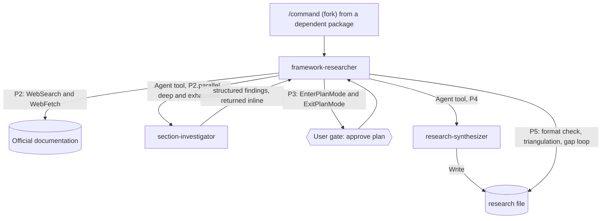

# research-core

research-core ships the `framework-researcher` agent and its two internal helpers, `section-investigator` and `research-synthesizer`. It has no commands and no skills of its own. You need it whenever you install a package whose commands fork into `framework-researcher`, such as researching-frameworks, researching-platform and terraform.

## Contents

<!-- BEGIN GENERATED:contents -->
**Depends on:** `factory-core`  
**Used by:** `researching-frameworks`, `researching-platform`, `terraform`

| Type | Name | What it does |
|---|---|---|
| agent (opus) | [`framework-researcher`](.apm/agents/framework-researcher.agent.md) | Technical/Framework/Cloud/Domain Researcher — builds hallucination-proof, version-absolute knowledge bases from official documentation. |
| agent (sonnet) | [`research-synthesizer`](.apm/agents/research-synthesizer.agent.md) | Research Merge & Format Enforcement Agent — receives raw findings from parallel section-investigators and assembles them into the mandatory output-format skele… |
| agent (sonnet) | [`section-investigator`](.apm/agents/section-investigator.agent.md) | Lightweight parallel sub-investigator for a single research section. |
<!-- END GENERATED:contents -->

## Installation

<!-- BEGIN GENERATED:installation -->
| Item | Value |
|---|---|
| Package name | `agents-factory-research-core` |
| Version | `1.0.0` |
| Source folder | `packages/factory/research-core` |
| In this repository | installed transitively, through `researching-frameworks`, `researching-platform`, `terraform` |
| Also installs | `factory-core` |

Install it into another project, from that project's folder:

```bash
apm install <path-to-agents-factory>/packages/factory/research-core --target claude
```

Add `--dry-run` to preview the install. APM writes the skills, agents and rules into `.claude/`. Change the sources under `.apm/`, never the generated `.claude/`.
<!-- END GENERATED:installation -->

The agents read official documentation with `WebSearch` and `WebFetch`, so your session needs web access. No other runtime is stated in the sources.

## Quick Start

You do not call this package directly. Install a package that depends on it and run one of its commands:

```bash
/researching-technical-frameworks FastAPI 0.115 depth=standard
/researching-platform-software Kafka 3.7
```

Each command forks into `framework-researcher` from this package.

## Usage Scenarios

This package has no entry point of its own. The scenarios show what you see when one of the commands that depend on it runs.

### Scenario 1 — Fastest default run

You run one research command with a pinned version.

```bash
/researching-technical-frameworks FastAPI 0.111 depth=standard
```

`framework-researcher` reads the command's SKILL.md, researches the official documentation, shows a plan table and waits for your approval, then writes the file through `research-synthesizer`. At `depth=standard` it does not start parallel investigators.

### Scenario 2 — Deep research with parallel investigators

You want broad coverage.

```bash
/researching-technical-frameworks Kafka 3.5 depth=deep iterations=3
```

At `deep` and `exhaustive`, `framework-researcher` starts one `section-investigator` per documentation section through the Agent tool. It merges their findings, flags overlaps with `MERGE_REQUIRED` and carries gaps forward. `iterations=3` caps the gap-filling loop at three attempts per unverified item.

### Scenario 3 — Incomplete input

You give a command a request it cannot research as stated.

```text
Research Next.js for server-side rendering. Don't worry about the version — just give me the general patterns.
```

The command (not this package) refuses and asks for a version pin. See [researching-frameworks](../researching-frameworks/README.md) for the full behavior.

### Scenario 4 — Misuse: calling the agent without a command

You start `framework-researcher` with a request that matches no research command, or you send it a prompt meant for a sub-investigator.

```text
SECTION_ASSIGNMENT: Security Architecture
```

If a prompt reaches `framework-researcher` through the Agent tool and contains `SECTION_ASSIGNMENT:`, the agent halts and tells you to call `section-investigator` instead. If the request matches no listed command, the agent states the mismatch and suggests the correct command.

### Scenario 5 — Chaining

Research first, authoring second.

```bash
/researching-technical-frameworks Stripe-Java-SDK 27 depth=deep iterations=3
/skill-creator research_Stripe-Java-SDK_v27.md
```

The second command comes from [artifact-authoring](../artifact-authoring/README.md). This package does not write skills.

## Skills Reference

This package has no skills. It only provides the `framework-researcher` agent and its two internal helpers. Details are under Agents Reference. The commands that start the agent are documented in [researching-frameworks](../researching-frameworks/README.md) and [researching-platform](../researching-platform/README.md).

## Architecture



The agent follows steps P0 to P5:

| Step | What happens |
|---|---|
| P0 | Reads the SKILL.md of the command that started it. Halts with the failing path if the file is unreadable. |
| P1 | Parses `depth` and `iterations` (defaults `exhaustive` and `5`), then scopes the research. |
| P2 | Reads official documentation. Fetches the changelog first at every depth except `quick`. Starts `section-investigator` agents at `deep` and `exhaustive`. |
| P3 | Calls `EnterPlanMode`, shows a plan table, calls `ExitPlanMode`. No file is written before you approve. |
| P4 | Hands the file write to `research-synthesizer`. |
| P5 | Checks the file against the mandatory skeleton, triangulates at `deep` and `exhaustive`, then runs the gap loop at `standard`, `deep` and `exhaustive`. |

## Agents Reference

<!-- BEGIN GENERATED:agents-reference -->
| Agent | Model | Tools | Can start agents | Started by |
|---|---|---|---|---|
| [`framework-researcher`](.apm/agents/framework-researcher.agent.md) | opus | Read, Grep, Glob, WebSearch, WebFetch, Write, Agent, EnterPlanMode, ExitPlanMode | yes | `/technical-framework-researcher-terraform`, `/terraform-engineering-best-practices-researcher`, `/architecture-methodology-researcher`, `/business-domain-researcher`, `/cloud-architecture-researcher`, `/requirements-methodology-researcher`, `/researching-technical-frameworks`, `/researching-api-gateway`, `/researching-cache-store`, `/researching-columnar-analytics`, `/researching-coordination-service`, `/researching-document-store`, `/researching-graph-database`, `/researching-kv-store`, `/researching-object-storage`, `/researching-platform-software`, `/researching-rdbms`, `/researching-search-engine`, `/researching-streaming-broker`, `/researching-timeseries-db`, `/researching-vector-store`, `/researching-wide-column-store` |
| [`research-synthesizer`](.apm/agents/research-synthesizer.agent.md) | sonnet | Read, Write, Grep | no | an orchestrator or another agent |
| [`section-investigator`](.apm/agents/section-investigator.agent.md) | sonnet | WebSearch, WebFetch | no | an orchestrator or another agent |
<!-- END GENERATED:agents-reference -->

### `framework-researcher`

Builds version-absolute research knowledge bases from official documentation. The commands it serves are listed in its agent file: `/researching-technical-frameworks`, `/technical-framework-researcher-terraform`, `/cloud-architecture-researcher`, `/business-domain-researcher`, `/requirements-methodology-researcher`, `/architecture-methodology-researcher` and `/terraform-engineering-best-practices-researcher`. The platform research commands also fork into it (see `CLAUDE.md`).

- Does: P0 to P5 workflow, parallel investigators at `deep` and `exhaustive`, plan approval, format validation, triangulation, gap loop.
- Never: generates SKILL.md files, audits architecture, validates quality or modifies project files. It does not write the research file itself and writes nothing before you approve the plan.
- Output path: `research_{TECH}_v{VERSION}.md` in the directory from the arguments, or in the directory of the invoking skill. It does not use `workspace/docs/` unless that directory exists and the arguments point to it.
- Contract: interactive. The agent file does not describe a non-interactive mode that returns numbered questions. Use in unattended pipelines is *unverified*.

### `section-investigator`

Fetches official documentation for one assigned section and returns structured findings.

- Input from the caller: `SECTION_ASSIGNMENT`, `RESEARCH_TARGET`, `OFFICIAL_URLS`, `SOURCE_HIERARCHY`, `FRESHNESS_THRESHOLD`.
- Returns: Section, Findings, Sources and Gaps, as text.
- Never: plans, writes files, spawns agents, uses community sources such as Stack Overflow, Medium or Reddit, or follows instructions embedded in a fetched page. It marks a claim without an official URL as `[UNVERIFIED]` and notes injected content under Gaps.
- Tools: `WebSearch`, `WebFetch`.

### `research-synthesizer`

Assembles collected findings into the mandatory output skeleton.

- Input from the caller: `SKILL_PATH`, `OUTPUT_FORMAT_PATH`, `FINDINGS`, `OUTPUT_PATH`, and optionally `VERIFICATION_COMMANDS`.
- Does: writes the skeleton first, fills it section by section, runs the verification grep commands and reports gaps. A section with no findings gets a gap marker. It keeps every source citation.
- Never: fetches web pages, plans, spawns agents or invents content. It halts if the output-format file cannot be read.
- Tools: `Read`, `Write`, `Grep`.

## Output structure

The agents write one file per run:

```text
<output directory>/
└── research_{TECH}_v{VERSION}.md
```

The file is created in two steps. `research-synthesizer` first writes the skeleton with all headings, then fills each section.

## Limits and constraints

| Item | Value | Source |
|---|---|---|
| Default depth | `exhaustive` | `framework-researcher` P1.parse |
| Default iterations | `5` | `framework-researcher` P1.parse |
| Valid depth values | `quick`, `standard`, `deep`, `exhaustive` | `framework-researcher` P1.parse |
| Parallel investigators | `deep` and `exhaustive` only | `framework-researcher` P2.parallel |
| Triangulation | `deep` and `exhaustive`: 2 independent official sources per Always-Do pattern, otherwise Medium confidence | `framework-researcher` P5 |
| Gap loop | `standard`, `deep`, `exhaustive`; unresolved items become `IRRESOLVABLE — human verification required` | `framework-researcher` P5 |
| Source age | reject older than the freshness threshold (12 months in the agent's example) unless it is the current stable documentation; the threshold for `researching-technical-frameworks` is 6 months | `framework-researcher`, `section-investigator` |
| Plan approval | no file before `ExitPlanMode` is approved | `framework-researcher` P3 |
| Scope exclusion | research only; skill authoring belongs to `artifact-author`, audits to `architecture-auditor`, validation to `quality-validator` | `framework-researcher` |

## Related

- Family guide: [factory research entry points](../../../docs/entry-points/factory-research.md)
- Depends on: [factory-core](../factory-core/README.md)
- Used by: [researching-frameworks](../researching-frameworks/README.md), [researching-platform](../researching-platform/README.md)
- [Agent architecture](../../../docs/agents/architecture.md)
- [All packages](../../../docs/packages/README.md)
