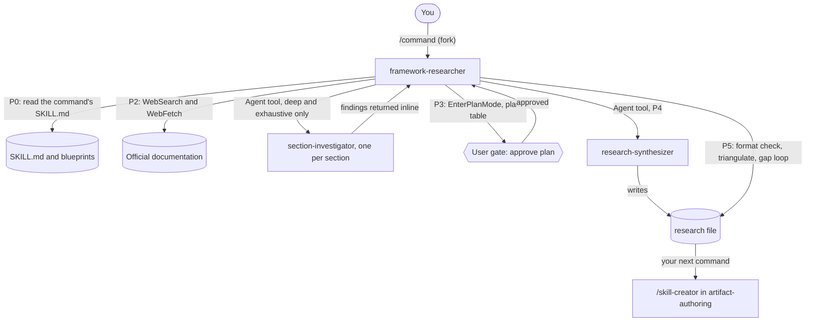

# researching-frameworks

researching-frameworks gives you five research commands that turn a technology, a cloud provider, a methodology or a business domain into a source-dated, version-pinned knowledge base. It is for people who author skills, rules or agents and must not rely on model memory for facts. You need it before you write a skill: the research file it produces is the input for the authoring step.

> Version-lock: `/researching-technical-frameworks` rejects unversioned requests. Every run pins one version or edition and treats other versions as misinformation.

## Contents

<!-- BEGIN GENERATED:contents -->
**Depends on:** `factory-core`, `research-core`  
**Used by:** [`anti-hallucination-research`](../../bundles/anti-hallucination-research/README.md) (bundle), [`skill-factory-pro`](../../bundles/skill-factory-pro/README.md) (bundle)

| Type | Name | What it does |
|---|---|---|
| command | [`/architecture-methodology-researcher`](.apm/skills/architecture-methodology-researcher/SKILL.md) | Researches an architecture methodology or notation (C4, UML, ADR, TOGAF, DDD, EDA) into a hallucination-proof knowledge base. |
| command | [`/business-domain-researcher`](.apm/skills/business-domain-researcher/SKILL.md) | Researches a business domain and its organizational processes into a structured, source-backed knowledge base. |
| command | [`/cloud-architecture-researcher`](.apm/skills/cloud-architecture-researcher/SKILL.md) | Researches a cloud provider's architecture framework/patterns (AWS WAF, Azure CAF, GCP, OCI) into a hallucination-proof, version-absolute knowledge base. |
| command | [`/requirements-methodology-researcher`](.apm/skills/requirements-methodology-researcher/SKILL.md) | Researches agile/product requirements methodologies (user stories, requirement artifacts) into a source-backed knowledge base. |
| command | [`/researching-technical-frameworks`](.apm/skills/researching-technical-frameworks/SKILL.md) | Researches technologies, frameworks, and SDKs to produce hallucination-proof research_[TECH]_v[VERSION].md documents. |
<!-- END GENERATED:contents -->

## Installation

<!-- BEGIN GENERATED:installation -->
| Item | Value |
|---|---|
| Package name | `agents-factory-researching-frameworks` |
| Version | `1.0.0` |
| Source folder | `packages/factory/researching-frameworks` |
| In this repository | listed directly in the root `apm.yml` |
| Also installs | `factory-core`, `research-core` |

Install it into another project, from that project's folder:

```bash
apm install <path-to-agents-factory>/packages/factory/researching-frameworks --target claude
```

Add `--dry-run` to preview the install. APM writes the skills, agents and rules into `.claude/`. Change the sources under `.apm/`, never the generated `.claude/`.
<!-- END GENERATED:installation -->

The commands fork into the `framework-researcher` agent from [research-core](../research-core/README.md). That agent reads official documentation with `WebSearch` and `WebFetch`, so your session needs web access. No other runtime (Node, Python, JDK, cloud CLI) is stated in the sources.

## Quick Start

```bash
/researching-technical-frameworks FastAPI 0.115 depth=standard
```

The agent researches, then shows you a plan table and waits for your approval before it writes any file (step P3 of its workflow). The result is a `research_FastAPI_v0.115.md` knowledge base. Pass it to `/skill-creator` from [artifact-authoring](../artifact-authoring/README.md) to turn it into a skill.

## Usage Scenarios

Every command is a deliberate `/command` (`disable-model-invocation: true`). It does not auto-invoke. The arguments are the same for all five: one or two positional values plus the optional `depth=` and `iterations=`.

Where a scenario quotes a request in plain text, it is the exact `query:` line from that command's `blueprints/evaluation-scenarios.md`.

### Scenario 1 — Fastest default run for a pinned technology

You know the technology and the exact version and want a knowledge base quickly.

```bash
/researching-technical-frameworks FastAPI 0.111 depth=standard
```

You get a plan table to approve, then `research_FastAPI_v0.111.md` with the Metadata, Executive Summary, three-tier guardrails (Mandatory, Conditional, Forbidden patterns), Migration Guide and the other mandatory sections. Without `depth=` the default is `exhaustive`, which is the slowest and most thorough level.

### Scenario 2 — Incomplete input: no version

You ask for a technology without a version.

```text
Research Next.js for server-side rendering. Don't worry about the version — just give me the general patterns.
```

`/researching-technical-frameworks` refuses to produce unversioned research. It explains the risk (App Router patterns from 13+ differ from Pages Router patterns before 13) and asks you for a version pin, for example 14, 13 or 12. Answer with one version and the run continues. It also asks about research breadth (minimal, standard or comprehensive) when you have not stated it.

### Scenario 3 — Misuse: you ask for code, not research

You ask a research command to implement something.

```text
Implement a FastAPI endpoint that creates a user, uses SQLAlchemy, and returns a JWT. Give me working production code.
```

The command declines. It produces knowledge bases, not application code. It offers a corrected scope: research FastAPI, SQLAlchemy and JWT (python-jose) at a pinned version. Run that research first, then hand the file to a code-generating agent or to `/skill-creator`.

### Scenario 4 — Thin official documentation

You research something young, with little official documentation.

```text
Research LangGraph 0.2 for an agentic Python workflow. No official URL known.
```

The command applies the source hierarchy, marks community-only claims as unverified, gives each pattern a High, Medium or Low confidence tier and lists what it could not confirm under Research Gaps. Read the Agent Operation Notes section before you rely on a Low-confidence pattern.

### Scenario 5 — Cloud provider framework, and the multi-cloud gate

Single provider with an edition and a context:

```text
Research AWS Well-Architected Framework 2024 for a B2B SaaS platform with multi-tenant requirements. Target audience: cloud architects and tech leads.
```

Multi-cloud without edition or output preference:

```text
Research networking architecture patterns for AWS, Azure, and GCP. We need to compare hub-spoke vs mesh topology across all three providers.
```

For the second request `/cloud-architecture-researcher` stops at the Ask First gate. It asks for the output form (per-provider sections, comparison matrix, or unified patterns with provider callouts) and for an edition per provider. After you confirm, cross-provider comparisons are marked Medium Confidence.

### Scenario 6 — Architecture methodology, and an abstraction-level trap

```text
Research the C4 Model (2024 guidance) for our microservices platform with 10+ services. We need to produce System Context and Container diagrams as Markdown with Mermaid.
```

`/architecture-methodology-researcher` pins the edition, documents minimal valid artifacts per diagram level and states the abstraction level of every example. If you then ask for something that breaks a level rule, such as putting table schemas on a Context diagram, it flags the violation:

```text
Add our PostgreSQL table schemas and Java class method signatures to our C4 System Context (L1) diagram so stakeholders can see all the details.
```

### Scenario 7 — Requirements methodology

```text
Research Scrum user story practices for a 5-person B2B SaaS product team using Scrum Guide 2020 and Jira for backlog management. We need to know how to write valid user stories with acceptance criteria.
```

`/requirements-methodology-researcher` pins the framework edition and requires every acceptance criterion in the output to be observable. A request such as "Generate a Definition of Done for our 5-person Scrum team working on a healthcare SaaS product." is the misuse case in the evaluation scenarios. The command declines to produce a binding Definition of Done, because the Scrum Team owns it. It asks clarifying questions first (regulatory requirements, automated testing, security review, mandatory documentation). It may then offer a template, labeled as a facilitation aid for team discussion.

### Scenario 8 — Business domain with human-escalation limits

```text
Research the Customer Service function for a Brazilian Fintech startup with 80 employees operating under BACEN regulation, with integrations to Zendesk (helpdesk) and Salesforce (CRM).
```

`/business-domain-researcher` builds a knowledge base where escalation to a human is a fixed rule. If a request asks an agent to commit money without a human, the command flags the approval as a Prohibited Action, flags direct supplier payment-date messages as Ask First, and documents the alternative: the agent prepares the analysis and a human approves.

```text
Research the Finance function for a healthcare operator under ANVISA regulation. An agent should be able to approve supplier invoice exceptions up to R$50,000 and communicate payment dates directly to suppliers without CFO approval.
```

### Scenario 9 — Platform software: wrong package

You ask for research on a self-managed broker or database.

```bash
/researching-platform-software Kafka 3.7
```

Use [researching-platform](../researching-platform/README.md) for software your team installs and operates (brokers, databases, gateways). Use `/researching-technical-frameworks` for client SDKs and frameworks that run on top of it, for example `/researching-technical-frameworks "Kafka Streams" <version>`.

### Scenario 10 — Chain research into a skill

```bash
/researching-technical-frameworks Stripe-Java-SDK 27 depth=deep iterations=3
/skill-creator research_Stripe-Java-SDK_v27.md
```

The first command writes the research file. The second belongs to [artifact-authoring](../artifact-authoring/README.md) and turns the file into a skill. The technical frameworks skill names this next step: pass the output to the skill author.

## Commands Reference

All five commands fork into `framework-researcher` (`context: fork`, `agent: framework-researcher`). Shared parameters:

- `depth=` is one of `quick`, `standard`, `deep`, `exhaustive`. Default `exhaustive`.
- `iterations=` is the gap-filling loop limit, any positive integer. Default `5`. It is ignored when `depth=quick`.

What each depth does (from `ask-first-decisions.md` and the agent workflow):

| Depth | Sources per claim | Gap loop | Changelog fetch | Parallel investigators |
|---|---|---|---|---|
| `quick` | 1 primary | off | no | no |
| `standard` | 2 for Always-Do patterns | up to `iterations` | yes | no |
| `deep` | 2 or more | up to `iterations` | yes | yes (Agent tool) |
| `exhaustive` | 2 or more, plus a community caveat scan | up to `iterations` | yes | yes (Agent tool) |

### `/researching-technical-frameworks`

*Research a technology, framework or SDK at one pinned version into `research_[TECH]_v[VERSION].md`.*

**Syntax**

```bash
/researching-technical-frameworks <tech> <version> [depth=exhaustive] [iterations=5]
```

**Parameters**

| Parameter | Required | Default | Description |
|---|---|---|---|
| `<tech>` | yes | none | Specific technology name, for example `FastAPI`, `Redis`, `Next.js`. Generic names such as "database" are rejected. |
| `<version>` | yes | none | Pinned version, for example `0.115`, `7.2`. "latest" or no version is rejected. |
| `depth=` | no | `exhaustive` | `quick`, `standard`, `deep` or `exhaustive`. |
| `iterations=` | no | `5` | Gap-filling loop limit. Ignored when `depth=quick`. |

The skill also reads an optional official URL and a comma-separated list of integration partners (for example "PostgreSQL, JWT, pytest") from your request. The argument hint has no key for them. Write them in plain words after the arguments.

**Prerequisites**

- Web access for `WebSearch` and `WebFetch`.
- A specific technology and one version.

**What it does**

1. Validates the inputs and rejects generic names and unpinned versions.
2. Maps the authority sources: official docs, registry, repository, release notes.
3. Researches the scope: authority and versioning, domain complexity tier (Foundational, Standard, Complex), the three guardrail tiers, migration considerations, integration partners, verification commands, isolation and mocking, production considerations.
4. Records a dated source bibliography.
5. Validates the result against a checklist.
6. At `deep` and `exhaustive`, `framework-researcher` spawns parallel `section-investigator` agents and hands the file write to `research-synthesizer`.

**What is updated and what is not**

It writes one research file. It does not write a SKILL.md, change project files or produce application code.

**Output files**

`research_{{SYSTEM_OR_TECH_NAME}}_v{{TARGET_VERSION}}.md`, for example `research_FastAPI_v0.111.md`. Where the file lands is set by the agent (see Output structure).

**Examples**

```bash
/researching-technical-frameworks FastAPI 0.115 depth=deep iterations=3
/researching-technical-frameworks Kafka 3.5 depth=standard
```

**Next**

`/skill-creator <research-file>` from [artifact-authoring](../artifact-authoring/README.md).

### `/cloud-architecture-researcher`

*Research a cloud provider's architecture framework or patterns into a version-absolute knowledge base.*

**Syntax**

```bash
/cloud-architecture-researcher <cloud-provider> [depth=exhaustive] [iterations=5]
```

**Parameters**

| Parameter | Required | Default | Description |
|---|---|---|---|
| `<cloud-provider>` | yes | none | For example `AWS`, `Google Cloud`, `Azure`, `Oracle Cloud (OCI)`, `Multi-Cloud`. |
| `depth=` | no | `exhaustive` | `quick`, `standard`, `deep` or `exhaustive`. If you leave it out, the skill asks which level you need. |
| `iterations=` | no | `5` | Gap-filling loop limit. Ignored when `depth=quick`. |

The skill also uses an architecture domain (for example Well-Architected Framework, Landing Zones, Serverless Patterns), a target edition (for example "AWS WAF 2024"), your architecture context and an optional official URL. The argument hint has no key for them. State them in your request. The edition is pinned in every section.

**Prerequisites**

- Web access.
- An edition per provider. A multi-cloud request without editions triggers the Ask First gate.

**What it does**

1. Pins the provider edition and rejects patterns from other editions.
2. Uses exact provider service names ("Amazon RDS Multi-AZ", not "managed database").
3. Builds the 13 mandatory sections: Metadata, Executive Summary, Cloud Architecture Glossary, Architecture Guardrails (Mandatory Patterns, Architectural Decisions, Anti-Patterns), Cloud-Native Design Patterns, Security Architecture, Operational Patterns, Reference Architectures, Provider Differentiators, Scenario Coverage, Research Iteration Changelog.
4. Runs the gap-filling loop against a checklist.

**What is updated and what is not**

It writes one research file. It does not write an Architecture Decision Record for a decision you already made. Ask for an ADR from the architect agent that consumes the knowledge base.

**Output files**

The skill's verification step greps `research_cloud_*.md`. The exact file name pattern is not stated in the SKILL.md (*unverified*).

**Examples**

```bash
/cloud-architecture-researcher AWS depth=deep iterations=3
/cloud-architecture-researcher "Oracle Cloud (OCI)" depth=standard
```

### `/architecture-methodology-researcher`

*Research an architecture methodology or notation (C4, UML, ADR, TOGAF, DDD, EDA).*

**Syntax**

```bash
/architecture-methodology-researcher <methodology> [depth=exhaustive] [iterations=5]
```

**Parameters**

| Parameter | Required | Default | Description |
|---|---|---|---|
| `<methodology>` | yes | none | For example `C4`, `ADR`, `TOGAF`, `UML`. |
| `depth=` | no | `exhaustive` | `quick`, `standard`, `deep` or `exhaustive`. If you leave it out, the skill asks. |
| `iterations=` | no | `5` | Gap-filling loop limit. Ignored when `depth=quick`. |

The skill also uses a target version or edition, your architecture context and the abstraction level (for example C4 Level 1). State them in your request.

**Prerequisites**

- Web access.
- A clear abstraction level when your context spans several. The skill asks before it narrows scope.

**What it does**

1. Sources every mandatory element from the official specification or recognised body.
2. Declares the abstraction level on every artifact example.
3. Shows a wrong artifact next to the corrected one for every forbidden pattern.
4. Builds the 18 required sections defined in `blueprints/output-format.md`.

**What is updated and what is not**

It writes one research file. It does not stretch a methodology beyond its purpose (for example ADRs for sprint retrospectives).

**Output files**

`research_{{METHODOLOGY_OR_NOTATION_NAME}}_{{TARGET_VERSION_OR_EDITION}}.md`

**Examples**

```bash
/architecture-methodology-researcher C4 depth=deep iterations=3
/architecture-methodology-researcher ADR depth=standard
```

### `/requirements-methodology-researcher`

*Research agile or product requirements methodologies (user stories and related artifacts).*

**Syntax**

```bash
/requirements-methodology-researcher <methodology> [depth=exhaustive] [iterations=5]
```

**Parameters**

| Parameter | Required | Default | Description |
|---|---|---|---|
| `<methodology>` | yes | none | For example `user-stories`, `Scrum`, `SAFe`. |
| `depth=` | no | `exhaustive` | `quick`, `standard`, `deep` or `exhaustive`. If you leave it out, the skill asks. |
| `iterations=` | no | `5` | Gap-filling loop limit. Ignored when `depth=quick`. |

The skill also uses the practice or artifact type, the framework edition (for example "Scrum Guide 2020"), your team context and your tools list (for example Jira, Gherkin). State them in your request.

**Prerequisites**

- Web access.
- An edition. If your context mixes frameworks or scales, the skill asks which one takes precedence.

**What it does**

1. Sources from the official framework guide of the pinned edition.
2. Requires a concrete wrong-and-corrected artifact for every forbidden pattern.
3. Requires every acceptance criterion to be testable.
4. Builds the 18 required sections defined in `blueprints/output-format.md`.

**What is updated and what is not**

It writes one research file. It does not author your Definition of Done or your stories for you.

**Output files**

`research_{{FRAMEWORK_NAME}}_{{PRACTICE_OR_ARTIFACT_TYPE}}_{{FRAMEWORK_EDITION}}.md`

**Examples**

```bash
/requirements-methodology-researcher user-stories depth=deep iterations=3
/requirements-methodology-researcher Scrum depth=standard
```

### `/business-domain-researcher`

*Research a business domain and its organizational processes.*

**Syntax**

```bash
/business-domain-researcher <business-domain> [depth=exhaustive] [iterations=5]
```

**Parameters**

| Parameter | Required | Default | Description |
|---|---|---|---|
| `<business-domain>` | yes | none | For example `supply-chain`, `Customer Service`, `Legal`, `Finance`. |
| `depth=` | no | `exhaustive` | `quick`, `standard`, `deep` or `exhaustive`. If you leave it out, the skill asks. |
| `iterations=` | no | `5` | Gap-filling loop limit. Ignored when `depth=quick`. |

The skill also uses your organizational context (company type, size, country, regulator), an optional regulator URL and a list of stakeholder systems. State them in your request.

**Prerequisites**

- Web access.
- An organizational context. The skill treats generic policies as misinformation.

**What it does**

1. Sources from regulation, internal policy, industry standards and verified best practice, in that order.
2. Puts human escalation first: decisions with financial, legal or reputational impact stay with a human.
3. Builds the 16 required sections defined in `blueprints/output-format.md`.

**What is updated and what is not**

It writes one research file. It does not give regulatory or legal advice, and it does not describe autonomous financial commitments as allowed.

**Output files**

`research_{{DOMAIN_OR_FUNCTION_NAME}}_{{ORGANIZATIONAL_CONTEXT}}.md`

**Examples**

```bash
/business-domain-researcher supply-chain depth=deep iterations=3
/business-domain-researcher "Customer Service" depth=standard
```

## Pipeline

Every command forks into `framework-researcher`. The agent follows steps P0 to P5 and asks you to approve a plan before it writes.



## Agents Reference

<!-- BEGIN GENERATED:agents-reference -->
This package has no subagents. Claude loads its skills by description, and agents of other packages can load them too.
<!-- END GENERATED:agents-reference -->

This package has no agent of its own. It uses the agents of [research-core](../research-core/README.md).

- `framework-researcher` runs the workflow. It requires the skill file to be readable and halts with the failing path if it is not. It does not write SKILL.md files, audit architecture, validate quality or change project files. It does not write the research file itself: `research-synthesizer` does. It never starts before you approve the plan.
- `section-investigator` and `research-synthesizer` are internal helpers. Only `framework-researcher` starts them.
- Non-interactive contract: the agent files describe an approval step (P3) and do not describe a mode that returns numbered questions. Treat the commands as interactive. Use in unattended pipelines is *unverified*.

## Output structure

```text
<output directory>/
└── research_<name>_v<version>.md     one file per run
```

`framework-researcher` writes `research_{TECH}_v{VERSION}.md` into the directory given in the arguments, or into the directory of the invoking skill when no path is given. It does not use `workspace/docs/` unless that directory exists and the arguments point to it. The argument hints of these commands have no path parameter, so how you pass a path is *unverified*. Check where the file landed after the run.

## Limits and constraints

| Item | Value | Source |
|---|---|---|
| Version Absolutism | one pinned version or edition per run; unversioned requests are refused | `researching-technical-frameworks` |
| Default depth | `exhaustive` | all five SKILL.md files |
| Default iterations | `5`; ignored when `depth=quick` | all five SKILL.md files |
| Gap loop | `standard`, `deep`, `exhaustive`; unresolved items become IRRESOLVABLE after `iterations` attempts | `framework-researcher` P5 |
| Triangulation | `deep`, `exhaustive`: each Always-Do pattern needs 2 independent official sources, otherwise Medium confidence | `framework-researcher` P5 |
| Source age, technical frameworks | flag after 6 months, reject after 12 months unless it documents the current stable version | `researching-technical-frameworks` |
| Source age, cloud | flag after 12 months | `cloud-architecture-researcher` |
| Source age, architecture methodology | review note after 18 months | `architecture-methodology-researcher` |
| Source age, requirements | review note after 24 months | `requirements-methodology-researcher` |
| Source age, business domain | flag after 18 months | `business-domain-researcher` |
| Output sections | 13 (cloud), 16 (business domain), 18 (architecture and requirements); the technical frameworks table lists 15 rows | each SKILL.md |
| Scope exclusion | research only: no skill authoring, no application code, no ADR writing | each SKILL.md |
| Scope exclusion | self-managed platform software belongs to `researching-platform` | `CLAUDE.md` |

## Related

- Family guide: [factory research entry points](../../../docs/entry-points/factory-research.md)
- Depends on: [factory-core](../factory-core/README.md), [research-core](../research-core/README.md)
- Next step: [artifact-authoring](../artifact-authoring/README.md)
- Platform software research: [researching-platform](../researching-platform/README.md)
- [Agent architecture](../../../docs/agents/architecture.md)
- [All packages](../../../docs/packages/README.md)
