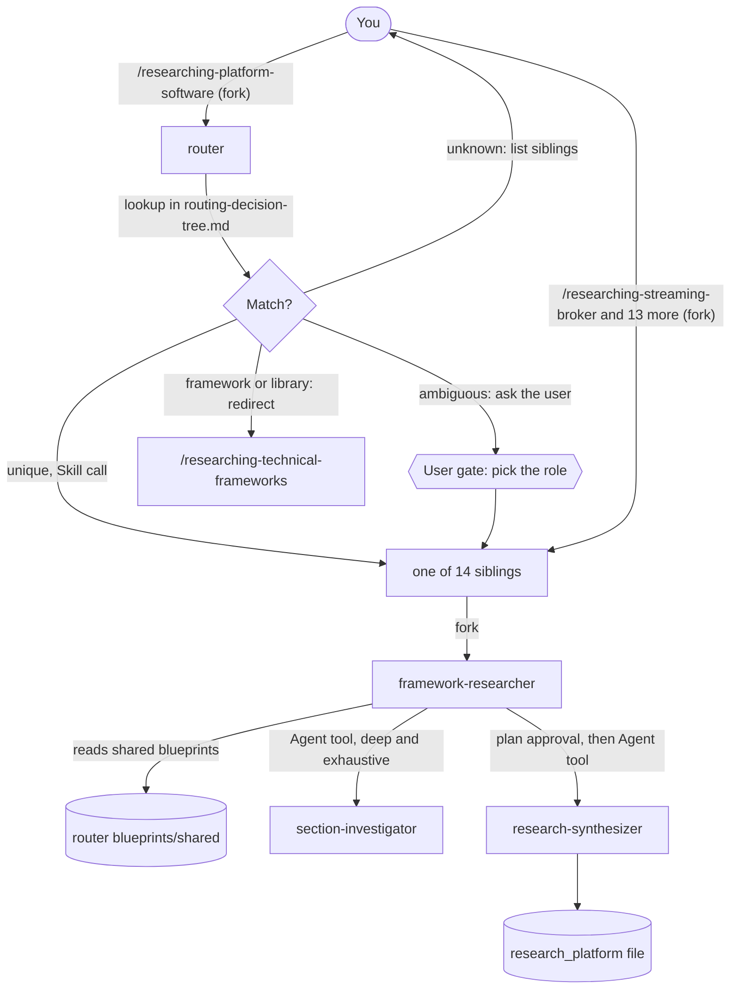

# researching-platform

researching-platform researches self-managed platform software (streaming brokers, relational and NoSQL databases, caches, search engines, API gateways, object storage and more) into version-pinned operational knowledge bases. It is for platform engineers and skill authors whose team will install and operate the software itself. You need it before you write skills or rules for a platform such as Kafka, PostgreSQL or Kong. One router command picks the right specialised command from the platform name.

> Version-lock: every run pins one platform and one exact version. This package is indivisible: the 14 specialised commands link the router's `blueprints/shared/`, so install the package as a whole and never a subset of its skills.

## Contents

<!-- BEGIN GENERATED:contents -->
**Depends on:** `factory-core`, `research-core`  
**Used by:** [`anti-hallucination-research`](../../bundles/anti-hallucination-research/README.md) (bundle)

| Type | Name | What it does |
|---|---|---|
| command | [`/researching-api-gateway`](.apm/skills/researching-api-gateway/SKILL.md) | Researches self-managed API gateways / API management platforms (Kong, Apache APISIX, Tyk, Traefik Enterprise, KrakenD, Envoy Gateway) into a hallucination-pro… |
| command | [`/researching-cache-store`](.apm/skills/researching-cache-store/SKILL.md) | Researches self-managed in-memory cache / session stores (Redis or Valkey as cache, Memcached, KeyDB, Dragonfly) into a hallucination-proof, version-absolute k… |
| command | [`/researching-columnar-analytics`](.apm/skills/researching-columnar-analytics/SKILL.md) | Researches self-managed columnar / OLAP analytics databases (ClickHouse, Apache Druid, Apache Pinot, DuckDB) into a hallucination-proof, version-absolute knowl… |
| command | [`/researching-coordination-service`](.apm/skills/researching-coordination-service/SKILL.md) | Researches self-managed distributed coordination services (etcd, Apache ZooKeeper, HashiCorp Consul) into a hallucination-proof, version-absolute knowledge bas… |
| command | [`/researching-document-store`](.apm/skills/researching-document-store/SKILL.md) | Researches self-managed document databases (MongoDB, Couchbase, RavenDB) into a hallucination-proof, version-absolute knowledge base covering installation, rep… |
| command | [`/researching-graph-database`](.apm/skills/researching-graph-database/SKILL.md) | Researches self-managed graph databases (Neo4j, JanusGraph, ArangoDB, Nebula Graph) into a hallucination-proof, version-absolute knowledge base covering instal… |
| command | [`/researching-kv-store`](.apm/skills/researching-kv-store/SKILL.md) | Researches self-managed persistent key-value stores (Redis or Valkey as primary datastore, RocksDB, LMDB, TiKV) into a hallucination-proof, version-absolute kn… |
| command | [`/researching-object-storage`](.apm/skills/researching-object-storage/SKILL.md) | Researches self-managed S3-compatible object storage (MinIO, Ceph RGW, SeaweedFS, GarageHQ) into a hallucination-proof, version-absolute knowledge base coverin… |
| command | [`/researching-platform-software`](.apm/skills/researching-platform-software/SKILL.md) | Entry-point that routes platform research requests to the correct specialized sibling skill (researching-streaming-broker, researching-rdbms, researching-docum… |
| command | [`/researching-rdbms`](.apm/skills/researching-rdbms/SKILL.md) | Researches self-managed relational / NewSQL databases (PostgreSQL, MySQL, MariaDB, CockroachDB) into a hallucination-proof, version-absolute knowledge base cov… |
| command | [`/researching-search-engine`](.apm/skills/researching-search-engine/SKILL.md) | Researches self-managed full-text search & log analytics engines (Elasticsearch, OpenSearch, Apache Solr, Typesense, Meilisearch) into a hallucination-proof, v… |
| command | [`/researching-streaming-broker`](.apm/skills/researching-streaming-broker/SKILL.md) | Researches self-managed streaming & messaging brokers (Apache Kafka, RabbitMQ, Apache Pulsar, NATS, ActiveMQ) into a hallucination-proof, version-absolute know… |
| command | [`/researching-timeseries-db`](.apm/skills/researching-timeseries-db/SKILL.md) | Researches self-managed time-series databases (InfluxDB, TimescaleDB, VictoriaMetrics, QuestDB) into a hallucination-proof, version-absolute knowledge base cov… |
| command | [`/researching-vector-store`](.apm/skills/researching-vector-store/SKILL.md) | Researches self-managed vector / ANN databases (Milvus, Qdrant, Weaviate, pgvector, Chroma) into a hallucination-proof, version-absolute knowledge base coverin… |
| command | [`/researching-wide-column-store`](.apm/skills/researching-wide-column-store/SKILL.md) | Researches self-managed wide-column databases (Apache Cassandra, ScyllaDB, Apache HBase) into a hallucination-proof, version-absolute knowledge base covering i… |
<!-- END GENERATED:contents -->

## Installation

<!-- BEGIN GENERATED:installation -->
| Item | Value |
|---|---|
| Package name | `agents-factory-researching-platform` |
| Version | `1.0.0` |
| Source folder | `packages/factory/researching-platform` |
| In this repository | listed directly in the root `apm.yml` |
| Also installs | `factory-core`, `research-core` |

Install it into another project, from that project's folder:

```bash
apm install <path-to-agents-factory>/packages/factory/researching-platform --target claude
```

Add `--dry-run` to preview the install. APM writes the skills, agents and rules into `.claude/`. Change the sources under `.apm/`, never the generated `.claude/`.
<!-- END GENERATED:installation -->

The commands fork into `framework-researcher` from [research-core](../research-core/README.md). It reads official documentation with `WebSearch` and `WebFetch`, so your session needs web access. No other runtime (Node, Python, JDK, cloud CLI) is stated in the sources.

## Quick Start

```bash
/researching-platform-software Kafka 3.7
```

The router names the sibling it chose on the first line (`Routing "Kafka 3.7" → researching-streaming-broker`) and forwards your arguments unchanged. The sibling researches, shows you a plan table, waits for your approval, then writes `research_platform_..._v3.7.md`. If you already know the family, call the sibling directly:

```bash
/researching-streaming-broker Kafka 3.7 deployment=kubernetes-operator
```

## Usage Scenarios

Every command is a deliberate `/command` (`disable-model-invocation: true`). The router and the 14 siblings take the same arguments, except that only the router reads `datastore-type=`.

**Shared `deployment=` values** (all 14 siblings and the router): `bare-metal`, `vm`, `container-compose`, `kubernetes-operator`, `hybrid`. A sibling asks for the deployment model if you leave it out. The playbooks live in the router's `blueprints/shared/deployment-guides/`: kubernetes-operator, container-compose and vm-and-bare-metal.

**Shared `depth=` and `iterations=`:** `depth=` is `quick`, `standard`, `deep` or `exhaustive` (default `exhaustive`). `iterations=` is the gap-filling loop limit (default `5`, ignored when `depth=quick`).

**Routing at a glance** (the full table is `blueprints/routing-decision-tree.md` in the router):

| You research | Sibling |
|---|---|
| Kafka, RabbitMQ, Pulsar, NATS, ActiveMQ | `/researching-streaming-broker` |
| Memcached, KeyDB, Dragonfly, Redis or Valkey as cache | `/researching-cache-store` |
| etcd, ZooKeeper, Consul | `/researching-coordination-service` |
| Elasticsearch, OpenSearch, Solr, Typesense, Meilisearch | `/researching-search-engine` |
| Kong, APISIX, Tyk, Traefik Enterprise, KrakenD, Envoy Gateway | `/researching-api-gateway` |
| PostgreSQL, MySQL, MariaDB, CockroachDB | `/researching-rdbms` |
| MongoDB, Couchbase, RavenDB | `/researching-document-store` |
| RocksDB, LMDB, TiKV, Redis or Valkey as primary store | `/researching-kv-store` |
| Cassandra, ScyllaDB, HBase | `/researching-wide-column-store` |
| Neo4j, JanusGraph, ArangoDB, Nebula Graph | `/researching-graph-database` |
| InfluxDB, TimescaleDB, VictoriaMetrics, QuestDB | `/researching-timeseries-db` |
| ClickHouse, Druid, Pinot, DuckDB | `/researching-columnar-analytics` |
| Milvus, Qdrant, Weaviate, pgvector, Chroma | `/researching-vector-store` |
| MinIO, Ceph RGW, SeaweedFS, GarageHQ | `/researching-object-storage` |

### Scenario 1 — Fastest default run (unique match)

You know the platform and the version.

```bash
/researching-platform-software Kafka 3.7
```

The router routes to `researching-streaming-broker` and produces no research text of its own. It passes extra arguments through unchanged and does not inject defaults. You get the research file from the sibling.

### Scenario 2 — Incomplete input: ambiguous platform

Redis plays three roles, so the router needs to know which one.

```bash
/researching-platform-software Redis 7.2
```

The router asks which role you deploy it for and lists three options: cache or session store (`researching-cache-store`), primary persistent key-value store (`researching-kv-store`), distributed coordination or locking (`researching-coordination-service`). Answer "cache", "kv" or "coordination" and it routes. Valkey behaves the same way and stays a separate research run: Redis and Valkey facts are never merged.

### Scenario 3 — Skip the question with an explicit disambiguator

```bash
/researching-platform-software Redis 7.2 datastore-type=kv
```

The router reads `datastore-type=kv`, routes straight to `researching-kv-store` and does not ask again. The accepted values in the argument hint are `rdbms`, `document`, `kv`, `wide-column`, `graph`, `time-series`, `columnar`, `vector` and `object`. The routing table and the router's evaluation scenarios also use `cache` and `coordination-analog` for Redis. The hint does not list them, so treat those two as *unverified* as flag values and answer the question in plain words instead.

### Scenario 4 — Platform not in the routing table

```bash
/researching-platform-software Aerospike 7.0
```

The router does not guess. It lists the 14 siblings with one-line descriptions, suggests the two closest candidates (for Aerospike the evaluation scenario names `researching-kv-store` and `researching-document-store`) and asks which fits, or whether the platform should be added to the routing table.

### Scenario 5 — Misuse: a framework or client library, not a platform

```bash
/researching-platform-software Debezium 3.0
```

Debezium, Kafka Streams, Kafka Connect and Schema Registry are not platforms. The router replies with `/researching-technical-frameworks Debezium 3.0` and stops. The source database (for example MySQL) still goes through the router. The same applies to a client library sent straight to a sibling:

```bash
/researching-streaming-broker kafka-python 2.0
```

The sibling detects a client library and redirects you to `researching-technical-frameworks`. See [researching-frameworks](../researching-frameworks/README.md).

### Scenario 6 — Call a sibling directly with a deployment model

```bash
/researching-streaming-broker Kafka 3.7 deployment=kubernetes-operator depth=standard
```

You get the base research plus the conditional "Kubernetes Deployment Blueprint" section (included when `deployment=kubernetes-operator`). The streaming-broker evaluation expects the Strimzi operator and KRaft mode for this request.

### Scenario 7 — Wrong tool for the workload

Several siblings check the workload and redirect you when it does not fit:

```bash
/researching-coordination-service etcd 3.5 (workload: 100k writes/sec application events)
/researching-api-gateway Kong 3.7 (question: how to expose the admin API for a remote team)
/researching-cache-store Redis 7.2 (workload: never lose customer session data)
```

The first is rejected as an etcd workload and redirected to `researching-streaming-broker` (event streams) or `researching-kv-store` (application data). The second refuses public exposure of the raw admin API and recommends RBAC with mTLS, an authenticated proxy, Kong Manager with auth, or GitOps with decK. The third is a primary-datastore need, not a cache, so the sibling routes to `researching-kv-store` or asks you to confirm.

### Scenario 8 — Extensions and category-crossing platforms

```bash
/researching-platform-software PostgreSQL 16
/researching-platform-software pgvector 0.7
/researching-platform-software TimescaleDB 2.14
```

PostgreSQL alone routes to `researching-rdbms` and may mention the extensions. pgvector routes to `researching-vector-store` and TimescaleDB to `researching-timeseries-db`. For both, the router notes that base PostgreSQL operations still apply and recommends also consulting `researching-rdbms`.

### Scenario 9 — Chain research into a skill

```bash
/researching-platform-software Kafka 3.7 deployment=kubernetes-operator
/skill-creator <research-file>
```

The second command comes from [artifact-authoring](../artifact-authoring/README.md). For an example of what is built from this kind of research, see the [Kafka package](../../data-platform/streaming/kafka/README.md).

### Scenario 10 — Partial install

If a file in the router's `blueprints/shared/` is missing, the router reports the file name and tells you to reinstall the whole package. It does not route normally and let a sibling fail in the middle of a run.

## Commands Reference

Fifteen commands: the router first, then one per family in alphabetical order. All fork into `framework-researcher`. Every sibling shares this contract:

- **Output:** each sibling's SKILL.md says to save `research_platform_{{PLATFORM_SOFTWARE}}_v{{TARGET_VERSION}}.md` in `workspace/docs/`. See Output structure for a conflict with the agent file.
- **Base sections** (from `output-format-base.md`): Metadata, Executive Summary, Platform Glossary, Operational Guardrails (Mandatory Configs, Topology Decisions, Anti-Patterns), Installation and Bootstrap Blueprint, Configuration Reference, HA and Failover Topology, Backup Restore and PITR, Upgrade and Migration Path, Observability and KPIs, Security Hardening Checklist, Failure Modes and Runbooks, Ecosystem and Adjacent Tools, Research Iteration Changelog.
- **Conditional sections:** Kubernetes Deployment Blueprint when `deployment=kubernetes-operator` (all 14 siblings); API Management Specifics (API gateways); Data Modeling (every sibling except the four named below).
- **Scope:** a sibling does not research managed cloud equivalents (RDS, MSK, Atlas, Amazon S3 and similar).
- **Prerequisites:** web access and a pinned version. Each `blueprints/references/` folder holds only an index `README.md` today and no per-vendor cards. At least the streaming-broker SKILL.md says to read the vendor reference card first, so expect the sibling to research from official documentation.

### `/researching-platform-software`

*Router: picks the right sibling from the platform name, then hands the research over.*

**Syntax**

```bash
/researching-platform-software <platform> <version> [datastore-type=rdbms|document|kv|wide-column|graph|time-series|columnar|vector|object] [deployment=bare-metal|vm|container-compose|kubernetes-operator|hybrid] [depth=exhaustive] [iterations=5]
```

**Parameters**

| Parameter | Required | Default | Description |
|---|---|---|---|
| `<platform>` | yes | none | Platform name. Matching ignores case and strips vendor prefixes such as "Apache" and "HashiCorp". Aliases work (`es`, `mongo`, `pg`, `kong`). |
| `<version>` | yes | none | Exact stable version, for example `3.7`, `7.0`, `16`. |
| `datastore-type=` | no | none | Disambiguator for platforms with several roles, mainly Redis and Valkey. Values as listed in the syntax. |
| `deployment=` | no | not stated | `bare-metal`, `vm`, `container-compose`, `kubernetes-operator` or `hybrid`. Passed through unchanged. |
| `depth=` | no | `exhaustive` | `quick`, `standard`, `deep` or `exhaustive`. Passed through unchanged. |
| `iterations=` | no | `5` | Gap-filling loop limit. Passed through unchanged. |

**Prerequisites**

- The complete package installed, so `blueprints/shared/` and all 14 siblings exist.

**What it does**

1. Parses `<platform>` and looks it up in `routing-decision-tree.md`.
2. Unique match: logs `Routing "<platform> <version>" → researching-<sibling>` on the first line and invokes the sibling.
3. Ambiguous match (Redis, Valkey): asks which role, then routes.
4. Not a platform (Kafka Streams, Kafka Connect, Schema Registry, Debezium): replies with the `/researching-technical-frameworks` redirect and stops.
5. No match: lists the 14 siblings and the two closest candidates. It never invents a route.

**What is updated and what is not**

It writes nothing. All research content comes from the sibling. It never researches inline and never rewrites your arguments.

**Output files**

None of its own.

**Examples**

```bash
/researching-platform-software MongoDB 7.0
/researching-platform-software Redis 7.2 datastore-type=kv
```

**Next**

The sibling it routes to, then `/skill-creator` from [artifact-authoring](../artifact-authoring/README.md).

### `/researching-streaming-broker`

*Streaming and messaging brokers: Apache Kafka, RabbitMQ, Apache Pulsar, NATS, Apache ActiveMQ and ActiveMQ Artemis.*

**Syntax**

```bash
/researching-streaming-broker <platform> <version> [deployment=bare-metal|vm|container-compose|kubernetes-operator|hybrid] [depth=exhaustive] [iterations=5]
```

**Parameters**

| Parameter | Required | Default | Description |
|---|---|---|---|
| `<platform>` | yes | none | A broker from the list above. |
| `<version>` | yes | none | Exact stable version. |
| `deployment=` | no | not stated (asked if missing) | See the shared values in Usage Scenarios. |
| `depth=` | no | `exhaustive` | `quick`, `standard`, `deep`, `exhaustive`. |
| `iterations=` | no | `5` | Gap loop limit. |

**Example**

```bash
/researching-streaming-broker RabbitMQ 3.13 deployment=vm depth=standard
```

**Differs:** covers delivery semantics per producer and consumer, minimum quorum size for the HA topology, retention model and geo-replication. Data Modeling does not apply. It asks about the delivery guarantee target (at-least-once or exactly-once) when you do not state it. It uses each broker's own terms: `partition` is Kafka-specific, RabbitMQ uses `queue`.

### `/researching-cache-store`

*Ephemeral in-memory cache and session stores: Redis, Valkey, Memcached, KeyDB, Dragonfly.*

**Syntax**

```bash
/researching-cache-store <platform> <version> [deployment=bare-metal|vm|container-compose|kubernetes-operator|hybrid] [depth=exhaustive] [iterations=5]
```

**Parameters**

| Parameter | Required | Default | Description |
|---|---|---|---|
| `<platform>` | yes | none | Redis, Valkey, Memcached, KeyDB or Dragonfly, used as an ephemeral cache. |
| `<version>` | yes | none | Exact stable version. |
| `deployment=` | no | not stated | See the shared values in Usage Scenarios. |
| `depth=` | no | `exhaustive` | `quick`, `standard`, `deep`, `exhaustive`. |
| `iterations=` | no | `5` | Gap loop limit. |

**Example**

```bash
/researching-cache-store Memcached 1.6 deployment=kubernetes-operator depth=standard
```

**Differs:** covers eviction policies and persistence trade-offs. Data Modeling does not apply (use `researching-kv-store` for that). It insists on a TTL policy and warns that a cache without TTL grows without bound. Data that must survive a restart belongs to `researching-kv-store`.

### `/researching-coordination-service`

*Distributed coordination: etcd, Apache ZooKeeper, HashiCorp Consul.*

**Syntax**

```bash
/researching-coordination-service <platform> <version> [deployment=bare-metal|vm|container-compose|kubernetes-operator|hybrid] [depth=exhaustive] [iterations=5]
```

**Parameters**

| Parameter | Required | Default | Description |
|---|---|---|---|
| `<platform>` | yes | none | etcd, Apache ZooKeeper or HashiCorp Consul. |
| `<version>` | yes | none | Exact stable version. |
| `deployment=` | no | not stated | See the shared values in Usage Scenarios. |
| `depth=` | no | `exhaustive` | `quick`, `standard`, `deep`, `exhaustive`. |
| `iterations=` | no | `5` | Gap loop limit. |

**Example**

```bash
/researching-coordination-service Apache ZooKeeper 3.9 deployment=vm depth=standard
```

**Differs:** covers consensus quorum, distributed locking, leader election and service discovery. Data Modeling does not apply. Use it for cluster metadata and locks, not for bulk application data.

### `/researching-search-engine`

*Full-text search and log analytics: Elasticsearch, OpenSearch, Apache Solr, Typesense, Meilisearch.*

**Syntax**

```bash
/researching-search-engine <platform> <version> [deployment=bare-metal|vm|container-compose|kubernetes-operator|hybrid] [depth=exhaustive] [iterations=5]
```

**Parameters**

| Parameter | Required | Default | Description |
|---|---|---|---|
| `<platform>` | yes | none | One of the five engines. |
| `<version>` | yes | none | Exact stable version. |
| `deployment=` | no | not stated | See the shared values in Usage Scenarios. |
| `depth=` | no | `exhaustive` | `quick`, `standard`, `deep`, `exhaustive`. |
| `iterations=` | no | `5` | Gap loop limit. |

**Example**

```bash
/researching-search-engine Meilisearch 1.8 deployment=container-compose depth=standard
```

**Differs:** covers shard and replica topology, index lifecycle and mapping design. Mapping, analyzer and index design count as the Data Modeling section. For arbitrary user-defined JSON it warns about mapping explosion and recommends `dynamic: false` or `dynamic: strict` with a field limit. When vector search is the main use case it points to `researching-vector-store`.

### `/researching-api-gateway`

*Self-managed API gateways: Kong Gateway, Apache APISIX, Tyk, Traefik Enterprise, KrakenD, Envoy Gateway.*

**Syntax**

```bash
/researching-api-gateway <platform> <version> [deployment=bare-metal|vm|container-compose|kubernetes-operator|hybrid] [depth=exhaustive] [iterations=5]
```

**Parameters**

| Parameter | Required | Default | Description |
|---|---|---|---|
| `<platform>` | yes | none | One of the six gateways. |
| `<version>` | yes | none | Exact stable version. |
| `deployment=` | no | not stated | See the shared values in Usage Scenarios. |
| `depth=` | no | `exhaustive` | `quick`, `standard`, `deep`, `exhaustive`. |
| `iterations=` | no | `5` | Gap loop limit. |

**Example**

```bash
/researching-api-gateway Kong 3.7 deployment=kubernetes-operator depth=standard
```

**Differs:** always includes the API Management Specifics section (control plane and data plane, plugin lifecycle, auth, rate limiting). Data Modeling does not apply. It treats public exposure of the raw admin API as a critical anti-pattern. Managed services such as AWS API Gateway or Azure APIM are out of scope.

### `/researching-rdbms`

*Relational and NewSQL databases: PostgreSQL, MySQL, MariaDB, CockroachDB.*

**Syntax**

```bash
/researching-rdbms <platform> <version> [deployment=bare-metal|vm|container-compose|kubernetes-operator|hybrid] [depth=exhaustive] [iterations=5]
```

**Parameters**

| Parameter | Required | Default | Description |
|---|---|---|---|
| `<platform>` | yes | none | PostgreSQL, MySQL, MariaDB or CockroachDB. |
| `<version>` | yes | none | Exact stable version. |
| `deployment=` | no | not stated | See the shared values in Usage Scenarios. |
| `depth=` | no | `exhaustive` | `quick`, `standard`, `deep`, `exhaustive`. |
| `iterations=` | no | `5` | Gap loop limit. |

**Example**

```bash
/researching-rdbms PostgreSQL 16 deployment=kubernetes-operator depth=standard
```

**Differs:** covers replication, backup with PITR, normalization, indexing and partitioning (always includes Data Modeling). For zero data loss it recommends synchronous replication with at least two standbys and documents the latency cost. Managed services (RDS, Cloud SQL, Aurora) are out of scope.

### `/researching-document-store`

*Document databases: MongoDB, Couchbase, RavenDB.*

**Syntax**

```bash
/researching-document-store <platform> <version> [deployment=bare-metal|vm|container-compose|kubernetes-operator|hybrid] [depth=exhaustive] [iterations=5]
```

**Parameters**

| Parameter | Required | Default | Description |
|---|---|---|---|
| `<platform>` | yes | none | MongoDB, Couchbase or RavenDB. |
| `<version>` | yes | none | Exact stable version. |
| `deployment=` | no | not stated | See the shared values in Usage Scenarios. |
| `depth=` | no | `exhaustive` | `quick`, `standard`, `deep`, `exhaustive`. |
| `iterations=` | no | `5` | Gap loop limit. |

**Example**

```bash
/researching-document-store MongoDB 7.0 deployment=kubernetes-operator depth=standard
```

**Differs:** covers replica sets, sharding, PITR and document modeling (embed or reference, indexing, schema evolution). For heavy multi-entity JOINs and cross-entity ACID it points to `researching-rdbms`. Managed services (Atlas, DocumentDB) are out of scope.

### `/researching-kv-store`

*Persistent key-value stores: Redis or Valkey as primary database, RocksDB, LMDB, TiKV.*

**Syntax**

```bash
/researching-kv-store <platform> <version> [deployment=bare-metal|vm|container-compose|kubernetes-operator|hybrid] [depth=exhaustive] [iterations=5]
```

**Parameters**

| Parameter | Required | Default | Description |
|---|---|---|---|
| `<platform>` | yes | none | Redis, Valkey, RocksDB, LMDB or TiKV, used as the primary store. |
| `<version>` | yes | none | Exact stable version. |
| `deployment=` | no | not stated | See the shared values in Usage Scenarios. |
| `depth=` | no | `exhaustive` | `quick`, `standard`, `deep`, `exhaustive`. |
| `iterations=` | no | `5` | Gap loop limit. |

**Example**

```bash
/researching-kv-store TiKV 7.5 deployment=kubernetes-operator depth=standard
```

**Differs:** covers persistence and durability and key design (structures, TTL, access patterns). When the request is an ephemeral cache where eviction is fine, it routes to `researching-cache-store` or asks to confirm.

### `/researching-wide-column-store`

*Wide-column databases: Apache Cassandra, ScyllaDB, Apache HBase.*

**Syntax**

```bash
/researching-wide-column-store <platform> <version> [deployment=bare-metal|vm|container-compose|kubernetes-operator|hybrid] [depth=exhaustive] [iterations=5]
```

**Parameters**

| Parameter | Required | Default | Description |
|---|---|---|---|
| `<platform>` | yes | none | Apache Cassandra, ScyllaDB or Apache HBase. |
| `<version>` | yes | none | Exact stable version. |
| `deployment=` | no | not stated | See the shared values in Usage Scenarios. |
| `depth=` | no | `exhaustive` | `quick`, `standard`, `deep`, `exhaustive`. |
| `iterations=` | no | `5` | Gap loop limit. |

**Example**

```bash
/researching-wide-column-store Apache Cassandra 5.0 deployment=kubernetes-operator depth=standard
```

**Differs:** covers ring and replication topology and query-first modeling with partition and clustering keys. For time-series events it warns against date-only partition keys (hot partition) and recommends a composite key and TWCS compaction. Managed services (Keyspaces, Bigtable) are out of scope.

### `/researching-graph-database`

*Graph databases: Neo4j, JanusGraph, ArangoDB, Nebula Graph.*

**Syntax**

```bash
/researching-graph-database <platform> <version> [deployment=bare-metal|vm|container-compose|kubernetes-operator|hybrid] [depth=exhaustive] [iterations=5]
```

**Parameters**

| Parameter | Required | Default | Description |
|---|---|---|---|
| `<platform>` | yes | none | Neo4j, JanusGraph, ArangoDB or Nebula Graph. |
| `<version>` | yes | none | Exact stable version. |
| `deployment=` | no | not stated | See the shared values in Usage Scenarios. |
| `depth=` | no | `exhaustive` | `quick`, `standard`, `deep`, `exhaustive`. |
| `iterations=` | no | `5` | Gap loop limit. |

**Example**

```bash
/researching-graph-database Neo4j 5.20 deployment=kubernetes-operator depth=standard
```

**Differs:** covers cluster and causal-consistency HA and graph modeling (node and edge granularity, property placement, super-node mitigation). For heavy tabular aggregation it points to `researching-rdbms` or `researching-columnar-analytics`. Managed services such as Neptune are out of scope.

### `/researching-timeseries-db`

*Time-series databases: InfluxDB, TimescaleDB, VictoriaMetrics, QuestDB.*

**Syntax**

```bash
/researching-timeseries-db <platform> <version> [deployment=bare-metal|vm|container-compose|kubernetes-operator|hybrid] [depth=exhaustive] [iterations=5]
```

**Parameters**

| Parameter | Required | Default | Description |
|---|---|---|---|
| `<platform>` | yes | none | InfluxDB, TimescaleDB, VictoriaMetrics or QuestDB. |
| `<version>` | yes | none | Exact stable version. |
| `deployment=` | no | not stated | See the shared values in Usage Scenarios. |
| `depth=` | no | `exhaustive` | `quick`, `standard`, `deep`, `exhaustive`. |
| `iterations=` | no | `5` | Gap loop limit. |

**Example**

```bash
/researching-timeseries-db TimescaleDB 2.14 deployment=kubernetes-operator depth=standard
```

**Differs:** covers retention, downsampling and modeling (tags versus fields, cardinality budget, chunk sizing). It warns that a high-cardinality value such as a user id used as a tag explodes the series count.

### `/researching-columnar-analytics`

*Columnar OLAP databases: ClickHouse, Apache Druid, Apache Pinot, DuckDB.*

**Syntax**

```bash
/researching-columnar-analytics <platform> <version> [deployment=bare-metal|vm|container-compose|kubernetes-operator|hybrid] [depth=exhaustive] [iterations=5]
```

**Parameters**

| Parameter | Required | Default | Description |
|---|---|---|---|
| `<platform>` | yes | none | ClickHouse, Apache Druid, Apache Pinot or DuckDB. |
| `<version>` | yes | none | Exact stable version. |
| `deployment=` | no | not stated | See the shared values in Usage Scenarios. |
| `depth=` | no | `exhaustive` | `quick`, `standard`, `deep`, `exhaustive`. |
| `iterations=` | no | `5` | Gap loop limit. |

**Example**

```bash
/researching-columnar-analytics DuckDB 1.0 deployment=bare-metal depth=standard
```

**Differs:** covers ingestion and analytical modeling (sort keys, partitioning, materialized views, dedup). High-frequency single-row transactional updates are an OLTP workload, so it recommends `researching-rdbms` and suggests CDC (Debezium) when you also need analytics.

### `/researching-vector-store`

*Vector and ANN databases: Milvus, Qdrant, Weaviate, pgvector, Chroma.*

**Syntax**

```bash
/researching-vector-store <platform> <version> [deployment=bare-metal|vm|container-compose|kubernetes-operator|hybrid] [depth=exhaustive] [iterations=5]
```

**Parameters**

| Parameter | Required | Default | Description |
|---|---|---|---|
| `<platform>` | yes | none | Milvus, Qdrant, Weaviate, pgvector or Chroma. |
| `<version>` | yes | none | Exact stable version. |
| `deployment=` | no | not stated | See the shared values in Usage Scenarios. |
| `depth=` | no | `exhaustive` | `quick`, `standard`, `deep`, `exhaustive`. |
| `iterations=` | no | `5` | Gap loop limit. |

**Example**

```bash
/researching-vector-store Qdrant 1.9 deployment=kubernetes-operator depth=standard
```

**Differs:** covers index topology and vector modeling (distance metric, index type, chunking, hybrid search). For a RAG workload it recommends chunking of 256 to 512 tokens with 10 to 20 percent overlap and hybrid dense plus BM25 search. pgvector is an extension: base PostgreSQL operations stay with `researching-rdbms`.

### `/researching-object-storage`

*S3-compatible object storage: MinIO, Ceph RGW, SeaweedFS, GarageHQ.*

**Syntax**

```bash
/researching-object-storage <platform> <version> [deployment=bare-metal|vm|container-compose|kubernetes-operator|hybrid] [depth=exhaustive] [iterations=5]
```

**Parameters**

| Parameter | Required | Default | Description |
|---|---|---|---|
| `<platform>` | yes | none | MinIO, Ceph RGW, SeaweedFS or GarageHQ. |
| `<version>` | yes | none | Exact version: date-based for MinIO (for example `2024`), semver for the others. |
| `deployment=` | no | not stated | See the shared values in Usage Scenarios. |
| `depth=` | no | `exhaustive` | `quick`, `standard`, `deep`, `exhaustive`. |
| `iterations=` | no | `5` | Gap loop limit. |

**Example**

```bash
/researching-object-storage MinIO 2024 deployment=kubernetes-operator depth=standard
```

**Differs:** covers erasure coding and replication HA and bucket layout, lifecycle and S3 compatibility. Object storage is for immutable blobs: frequently updated, queryable records go to `researching-rdbms` or `researching-document-store`. Managed Amazon S3 is out of scope.

## Architecture



## Agents Reference

<!-- BEGIN GENERATED:agents-reference -->
This package has no subagents. Claude loads its skills by description, and agents of other packages can load them too.
<!-- END GENERATED:agents-reference -->

This package has no agent of its own. It uses the agents of [research-core](../research-core/README.md).

- `framework-researcher` runs the workflow for every sibling. It does not write SKILL.md files, audit architecture or change project files, and it writes nothing before you approve the plan.
- `section-investigator` and `research-synthesizer` are internal helpers started only by `framework-researcher`.
- The router is a thin routing layer. It contains no research logic and produces no research text.
- Non-interactive contract: the agents describe an approval step and do not describe a mode that returns numbered questions. Treat the commands as interactive. Unattended use is *unverified*.

## Output structure

```text
workspace/docs/
└── research_platform_<PLATFORM_SOFTWARE>_v<TARGET_VERSION>.md
```

This is the location the sibling SKILL.md files state. `framework-researcher` says it writes into the directory from the arguments or the invoking skill's directory and does not use `workspace/docs/` unless it exists and the arguments point to it. The two statements conflict. Check where the file landed after the run.

The router's `blueprints/shared/` holds the assets every sibling reuses: `output-format-base.md`, `research-scope-operations.md`, `data-modeling-principles.md`, `reference-card-template.md`, `reference-card-example-kafka-3.7.md` and three `deployment-guides/` playbooks.

## Limits and constraints

| Item | Value | Source |
|---|---|---|
| Install unit | the whole package; never a subset of skills | `apm.yml`, router SKILL.md |
| Routing | every route traces to a row in `routing-decision-tree.md`; unknown platforms are never guessed | router SKILL.md |
| Ambiguous platforms | Redis and Valkey (three roles), PostgreSQL with extensions, Elasticsearch for vector search | `routing-decision-tree.md` |
| Redis and Valkey | researched separately, one version per run | `routing-decision-tree.md` |
| Not a platform | Kafka Streams, Kafka Connect, Schema Registry, Debezium: redirected to `researching-technical-frameworks` | `routing-decision-tree.md` |
| Argument passthrough | the router forwards `deployment=`, `depth=`, `iterations=` unchanged and injects no defaults | router SKILL.md |
| Default depth | `exhaustive` | argument hints |
| Default iterations | `5`; ignored when `depth=quick` | argument hints, `framework-researcher` |
| Deployment values | `bare-metal`, `vm`, `container-compose`, `kubernetes-operator`, `hybrid`; default not stated | argument hints |
| Data Modeling section | not applicable to streaming brokers, caches, coordination services and API gateways | sibling SKILL.md files |
| Scope exclusion | managed cloud services (RDS, MSK, Atlas, Amazon S3, Elastic Cloud and similar) | sibling descriptions |
| Scope exclusion | client SDKs and frameworks: use `researching-technical-frameworks` | router SKILL.md |
| Source age | rejected after 12 months unless it documents the current stable version; this comes from `framework-researcher` and the output template | `framework-researcher` |

## Related

- Family guides: [platform software entry points](../../../docs/entry-points/platform-software.md), [factory research entry points](../../../docs/entry-points/factory-research.md)
- Depends on: [factory-core](../factory-core/README.md), [research-core](../research-core/README.md)
- Next step: [artifact-authoring](../artifact-authoring/README.md)
- Client SDKs and frameworks: [researching-frameworks](../researching-frameworks/README.md)
- Example of output built from this research: [Kafka package](../../data-platform/streaming/kafka/README.md)
- [Agent architecture](../../../docs/agents/architecture.md)
- [All packages](../../../docs/packages/README.md)
