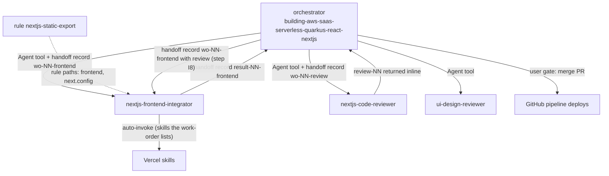

# nextjs-frontend

This package builds and reviews the front end of a SaaS that ships as a Next.js static export on S3 and CloudFront. It holds an implementation agent, a code reviewer and one scoped rule. You need it when a work-order asks for one closed front-end task or for a code review of it. The orchestrator `building-aws-saas-serverless-quarkus-react-nextjs` starts both agents.

> Version lock: Next.js static export (`output: 'export'`), React, pnpm, Node 26.

## Contents

<!-- BEGIN GENERATED:contents -->
**Depends on:** `factory-core`, `handoff-core`  
**Used by:** `aws-saas-serverless-quarkus-react-nextjs`

| Type | Name | What it does |
|---|---|---|
| agent (sonnet) | [`nextjs-code-reviewer`](.apm/agents/nextjs-code-reviewer.agent.md) | Next.js Code Reviewer - independent, read-only reviewer (step I7) of the front-end diff produced by nextjs-frontend-integrator for a Next.js static export (S3… |
| agent (sonnet) | [`nextjs-frontend-integrator`](.apm/agents/nextjs-frontend-integrator.agent.md) | Next.js Frontend Integrator - non-interactive executor that implements ONE closed front-end task of a SaaS (Next.js static export on S3 + CloudFront, React, pn… |
| rule | [`nextjs-static-export.instructions`](.apm/instructions/nextjs-static-export.instructions.md) | Guardrails for a Next.js front end deployed as a static export to S3 + CloudFront: output 'export', no server features, unoptimized images, no secrets in NEXT_… |
<!-- END GENERATED:contents -->

## Installation

<!-- BEGIN GENERATED:installation -->
| Item | Value |
|---|---|
| Package name | `agents-factory-nextjs-frontend` |
| Version | `1.0.0` |
| Source folder | `packages/frontend/react/nextjs-frontend` |
| In this repository | installed transitively, through `aws-saas-serverless-quarkus-react-nextjs` |
| Also installs | `factory-core`, `handoff-core`, `openspec-core` |

Install it into another project, from that project's folder:

```bash
apm install <path-to-agents-factory>/packages/frontend/react/nextjs-frontend --target claude
```

Add `--dry-run` to preview the install. APM writes the skills, agents and rules into `.claude/`. Change the sources under `.apm/`, never the generated `.claude/`.
<!-- END GENERATED:installation -->

Runtime prerequisites stated in the agent: `node` and `pnpm` must be installed and meet what the loaded skills and `building-nextjs-github-actions-v16-4` state (pnpm on Node 26). The integrator runs `node --version` and `pnpm --version` first and stops if they do not meet it. It does not change your toolchain.

The agents load Vercel skills (for example `react-best-practices`, `composition-patterns`, `building-components`, `web-design-guidelines`, `next-dev-loop`, `next-bundle-optimizer`). This package ships none of them. They come from [vercel-frontend](../../../third-party/vercel-frontend/README.md). In `apm.yml` the line `#- path: ../../../third-party/vercel-frontend` is commented out, so this package does not install them on its own. Check that the skills are present before you use the agents alone.

## Quick Start

This package has no `/command`. The orchestrator launches the agents with the Agent tool and passes a work-order file. Two plain-text requests, quoted from the agent descriptions:

```text
execute openspec/changes/list-tenant-items/handoff/wo-07-frontend.md
```

```text
review the files listed in wo-08-review.md against the items-api contract
```

The first goes to `nextjs-frontend-integrator`, the second to `nextjs-code-reviewer`. The rule loads on its own when you edit a file under `frontend/` or a `next.config.*`. To run the whole flow, start the orchestrator. See [SaaS on Quarkus and AWS entry points](../../../../docs/entry-points/saas-quarkus-aws.md).

## Usage Scenarios

The agents have no evaluation scenarios of their own. The scenarios below come from the agent descriptions and from their Workflow and Never-Do sections.

### Scenario 1 — Build one front-end task

Use it when the orchestrator has a closed work-order for one screen or component.

```text
execute openspec/changes/list-tenant-items/handoff/wo-07-frontend.md
```

You get code in the front-end folder, tests named `R<n>_<scenario>_<expectation>` (for example `R1_empty_showsEmptyState`), and a report `result-NN-frontend.md` with the `pnpm build` output in `out/`, its hash, the commands actually run and a "Spec impact" section.

### Scenario 2 — Incomplete work-order

Use it to see what happens when something is missing: requirements, wireframe, design system, contract, ADRs, skill list, limits or target path.

```text
execute openspec/changes/list-tenant-items/handoff/wo-07-frontend.md
```

The integrator stops at Step 0, writes no code and reports `outcome: needs-input` with numbered questions. Answer them through the orchestrator, which sends a new work-order.

### Scenario 3 — Cognito browser login

Use it when a screen needs login in the browser (Hosted UI or OIDC PKCE).

```text
execute openspec/changes/list-tenant-items/handoff/wo-07-frontend.md
```

No skill covers this, so it is `(unverified)` and Ask First. The integrator returns `needs-input` until the work-order settles it.

### Scenario 4 — Code review of the diff

Use it after the integrator reports, before the visual review.

```text
review the files listed in wo-08-review.md against the items-api contract
```

You get one review record (role `frontend`) with the matrix requirement -> scenario -> test (file:line) and findings rated HIGH, MEDIUM or LOW. `approved` needs no HIGH and every MEDIUM fixed or justified in the work-order.

### Scenario 5 — Fix after a review (step I8)

Use it when the review is `changes-requested`.

```text
Hand the integrator the work-order with the review-NN.md path (step I8).
```

HIGH findings are always fixed, MEDIUM fixed or justified, then it goes back to step I6 (install, lint, test, build). If the review-round limit is reached, it returns `needs-input` without editing.

### Scenario 6 — Misuse: server features, deploy, or secrets

Use this as a guide to what the agents refuse.

```text
Add a Server Action that calls the Stripe API and deploy the site with vercel.
```

Both are refused. A static export cannot use Server Actions, ISR, rewrites, Proxy or default image optimization. The integrator never runs `aws`, `vercel`, `terraform` or `gh`: the GitHub pipeline publishes the artifact after the PR. A secret never goes into `NEXT_PUBLIC_*`; it stays server-side in AWS behind the API. A call to an endpoint outside the contract needs a contract delta from the orchestrator.

### Scenario 7 — Chaining

```text
nextjs-frontend-integrator -> nextjs-code-reviewer -> ui-design-reviewer (E6-visual)
```

The code reviewer runs first. The visual review in [ui-design](../ui-design/README.md) comes after it approves.

## Skills Reference

This package ships no skill. The agents load these skills when the work-order lists them (the integrator allows only this set, plus `react-view-transitions`, `turborepo` and `agent-browser` when listed). A skill outside the set, or one needed but not listed, becomes a question.

| Skill | Loads when | Locks | Never |
|---|---|---|---|
| `react-best-practices` | work-order lists it | upstream Vercel skill, pinned in `vercel-frontend` | The agents keep its `(unverified)` tags |
| `composition-patterns` | work-order lists it | same | same |
| `building-components` | work-order lists it | same | same |
| `web-design-guidelines` | work-order lists it | same | same |
| `next-dev-loop` | work-order lists it | same | same |
| `next-bundle-optimizer` | work-order lists it | same | same |
| `react-view-transitions`, `turborepo`, `agent-browser` | only when listed | same | same |
| `building-nextjs-github-actions-v16-4` | integrator preflight reads its Node and pnpm facts | from package `github-actions-cicd` | not stated |

## Pipeline



## Agents Reference

<!-- BEGIN GENERATED:agents-reference -->
| Agent | Model | Tools | Can start agents | Started by |
|---|---|---|---|---|
| [`nextjs-code-reviewer`](.apm/agents/nextjs-code-reviewer.agent.md) | sonnet | Read, Grep, Glob | no | an orchestrator or another agent |
| [`nextjs-frontend-integrator`](.apm/agents/nextjs-frontend-integrator.agent.md) | sonnet | Read, Grep, Glob, Edit, Write, Bash | no | an orchestrator or another agent |
<!-- END GENERATED:agents-reference -->

### nextjs-frontend-integrator

- Model `sonnet`. Tools: Read, Grep, Glob, Edit, Write, Bash. Non-interactive.
- Steps: I0 plan, I1 tests first, I2 minimal implementation, I3 refinement (four states, 401 to login, 403 to a no-permission view, network errors, accessibility), I4 clean code, I5 behavior-preserving refactor, I6 verify, I8 fix (only with a review), I9 close.
- I6 runs `pnpm install --frozen-lockfile`, lint, test and `pnpm build` (static export to `out/`), then hashes `out/` with `python .claude/skills/coordinating-agent-handoffs/scripts/portable.py dirhash out`.
- Each failed I6 run counts as one `build_attempts`. At `limits.build_attempts` it stops with `outcome: failed` or `needs-input`, with what each attempt tried and the persisting error.
- Report: `result-NN-frontend.md` (`kind: report`, role `frontend`, `outcome: success | partial | failed | needs-input`, `spec_impact: none | divergence | ambiguity`) with a "Spec impact" section. It never claims a green build it did not run.
- It calls only endpoints of the contract and reads per-environment values from a config the client fetches.
- Ask First: Cognito browser login, dependencies beyond what the work-order implies, a skill not listed, overwriting files this task did not create.
- Never: call endpoints outside the contract, use Server Actions, route handlers, `next/headers`, ISR or Proxy, put secrets in `NEXT_PUBLIC_*`, deploy or publish, run `aws`, `vercel`, `terraform` or `gh`, spawn agents, run `git commit` or `git push`, edit the spec, ADRs, `tasks.md` or other agents' records, review its own output, write outside the front-end folder and the handoff folder.

### nextjs-code-reviewer

- Model `sonnet`. Tools: Read, Grep, Glob. Read-only, non-interactive.
- It checks the files of the work-order against the `nextjs-static-export` rule, the Never-Do items of the listed skills, the accepted ADRs (a violation is HIGH), the contract (only listed endpoints), secrets in `NEXT_PUBLIC_*`, the four states with 401, 403 and network errors, and builds the matrix requirement -> scenario -> test. A scenario without a test is HIGH; an orphan test is LOW.
- It returns one review record (`kind: review`, role `frontend`, `outcome: approved | changes-requested`) inline. The orchestrator saves it.
- Non-interactive contract: if the work-order files, contract, requirements, ADR path or skill list are missing, it gives no verdict, writes "review not performed" and lists numbered questions. It cannot run `pnpm build` or tests and never says they pass. It does not read `result-*` records.
- Never: write or edit files, run any command, propose rewrites or style preferences beyond the findings, review visual fidelity, approve with an open HIGH, rely on the author's reasoning, state Next.js facts from memory, talk to the user.

## Rules Reference

| Rule | Applies to (`applyTo`) | What it enforces |
|---|---|---|
| `nextjs-static-export` | `**/frontend/**`, `**/next.config.*` | Always: `output: 'export'` and build to `out/`; unoptimized images or a custom loader; only contract endpoints; every `NEXT_PUBLIC_*` value is public; handle 401, 403 and network errors; reproducible build with `pnpm install --frozen-lockfile` and lint as its own step. Never: Server Actions, ISR, rewrites, Proxy, default image optimization; route handlers, `next/headers`, `cookies()`; secrets in `NEXT_PUBLIC_*`; endpoints outside the contract; deploy from the agent or laptop. |

The source file uses `applyTo:`. The installed `.claude/rules/` copy uses `paths:`. The rule marks facts the loaded skills do not state as `(unverified)`. Ask First items: browser login with Cognito, deep links on an S3 REST origin with OAC, and a dependency that needs a server or a Node runtime at request time.

## Output structure

```text
<project>/
├── frontend/                          code and tests written by the integrator
│   └── out/                           static export from pnpm build (hashed in the report)
└── openspec/changes/<id>/handoff/
    ├── wo-NN-frontend.md              work-order in
    ├── wo-NN-review.md                review work-order in
    └── result-NN-frontend.md          integrator report
```

The reviewer's `review-NN` record is returned inline and saved by the orchestrator. The front-end folder name `frontend/` is taken from the rule's path pattern; the integrator writes only inside "the front-end folder" its work-order names.

## Limits and constraints

| Item | Value | Source |
|---|---|---|
| Build | `output: 'export'`, `pnpm install --frozen-lockfile`, lint, test, `pnpm build` | rule, integrator |
| Toolchain | Node 26 with pnpm | integrator, package header |
| Build attempts | `limits.build_attempts` from the work-order; each failed I6 counts one | integrator |
| Review gate | `approved` only with no HIGH and every MEDIUM fixed or justified | reviewer |
| Server features | none: no SSR, Server Actions, route handlers, ISR, Proxy | rule |
| Publishing | by the GitHub pipeline (package `github-actions-cicd`), not by these agents | integrator, rule |
| Cognito browser login | no skill covers it; `(unverified)`, Ask First | rule, integrator |
| Vercel skills | not installed by this package alone (dependency commented out in `apm.yml`) | `apm.yml` |

## Related

- Guides: [SaaS on Quarkus and AWS entry points](../../../../docs/entry-points/saas-quarkus-aws.md), [frontmatter cheatsheet](../../../../docs/reference/frontmatter-cheatsheet.md).
- Dependencies: [factory-core](../../../factory/factory-core/README.md), [handoff-core](../../../delivery/protocol/handoff-core/README.md).
- Source of the Vercel skills: [vercel-frontend](../../../third-party/vercel-frontend/README.md).
- Neighbours: [ui-design](../ui-design/README.md) is the second reviewer of front tasks. [github-actions-cicd](../../../delivery/github/github-actions-cicd/README.md) publishes the artifact.
- Used by [aws-saas-serverless-quarkus-react-nextjs](../../../saas/aws-saas-serverless-quarkus-react-nextjs/README.md).
- [Agent architecture](../../../../docs/agents/architecture.md), [entry points](../../../../docs/entry-points/README.md), [packages](../../../../docs/packages/README.md).
