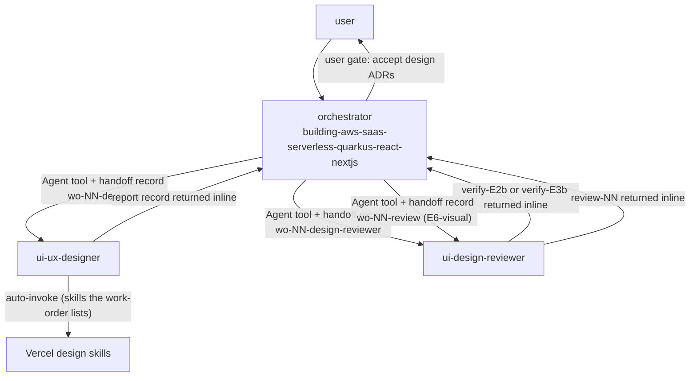

# ui-design

This package holds the two UI/UX agents of the SaaS flow: a designer and an independent reviewer. It is for teams that build a SaaS with the factory orchestrator and want a design system, design ADRs and wireframes before any front-end code. You need it when a work-order asks for a design (E2b, E3b) or for a review of a design or of the built front end (E2b, E3b, E6-visual).

## Contents

<!-- BEGIN GENERATED:contents -->
**Depends on:** `factory-core`, `handoff-core`  
**Used by:** `aws-saas-serverless-quarkus-react-nextjs`

| Type | Name | What it does |
|---|---|---|
| agent (sonnet) | [`ui-design-reviewer`](.apm/agents/ui-design-reviewer.agent.md) | UI Design Reviewer - independent, read-only reviewer of design and of its implementation: the design system and design ADRs (E2b), the wireframes and navigatio… |
| agent (sonnet) | [`ui-ux-designer`](.apm/agents/ui-ux-designer.agent.md) | UI/UX Designer - non-interactive, read-only designer of the product look and use: the design system with light and dark tokens and contrast, component states,… |
<!-- END GENERATED:contents -->

## Installation

<!-- BEGIN GENERATED:installation -->
| Item | Value |
|---|---|
| Package name | `agents-factory-ui-design` |
| Version | `1.0.0` |
| Source folder | `packages/frontend/react/ui-design` |
| In this repository | installed transitively, through `aws-saas-serverless-quarkus-react-nextjs` |
| Also installs | `factory-core`, `handoff-core`, `openspec-core` |

Install it into another project, from that project's folder:

```bash
apm install <path-to-agents-factory>/packages/frontend/react/ui-design --target claude
```

Add `--dry-run` to preview the install. APM writes the skills, agents and rules into `.claude/`. Change the sources under `.apm/`, never the generated `.claude/`.
<!-- END GENERATED:installation -->

The agents load Vercel design skills (`building-components`, `web-design-guidelines`, `composition-patterns`). This package ships none of them. They come from [vercel-frontend](../../../third-party/vercel-frontend/README.md). In `apm.yml` the line `#- path: ../../../third-party/vercel-frontend` is commented out, so this package does not install them on its own. Install `vercel-frontend` yourself (its README gives install time and the Windows requirements) or check that the three skills are present before you use the agents alone. The sources do not say what happens when a listed skill is not installed.

## Quick Start

This package has no `/command`. You do not call the agents directly. The orchestrator `building-aws-saas-serverless-quarkus-react-nextjs` launches them with the Agent tool and passes a work-order file. Two plain-text requests, quoted from the agent descriptions:

```text
execute openspec/changes/list-tenant-items/handoff/wo-03-designer.md
```

```text
review frontend/ against wireframes/items-list.md per wo-08-review.md
```

The first goes to `ui-ux-designer`, the second to `ui-design-reviewer`. To run the whole flow, start the orchestrator. See [SaaS on Quarkus and AWS entry points](../../../../docs/entry-points/saas-quarkus-aws.md).

## Usage Scenarios

The agents have no evaluation scenarios of their own. The scenarios below come from the agent descriptions and from their Workflow and Never-Do sections.

### Scenario 1 — Design system at E2b

Use it when the interview blocks B9-B11 are done and the SaaS needs a design system.

```text
execute openspec/changes/list-tenant-items/handoff/wo-03-designer.md
```

The work-order carries `mode: design-system`. You get, inline: `design/design-system.md` (light and dark tokens with computed contrast, base components in every state) and one ADR per decision as `design/adr/NNN-*.md`, all `proposed`. You also get a report record the orchestrator saves as `result-NN-designer.md`. The designer has no Write tool, so the orchestrator writes the files.

### Scenario 2 — Wireframes at E3b

Use it when the functional spec has approved `R*` requirements and the screens must be drawn.

```text
execute openspec/changes/list-tenant-items/handoff/wo-03-designer.md
```

The work-order carries `mode: wireframes`. You get one file per screen, `design/wireframes/<screen>.md`, with an `R*` tag on each element and the four states (empty, loading, error, no permission), plus `design/navigation.md`.

### Scenario 3 — Incomplete input: brand and accessibility level

Use it when the work-order does not state the brand, the languages, an accessibility level other than WCAG AA, or the dark-mode policy.

```text
execute openspec/changes/list-tenant-items/handoff/wo-03-designer.md
```

The designer produces no design for the open point. It returns numbered questions with options and `outcome: needs-input`. The orchestrator asks you, then sends a new work-order with your answers. A wireframe that needs a component the design system lacks also becomes a question.

### Scenario 4 — Review of the design system or wireframes

Use it after the designer returns, to verify the design with a different agent.

```text
Launch ui-design-reviewer with the work-order wo-NN-design-reviewer.md (stage E2b or E3b).
```

`NN` is the work-order number the orchestrator assigns. You get a `verify-E2b` or `verify-E3b` record with `outcome: pass | fail`, findings with a fix hint, and caveats. `pass` needs no open HIGH or MEDIUM finding.

### Scenario 5 — Visual review of a built front end

Use it as the second reviewer of a front task, after `nextjs-code-reviewer` approved the code.

```text
review frontend/ against wireframes/items-list.md per wo-08-review.md
```

You get a `review-NN` record (role `frontend`) with the traceability `R*` -> screen element -> file:line and `outcome: approved | changes-requested`. The reviewer cannot render the page and says so in Caveats.

### Scenario 6 — Misuse: asking the designer to review, or the reviewer to fix

Use this as a guide to who does what.

```text
Ask ui-ux-designer to approve the wireframes it just wrote.
```

The designer never reviews. Send the work to `ui-design-reviewer`. In the other direction, the reviewer never creates or corrects a design: it gives a fix hint limited to the finding. A request to write code goes to `nextjs-frontend-integrator` in [nextjs-frontend](../nextjs-frontend/README.md). A code review goes to `nextjs-code-reviewer`.

### Scenario 7 — Chaining to the next step

Use it to follow the flow after a design exists.

```text
ui-ux-designer (E2b, E3b) -> ui-design-reviewer (verify-E2b, verify-E3b) -> nextjs-frontend-integrator -> nextjs-code-reviewer -> ui-design-reviewer (E6-visual)
```

Only the user's approval moves a design ADR from `proposed` to `accepted`. The orchestrator records it.

## Skills Reference

This package ships no skill. The agents load these skills, installed by `vercel-frontend`, when the work-order lists them:

| Skill | Loaded by | Loads when | Locks | Never |
|---|---|---|---|---|
| `building-components` | designer, reviewer | the work-order lists it | upstream skill, pinned by commit in `vercel-frontend` | The agents keep its `(unverified)` tags and do not state facts from memory |
| `web-design-guidelines` | designer, reviewer | the work-order lists it | same | same |
| `composition-patterns` | designer, reviewer | the work-order lists it | same | same |

The designer loads other skills only if the work-order lists them. The handoff skills `coordinating-agent-handoffs` and `coordinating-quarkus-aws-handoffs` define the record formats (roles `designer` and `design-reviewer`). The rule `openspec-project-layout` defines where the design files live.

## Pipeline



## Agents Reference

<!-- BEGIN GENERATED:agents-reference -->
| Agent | Model | Tools | Can start agents | Started by |
|---|---|---|---|---|
| [`ui-design-reviewer`](.apm/agents/ui-design-reviewer.agent.md) | sonnet | Read, Grep, Glob | no | an orchestrator or another agent |
| [`ui-ux-designer`](.apm/agents/ui-ux-designer.agent.md) | sonnet | Read, Grep, Glob | no | an orchestrator or another agent |
<!-- END GENERATED:agents-reference -->

### ui-ux-designer

- Model `sonnet`. Tools: Read, Grep, Glob. Non-interactive.
- Mode `design-system` (E2b): light and dark tokens with computed contrast, base components in every state, one design ADR per decision (component base, style and token strategy, theme, accessibility level, languages, density and layout). ADR front matter: `id, title, area: design, status: proposed, author: ui-ux-designer, reviewer: ui-design-reviewer`. Sections: Context, Alternatives (at least 2), Decision, Consequences, Sources.
- Mode `wireframes` (E3b): one ASCII wireframe per screen using only design-system components, with `R*` tags and the four states, plus `design/navigation.md`.
- A decision that touches architecture (bundle weight, i18n routes) is flagged under "Cross-area impact" for the orchestrator to hand to `solution-architect`.
- Output: every file as a fenced block headed by its repo-relative path, then a report record (`kind: report`, role `designer`, `outcome: success | partial | needs-input`, `spec_impact: none`). The orchestrator must write the files.
- Never: review or approve designs, write code, write or edit files, invent a requirement or a screen without an `R*`, pick architecture, spawn agents, use plan mode, ask the user.

### ui-design-reviewer

- Model `sonnet`. Tools: Read, Grep, Glob. Read-only, non-interactive.
- Stage `E2b`: contrast meets the stated level (AA unless an ADR says otherwise), coherent scale, focus and error styles on every component, no loose value outside tokens, each ADR has alternatives, consequences and a source and is `proposed`.
- Stage `E3b`: every `R*` with UI appears, only design-system components, four states present, no dead end in navigation.
- Stage `E6-visual`: the built front matches the wireframe (structure, states, `R*` elements) and uses the tokens, in both themes if an ADR requires it, with no hard-coded colors or sizes.
- Output: `verify-E2b` or `verify-E3b` (`kind: verify`, `outcome: pass | fail`), or `review-NN` (`kind: review`, role `frontend`, `outcome: approved | changes-requested`). Findings use `### F1 HIGH - <title>` with Location, Evidence, Violates and Fix hint.
- A violation of an accepted ADR in any folder is HIGH. `pass` or `approved` only with no open HIGH or MEDIUM finding.
- Non-interactive contract: if the work-order, files, design system, wireframes or skill list are missing, it gives no verdict, writes "review not performed" and lists numbered questions. It never reads the author's `result-*` records.
- Never: create or correct a design, edit files, run commands, write code, accept ADRs, spawn agents, talk to the user.

## Output structure

The agents return content inline. The orchestrator writes it under the layout of the rule `openspec-project-layout`:

```text
openspec/
├── specs/design/
│   ├── design-system.md
│   ├── navigation.md
│   ├── wireframes/<screen>.md
│   └── adr/NNN-*.md
└── changes/<id>/handoff/
    ├── wo-NN-designer.md            work-order in
    └── result-NN-designer.md        designer report
```

The agent sources name the targets as `design/design-system.md`, `design/navigation.md`, `design/wireframes/<screen>.md` and `design/adr/NNN-*.md`. The `openspec/specs/design/` prefix comes from `openspec-project-layout`. The reviewer's `verify-E2b`, `verify-E3b` and `review-NN` records are also saved by the orchestrator; their file names are set by the handoff profile and are not stated in these agents.

## Limits and constraints

| Item | Value | Source |
|---|---|---|
| Accessibility level | WCAG AA by default; any other level is a question | designer, Non-interactive contract |
| Wireframe states | 4: empty, loading, error, no permission | both agents |
| ADR alternatives | at least 2 per ADR | designer, Mode design-system |
| ADR status | `proposed` only; the designer never sets `accepted` | designer, reviewer |
| Verdict rule | `pass` or `approved` only with no open HIGH or MEDIUM finding | reviewer |
| Files | the designer has no Write tool; the orchestrator saves them | designer |
| Out of scope | code review of the front end belongs to `nextjs-code-reviewer` | reviewer |
| Vercel skills | not installed by this package alone (dependency commented out in `apm.yml`) | `apm.yml` |

## Related

- Guides: [SaaS on Quarkus and AWS entry points](../../../../docs/entry-points/saas-quarkus-aws.md), [frontmatter cheatsheet](../../../../docs/reference/frontmatter-cheatsheet.md).
- Dependencies: [factory-core](../../../factory/factory-core/README.md), [handoff-core](../../../delivery/protocol/handoff-core/README.md).
- Source of the Vercel skills: [vercel-frontend](../../../third-party/vercel-frontend/README.md).
- Neighbours: [nextjs-frontend](../nextjs-frontend/README.md) builds and reviews the front end this package designs. [solution-architecture](../../../architecture/solution-architecture/README.md) receives cross-area impacts.
- Used by [aws-saas-serverless-quarkus-react-nextjs](../../../saas/aws-saas-serverless-quarkus-react-nextjs/README.md).
- [Agent architecture](../../../../docs/agents/architecture.md), [entry points](../../../../docs/entry-points/README.md), [packages](../../../../docs/packages/README.md).
