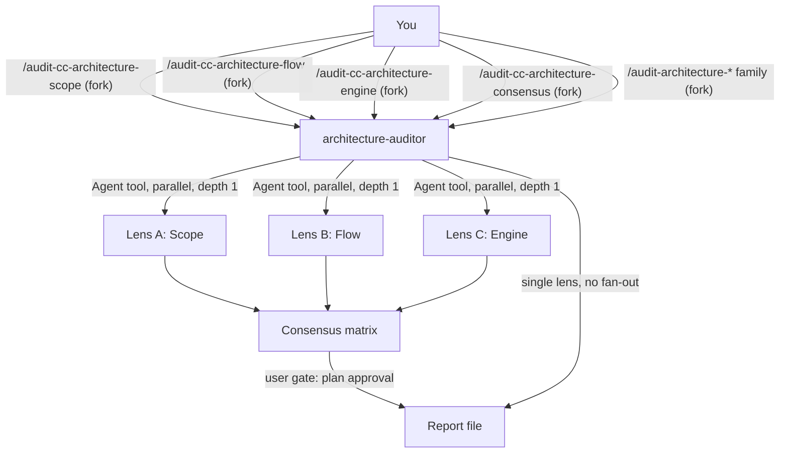

# auditing

auditing lets you audit the architecture of an agent project: scope hierarchy, invocation flow and engine mechanics. It is for you if you maintain a Claude Code (`.claude/`) project or a GitHub Copilot project and want a scored compliance report with remediation. You need it before a release, after a refactor, or when you add commands, skills or rules and want to know whether the chains still hold.

## Contents

<!-- BEGIN GENERATED:contents -->
**Depends on:** `factory-core`  
**Used by:** [`harness-quality-kit`](../../bundles/harness-quality-kit/README.md) (bundle)

| Type | Name | What it does |
|---|---|---|
| command | [`/audit-architecture-consensus`](.apm/skills/audit-architecture-consensus/SKILL.md) | Orchestrates a multi-model architecture audit (Scope + Flow + Engine in parallel) against a target agent and produces a consensus compliance report with priori… |
| command | [`/audit-architecture-engine`](.apm/skills/audit-architecture-engine/SKILL.md) | Audits agent architecture from the engine perspective — paths injection mechanics, context budget, frontmatter dedup, active vs passive loading, instruction co… |
| command | [`/audit-architecture-flow`](.apm/skills/audit-architecture-flow/SKILL.md) | Audits agent architecture from the invocation-flow perspective (command to agent to rules to skills) — complete chains, no dead-ends or cycles, everything reac… |
| command | [`/audit-architecture-scope`](.apm/skills/audit-architecture-scope/SKILL.md) | Audits agent architecture from the scope-hierarchy perspective (L0 to L4), detecting responsibility leakage, with scoring and remediation (Model A). |
| command | [`/audit-cc-architecture-consensus`](.apm/skills/audit-cc-architecture-consensus/SKILL.md) | Orchestrates a multi-model Claude Code architecture audit (Scope + Flow + Engine in parallel via the Agent tool) and produces a consensus report prioritized by… |
| command | [`/audit-cc-architecture-engine`](.apm/skills/audit-cc-architecture-engine/SKILL.md) | Audits Claude Code agent architecture from the engine perspective — paths glob firing, auto-listing budget of skills without disable-model-invocation, context… |
| command | [`/audit-cc-architecture-flow`](.apm/skills/audit-cc-architecture-flow/SKILL.md) | Audits Claude Code agent architecture from the invocation-flow perspective (/command → subagent fork → rules → skills) — complete chains, no dead-ends or cycle… |
| command | [`/audit-cc-architecture-scope`](.apm/skills/audit-cc-architecture-scope/SKILL.md) | Audits Claude Code agent architecture from the scope-hierarchy perspective (CLAUDE.md → subagent → rules → commands → skills), detecting responsibility leakage… |
| agent (opus) | [`architecture-auditor`](.apm/agents/architecture-auditor.agent.md) | Agent-Architecture Auditor — audits an agent project (scope hierarchy, invocation flow, engine mechanics) and produces a compliance report with scoring and rem… |
<!-- END GENERATED:contents -->

## Installation

<!-- BEGIN GENERATED:installation -->
| Item | Value |
|---|---|
| Package name | `agents-factory-auditing` |
| Version | `1.0.0` |
| Source folder | `packages/harness-quality/auditing` |
| In this repository | listed directly in the root `apm.yml` |
| Also installs | `factory-core` |

Install it into another project, from that project's folder:

```bash
apm install <path-to-agents-factory>/packages/harness-quality/auditing --target claude
```

Add `--dry-run` to preview the install. APM writes the skills, agents and rules into `.claude/`. Change the sources under `.apm/`, never the generated `.claude/`.
<!-- END GENERATED:installation -->

No runtime prerequisites are stated in the sources. The audits read files only; they need no network access or external CLI. The agent has the `Bash` tool and its verification step uses `ls`, `wc` and `grep`.

## Quick Start

```
/audit-cc-architecture-consensus framework-researcher
```

This runs the three lenses (Scope, Flow, Engine) in parallel against a Claude Code subagent and merges them into one consensus report. For a faster, narrower check, run one lens, for example `/audit-cc-architecture-scope framework-researcher`.

## Two families, three lenses, one consensus

The package has two parallel families. They differ in the platform they audit, not in method.

| | Claude Code family | Copilot family |
|---|---|---|
| Use it when the target is | a `.claude/` project (`/command` forks to a subagent, rules with `paths:`, skills) | a GitHub Copilot project (agent, instructions with `applyTo`, prompts, skills) |
| Command prefix | `/audit-cc-architecture-*` | `/audit-architecture-*` |
| Argument | subagent or command name, or a path to a `.claude` directory | agent name, or a path to a project directory |
| Scope layers | G0 CLAUDE.md, G1 subagent, G2 rules, G3 commands, G4 skills, plus G-perm (`settings.json`) | L0 global instructions, L1 agent, L2 instructions, L3 prompts, L4 skills |
| Scope criteria | G0.1 to G4.8, XCC.1 to XCC.10 | L0.1 to L4.10, X.1 to X.8 |
| Flow criteria | FCC.1 to FCC.20 | B.1 to B.20 |
| Engine criteria | ECC.1 to ECC.18 | C.1 to C.24 |

Each family has three single-lens commands and one consensus command:

| Lens | What it asks | Best at finding |
|---|---|---|
| Model A, Scope hierarchy | Which layer is more global or persistent, and does each layer hold only its own responsibility? | responsibility leakage (logic or code in the wrong layer) |
| Model B, Invocation flow | Who calls whom at runtime, and does every chain reach a skill? | broken chains, unreachable components, dead ends, cycles |
| Model C, Engine mechanics | How does the engine load things (path injection, auto-listing budget, fork, frontmatter)? | budget bloat, name collisions, field swaps, invalid model, globs that do not fire |
| Consensus | Run A, B and C in parallel and compare | issues confirmed by 3, 2 or 1 lens |

In Claude Code, G3 commands and G4 knowledge skills are the same file type. They differ only in frontmatter: `disable-model-invocation: true` marks a command, its absence marks an auto-invocable knowledge skill. The Claude Code lenses classify by frontmatter, never by folder or filename.

The Copilot family is a generic tool for auditing other projects that target Copilot. It is not about this repository's own state.

## Usage Scenarios

### Scenario 1 — Full audit before a release

Use the consensus command when you want the highest-confidence list of fixes.

```
/audit-cc-architecture-consensus framework-researcher
```

You get one report that puts findings confirmed by all three lenses first (Must Fix), then two-lens findings (Should Fix), then single-lens findings (Consider), with a remediation roadmap.

### Scenario 2 — Quick check of one concern after a change

You changed rules and want to know whether `paths:` still fire correctly.

```
/audit-cc-architecture-engine framework-researcher
```

The query "Audit the engine mechanics for the framework-researcher subagent." produces a loading landscape (always-on, passive, active), a budget simulation and a name-collision table. Use `/audit-cc-architecture-flow` after adding commands or skills and `/audit-cc-architecture-scope` after a refactor.

### Scenario 3 — You pass a directory, not a name

```
/audit-cc-architecture-scope .claude
```

With a `.claude/` path and no named target, the lens asks: "I see multiple subagents/commands here. Audit all of them, or one specific target?" If the name matches routing keywords in more than one subagent it asks which one first. If you say "quick check" it asks whether you want the full G0 to G4 plus cross-layer audit or a targeted single-layer pass, and labels a partial pass as partial in the report. Answer with the target name or "all".

### Scenario 4 — Ask the auditor to generate or fix files (out of scope)

```
Look at the framework-researcher subagent and generate the missing skill files it should have.
```

The scope lens declines. It audits and proposes remediation but does not write skill content. Run the audit, then use `/skill-creator` to generate the missing skills. The same holds for "The engine audit found two skills with the same name value and one subagent using allowed-tools:. Fix the YAML in all of them for me.": the engine lens edits nothing and points you to the report's Proposed Change blocks (name collision ECC.11, field swap ECC.8). Likewise, a flow audit that finds a command pointing to a missing subagent does not create the subagent; use `/agent-creator`.

### Scenario 5 — Skip one lens to save time (misuse)

```
Run the consensus audit but skip Engine — I know the mechanics are fine.
```

The orchestrator explains that two lenses cannot give a 3/3 consensus. It asks whether to run all three and note the area as expected clean, or to run `/audit-cc-architecture-engine` on its own. If you confirm two lenses, the report is labeled a two-model correlation, not a consensus.

### Scenario 6 — Is a knowledge skill without a command an orphan?

```
Audit the invocation flow. One knowledge skill (researching-technical-frameworks) has no /command forking to it — is it an orphan?
```

No. A skill without `disable-model-invocation` is reachable by description match (PATH 3). The flow lens records it as reachable and reserves "orphan" for files no path reaches, such as a command whose `agent:` points to a missing subagent.

### Scenario 7 — Audit a Copilot project

```
/audit-architecture-consensus oci-terraform
```

Use the Copilot family only for a project that targets GitHub Copilot. The canonical query is "Run a full multi-model architecture audit on the oci-terraform agent." The report is `AGENT_ARCHITECTURE_MULTI_MODEL_REPORT.md`.

### Scenario 8 — Chain to the next step

After you fix the findings, re-audit and validate the artifacts.

```
/audit-cc-architecture-consensus framework-researcher
/skill-best-practices-validator .claude/skills/
```

Per-skill quality checks belong to [validating](../validating/README.md).

## Commands Reference

All eight commands use `context: fork`, `agent: architecture-auditor` and `disable-model-invocation: true`. Each takes one argument. Single-lens commands read every file in the target's dependency graph, score it, and save one report. Consensus commands fork into the same agent, which spawns the three lenses with the Agent tool.

### Claude Code family

### `/audit-cc-architecture-scope`

*Scope hierarchy, Model A, for a `.claude/` project.*

**Syntax**

```
/audit-cc-architecture-scope <subagent-or-command-name | path-to-.claude>
```

**Parameters**

| Parameter | Required | Default | Description |
|---|---|---|---|
| `target` | yes | none | Subagent or command name (for example `framework-researcher`) or a path to a `.claude` directory. |

**Prerequisites**

- The target exists as `.claude/agents/<target>.md`. A `CLAUDE.md` (G0) and `.claude/settings.json` (G-perm) are read when present.

**What it does**

1. Maps the file graph: G0 CLAUDE.md, G1 subagent, G2 rules, G3 commands (`context: fork` pointing at the subagent), G4 skills, G-perm settings. Lists orphans.
2. Audits each layer against G0.1 to G4.8.
3. Runs cross-layer checks XCC.1 to XCC.10: keyword alignment, responsibility leakage, skill reachability, link chain integrity, naming, rule coverage gaps, orphans, duplication, field swap (`tools:` on a skill or `allowed-tools:` on a subagent), G3/G4 classification.
4. Scores each layer 0 to 10 and weights them: G0 5%, G1 20%, G2 20%, G3 20%, G4 30%, G-perm 5%. PASS is overall 7.0 or more with no layer below 5.0. CONDITIONAL is overall 5.0 or more, or any layer below 5.0. FAIL is overall below 5.0 or any layer at 0.
5. Writes a remediation plan with Violation ID, file, section, what is wrong, how to fix, proposed content and impact. Severity is critical, medium or low.

**What is updated and what is not**

- Writes one report. It does not edit project files and does not generate application code or skills.

**Output files**

- `CC_ARCHITECTURE_COMPLIANCE_REPORT.md`

**Examples**

```
/audit-cc-architecture-scope framework-researcher
/audit-cc-architecture-scope .claude
```

**Next**

Fix the findings, then run `/audit-cc-architecture-flow` or the consensus command.

### `/audit-cc-architecture-flow`

*Invocation flow, Model B, for a `.claude/` project.*

**Syntax**

```
/audit-cc-architecture-flow <subagent-or-command-name | path-to-.claude>
```

**Parameters**

| Parameter | Required | Default | Description |
|---|---|---|---|
| `target` | yes | none | Subagent or command name, or a path to a `.claude` directory. |

**Prerequisites**

- The target subagent file exists. Every referenced file is read before any chain is traced.

**What it does**

1. Discovers entry points: PATH 1 commands (`context: fork` with `agent: <target>`), PATH 2 direct auto-delegation by the subagent description, PATH 3 auto-invocable knowledge skills.
2. Traces each chain step by step and labels it COMPLETE or BROKEN at step N. Verifies the reference appears inside the referencing file, not just that the file exists.
3. Evaluates FCC.1 to FCC.20 across commands, the subagent hub, rules (passive path) and skills (terminal nodes). Checks fallback path and cycles (FCC.10).
4. Builds a reachability matrix with unreachable skills, orphan commands and dead-end chains.
5. Scores 0 to 10 with weights: commands 25%, subagent 30%, rules 20%, skills 25%.

**What is updated and what is not**

- Writes one report. It does not create missing subagents, commands or skills.

**Output files**

- `CC_INVOCATION_FLOW_AUDIT_REPORT.md` with eight sections: executive summary, entry point registry, chain traces, reachability matrix, criteria evaluation, flow issues, remediation plan, conclusion.

**Examples**

```
/audit-cc-architecture-flow framework-researcher
/audit-cc-architecture-flow .claude
```

**Next**

Run `/audit-cc-architecture-engine` for loading mechanics, or the consensus command.

### `/audit-cc-architecture-engine`

*Engine mechanics, Model C, for a `.claude/` project.*

**Syntax**

```
/audit-cc-architecture-engine <subagent-or-command-name | path-to-.claude>
```

**Parameters**

| Parameter | Required | Default | Description |
|---|---|---|---|
| `target` | yes | none | Subagent or command name, or a path to a `.claude` directory. |

**Prerequisites**

- The target exists. The lens reads CLAUDE.md, each rule and each skill to count real lines. It does not use placeholder numbers.

**What it does**

1. Maps the loading landscape: always-on (CLAUDE.md and auto-listed skill descriptions), passive (`paths:` rules that fire for the files the work touches), active (`context: fork` commands).
2. Validates `paths:` firing (ECC.1 to ECC.3, ECC.14, ECC.15), auto-listing and context budget (ECC.4, ECC.5, ECC.13), fork and progressive disclosure (ECC.6, ECC.7), and frontmatter and governance (ECC.8 to ECC.12, ECC.16 to ECC.18): field discipline, description validity, name format, name uniqueness, model validity, permissions coherence, YAML validity, `argument-hint`.
3. Simulates the budget for a representative task: always-on plus passive plus active against a practical limit of about 500 lines (a heuristic; it asks before flagging).
4. Always produces a name-collision table and a field-swap table.
5. Scores 0 to 10 with weights: `paths:` correctness 25%, auto-listing and budget 25%, fork and disclosure 20%, conflict freedom 15%, frontmatter and governance 15%.

**What is updated and what is not**

- Writes one report. It does not edit YAML or rename files. Redundant rules are a warning; contradictory rules are a failure. A broad `paths: **/*` is not automatically wrong for genuinely global conventions.

**Output files**

- `CC_ENGINE_MECHANICS_AUDIT_REPORT.md` with eight sections: executive summary, loading landscape, budget simulation, conflict analysis, criteria evaluation, name-collision and field-swap tables, remediation plan, conclusion.

**Examples**

```
/audit-cc-architecture-engine framework-researcher
/audit-cc-architecture-engine .claude
```

**Next**

Fix collisions and swaps first, since they fail silently.

### `/audit-cc-architecture-consensus`

*All three Claude Code lenses in parallel, merged by agreement.*

**Syntax**

```
/audit-cc-architecture-consensus <subagent-or-command-name | path-to-.claude>
```

**Parameters**

| Parameter | Required | Default | Description |
|---|---|---|---|
| `target` | yes | none | Subagent or command name, or a path to a `.claude` directory. |

**Prerequisites**

- The target subagent file exists. With a dependency graph of more than about 15 files the command asks whether to audit everything or start with the core layers G1 to G3.

**What it does**

1. Identifies the target and verifies it exists.
2. Forks into `architecture-auditor`, which spawns Scope, Flow and Engine as real parallel sub-agents with the Agent tool. It embeds each lens's full criteria in the sub-agent prompt. It never spawns a consensus lens from inside a consensus run, so fan-out depth is 1.
3. Normalizes findings (models, criterion ID, file, issue, severity) and groups them by root cause, not by label.
4. Prioritizes: 3 of 3 lenses is Must Fix, 2 of 3 is Should Fix, 1 of 3 is Consider (each with a judgement on whether it is real, lens-specific or a false positive).
5. Verdict: PASS if all three scores are 7.0 or more and there is no Must Fix finding. CONDITIONAL if any score is 5.0 to 6.9 or there are 1 or 2 consensus findings. FAIL if any score is below 5.0 or there are 3 or more consensus findings.

**What is updated and what is not**

- Writes one report. It reports each model's score separately and never averages them. It does not edit project files.

**Output files**

- `CC_ARCHITECTURE_MULTI_MODEL_REPORT.md` with eight sections: executive summary and score comparison, consensus findings (3/3), two-model findings (2/3), single-model findings, per-model results, unified remediation roadmap, model effectiveness analysis, conclusion.
- The agent file also names `.claude/reports/audit_{target}_{YYYY-MM-DD}.md` as the output path (see Limits and constraints).

**Examples**

```
/audit-cc-architecture-consensus framework-researcher
/audit-cc-architecture-consensus .claude
```

**Next**

Work the Must Fix list first, then re-run the consensus audit.

### Copilot family

### `/audit-architecture-scope`

*Scope hierarchy, Model A, for a Copilot project.*

**Syntax**

```
/audit-architecture-scope <agent-name | path-to-project-directory>
```

**Parameters**

| Parameter | Required | Default | Description |
|---|---|---|---|
| `target` | yes | none | Agent name (for example `oci-terraform`) or a path to a project directory. |

**Prerequisites**

- A Copilot-style project: global instructions (L0), an agent (L1), instructions with `applyTo` (L2), prompts (L3), skills (L4).

**What it does**

Same method as the Claude Code scope lens, with these differences. Layers are L0 to L4 with criteria L0.1 to L4.10 and cross-layer checks X.1 to X.8. Weights are L0 5%, L1 20%, L2 25%, L3 20%, L4 30%. PASS, CONDITIONAL and FAIL use the same thresholds (7.0 and 5.0). There is no `settings.json` layer.

**What is updated and what is not**

- Writes one report. No project file is edited and no code is generated.

**Output files**

- `AGENT_ARCHITECTURE_COMPLIANCE_REPORT.md`

**Examples**

```
/audit-architecture-scope oci-terraform
```

**Next**

Run `/audit-architecture-flow` or `/audit-architecture-consensus`.

### `/audit-architecture-flow`

*Invocation flow, Model B, for a Copilot project.*

**Syntax**

```
/audit-architecture-flow <agent-name | path-to-project-directory>
```

**Parameters**

| Parameter | Required | Default | Description |
|---|---|---|---|
| `target` | yes | none | Agent name or a path to a project directory. |

**Prerequisites**

- A Copilot-style project with prompts that name an agent.

**What it does**

Same method as the Claude Code flow lens. Entry points are prompts (`agent:` field) and `@agent`. Criteria are B.1 to B.20. Weights: entry points (prompts) 25%, agent 30%, instructions (passive injection) 20%, skills 25%. B.19 checks that a skill does not auto-activate.

**What is updated and what is not**

- Writes one report. It does not create missing prompt files.

**Output files**

- `INVOCATION_FLOW_AUDIT_REPORT.md`

**Examples**

```
/audit-architecture-flow oci-terraform
```

**Next**

Run `/audit-architecture-engine` or `/audit-architecture-consensus`.

### `/audit-architecture-engine`

*Engine mechanics, Model C, for a Copilot project.*

**Syntax**

```
/audit-architecture-engine <agent-name | path-to-project-directory>
```

**Parameters**

| Parameter | Required | Default | Description |
|---|---|---|---|
| `target` | yes | none | Agent name or a path to a project directory. |

**Prerequisites**

- A Copilot-style project with instruction files that use `applyTo`.

**What it does**

Same method as the Claude Code engine lens, for VS Code and Copilot mechanics. Criteria are C.1 to C.24. Weights: `applyTo` correctness 30%, conflict freedom 25%, context budget 20%, active path correctness 15%, frontmatter compliance 10%. The practical limit is about 500 lines of simultaneously injected instructions for one file type.

**What is updated and what is not**

- Writes one report. It does not fix frontmatter or rename files.

**Output files**

- `TECHNICAL_MECHANISMS_AUDIT_REPORT.md`

**Examples**

```
/audit-architecture-engine oci-terraform
```

**Next**

Run `/audit-architecture-consensus`.

### `/audit-architecture-consensus`

*All three Copilot lenses in parallel, merged by agreement.*

**Syntax**

```
/audit-architecture-consensus <agent-name | path-to-project-directory>
```

**Parameters**

| Parameter | Required | Default | Description |
|---|---|---|---|
| `target` | yes | none | Agent name or a path to a project directory. |

**Prerequisites**

- A Copilot-style project.

**What it does**

Same orchestration as `/audit-cc-architecture-consensus`: three parallel lens sub-agents through the Agent tool, correlation by root cause, and the same 3/3, 2/3, 1/3 prioritization and verdict rules. It uses the Copilot criteria (L, B, C).

**What is updated and what is not**

- Writes one report. It never averages the three scores and never skips a lens.

**Output files**

- `AGENT_ARCHITECTURE_MULTI_MODEL_REPORT.md`

**Examples**

```
/audit-architecture-consensus oci-terraform
```

**Next**

Work the Must Fix findings, then re-audit.

## Pipeline



## Agents Reference

<!-- BEGIN GENERATED:agents-reference -->
| Agent | Model | Tools | Can start agents | Started by |
|---|---|---|---|---|
| [`architecture-auditor`](.apm/agents/architecture-auditor.agent.md) | opus | Read, Grep, Glob, Agent, Write, Bash, EnterPlanMode, ExitPlanMode | yes | `/audit-architecture-consensus`, `/audit-architecture-engine`, `/audit-architecture-flow`, `/audit-architecture-scope`, `/audit-cc-architecture-consensus`, `/audit-cc-architecture-engine`, `/audit-cc-architecture-flow`, `/audit-cc-architecture-scope` |
<!-- END GENERATED:agents-reference -->

**`architecture-auditor`**

- **Does:** audits scope separation (G0 to G4 for Claude Code, L0 to L4 for Copilot), complete command-to-subagent-to-rules-to-skills chains, and engine mechanics. It follows a P0 to P5 workflow: load the criteria of the invoking skill, fan out (consensus only), collect, build the consensus and confirm the plan, write the report, then verify counts with `ls`, `wc` and `grep` rather than trusting reported numbers. Model `opus`. Tools: Read, Grep, Glob, Agent, Write, Bash, EnterPlanMode, ExitPlanMode.
- **Gates:** before it writes the report it calls `EnterPlanMode`, shows a Report Plan table and calls `ExitPlanMode` for your approval. It does not write before you approve.
- **Fan-out:** in a consensus run it spawns only the scope, flow and engine lenses, never another consensus lens, and embeds each lens's full criteria in the prompt.
- **Never does:** research technologies, generate SKILL.md files or validate skill quality (those belong to `framework-researcher`, `artifact-author` and `quality-validator`). If a request matches no command it states the mismatch and suggests the right command.
- **Non-interactive contract:** the agent file does not describe a numbered-questions mode. The invoking skills ask in their Ask-First cases (several subagents match, partial audit, directory without a target, report language). Treat that as unverified for fully unattended use.

## Output structure

Each command saves one Markdown report under the file name below. The agent file names a different path (see Limits and constraints).

| Command | Report file |
|---|---|
| `/audit-cc-architecture-scope` | `CC_ARCHITECTURE_COMPLIANCE_REPORT.md` |
| `/audit-cc-architecture-flow` | `CC_INVOCATION_FLOW_AUDIT_REPORT.md` |
| `/audit-cc-architecture-engine` | `CC_ENGINE_MECHANICS_AUDIT_REPORT.md` |
| `/audit-cc-architecture-consensus` | `CC_ARCHITECTURE_MULTI_MODEL_REPORT.md` |
| `/audit-architecture-scope` | `AGENT_ARCHITECTURE_COMPLIANCE_REPORT.md` |
| `/audit-architecture-flow` | `INVOCATION_FLOW_AUDIT_REPORT.md` |
| `/audit-architecture-engine` | `TECHNICAL_MECHANISMS_AUDIT_REPORT.md` |
| `/audit-architecture-consensus` | `AGENT_ARCHITECTURE_MULTI_MODEL_REPORT.md` |

## Limits and constraints

| Item | Value | Source |
|---|---|---|
| Fan-out depth | exactly 1; a consensus run spawns only scope, flow and engine | `architecture-auditor` |
| Consensus levels | 3/3 Must Fix, 2/3 Should Fix, 1/3 Consider | consensus skills |
| Verdict | PASS: all scores 7.0 or more and no consensus finding; FAIL: any score under 5.0 or 3 or more consensus findings | consensus skills |
| Single-lens verdict | PASS: 7.0 or more and no layer under 5.0; FAIL: under 5.0 or a layer at 0 (scope lens) | scope skills |
| Score scale | 0 to 10 per layer or component | all lenses |
| Context budget heuristic | about 500 lines of always-on plus passive content | engine skills |
| Large target | over about 15 files: asks to scope to core layers first | consensus skills |
| Scores | never averaged into one overall score | consensus skills |
| Edits | none; the auditors analyze and prescribe, they do not fix | all skills |
| Platform | the Copilot family audits other projects that target Copilot, not this repository | CLAUDE.md |
| Per-skill quality | belongs to [validating](../validating/README.md) | `architecture-auditor` |

Source defects that affect how you read the output (unresolved in the sources): the agent writes its report to `.claude/reports/audit_{target}_{YYYY-MM-DD}.md` while each skill names a file such as `CC_ARCHITECTURE_COMPLIANCE_REPORT.md`; which name wins is not stated (unverified). The Copilot-family step 1 text reads `.claude/agents/<name>.md` and `.claude/skills/*/SKILL.md`, although its layer model is L0 to L4 with `.github/` names, so check where the report finds the Copilot files.

## Related

- Family guide: [Quality harness commands](../../../docs/entry-points/harness-quality.md), [Authoring commands](../../../docs/entry-points/factory-authoring.md)
- Flows: [Quality loop](../../../docs/flows/quality-loop.md), [Full agent package](../../../docs/flows/full-agent-package.md)
- [Agent architecture](../../../docs/agents/architecture.md)
- [All packages](../../../docs/packages/README.md)
- Depends on: [factory-core](../../factory/factory-core/README.md)
- Siblings: [validating](../validating/README.md), [evaluating](../evaluating/README.md)
- Used by the full chain: [agent-package-builder](../../factory/agent-package-builder/README.md)
