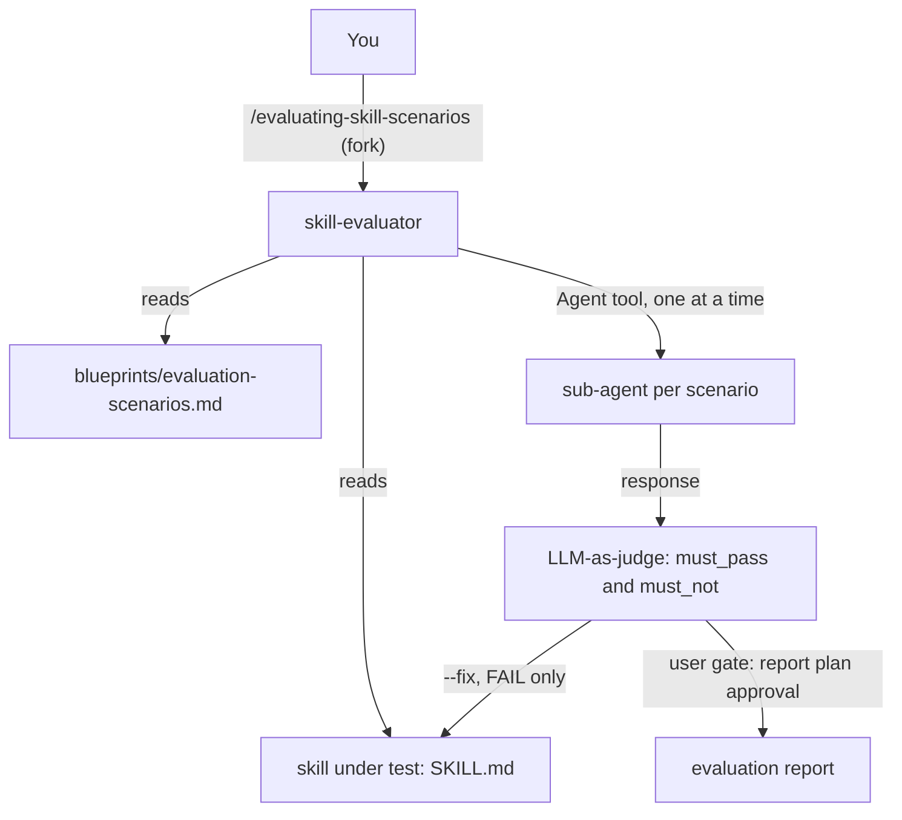

# evaluating

evaluating tests whether a skill behaves correctly. It runs the scenarios in a skill's `blueprints/evaluation-scenarios.md` and judges each response against `must_pass` and `must_not` criteria (LLM-as-judge). Use it after you author or change a skill, when static quality checks are not enough. The one command forks into the `skill-evaluator` subagent.

## Contents

<!-- BEGIN GENERATED:contents -->
**Depends on:** `factory-core`  
**Used by:** [`harness-quality-kit`](../../bundles/harness-quality-kit/README.md) (bundle)

| Type | Name | What it does |
|---|---|---|
| command | [`/evaluating-skill-scenarios`](.apm/skills/evaluating-skill-scenarios/SKILL.md) | Executes a skill's evaluation scenarios from blueprints/evaluation-scenarios.md, invokes the skill under test via LLM-as-judge, and reports pass/fail per crite… |
| agent (sonnet) | [`skill-evaluator`](.apm/agents/skill-evaluator.agent.md) | Skill Behavioral Evaluator — executes evaluation scenarios from a skill's blueprints/evaluation-scenarios.md by invoking the skill under test and applying LLM-… |
<!-- END GENERATED:contents -->

## Installation

<!-- BEGIN GENERATED:installation -->
| Item | Value |
|---|---|
| Package name | `agents-factory-evaluating` |
| Version | `1.0.0` |
| Source folder | `packages/harness-quality/evaluating` |
| In this repository | listed directly in the root `apm.yml` |
| Also installs | `factory-core` |

Install it into another project, from that project's folder:

```bash
apm install <path-to-agents-factory>/packages/harness-quality/evaluating --target claude
```

Add `--dry-run` to preview the install. APM writes the skills, agents and rules into `.claude/`. Change the sources under `.apm/`, never the generated `.claude/`.
<!-- END GENERATED:installation -->

The package declares no runtime dependency on the packages under test, to avoid a cycle. It reads `blueprints/evaluation-scenarios.md` from whichever skill you name, so install it in the same project as the skill you want to evaluate. The skill under test must be present as `.claude/skills/<skill-name>/SKILL.md`. Researcher skills may trigger real web searches during a run, so those runs need web access.

## Quick Start

```
/evaluating-skill-scenarios cloud-architecture-researcher
```

You get a report file with a verdict per scenario. Each verdict rests on quoted fragments of the real response.

## Usage Scenarios

### Scenario 1 — Test a skill after you changed it

The fastest default run.

```
/evaluating-skill-scenarios cloud-architecture-researcher
```

The canonical query is "Evaluate the cloud-architecture-researcher skill using its evaluation scenarios." The evaluator reads the full `SKILL.md` and the scenarios file, runs each scenario one after another in a spawned sub-agent, judges each response and shows you a report plan. After you approve, it saves `.claude/skills/cloud-architecture-researcher/cloud-architecture-researcher-evaluation-report.md` with a summary matrix, per-scenario detail and a "Findings & Recommended Fixes" section.

### Scenario 2 — The skill has fewer than 3 scenarios

You evaluate a skill whose scenarios file is thin. The canonical query is "Evaluate the skill at .claude/skills/hypothetical-minimal-skill/ — it only has 2 scenarios in its evaluation-scenarios.md."

```
/evaluating-skill-scenarios hypothetical-minimal-skill
```

The evaluator warns that fewer than 3 scenarios exist (criterion C1 asks for canonical, edge and misuse), carries on with the scenarios it has, and lists the shortfall as a Critical finding in the report. It does not invent a third scenario.

### Scenario 3 — The skill has no scenarios file (incomplete input)

```
/evaluating-skill-scenarios some-skill-without-scenarios
```

The evaluator checks with Glob that both `SKILL.md` and `blueprints/evaluation-scenarios.md` exist. If the scenarios file is missing it aborts with a clear error and does not continue. Create the file first, for example with `/skill-creator`, which always produces `blueprints/evaluation-scenarios.md` for command skills.

### Scenario 4 — Ask the evaluator to fix the skill (misuse)

```
Evaluate cloud-architecture-researcher and fix any criteria that fail. Rewrite the SKILL.md sections that cause failures.
```

The evaluator declines to rewrite the skill. It explains that it evaluates and reports, and that fixes need a human reading the report or a separate authoring step with `artifact-author`. It offers the evaluation-only run, where the recommended fixes appear in the report and no file changes. Note that the agent and skill also describe an explicit `--fix` flag (see Commands Reference), so the two statements differ in the sources.

### Scenario 5 — Evaluate a researcher skill (cost warning)

```
/evaluating-skill-scenarios cloud-architecture-researcher
```

When the skill is a researcher type and you did not ask for a full-fidelity run, the evaluator asks first, because execution may trigger real WebSearch and WebFetch calls. These raise cost and latency. For a skill routed to `framework-researcher`, the spawned sub-agent gets WebSearch and WebFetch in its tool list.

### Scenario 6 — Chain to the next step

Run the static check first, then the behavior check.

```
/skill-best-practices-validator .claude/skills/cloud-architecture-researcher/
/evaluating-skill-scenarios cloud-architecture-researcher
```

Static quality (frontmatter, line counts, naming) belongs to [validating](../validating/README.md).

## Commands Reference

### `/evaluating-skill-scenarios`

*Run a skill's evaluation scenarios and judge each response.*

The command forks into `skill-evaluator` and has `disable-model-invocation: true`. It is a behavior test, not a static check.

**Syntax**

```
/evaluating-skill-scenarios <skill-name> [--fix]
```

**Parameters**

| Parameter | Required | Default | Description |
|---|---|---|---|
| `skill-name` | yes | none | Name of the skill to evaluate, for example `cloud-architecture-researcher`. The evaluator reads `.claude/skills/<skill-name>/`. A directory path makes it ask before it iterates every skill in that directory. |
| `--fix` | no | off | Not in the `argument-hint`; described in the SKILL.md Ask-First list and the agent's `--fix` mode. It asks you to confirm before it changes any skill file. |

**Prerequisites**

- `.claude/skills/<skill-name>/SKILL.md` and `.claude/skills/<skill-name>/blueprints/evaluation-scenarios.md`. If the scenarios file is missing the run aborts.
- Scenarios written with `query`, `expected_behavior`, and `success_criteria.must_pass` and `success_criteria.must_not` (the JSON layout the evaluator parses).

**What it does**

1. P0: confirms it has the rubric from the skill.
2. P1: parses the skill name, reads `SKILL.md` and the scenarios file, verifies both exist with Glob and warns if fewer than 3 scenarios exist.
3. P2: for each scenario, builds a prompt (the full `SKILL.md` body, then the scenario query), spawns a sub-agent to simulate `/skill-name <query>` and captures the response. The sub-agent type follows the skill's `agent:` field. For `framework-researcher` it gets WebSearch and WebFetch; otherwise Read, Grep, Glob and Write. Scenarios run sequentially, never in parallel.
4. P3: judges each response. A `must_pass` item is PASS (with a quoted fragment) or FAIL. A `must_not` item is OK or VIOLATED (with a quoted fragment). The scenario verdict is PASS (all `must_pass` PASS and all `must_not` OK), PARTIAL (at least one `must_pass` FAIL but at least half pass, and all `must_not` OK) or FAIL (more than half of `must_pass` FAIL, or any `must_not` VIOLATED). A failed run is marked `EXECUTION ERROR`, never filled in with an invented response.
5. P3 gate: shows a Report Plan and waits for your approval.
6. P4: writes the report and confirms it exists with Glob.

**What is updated and what is not**

- Without `--fix` it changes nothing but the report.
- With `--fix` it edits only the part of the skill responsible for each FAIL scenario, re-runs that scenario once, and marks it `UNRESOLVED` if it still fails. It does not fix `must_not` violations; those need human review. After all attempts it re-runs the full suite once and updates the report.

**Output files**

- `.claude/skills/<skill-name>/<skill-name>-evaluation-report.md` with a header (date, scenarios executed, overall counts), a Summary Matrix, scenario detail with `must_pass` and `must_not` evidence, and Findings and Recommended Fixes split into Critical (FAIL) and Improvements (PARTIAL).

**Examples**

```
/evaluating-skill-scenarios cloud-architecture-researcher
/evaluating-skill-scenarios skill-creator
/evaluating-skill-scenarios cloud-architecture-researcher --fix
```

**Next**

Apply the recommended fixes (or use `/skill-creator` or `artifact-author`), then evaluate again. Then run [validating](../validating/README.md) commands for static quality.

## Pipeline



## Agents Reference

<!-- BEGIN GENERATED:agents-reference -->
| Agent | Model | Tools | Can start agents | Started by |
|---|---|---|---|---|
| [`skill-evaluator`](.apm/agents/skill-evaluator.agent.md) | sonnet | Read, Grep, Glob, Agent, Write, Edit | yes | `/evaluating-skill-scenarios` |
<!-- END GENERATED:agents-reference -->

**`skill-evaluator`**

- **Does:** executes the scenarios of a skill by spawning sub-agents with the Agent tool, judges each response with LLM-as-judge and writes the report. Model `sonnet`. Tools: Read, Grep, Glob, Agent, Write, Edit.
- **Gate:** it presents a Report Plan table and does not write the report until you approve.
- **Never does:** fabricate a response (a failed run is an `EXECUTION ERROR`), give a verdict without a quoted fragment or a specific statement of absence, or judge from the `expected_behavior` prose alone. It does not judge static quality such as frontmatter, line counts or naming (that belongs to `quality-validator`), research technologies or generate skills. It does not rewrite the skill under test unless you pass `--fix`.
- **Non-interactive contract:** the agent file does not describe a numbered-questions mode. The command asks in its Ask-First cases (researcher skills, a directory instead of a skill name, `--fix`). Treat unattended use as unverified.

## Output structure

```
.claude/skills/<skill-name>/
├── SKILL.md                                  (read; edited only with --fix)
├── blueprints/evaluation-scenarios.md        (read)
└── <skill-name>-evaluation-report.md         (written)
```

## Limits and constraints

| Item | Value | Source |
|---|---|---|
| Scenario execution | sequential, never parallel | SKILL.md, agent |
| Minimum scenarios | 3 (criterion C1); fewer gives a warning and a Critical finding, not an abort | agent, evaluation scenarios |
| Missing scenarios file | aborts with an error | agent P1 |
| Verdict PARTIAL | at least one `must_pass` FAIL but at least 50% pass, and no `must_not` violated | SKILL.md |
| Verdict FAIL | more than 50% `must_pass` FAIL, or any `must_not` violated | SKILL.md |
| `--fix` | one fix attempt per FAIL scenario, then `UNRESOLVED`; `must_not` violations are never auto-fixed | agent |
| Report | saved only after all scenarios complete; no partial reports | SKILL.md |
| Scope | behavior only; static quality belongs to [validating](../validating/README.md) | agent |
| Dependencies | none declared on the skills under test | `apm.yml` |

Source defects that affect how you read the output (unresolved in the sources):

- The scenarios files of other packages do not all use the JSON layout the evaluator parses. For example `agent-creator` writes YAML (`must_pass:` at the top level of each scenario) and `building-agent-packages` writes prose lines ("Must pass: ... Must not: ..."), with no `success_criteria` object. How the evaluator treats those is not stated (unverified).
- The misuse scenario says fixes need a human or `artifact-author`, while the SKILL.md and agent describe a `--fix` flag that edits the skill.
- `--fix` is not in the command's `argument-hint`.

## Related

- Family guides: [Quality harness commands](../../../docs/entry-points/harness-quality.md), [Authoring commands](../../../docs/entry-points/factory-authoring.md)
- Flows: [Quality loop](../../../docs/flows/quality-loop.md), [Full agent package](../../../docs/flows/full-agent-package.md)
- [Agent architecture](../../../docs/agents/architecture.md)
- [All packages](../../../docs/packages/README.md)
- Depends on: [factory-core](../../factory/factory-core/README.md)
- Siblings: [validating](../validating/README.md), [auditing](../auditing/README.md)
- Tests the output of: [artifact-authoring](../../factory/artifact-authoring/README.md)
