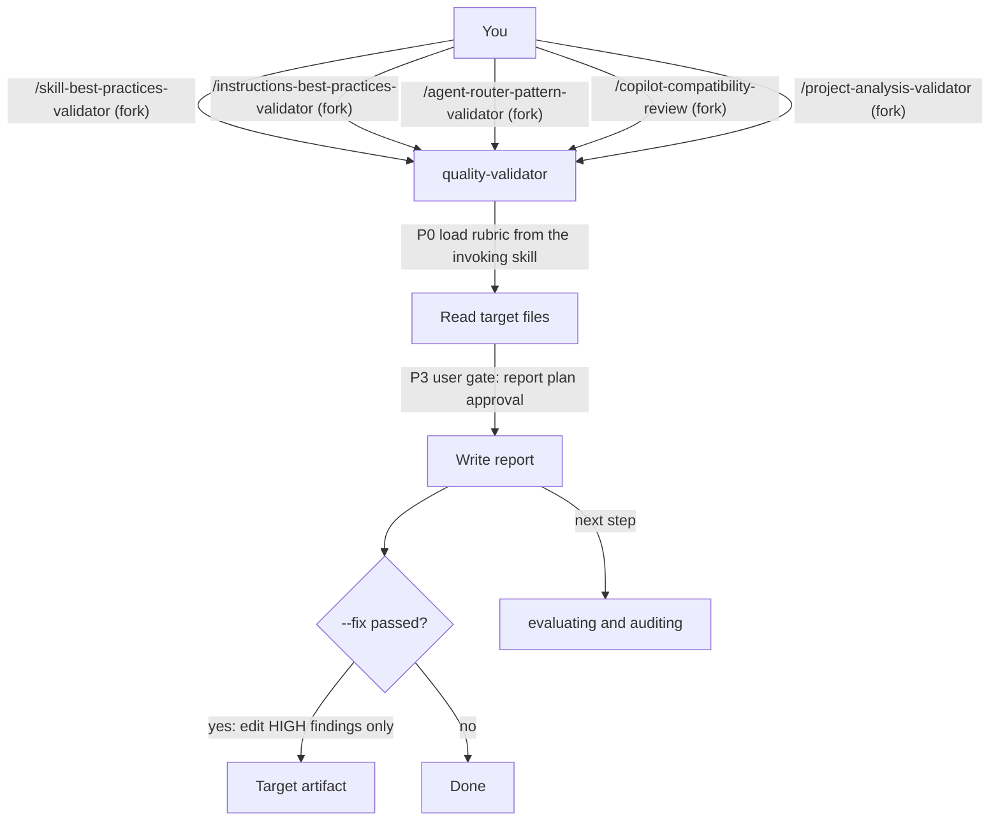

# validating

validating checks the quality of existing artifacts against official documentation and team conventions. It is for you if you want a prioritized report on skills, rules, router wiring, Copilot compatibility or a whole agent project. You need it before you ship an artifact, after an authoring run, or when you suspect that documentation and implementation have drifted apart.

## Contents

<!-- BEGIN GENERATED:contents -->
**Depends on:** `factory-core`  
**Used by:** [`harness-quality-kit`](../../bundles/harness-quality-kit/README.md) (bundle)

| Type | Name | What it does |
|---|---|---|
| command | [`/agent-router-pattern-validator`](.apm/skills/agent-router-pattern-validator/SKILL.md) | Analyzes an agent project and reports Agent Router Pattern compliance — deviations and concrete improvements; technology-agnostic. |
| command | [`/copilot-compatibility-review`](.apm/skills/copilot-compatibility-review/SKILL.md) | Reviews GitHub Copilot assets for compatibility against official documentation and reports gaps. |
| command | [`/instructions-best-practices-validator`](.apm/skills/instructions-best-practices-validator/SKILL.md) | Analyzes instruction/rule files for quality and adherence to official (GitHub/VS Code) best practices and team conventions. |
| command | [`/project-analysis-validator`](.apm/skills/project-analysis-validator/SKILL.md) | Validates an entire agent project for structural integrity, CLAUDE.md accuracy, router consistency, frontmatter correctness, and naming conventions across all… |
| command | [`/skill-best-practices-validator`](.apm/skills/skill-best-practices-validator/SKILL.md) | Analyzes Agent Skills for quality and adherence to official Claude best practices and team conventions. |
| agent (sonnet) | [`quality-validator`](.apm/agents/quality-validator.agent.md) | Quality & Best-Practices Validator — analyzes skills, rules/instructions, agent-router compliance, Copilot-compatibility, or a complete agent project against o… |
<!-- END GENERATED:contents -->

## Installation

<!-- BEGIN GENERATED:installation -->
| Item | Value |
|---|---|
| Package name | `agents-factory-validating` |
| Version | `1.0.0` |
| Source folder | `packages/harness-quality/validating` |
| In this repository | listed directly in the root `apm.yml` |
| Also installs | `factory-core` |

Install it into another project, from that project's folder:

```bash
apm install <path-to-agents-factory>/packages/harness-quality/validating --target claude
```

Add `--dry-run` to preview the install. APM writes the skills, agents and rules into `.claude/`. Change the sources under `.apm/`, never the generated `.claude/`.
<!-- END GENERATED:installation -->

Runtime prerequisites from the sources:

- `/copilot-compatibility-review` tells the agent to search the official GitHub and VS Code documentation on the web before it evaluates. The `quality-validator` agent lists only Read, Grep, Glob and Write, so web search may not be available to it (see Limits and constraints).
- The other four commands need only read access to the directory you pass.

## Quick Start

```
/skill-best-practices-validator .claude/skills/
```

You get one review file per skill and a consolidated summary matrix. Every finding names a criterion and a location.

## Usage Scenarios

### Scenario 1 — Check skills before you ship them

You just authored or edited skills.

```
/skill-best-practices-validator .claude/skills/
```

The canonical query is "Validate the skills in .claude/skills/". The validator reads the team standard first, lists the `SKILL.md` files, grades each one against official criteria A1 to A6, B and C and team criteria D1 to D7, and writes a review per skill plus a summary matrix. To check one skill, pass its folder: "Check skill quality for .claude/skills/example-skill/".

### Scenario 2 — Check rule or instruction files

```
/instructions-best-practices-validator .claude/rules/
```

It checks frontmatter (`name`, `description`, and `paths:` for Claude Code rules or `applyTo` for Copilot instructions), content, paths, scope and team conventions. It always includes an `applyTo` Patterns Analysis with coverage, conflicts and gaps. A file with no scope field is the most critical finding, because it is never applied automatically. A broad `**` pattern makes it ask whether the pattern is intentional before it flags a violation.

### Scenario 3 — Check the whole project for drift

```
/project-analysis-validator .claude/
```

Use it before a release, after a migration, or when CLAUDE.md may no longer match disk. It grades seven dimensions (P1 to P7). With a healthy project it reports minor count drift, for example a count in CLAUDE.md that no longer matches `find`. With a broken `agent:` reference it reports a P4 failure.

### Scenario 4 — Input is incomplete or the layout is non-standard

```
/project-analysis-validator src/agents/
```

If the root has no `skills/` directory and no `CLAUDE.md`, the validator does not grade P2 to P7. It lists what is missing, explains what a valid root looks like and asks you to confirm the layout. In the same way, a project with both `.github/` and `.claude/` makes `/agent-router-pattern-validator` ask which layout to analyze (or analyze both and note the dual target).

### Scenario 5 — You point a validator at the wrong directory (misuse)

```
/skill-best-practices-validator src/main/java/
```

The validator finds no `SKILL.md` files and says so: "No SKILL.md files found in src/main/java/ — this does not appear to be a skills directory". It suggests `.claude/skills/`. It writes no reviews and no zero-percent matrix. The other validators behave the same way: "Validate my project structure." on a directory with no router artifacts gets an inventory of "none" and a request to point at `.github/` or `.claude/`; "Review Copilot assets in src/" finds no Copilot assets and writes no report; "Validate instructions in src/main/java/" finds no rule files.

### Scenario 6 — Check the router wiring of a project

```
/agent-router-pattern-validator .claude/
```

It builds an inventory, checks each layer against the Agent Router Pattern (the router only classifies, routes, composes and falls back), weights the layers (router 40%, instructions 20%, prompts 30%, skills 10%) and writes an eight-section report. For "Check if the agent in .github/ correctly implements the router pattern." with domain logic leaked into the router, it reports the leakage as a violation in Section 4 and proposes the move in Section 5. If you give no path it defaults to `.github/`.

### Scenario 7 — Review a Copilot project

```
/copilot-compatibility-review .github/
```

For "Review the Copilot assets in .github/ for compatibility." it checks `.agent.md`, `.instructions.md`, `.prompt.md`, `SKILL.md` and `README.md` against the official documentation. It leads with an Action Summary ranked HIGH, MEDIUM and LOW, and it never includes corrected code. This command is a generic tool for other projects that target Copilot, not for this repository.

### Scenario 8 — Chain to the next step

After a validator finds problems, fix them (or use the agent's `--fix` mode, see Agents Reference), then check behavior and architecture.

```
/skill-best-practices-validator .claude/skills/
/evaluating-skill-scenarios cloud-architecture-researcher
/audit-cc-architecture-consensus framework-researcher
```

## Commands Reference

All five commands use `context: fork`, `agent: quality-validator` and `disable-model-invocation: true`. They report; they do not edit the audited files. The agent also supports a `--fix` flag that is not in any `argument-hint` (see Agents Reference).

### `/skill-best-practices-validator`

*Agent Skills against official Claude best practices and team conventions.*

**Syntax**

```
/skill-best-practices-validator <skills-directory>
```

**Parameters**

| Parameter | Required | Default | Description |
|---|---|---|---|
| `skills-directory` | yes | `.claude/skills/` as used in the hint's example | Directory of skills to validate, for example `.claude/skills/` or one skill folder. A non-standard path makes it ask for confirmation. |

**Prerequisites**

- A directory that contains `SKILL.md` files. The validator reads `skill-creator/SKILL.md` and `skill-creator/blueprints/three-tier-architecture.md` first.

**What it does**

1. Loads the reference criteria (team standard and three-tier architecture).
2. Enumerates the skills with `ls` or `Glob` and reads each file completely.
3. Grades each skill: official A1 (frontmatter), A2 (under 500 lines), A3 (progressive disclosure), A4 (content), A5 (workflows), A6 (file paths), B (code and scripts), C (testing, at least 3 evaluation scenarios), and team D1 (naming), D2 (three tiers), D3 (version context), D4 (verification loop), D5 (anti-patterns with alternatives), D6 (links), D7 (external resources).
4. Detects 11 anti-patterns, such as an overlong SKILL.md, a first-person description, Windows paths and a Never-Do item without an alternative.
5. Runs a verification loop (review file count equals `SKILL.md` count, summary exists, every review cites criteria) and saves.

It keeps official and team criteria in separate tables and ranks recommendations HIGH, MEDIUM and LOW. It asks first for third-party or legacy skills, for skills without a version, and for skills over 500 lines (diagnosis only, or also an extraction proposal).

**What is updated and what is not**

- It writes review files. It does not change any `SKILL.md` unless the agent runs in `--fix` mode.

**Output files**

- `.claude/skills/<skill-name>/<skill-name>-best-practices-review.md`, one per skill.
- `.claude/skills/skills-best-practices-summary.md`, the compliance matrix with an AVERAGE row.

**Examples**

```
/skill-best-practices-validator .claude/skills/
/skill-best-practices-validator .claude/skills/example-skill/
```

**Next**

Fix HIGH items, then run `/evaluating-skill-scenarios <skill-name>` for behavior.

### `/instructions-best-practices-validator`

*Instruction and rule files against GitHub, VS Code and team conventions.*

**Syntax**

```
/instructions-best-practices-validator <instructions-directory>
```

**Parameters**

| Parameter | Required | Default | Description |
|---|---|---|---|
| `instructions-directory` | yes | none | Directory of instructions or rules, for example `.claude/rules/` (Claude Code) or `.github/instructions/` (Copilot). If both layouts exist it analyzes both and notes the dual target. |

**Prerequisites**

- Rule or instruction files in the directory. The validator reads at least 3 existing files as a style baseline.

**What it does**

1. Detects the layout: `.claude/rules/*.md` or `.github/instructions/*.instructions.md`.
2. Grades 13 official criteria (A1 name, A2 description, A3 scope field, A4 `excludeAgent`, B1 to B5 content, C paths, D1 to D3 scope and conflicts) and 6 team criteria (E1 naming, E2 role statement, E3 version context, E4 code as instruction, E5 skill integration, E6 links).
3. Builds the `applyTo` Patterns Analysis: coverage, conflicts, gaps.
4. Detects 14 anti-patterns, such as a missing scope field, an overly broad pattern, a name that does not match the filename and a rule without a reason.

It asks first about a broad scope pattern, mixed-language files, files over 300 lines and conflicts between files with the same scope.

**What is updated and what is not**

- It writes one report and edits no rule.

**Output files**

- `INSTRUCTIONS_BEST_PRACTICES_REVIEW.md` with an executive summary, per-file evaluation, compliance matrix, patterns analysis, recommendations by priority and conclusions.

**Examples**

```
/instructions-best-practices-validator .claude/rules/
/instructions-best-practices-validator .github/instructions/
```

**Next**

Fix files with a missing scope field first. They never activate.

### `/agent-router-pattern-validator`

*Agent Router Pattern compliance, technology-agnostic.*

**Syntax**

```
/agent-router-pattern-validator [project-directory]
```

**Parameters**

| Parameter | Required | Default | Description |
|---|---|---|---|
| `project-directory` | no | `.github/` | Path to the agent project, for example `.claude/` for Claude Code or `.github/` for Copilot. The SKILL.md Step 1 states the `.github/` default. |

**Prerequisites**

- Router artifacts in the directory: `CLAUDE.md` and `.claude/agents`, `rules`, `skills` for Claude Code, or `.github/agents`, `instructions`, `prompts` for Copilot.

**What it does**

1. Discovers files and builds the INVENTORY table (layout detected, router, agents, rules or instructions, prompts or fork skills, knowledge skills) before any analysis.
2. Analyzes four layers: router purity, routing completeness and fallback; rules or instructions (single concern, no routing duplication); prompts or fork skills (specialization, skill loading, three-tier guardrails); skills (a sample of up to 5, unless you ask for all).
3. Runs cross-layer checks: keyword alignment, responsibility audit, naming, supported environments.
4. Scores 0 to 10 per layer and weights them: router 40%, instructions 20%, prompts 30%, skills 10%.
5. Writes the report and confirms the overall score, problem counts and estimated effort.

It asks first when both `.github/` and `.claude/` hold agent artifacts, when there is no `README.md`, when there are more than 5 skills, and when file extensions are non-standard.

**What is updated and what is not**

- It writes one report and generates no code. It does not score a layer whose files it could not read.

**Output files**

- `AGENT_ROUTER_PATTERN_REPORT.md`, saved in the root of the analyzed project directory or the current working directory.

**Examples**

```
/agent-router-pattern-validator .claude/
/agent-router-pattern-validator .github/
```

**Next**

Run `/copilot-compatibility-review` for format and field compliance, then `/skill-best-practices-validator` for implementation quality. The SKILL.md recommends this order. For layer scope, flow and engine mechanics use [auditing](../auditing/README.md).

### `/copilot-compatibility-review`

*GitHub Copilot assets against the official documentation.*

**Syntax**

```
/copilot-compatibility-review <copilot-assets-directory>
```

**Parameters**

| Parameter | Required | Default | Description |
|---|---|---|---|
| `copilot-assets-directory` | yes | none | Path to the Copilot assets repository or directory, normally `.github/`. |

**Prerequisites**

- Copilot assets: `.github/agents/*.agent.md`, `instructions/*.instructions.md`, `prompts/**/*.prompt.md`, `skills/**/SKILL.md`, and `README.md`.
- Web access, because the skill tells the agent to search current official documentation first (see Limits and constraints).

**What it does**

1. Searches the official GitHub Copilot and VS Code documentation for agents, instructions, prompt files and skills.
2. Reads every asset and checks required and optional frontmatter fields per asset type, plus the `README.md` supported-environments list.
3. Writes the report with an Action Summary first (HIGH, MEDIUM, LOW), then one section per asset type with the file list and `Issues Detected`.
4. Marks a check as "requires internal access" if an internal conventions URL is not reachable, instead of failing.

It asks first about undocumented frontmatter fields, a missing `README.md` and a non-standard directory layout.

**What is updated and what is not**

- It writes one report. It never includes corrected code. It only names the problem and links the official page.

**Output files**

- `COPILOT_COMPATIBILITY_REVIEW.md`

**Examples**

```
/copilot-compatibility-review .github/
/copilot-compatibility-review
```

**Next**

Fix HIGH frontmatter issues, then re-run.

### `/project-analysis-validator`

*Structure, CLAUDE.md accuracy, router consistency, frontmatter and naming of a whole Claude Code project.*

**Syntax**

```
/project-analysis-validator [project-root]
```

**Parameters**

| Parameter | Required | Default | Description |
|---|---|---|---|
| `project-root` | no | `.claude/` | Root directory of the agent project to validate. The SKILL.md states the default. |

**Prerequisites**

- A root that contains `agents/`, `skills/` and `rules/`, with `CLAUDE.md` at the project root. Otherwise it asks you to confirm the layout. With more than 50 skills it offers a targeted audit or a full sweep. With `.claude/worktrees/` present it asks whether to include them.

**What it does**

1. Enumerates agents, skills, rules and key docs.
2. Reads `CLAUDE.md`, every agent file and `.claude/rules/skill-frontmatter.md`.
3. Grades seven dimensions: P1 directory structure (and no `.claude/templates/`), P2 CLAUDE.md accuracy (counts and routing table), P3 frontmatter, P4 router consistency (every `context: fork` skill has a valid `agent:`), P5 naming, P6 progressive disclosure (under 500 lines), P7 rule coverage.
4. Detects 9 anti-patterns, such as an orphan `context: fork`, a broken agent reference, a field swap and CLAUDE.md count drift.
5. Runs the verification commands (skill and agent counts, fork skills with no `agent:`, broken `agent:` references) and saves.

Grades are Pass (0 issues), Warn (1 or more soft issues) and Fail (1 or more hard issues). The overall project grade is the lowest single-dimension grade.

**What is updated and what is not**

- It is read-only for audited files. It writes one report.

**Output files**

- `.claude/project-analysis-report.md`

**Examples**

```
/project-analysis-validator .claude/
/project-analysis-validator src/agents/
```

**Next**

Fix Fail dimensions first. For deeper structural analysis use `/audit-cc-architecture-consensus`.

## Pipeline



## Agents Reference

<!-- BEGIN GENERATED:agents-reference -->
| Agent | Model | Tools | Can start agents | Started by |
|---|---|---|---|---|
| [`quality-validator`](.apm/agents/quality-validator.agent.md) | sonnet | Read, Grep, Glob, Write | no | `/agent-router-pattern-validator`, `/copilot-compatibility-review`, `/instructions-best-practices-validator`, `/project-analysis-validator`, `/skill-best-practices-validator` |
<!-- END GENERATED:agents-reference -->

**`quality-validator`**

- **Does:** reviews existing artifacts against official documentation and team conventions and writes a graded, prioritized report. Workflow: P0 confirm the rubric of the invoking skill, P1 read the target completely, P2 compare with the checklist, P3 grade and present a Report Plan, P4 write the report, P5 prioritize findings from P0 (blocking) to P3 (nice to have). Model `sonnet`. Tools: Read, Grep, Glob, Write.
- **Gate:** at P3 it shows a `Report Plan` table with a path and does not write until you approve.
- **`--fix` mode:** when the arguments contain `--fix`, it applies a targeted fix to each HIGH finding, re-validates the item, marks any that still fail as `UNRESOLVED`, then re-runs the full validation and updates the report. It does not auto-fix CRITICAL findings without asking you. The flag is described only in the agent file, not in any command's `argument-hint`.
- **Never does:** research technologies, generate SKILL.md files or audit architecture (those belong to `framework-researcher`, `artifact-author` and `architecture-auditor`). It does not rewrite the target without `--fix`. If a request matches no command it states the mismatch and suggests the right one.
- **Non-interactive contract:** the agent file does not describe a numbered-questions mode. The commands ask in their Ask-First cases. Treat unattended use as unverified.

## Output structure

| Command | Report file |
|---|---|
| `/skill-best-practices-validator` | `.claude/skills/<skill>/<skill>-best-practices-review.md` per skill, and `.claude/skills/skills-best-practices-summary.md` |
| `/instructions-best-practices-validator` | `INSTRUCTIONS_BEST_PRACTICES_REVIEW.md` |
| `/agent-router-pattern-validator` | `AGENT_ROUTER_PATTERN_REPORT.md` |
| `/copilot-compatibility-review` | `COPILOT_COMPATIBILITY_REVIEW.md` |
| `/project-analysis-validator` | `.claude/project-analysis-report.md` |

The agent file names `.claude/reports/quality_{artifact}_{YYYY-MM-DD}.md` as the report path. See Limits and constraints.

## Limits and constraints

| Item | Value | Source |
|---|---|---|
| Finding format | every finding cites a criterion and a location (file and section) | all skills |
| Skill rows per review | 8 official (A1 to A6, B, C) and 7 team (D1 to D7) | `skill-best-practices-validator` |
| Instruction rows per file | 13 official and 6 team | `instructions-best-practices-validator` |
| Router layer weights | router 40%, instructions 20%, prompts 30%, skills 10% | `agent-router-pattern-validator` |
| Router skills sampled | up to 5 by default | `agent-router-pattern-validator` |
| Project dimensions | P1 to P7; overall grade is the lowest dimension | `project-analysis-validator` |
| Large project | over 50 skills: offers a targeted audit | `project-analysis-validator` |
| Long skill or rule | over 500 lines (skill) or over 300 lines (rule): asks whether you want a split proposal | skill and instruction validators |
| Edits | none unless `--fix`; `--fix` touches HIGH findings only | `quality-validator` |
| Scope | static quality only. Behavior tests belong to [evaluating](../evaluating/README.md), architecture audits to [auditing](../auditing/README.md) | skills |
| Copilot review | generic tool for other projects that target Copilot | CLAUDE.md |

Source defects that affect how you read the output (unresolved in the sources):

- Report paths conflict. The agent writes `.claude/reports/quality_{artifact}_{YYYY-MM-DD}.md`, while each skill names its own file (for example `.claude/project-analysis-report.md`). Which one wins is not stated (unverified).
- `/copilot-compatibility-review` requires web search, and `--fix` requires the Edit tool, but the agent lists only Read, Grep, Glob and Write. The validators also run `ls`, `wc` and `find` commands, and the agent has no Bash tool.
- `/agent-router-pattern-validator` says "8 sections" in its navigation and "10 required sections" in its verification loop.

## Related

- Family guides: [Quality harness commands](../../../docs/entry-points/harness-quality.md), [Authoring commands](../../../docs/entry-points/factory-authoring.md)
- Flows: [Quality loop](../../../docs/flows/quality-loop.md), [Full agent package](../../../docs/flows/full-agent-package.md)
- [Agent architecture](../../../docs/agents/architecture.md)
- [All packages](../../../docs/packages/README.md)
- Depends on: [factory-core](../../factory/factory-core/README.md)
- Siblings: [auditing](../auditing/README.md), [evaluating](../evaluating/README.md)
- Checks the output of: [artifact-authoring](../../factory/artifact-authoring/README.md)
