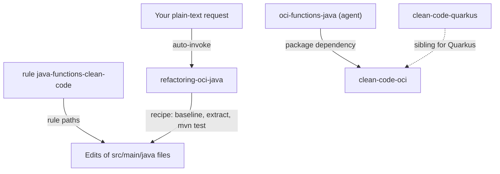

# clean-code-oci

This package helps you refactor the Java code of OCI Functions (FDK) projects without changing behavior. It gives you one skill with a safe step-by-step recipe and one rule that keeps new code small and single-purpose. It is for developers who write or clean up handler and service classes of an OCI Function, and you need it when a function class grows past a readable size. `oci-functions-java` depends on it, so installing that package brings this one too.

> Version lock: Corretto 21 for `mvn test` (Java 25+ breaks Mockito byte-buddy mocking, per the skill). The OCI Functions FDK lifecycle (`@FnConfiguration`, `handler`) must survive the refactor. Maven 3.8+. No other pinned version; the skill gives no research-date lock line.

## Contents

<!-- BEGIN GENERATED:contents -->
**Depends on:** `factory-core`  
**Used by:** `oci-functions-java`, [`java-clean-code`](../../../bundles/java-clean-code/README.md) (bundle)

| Type | Name | What it does |
|---|---|---|
| knowledge skill | [`refactoring-oci-java`](.apm/skills/refactoring-oci-java/SKILL.md) | Refactors OCI Functions Java code for readability with Extract Method, SOLID decomposition, DRY, and behavior-preserving safety (tests stay green). |
| rule | [`java-functions-clean-code.instructions`](.apm/instructions/java-functions-clean-code.instructions.md) | SOLID, Extract Method, and readability rules for OCI Functions Java. |
<!-- END GENERATED:contents -->

## Installation

<!-- BEGIN GENERATED:installation -->
| Item | Value |
|---|---|
| Package name | `agents-factory-clean-code-oci` |
| Version | `1.0.0` |
| Source folder | `packages/java/clean-code/clean-code-oci` |
| In this repository | installed transitively, through `oci-functions-java` |
| Also installs | `factory-core` |

Install it into another project, from that project's folder:

```bash
apm install <path-to-agents-factory>/packages/java/clean-code/clean-code-oci --target claude
```

Add `--dry-run` to preview the install. APM writes the skills, agents and rules into `.claude/`. Change the sources under `.apm/`, never the generated `.claude/`.
<!-- END GENERATED:installation -->

Prerequisites, from the skill: a JDK 21 (Corretto) selected through `JAVA_HOME` before you run tests (`java -version` must show openjdk 21) and Maven 3.8+ (`mvn test`, or `mvn -f services/<func>/pom.xml test`). The skill's example uses the macOS command `export JAVA_HOME=$(/usr/libexec/java_home -v 21)`.

## Quick Start

This package has no `/command` and no agent. Ask in plain language and Claude loads `refactoring-oci-java`.

```text
My RestProxyFunction is 580 lines. It does routing, store-id resolution, HTTP client calls, OAuth, APM tracing, and error mapping all in one class. Refactor it.
```

The skill starts from a green `mvn test` baseline, maps which tests depend on handler and package-private signatures, and extracts one smell at a time, running `mvn test` after each step.

## Usage Scenarios

Each request is an evaluation scenario of `refactoring-oci-java` (quoted `query` fields of its JSON scenarios).

### Scenario 1 - Fastest default: decompose a god class

```text
My RestProxyFunction is 580 lines. It does routing, store-id resolution, HTTP client calls, OAuth, APM tracing, and error mapping all in one class. Refactor it.
```

You get a green baseline first, a map of test coupling, then one extraction at a time while public signatures and exact exception types and messages stay the same. OAuth moves to `OAuth2TokenProvider`, routing to `Route`, error mapping to `ErrorMapper`; the handler stays as a thin dispatcher (about 230 lines in the skill's example) and no speculative abstraction is added.

### Scenario 2 - Incomplete input: the baseline is red

```text
I want to refactor my VaultService class but some tests are already failing before I start. Should I fix the tests first or refactor anyway?
```

The skill blocks the start. It requires a green baseline (a red one hides regressions), tells you to fix the failing tests first or confirm they are intentionally skipped, offers help with that prerequisite, and never suggests commenting out failing tests.

### Scenario 3 - A failure that looks like a refactor regression

```text
After the refactoring, tests started failing with 'Cannot mock/spy class ... Mockito cannot mock this class'. I didn't change any test code.
```

The skill identifies a JVM and Mockito compatibility problem, not a refactor regression. It checks that `JAVA_HOME` is Corretto 21 (Java 25+ breaks Mockito byte-buddy mocking) and gives the fix `export JAVA_HOME=$(/usr/libexec/java_home -v 21)`. It does not suggest a Mockito upgrade first.

### Scenario 4 - Misuse: fixing behavior while refactoring

```text
While refactoring the error mapper, I noticed the HTTP status codes returned for some errors seem wrong. Should I fix them as part of this refactoring?
```

The skill says no. Outputs, status codes, log texts and side-effect order stay identical. Finish the refactor with the current behavior, then open a separate task for the fix, so a regression can be bisected.

### Scenario 5 - Out-of-scope: Quarkus code

Ask for the Quarkus equivalent and you leave this package. For Quarkus 3.40 code use [clean-code-quarkus](../clean-code-quarkus/README.md). This package targets OCI Functions only.

### Scenario 6 - Chain to the function workflow

After the refactor, the function is built and deployed by other packages: `/develop-java-function` (agent `oci-functions-java`, which depends on this package), then `/deploy-oci-function`. The `oci-functions-java` rule `java-functions-skills` lists this skill under the keywords refactor, clean code, SOLID, extract method, readability, decompose and god class.

## Skills Reference

One knowledge skill.

### `refactoring-oci-java`

- Loads when: you ask to refactor, clean up, improve readability, decompose a god class, extract methods, or apply clean code or SOLID to existing OCI Functions Java.
- Locks: Corretto 21 for `mvn test`; Mockito current stable compatible with Java 21 (`mockito-core` and `mockito-junit-jupiter`); OCI Functions FDK current stable (`com.fnproject.fn:api` and `runtime`); Maven 3.8+.
- Always: establish a green baseline; map test coupling before extracting; refactor one smell at a time; run `mvn test` after every extraction; preserve exact exception types, messages, log texts, status codes and side-effect order.
- Ask first: scope of the refactoring (one method, a class, a package restructuring); test coverage adequacy (under 50% coverage, add tests first?); a new collaborator that would have a single use; relocating tests.
- Never: change behavior during a refactoring session; remove package-private test constructors or change handler signatures without relocating the dependent test; start with a red test suite; add speculative abstractions (extract a new class only when there are two or more call sites).
- Example request: "I want to refactor my VaultService class but some tests are already failing before I start. Should I fix the tests first or refactor anyway?"

## Architecture



## Agents Reference

<!-- BEGIN GENERATED:agents-reference -->
This package has no subagents. Claude loads its skills by description, and agents of other packages can load them too.
<!-- END GENERATED:agents-reference -->

This package has no agent. The agent `oci-functions-java` (command `/develop-java-function`, from the OCI packages) depends on it and uses the skill and the rule. No orchestrator launches anything from this package.

### Rules

| Rule | Scope as the file states it (`paths`) | What it enforces |
|---|---|---|
| `java-functions-clean-code` | `**/src/main/java/**/*.java`, `**/pom.xml`, `**/func.yaml`, `**/Dockerfile` | Small single-responsibility methods (about 40 lines or fewer), Extract Method, a package taxonomy (`route/`, `transform/`, `web/`, `handler/`, `client/`, `obs/`), DRY with exact exception parity, records for grouped values, facade over statics, behavior-preserving refactors. |

This is the one rule in these packages whose frontmatter uses `paths` (the factory convention, `.claude/rules/skill-frontmatter.md`); the other Java rules use `applyTo`. The rule body names `src/main/java` as its target ("Every time you write a new class/method OR edit an existing one in `src/main/java`"), while the frontmatter also lists `pom.xml`, `func.yaml` and `Dockerfile`; the rule file does not say why.

## Limits and constraints

| Item | Value | Where stated |
|---|---|---|
| JVM for tests | Corretto 21; Java 25+ breaks Mockito byte-buddy mocking | skill |
| Method size | target about 40 lines or fewer; extract when longer | rule |
| Nesting | at most about 2 levels inside a method | rule |
| Collaborator extraction | only with two or more call sites; no single-use indirection | skill, rule |
| Behavior | exception types, messages, log texts, status codes, side-effect order unchanged | skill, rule |
| Signatures | public, handler and package-private test constructors unchanged unless the test moves with the logic | skill, rule |
| Coverage hint | under 50% coverage: ask whether to add tests first | skill |
| Scope | OCI Functions (FDK) only; not Quarkus | skill, README of the family |

Do not install both clean-code rules in one project. The overview in [clean-code](../README.md) says each rule applies to every `src/main/java/**/*.java` it can see; the Quarkus rule's text instead says that if both load, the more restrictive guidance wins (see [clean-code-quarkus](../clean-code-quarkus/README.md)).

## Related

- Family guide: [Java integration commands](../../../../docs/entry-points/java-integrations.md) (this package is not listed there; it has no command).
- Depends on [factory-core](../../../factory/factory-core/apm.yml).
- Sibling: [clean-code-quarkus](../clean-code-quarkus/README.md); shared overview in [clean-code](../README.md).
- Docs: [agent architecture](../../../../docs/agents/architecture.md), [entry points](../../../../docs/entry-points/README.md), [packages](../../../../docs/packages/README.md).
