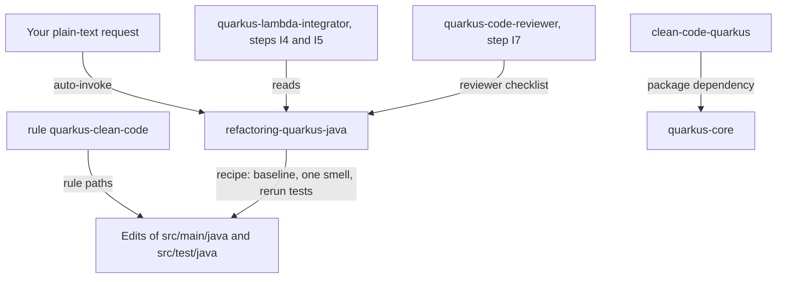

# clean-code-quarkus

This package helps you refactor and review Quarkus 3.40 Java code (REST resources, CDI beans, Lambda handlers, AWS client wrappers) without changing behavior. It gives you one skill with a refactor recipe and a reviewer checklist, and one rule that sets clean-code expectations. It is for developers who write or review Java in a Quarkus project, and you need it when a resource, handler or service grows hard to read. `quarkus-core` depends on it, so installing that package brings this one too.

> Version lock: the refactoring method is not version-specific; every Quarkus-specific statement applies to Quarkus 3.40.x only (research dates 2026-10-14 for ArC, REST and JUnit, and 2026-10-28 for the AWS family facts). Quarkus 4 is out of scope. Quarkus 4.0.0.Beta1 was published 2026-10-01 and the skill says to re-check when 4.0 is final.

## Contents

<!-- BEGIN GENERATED:contents -->
**Depends on:** `factory-core`  
**Used by:** `quarkus-core`, [`java-clean-code`](../../../bundles/java-clean-code/README.md) (bundle)

| Type | Name | What it does |
|---|---|---|
| knowledge skill | [`refactoring-quarkus-java`](.apm/skills/refactoring-quarkus-java/SKILL.md) | Guides behaviour-preserving refactoring of Quarkus 3.40 Java code (REST resources, CDI services, Lambda handlers, AWS client wrappers): Extract Method, DRY, re… |
| rule | [`quarkus-clean-code.instructions`](.apm/instructions/quarkus-clean-code.instructions.md) | Clean code and behaviour-preserving refactor rules for Quarkus 3.40 Java (REST resources, CDI beans, Lambda handlers, AWS client wrappers). |
<!-- END GENERATED:contents -->

## Installation

<!-- BEGIN GENERATED:installation -->
| Item | Value |
|---|---|
| Package name | `agents-factory-clean-code-quarkus` |
| Version | `1.0.0` |
| Source folder | `packages/java/clean-code/clean-code-quarkus` |
| In this repository | installed transitively, through `quarkus-core` |
| Also installs | `factory-core` |

Install it into another project, from that project's folder:

```bash
apm install <path-to-agents-factory>/packages/java/clean-code/clean-code-quarkus --target claude
```

Add `--dry-run` to preview the install. APM writes the skills, agents and rules into `.claude/`. Change the sources under `.apm/`, never the generated `.claude/`.
<!-- END GENERATED:installation -->

Prerequisites, from the skill and its recipe: a Quarkus project (`pom.xml` or `build.gradle` containing `io.quarkus`) with a runnable test suite; the recipe's representative command is `./mvnw test`. The Quarkus 3.40 minimum Java version is not recorded (*unverified*), so the skill asks which JDK the build uses before it suggests records.

## Quick Start

This package has no `/command` and no agent. Ask in plain language and Claude loads `refactoring-quarkus-java`.

```text
My Quarkus 3.40 OrderResource.create is 90 lines: it validates, maps, sends to SQS and builds error responses. Refactor it for readability.
```

You get a refactor in small steps from a green baseline, with the tests rerun after each step.

## Usage Scenarios

Each request is an evaluation scenario of `refactoring-quarkus-java` (quoted `query:` lines).

### Scenario 1 - Fastest default: a fat resource

```text
My Quarkus 3.40 OrderResource.create is 90 lines: it validates, maps, sends to SQS and builds error responses. Refactor it for readability.
```

The skill establishes a green baseline, maps test coupling, and refactors one smell at a time. The resource stays thin with the same blocking signature, `@Valid` on the parameter and the same status codes. It extracts a flow, a mapper and a client wrapper, and every injected new class gets a scope such as `@ApplicationScoped`. Log texts, exception types and side-effect order stay as they were.

### Scenario 2 - Incomplete or unverified input: moving a bean to a new module

```text
I want to move OrderMapper, which has only @Identifier("orderMapper") and is called by name from a Camel route, into a new orders-core Maven module. Will it still work, and can I use a record for the route context?
```

The skill does not guess. It states that beans in another module are discovered only with `beans.xml`, `META-INF/jandex.idx` or `quarkus.index-dependency.*` and shows the properties; says removal of an `@Identifier`-only bean is *unverified* and keeps or adds `@Unremovable`; treats the module split as an Ask-First decision; and says the Quarkus 3.40 minimum Java is not recorded, so it asks which JDK the build uses before using records. Answer its questions: is the bean injected by type or only looked up by name, is a separate module worth the indexing, which JDK.

### Scenario 3 - Misuse: fixing behavior while refactoring

```text
While refactoring my exception mapper I noticed IllegalStateException returns 500 but should probably be 409, and a log line is misleading. Change them as part of this cleanup.
```

The skill declines. Behavior, scope, thread model and validation placement do not change during a refactor; open a separate change for the 409 and the log text.

### Scenario 4 - Anti-pattern trap: scope, validation and handler rename

```text
Clean up my Lambda project: make Clock a @Singleton for speed, move @Valid from the resource into OrderService.create, and rename OrderEventsHandler to OrderEventProcessor.
```

The skill declines the scope change as a separate task (it notes `@InjectMock` works only on normal-scoped beans and a `@Singleton` needs `@MockitoConfig(convertScopes = true)`, tagged *medium confidence*), declines moving `@Valid` (parameter violations return 400, service-method violations give 5xx unless `ConstraintViolationException` is mapped), and for the rename changes class name, CDI name and `quarkus.lambda.handler` together, or recommends not renaming deployed configuration during a refactor.

### Scenario 5 - Review a refactor diff (step I7)

```text
Review this refactor diff: OrderResource now returns Uni<OrderDto>, a new class CreateOrderFlow has no scope annotation, and the PR replaces the X-Ray client wrapper with an OpenTelemetry one.
```

The skill starts with the process items (the diff against the project's ADRs), flags the `Uni` return as a thread-model flip (high), flags the missing scope on an injected class (high), flags the tracing replacement as a non-refactor and a possible ADR contradiction, and reports in the verdict format with severity `low`, `moderate` or `high` (not the bare word "medium").

### Scenario 6 - Out of scope: OCI Functions and Quarkus 4

```text
Refactor my OCI Function (FnConfiguration, fn-events) and also apply the Quarkus 4 Jackson 3 changes while you are at it.
```

Both parts are out of scope. For OCI Functions use [clean-code-oci](../clean-code-oci/README.md); Quarkus 4 is not covered.

### Scenario 7 - Chain

In orchestrated flows the skill is used at implementation steps I4 (clean code) and I5 (refactor) and by the reviewer at I7, in the Quarkus + Camel and Quarkus + AWS flows. The agent `quarkus-lambda-integrator` in [quarkus-aws](../../quarkus/quarkus-aws/README.md) always loads it for I4 and I5, and `quarkus-code-reviewer` checks diffs against the same checklist. You can also use it on its own, as in the scenarios above.

## Skills Reference

One knowledge skill.

### `refactoring-quarkus-java`

- Loads when: you clean up or review Quarkus 3.40 Java (REST resources, CDI services, Lambda handlers, AWS client wrappers): Extract Method, DRY, records, package split.
- Locks: Quarkus-specific facts apply to 3.40.x only; the method itself (the team practice, register U1) is not version-specific. Not for OCI Functions or Quarkus 4.
- Blueprints: `always-do-patterns`, `never-do-patterns`, `refactor-recipe`, `package-taxonomy`, `before-after-examples`, `reviewer-checklist`, `unverified-and-risks`, `evaluation-scenarios`.
- Always: give an extracted injected collaborator a bean-defining scope; move `@Unremovable`, `@Named` and observer methods together with the bean; keep a resource method's signature kind (`Uni`, `Multi`, `CompletionStage` and `Publisher` run on the IO thread, other types are blocking); keep constraint annotations on the REST parameter; keep `quarkus.lambda.handler` equal to the handler bean's CDI name; index a bean archive when moving classes into another module.
- Ask first: a new interface; splitting a module; scope of a new bean; a moved bean qualified only with `@Identifier`; private injection members (*medium confidence*); constructor versus field injection (*medium confidence*); moving init or startup logic; moving a `@ServerExceptionMapper`; scope change and mocking; records as value holders; low test coverage; relocating tests.
- Never: read a field of a normal-scoped bean from another bean after extracting; move `@Valid` or constraint annotations from the resource parameter into a service method; flip a resource method between blocking and `Uni` while cleaning up; drop `@Unremovable`, `@Named` or an observer when moving a bean; rename or move the Lambda handler bean without updating `quarkus.lambda.handler`.
- Example request: "Review this refactor diff: OrderResource now returns Uni<OrderDto>, a new class CreateOrderFlow has no scope annotation, and the PR replaces the X-Ray client wrapper with an OpenTelemetry one."

## Architecture



## Agents Reference

<!-- BEGIN GENERATED:agents-reference -->
This package has no subagents. Claude loads its skills by description, and agents of other packages can load them too.
<!-- END GENERATED:agents-reference -->

This package has no agent. `quarkus-lambda-integrator` (steps I4 and I5) and `quarkus-code-reviewer` (step I7) live in [quarkus-aws](../../quarkus/quarkus-aws/README.md); they are launched by the orchestrator `/building-aws-saas-serverless-quarkus-react-nextjs` from a work-order. The skill's text also names a Quarkus + Camel flow (steps I4, I5 and I7); the sources of this package do not name an agent for it.

### Rules

| Rule | Scope as the file states it (`applyTo`) | What it enforces |
|---|---|---|
| `quarkus-clean-code` | `**/src/main/java/**/*.java,**/src/test/java/**/*.java` | Green baseline first; preserve status codes, exception types, log texts and side-effect order; keep resources and Lambda handlers thin; give extracted beans a bean-defining scope; keep `quarkus.lambda.handler` equal to the handler bean's CDI name; review with the checklist at I7. |

The rule file uses the frontmatter key `applyTo`, while the factory rule convention (`.claude/rules/skill-frontmatter.md`) uses `paths`. A glob cannot test file content, so the rule says to apply it only in Quarkus projects (the `pom.xml` or `build.gradle` contains `io.quarkus`) and to ignore it otherwise. In OCI Functions projects the `java-functions-clean-code` rule governs, and if both load the more restrictive guidance wins.

## Limits and constraints

| Item | Value | Where stated |
|---|---|---|
| Quarkus version | 3.40.x only for Quarkus-specific claims; Quarkus 4 out of scope | skill, rule |
| Research dates | 2026-10-14 (ArC, REST, JUnit), 2026-10-28 (AWS family facts) | skill |
| Quarkus 4 | 4.0.0.Beta1 published 2026-10-01; re-check when 4.0 is final | skill |
| Method size | extract methods longer than about 40 lines; at most 2 nesting levels | recipe |
| Collaborators | extract duplicated logic when it appears in two or more places, keeping exact exception types and messages | recipe |
| Behavior | status codes, exception types and messages, log texts, side-effect order, thread model, scope and validation placement unchanged | skill, rule |
| Reviewer severity | `low`, `moderate`, `high` | evaluation scenario 5 |
| Minimum Java for 3.40 | not recorded (*unverified*); asks before using records | skill |
| Scope | Quarkus Java only; not OCI Functions | skill, rule |

Claims the skill tags `(unverified)` or `(medium confidence)` stay tagged when you rely on them; the register is `blueprints/unverified-and-risks.md`. The skill's text still refers to the rule as part of the package `quarkus-core`; the rule now ships in this package.

## Related

- Family guide: [Java integration commands](../../../../docs/entry-points/java-integrations.md) (this package is not listed there; it has no command).
- Depends on [factory-core](../../../factory/factory-core/apm.yml). Depended on by [quarkus-core](../../quarkus/quarkus-core/README.md).
- Sibling: [clean-code-oci](../clean-code-oci/README.md); shared overview in [clean-code](../README.md).
- Docs: [agent architecture](../../../../docs/agents/architecture.md), [entry points](../../../../docs/entry-points/README.md), [packages](../../../../docs/packages/README.md).
