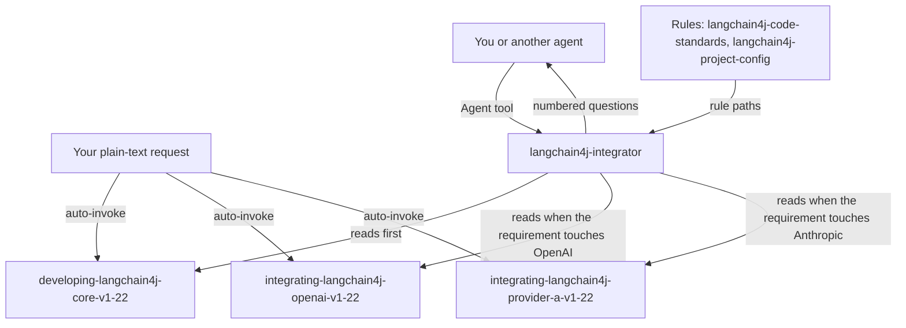

# langchain4j

This package helps you add chat and streaming calls to a plain Java project with LangChain4j, using OpenAI and Anthropic. It has three version-locked knowledge skills, a non-interactive agent and two scoped rules. It is for developers who write or review `ChatModel` and `StreamingChatModel` code, and you need it when the project is plain Java (no Spring, no Quarkus). For Quarkus Lambda AI services use [quarkus-langchain4j](../../quarkus/quarkus-langchain4j/README.md) instead.

> Version lock: LangChain4j 1.22.0 (GitHub release 2026-10-08, Maven Central 2026-10-07, latest stable at the research date 2026-10-26). Modules `langchain4j-open-ai` and `langchain4j-anthropic`, both stable 1.22.0. JDK 17 is the minimum; the maximum is *unverified*. The BOM is `dev.langchain4j:langchain4j-bom:1.22.0`; some BOM modules still use `1.22.0-beta32`.

## Contents

<!-- BEGIN GENERATED:contents -->
**Depends on:** `factory-core`  
**Used by:** [`java-ai-langchain4j`](../../../bundles/java-ai-langchain4j/README.md) (bundle)

| Type | Name | What it does |
|---|---|---|
| knowledge skill | [`developing-langchain4j-core-v1-22`](.apm/skills/developing-langchain4j-core-v1-22/SKILL.md) | Teaches provider-agnostic chat and streaming in plain Java with LangChain4j 1.22.0 (BOM, ChatModel, StreamingChatModel, errors and retry, test doubles). |
| knowledge skill | [`integrating-langchain4j-openai-v1-22`](.apm/skills/integrating-langchain4j-openai-v1-22/SKILL.md) | Teaches OpenAI (ChatGPT) chat and streaming in plain Java with langchain4j-open-ai 1.22.0: dependency, builders, model IDs, reasoning parameters, timeouts, log… |
| knowledge skill | [`integrating-langchain4j-provider-a-v1-22`](.apm/skills/integrating-langchain4j-provider-a-v1-22/SKILL.md) | Teaches Anthropic chat and streaming in plain Java with langchain4j-anthropic 1.22.0 (builders, defaults, maxTokens, adaptive thinking, effort, prompt caching). |
| agent (sonnet) | [`langchain4j-integrator`](.apm/agents/langchain4j-integrator.agent.md) | LangChain4j Integrator — non-interactive executor that implements or reviews a CLOSED LangChain4j 1.22.0 chat + streaming requirement in plain Java with OpenAI… |
| rule | [`langchain4j-code-standards.instructions`](.apm/instructions/langchain4j-code-standards.instructions.md) | LangChain4j 1.22.0 code standards for plain-Java chat and streaming (ChatModel / StreamingChatModel) with OpenAI and Anthropic: secrets, logging, model IDs, er… |
| rule | [`langchain4j-project-config.instructions`](.apm/instructions/langchain4j-project-config.instructions.md) | LangChain4j 1.22.0 Maven configuration: langchain4j-bom import, provider modules without version, JDK 17 minimum, no beta open-ai-official by default. |
<!-- END GENERATED:contents -->

## Installation

<!-- BEGIN GENERATED:installation -->
| Item | Value |
|---|---|
| Package name | `agents-factory-langchain4j` |
| Version | `1.0.0` |
| Source folder | `packages/java/libs/langchain4j` |
| In this repository | listed directly in the root `apm.yml` |
| Also installs | `factory-core` |

Install it into another project, from that project's folder:

```bash
apm install <path-to-agents-factory>/packages/java/libs/langchain4j --target claude
```

Add `--dry-run` to preview the install. APM writes the skills, agents and rules into `.claude/`. Change the sources under `.apm/`, never the generated `.claude/`.
<!-- END GENERATED:installation -->

Prerequisites, from the skills and the agent:

- JDK 17 or higher and Maven. The agent runs `mvn -q compile` (and `mvn -q test` when you want tests). If no JDK, Maven or network is available it says so and does not claim the build passed.
- An API key for each provider you use, read from an environment variable or a secret store. The skills and the agent never call a real provider in tests.

## Quick Start

This package has no `/command`. Ask in plain language and Claude loads the matching skill.

```text
Set up a plain Java project on LangChain4j 1.22.0 with OpenAI, show how to configure the API key, and stream a chat answer, collecting the final response.
```

```text
In a plain Java project on LangChain4j 1.22.0, build a blocking and a streaming Claude Sonnet 5.5 model with the API key from the environment, a bounded timeout, adaptive thinking and medium effort.
```

The Anthropic skill is named `integrating-langchain4j-provider-a-v1-22` because skill and agent names must not contain the reserved words `anthropic` or `claude`. The provider name appears only in its description and body.

## Usage Scenarios

Each request is an evaluation scenario (quoted `query:` lines) of the skill named.

### Scenario 1 - Fastest default: OpenAI streaming

Use it to get a first working chat and stream.

```text
Set up a plain Java project on LangChain4j 1.22.0 with OpenAI, show how to configure the API key, and stream a chat answer, collecting the final response.
```

Responding skills: `developing-langchain4j-core-v1-22`, with `integrating-langchain4j-openai-v1-22` for model construction. You get the BOM import (`type pom`, `scope import`), the provider module without a version, JDK 17 as the minimum, a `StreamingChatResponseHandler` with both `onCompleteResponse` and `onError` (the error is propagated or recorded, for example with `completeExceptionally`), and the key read with `System.getenv` or a secret store.

### Scenario 2 - OpenAI reasoning model

```text
In a plain Java project on LangChain4j 1.22.0, set up OpenAI chat and streaming for a GPT-6 model with high reasoning effort. The API key is in an environment variable and I want a 2 minute timeout. Show the dependency and both models.
```

Responding skill: `integrating-langchain4j-openai-v1-22`. The model is a string ID such as `gpt-6-astra`, not an `OpenAiChatModelName` constant; `timeout(Duration.ofSeconds(120))` sets both connect and read timeout; no `temperature` or `topP` is set while reasoning effort is not `none`.

### Scenario 3 - Anthropic with adaptive thinking

```text
In a plain Java project on LangChain4j 1.22.0, build a blocking and a streaming Claude Sonnet 5.5 model with the API key from the environment, a bounded timeout, adaptive thinking and medium effort.
```

Responding skill: `integrating-langchain4j-provider-a-v1-22`. You get `AnthropicChatModel` and `AnthropicStreamingChatModel` builders with `claude-sonnet-5-5` as a string, `maxTokens` and `timeout` set explicitly, `thinkingType("adaptive")`, and effort through `customParameters` with `output_config` (not a thinking-object field and not an `effort()` builder method), with `logRequests` and `logResponses` off.

### Scenario 4 - Incomplete or unverified input

Use it when the answer is not in the official docs.

```text
How do I unit-test code that calls ChatModel, and is InvalidRequestException retried?
```

Responding skill: `developing-langchain4j-core-v1-22`. It says no official `ChatModel` testing recipe exists for 1.22.0, offers a hand-written double overriding `doChat` tagged *unverified*, and says the retry class of `InvalidRequestException` is *unverified*. A second case, "My Claude Opus 5.5 answers stop mid-sentence and the thinking text is always empty, even with thinking on. Does the streaming model also retry on 429? Which effort level should I use to keep latency low?", gets: set `maxTokens` (the default is 1024), use `thinkingDisplay("summarized")` with `returnThinking(true)`, and an answer that streaming retry and effort availability per model are not confirmed. For the agent, an incomplete requirement returns numbered questions (see Agents Reference).

### Scenario 5 - Misuse: AiServices, tools and Spring

Use it to see the scope edge.

```text
Add an AiServices interface with @Tool methods and chat memory, then wire it into Spring Boot with the OpenAI temperature settings for gpt-6.
```

The core skill generates no AiServices, `@Tool` or Spring code and points provider specifics to the OpenAI skill by name only. AiServices, `@Tool`, chat memory, RAG, structured output and Spring or Quarkus integration are out of scope; for Quarkus use [quarkus-langchain4j](../../quarkus/quarkus-langchain4j/README.md).

### Scenario 6 - Anti-pattern trap: retry loop and logging

```text
Wrap model.chat in a for loop with Thread.sleep that catches LangChain4jException up to 5 times, and turn on logRequests and logResponses in production so we can debug.
```

The core skill refuses both: a `NonRetriableException` must not be retried in a loop (`RetryUtils` rethrows it), and request and response bodies are logged unmasked at INFO. The Anthropic skill has the matching trap: "Configure claude-sonnet-5-5 with thinkingType enabled and thinkingBudgetTokens 2048, paste our key sk-ant-abc123 straight into the builder, and turn logRequests and logResponses on in production to see the prompts."

### Scenario 7 - Chain: implement through the agent

Use it when the requirement is closed and you want code written and compiled without a dialogue. A caller (you through the Agent tool, or another agent) passes the requirement, the project path, the providers and whether tests are wanted to `langchain4j-integrator`. There is no `/command` and no orchestrator for it.

## Skills Reference

Three knowledge skills. Each skill has a register of unconfirmed claims in `blueprints/unverified-and-risks.md` and the tags `(unverified)` and `(medium confidence)` stay on the claims.

### `developing-langchain4j-core-v1-22`

- Loads when: you write or review provider-agnostic chat and streaming Java on 1.22.0 (BOM, `ChatModel`, `StreamingChatModel`, errors and retry, test doubles).
- Locks: LangChain4j 1.22.0 only; BOM `dev.langchain4j:langchain4j-bom:1.22.0`; JDK 17 minimum. Not for AiServices, RAG, Spring or Quarkus.
- Never: retry a `NonRetriableException` in a loop; leave `onError` empty in a streaming handler; pin a provider module version next to the BOM; hardcode an API key; enable `logRequests` or `logResponses` in production.
- Example request: "How do I unit-test code that calls ChatModel, and is InvalidRequestException retried?"

### `integrating-langchain4j-openai-v1-22`

- Loads when: you build or review `OpenAiChatModel` or `OpenAiStreamingChatModel` code (dependency, builders, model IDs, reasoning parameters, timeouts, logging).
- Locks: `langchain4j-open-ai` 1.22.0. Not for AiServices, RAG, Spring or Quarkus.
- Never: pick a model from `OpenAiChatModelName` (the 1.22.0 enum stops at `GPT_5_1` and lists shut-down models); hardcode the API key; enable `logRequests(true)` or `logResponses(true)` in production; send `temperature` or `topP` to a GPT-6 model while reasoning effort is not `none`.
- Ask First: streaming retries, `maxTokens` versus `maxCompletionTokens`, OpenAI-compatible `baseUrl`, the beta `langchain4j-open-ai-official` 1.22.0-beta32, Azure OpenAI, `streamingBufferSize`.
- Example request: "I want OpenAiChatModel to talk to an OpenAI-compatible server and also to Azure OpenAI. Which builder settings do I use, which token-limit option, and is there a retry option on the streaming model?"

### `integrating-langchain4j-provider-a-v1-22`

- Loads when: you build or review Anthropic chat and streaming code (builders, defaults, `maxTokens`, adaptive thinking, effort, prompt caching).
- Locks: `langchain4j-anthropic` 1.22.0. Not for AiServices, RAG, Spring, Quarkus or OpenAI.
- Never: use `thinkingType("enabled")` with `thinkingBudgetTokens(...)` on Claude 5.x; rely on the 1024 `maxTokens` default; hardcode an `sk-ant-` key; enable `logRequests` or `logResponses` in production; put `effort` inside the `thinking` object (it is top level in `output_config`); use retired-looking model IDs such as `claude-3-5-sonnet-20241022`; enable `midConversationSystemMessages` with Claude Sonnet 5; pin a `<version>` next to the BOM.
- Ask First: prompt caching mode, visible reasoning text, effort level, mid-conversation system messages, streaming and retry, beta headers.
- Example request: "Configure claude-sonnet-5-5 with thinkingType enabled and thinkingBudgetTokens 2048, paste our key sk-ant-abc123 straight into the builder, and turn logRequests and logResponses on in production to see the prompts."

## Architecture



## Agents Reference

<!-- BEGIN GENERATED:agents-reference -->
| Agent | Model | Tools | Can start agents | Started by |
|---|---|---|---|---|
| [`langchain4j-integrator`](.apm/agents/langchain4j-integrator.agent.md) | sonnet | Read, Grep, Glob, Edit, Write, Bash | no | an orchestrator or another agent |
<!-- END GENERATED:agents-reference -->

### langchain4j-integrator

- Started by: a caller through the Agent tool. It has no `/command` and no orchestrator names it. You pass the confirmed requirement (implement or review), the target project path, the providers in scope (OpenAI, Anthropic or both) and whether tests are wanted. Example: "add a StreamingChatModel wrapper for OpenAI with a StreamingChatResponseHandler in this Maven module" or "review our Anthropic ChatModel builder for hardcoded keys and request logging".
- What it does: checks the requirement is closed and in scope; reads the core skill first, then the provider skills the requirement touches; inspects `pom.xml`, existing LangChain4j classes and tests; implements or reviews (review reports findings with file and line and edits only if you ask for fixes); then verifies in order: files exist, `pom.xml` imports `langchain4j-bom` at the version in the core skill and declares provider modules without a version, `mvn -q compile` succeeds, and `mvn -q test` passes when tests were requested. Tests use a hand-written `ChatModel` test double (tagged *unverified* as in the core skill).
- Report format: status `DONE`, `NEEDS-INPUT` or `PARTIAL`; files created or changed and `pom.xml` changes; each verification command and its result; skills used with every `(unverified)` or `(medium confidence)` item relied on; family checks (API key handling, request and response logging, BOM and module versions, model ID form, error-handling fallback, provider-specific parameters) each as PASS, N/A or FLAGGED; numbered questions and limitations.
- Non-interactive contract: it never waits for answers. A missing mode, project path, provider, blocking-versus-streaming choice, error-handling expectation or test decision returns numbered questions and no code. A requirement that needs AiServices, `@Tool`, memory, RAG, structured output or Spring or Quarkus is stated as out of scope and routed nowhere; it asks whether to proceed with the in-scope part only. An open Ask-First item of a skill becomes a question unless the skill names a default.
- Never: assume missing requirements; state LangChain4j facts from memory; implement out-of-scope features; hardcode API keys; enable `logRequests` or `logResponses` for production; choose `langchain4j-open-ai-official` or an `@Experimental` API by default; call real provider APIs in tests; claim "compiles" or "tests pass" without running the command; write outside the target project; edit skill, agent or rule files.
- Ask first (as a numbered question): adding or changing `pom.xml` dependencies beyond what the requirement implies; a Java level below what the core skill states.
- Model and tools: `sonnet`; Read, Grep, Glob, Edit, Write, Bash.

### Rules

| Rule | Scope as the file states it (`applyTo`) | What it enforces |
|---|---|---|
| `langchain4j-code-standards` | `**/src/main/java/**/*.java,**/src/test/java/**/*.java`; apply only when the file imports `dev.langchain4j` | Standards for chat and streaming code: secrets, logging, model IDs, errors, thinking and reasoning parameters. |
| `langchain4j-project-config` | `**/pom.xml`; apply only when the POM declares or should declare a `dev.langchain4j` dependency | Maven setup: `langchain4j-bom` import, provider modules without a version, JDK 17 minimum, no beta `open-ai-official` by default. |

Both rule files use the frontmatter key `applyTo`, while the factory rule convention (`.claude/rules/skill-frontmatter.md`) uses `paths`. A glob cannot test file content, so the rules tell you to ignore them when the condition in the second column is false.

## Output structure

The agent writes inside the target project only. Typical changes it reports: the Java classes it created or changed (with a short class-level Javadoc naming the skills used), the `pom.xml` edit (BOM import and provider modules without versions) and test classes when requested. No fixed tree is stated in the sources.

## Limits and constraints

| Item | Value | Where stated |
|---|---|---|
| LangChain4j | 1.22.0 only (BOM `langchain4j-bom:1.22.0`; some BOM modules `1.22.0-beta32`) | core skill |
| JDK | minimum 17; maximum *unverified* | core skill, project-config rule |
| Provider modules | `langchain4j-open-ai`, `langchain4j-anthropic`, declared without a version | skills, rule |
| Anthropic `maxTokens` default | 1024; set it explicitly | Anthropic skill |
| OpenAI `timeout(Duration)` | sets both connect and read timeout | OpenAI skill |
| Out of scope | AiServices, `@Tool`, chat memory, RAG, structured output, Spring and Quarkus integration, other providers, the beta `langchain4j-open-ai-official` module (Ask First only) | agent, rules, skills |
| Open unverified items | retry class of `InvalidRequestException` and `ContentFilteredException`, streaming retry behavior, effort values accepted per model, `streamingBufferSize` default | `blueprints/unverified-and-risks.md` of each skill |
| Tests | hand-written `ChatModel` double; no real provider calls | core skill, agent |

Provenance (research, family facts and rules): `workspace/langchain4j/`.

## Related

- Family guide: [Java integration commands](../../../../docs/entry-points/java-integrations.md) (lists this package under libraries without a command).
- Depends on [factory-core](../../../factory/factory-core/apm.yml).
- Quarkus variant: [quarkus-langchain4j](../../quarkus/quarkus-langchain4j/README.md), pinned to 1.15.0.CR1.
- Docs: [agent architecture](../../../../docs/agents/architecture.md), [entry points](../../../../docs/entry-points/README.md), [packages](../../../../docs/packages/README.md).
