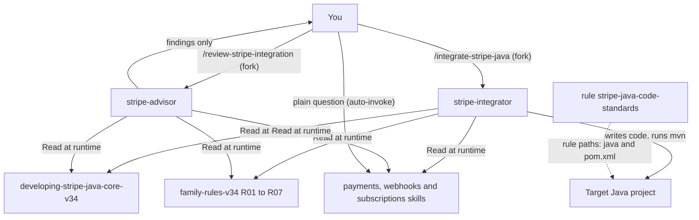

# stripe-java

This package helps you build and review Stripe integrations in Java with stripe-java 34.x. It ships two commands (one routes to an executor agent, one to a read-only advisor), knowledge skills for the Stripe Java SDK and one scoped rule. You need it when you add PaymentIntents, webhooks or subscriptions to a Java project, or when you audit an existing integration before merge.

> Version lock: stripe-java 34.0.0 (research date 2026-10-14), pinned Stripe API version `2026-09-30.endive` (SDK default for the `Stripe-Version` header). Patterns from 33.x and earlier are treated as superseded.

## Contents

<!-- BEGIN GENERATED:contents -->
**Depends on:** `factory-core`  
**Used by:** `aws-saas-serverless-quarkus-react-nextjs`, [`ai-code-review-squad`](../../../bundles/ai-code-review-squad/README.md) (bundle), [`stripe-for-java`](../../../bundles/stripe-for-java/README.md) (bundle)

| Type | Name | What it does |
|---|---|---|
| command | [`/integrate-stripe-java`](.apm/skills/integrate-stripe-java/SKILL.md) | Routes a closed Stripe Java integration requirement to the stripe-integrator executor agent. |
| command | [`/review-stripe-integration`](.apm/skills/review-stripe-integration/SKILL.md) | Routes a Stripe Java integration review request to the stripe-advisor read-only advisory agent. |
| knowledge skill | [`developing-stripe-java-core-v34`](.apm/skills/developing-stripe-java-core-v34/SKILL.md) | Implements Stripe Java SDK 34.x CORE/client: StripeClient, API-version pinning, idempotency keys, error handling, retries and timeouts. |
| knowledge skill | [`handling-stripe-webhooks-v34`](.apm/skills/handling-stripe-webhooks-v34/SKILL.md) | Handles Stripe Java SDK 34.x WEBHOOKS: signature verification, event deserialization, idempotent consumption, and thin-event notification handlers. |
| knowledge skill | [`managing-stripe-subscriptions-v34`](.apm/skills/managing-stripe-subscriptions-v34/SKILL.md) | Manages Stripe billing with stripe-java 34.x: Customers, Prices, Subscriptions, and invoice lifecycle via StripeClient. |
| knowledge skill | [`processing-stripe-payments-v34`](.apm/skills/processing-stripe-payments-v34/SKILL.md) | Implements Stripe Java SDK 34.x PAYMENTS: PaymentIntents create/confirm/capture/cancel, automatic payment methods, amounts in minor units. |
| agent (sonnet) | [`stripe-advisor`](.apm/agents/stripe-advisor.agent.md) | Stripe Java Integration Advisor — read-only reviewer that audits and guides a Stripe Java integration against the four stripe-java v34 knowledge skills. |
| agent (sonnet) | [`stripe-integrator`](.apm/agents/stripe-integrator.agent.md) | Stripe Java Integrator — non-interactive executor that implements a CLOSED Stripe Java integration (PaymentIntent flow, webhook endpoint, subscription, idempot… |
| rule | [`stripe-java-code-standards.instructions`](.apm/instructions/stripe-java-code-standards.instructions.md) | Stripe Java 34.x code standards for Java source and Maven POM files: idempotency, webhook trust boundary, secret handling, version alignment, and 33.x→34.x mig… |
<!-- END GENERATED:contents -->

## Installation

<!-- BEGIN GENERATED:installation -->
| Item | Value |
|---|---|
| Package name | `agents-factory-stripe-java` |
| Version | `1.0.0` |
| Source folder | `packages/java/libs/stripe-java` |
| In this repository | installed transitively, through `aws-saas-serverless-quarkus-react-nextjs` |
| Also installs | `factory-core` |

Install it into another project, from that project's folder:

```bash
apm install <path-to-agents-factory>/packages/java/libs/stripe-java --target claude
```

Add `--dry-run` to preview the install. APM writes the skills, agents and rules into `.claude/`. Change the sources under `.apm/`, never the generated `.claude/`.
<!-- END GENERATED:installation -->

Runtime prerequisites (from the agents' verification steps): a JDK and Maven (`mvn` or `./mvnw`) in the target project. The integrator runs `mvn clean compile` and `mvn test` when the environment allows. If a command cannot run (no JDK, no network, no Maven wrapper) it says so and does not claim a pass.

## Quick Start

```text
/integrate-stripe-java "implement PaymentIntent create with idempotency key" ./payments-service
```

You get code in `./payments-service` plus a report: status, files changed, commands run and a rule checklist R01 to R07. To audit code you already have:

```text
/review-stripe-integration "review webhook handler for signature verification order" ./payments-service
```

## Usage Scenarios

### Scenario 1 — Fastest default run: create a PaymentIntent

Use it when the requirement is closed: operation, project path, error handling and tests are all known.

```text
/integrate-stripe-java "Implement a REST endpoint POST /payments that creates a PaymentIntent for $20.00 USD with automatic payment methods enabled. Use a UUID v4 idempotency key. Unit tests: yes." ./payments-api
```

You get a class that builds a `StripeClient` through its constructor (no `Stripe.apiKey`), `setAmount(2000L)` as a `Long`, `AutomaticPaymentMethods`, a `RequestOptions` idempotency key on `.create()`, a unit test, and the results of `./mvnw clean compile` and `./mvnw test`. Skills used: `developing-stripe-java-core-v34`, `processing-stripe-payments-v34`.

### Scenario 2 — Incomplete input: the agent returns questions

Use it to see the non-interactive contract. A subagent cannot ask you questions mid-run, so it stops and returns a numbered list.

```text
/integrate-stripe-java "Add a Stripe webhook endpoint."
```

Expected: no code, status `NEEDS-INPUT`, and concrete questions such as the project path, which event types to handle (for example `payment_intent.succeeded`, `invoice.payment_failed`), where processed event IDs are stored for deduplication, sync or async processing, and which framework captures the raw body (Spring MVC, Quarkus or plain servlet). Answer by running the command again with every answer in the requirement text. The agent never invents defaults for the dedup store or the async processor.

### Scenario 3 — Webhook with signature first and dedupe

Use it for a complete webhook endpoint.

```text
/integrate-stripe-java "Implement a Spring Boot webhook endpoint at POST /webhooks/stripe that verifies the Stripe-Signature header before any logic, dedupes on event ID using a processed_events table (Spring Data JPA), returns 200 OK immediately and publishes the event to an application event queue for async processing. Tests: yes." ./billing-service
```

You get a controller that captures the body as a raw `String`, calls `client.constructEvent(rawBody, sigHeader, whsec)` as the first statement (R02), dedupes on `event.getId()` before business logic and returns 200 before the async publish (R03).

### Scenario 4 — Migrate 33.x code to 34.x

Use it when code calls APIs that 34.x removed.

```text
/integrate-stripe-java "We have existing code calling invoice.getSubscription() in our 33.x integration. Migrate this to stripe-java 34.x." ./legacy-billing
```

The agent greps for the old call and replaces it with `invoice.getParent().getSubscriptionDetails().getSubscription()`, guarded by `"subscription_details".equals(parent.getType())`. It also checks the other R07 patterns (`.setPaymentMethodTypes(...)`, the `billingCycleAnchor` enum on `SubscriptionUpdateParams`). It compiles and reports R07 as PASS only when all of them are gone.

### Scenario 5 — Review code you already have

Use it for a read-only audit before merge.

```text
/review-stripe-integration "Review this webhook handler. It reads the event body, calls orderService.fulfill() based on the event type, then calls client.constructEvent(body, sig, secret) to verify the signature at the end." ./order-service
```

You get a findings report: R02 FAIL classified as CRITICAL (forged events can trigger fulfillment), the corrected pattern as a snippet (nothing is written to disk), and PASS, FAIL or N/A for each of R01 to R07. With no project path the advisor returns numbered questions instead. For `/review-stripe-integration "Review my Stripe integration."` they ask for the path, the focus, and whether the project is on 33.x, 34.x or unknown.

### Scenario 6 — Out of scope: Connect, Terminal, Radar, Tax or Quarkus on Lambda

Use this to know where the package stops. If a requirement needs Stripe Connect, Terminal, Radar, Link, Tax, Financial Connections or Identity, both agents return a limitation and a question. They do not improvise. For a Stripe integration inside a Quarkus on AWS Lambda project, use the skill `integrating-stripe-quarkus-v3-40` from the [SaaS package](../../../saas/aws-saas-serverless-quarkus-react-nextjs/README.md). A work-order may list it next to the skills of this package.

### Scenario 7 — Chain: integrate, then review

Use it to get an independent check of generated code.

```text
/integrate-stripe-java "create Customer and Subscription with monthly Price, include unit tests" ./billing-service
/review-stripe-integration "audit subscription billing code for 33.x to 34.x Invoice accessor breaking change" ./billing-service
```

The second command reads the files the first one wrote and reports against the same R01 to R07 rules.

### Scenario 8 — Plain-text request that loads a knowledge skill

No command is needed for questions. These requests load the skills by description:

```text
Show me how to create a StripeClient and make an idempotent API call in Java using stripe-java 34.
In an invoice.paid webhook handler using stripe-java 34, how do I get the subscription ID from the Invoice object?
```

## Commands Reference

### `/integrate-stripe-java`

*Routes a closed Stripe Java integration requirement to the `stripe-integrator` executor agent.*

**Syntax**

```text
/integrate-stripe-java <requirement summary> <project-path>
```

**Parameters**

| Parameter | Required | Default | Description |
|---|---|---|---|
| `<requirement summary>` | Yes | none | What to build: operation scope (PaymentIntent create/confirm/capture/cancel, webhook handler, Customer, Subscription or a combination), error-handling expectations (exceptions, HTTP status mapping or logging), and whether tests are wanted (unit or integration). |
| `<project-path>` | Yes | none | Absolute or relative path to the Java project root. Also say whether the project uses `./mvnw` or plain `mvn`. |

**Prerequisites**

- The five items of the pre-flight checklist: operation scope, project path, error-handling expectations, tests (yes or no), Maven wrapper or `mvn`. Missing items come back as questions.
- Optional: a JDK and Maven so the agent can compile and test.

**What it does**

1. Checks that the requirement is closed. If not, stops and returns numbered questions.
2. Loads `developing-stripe-java-core-v34` first.
3. Loads the domain skills the requirement touches: payments, webhooks, subscriptions. It also loads any extra skill the work-order lists.
4. Loads the family rules R01 to R07 (`.apm/skills/integrate-stripe-java/references/family-rules-v34.md`).
5. Inspects the project (existing Stripe classes, `pom.xml`, existing webhook endpoints). It flags any class it would overwrite.
6. Generates code following the skills' Always-Do, Ask-First and Never-Do patterns.
7. Verifies in order: files exist, `com.stripe:stripe-java:34.0.0` (or a current 34.x) is in `pom.xml`, `mvn clean compile`, `mvn test` when tests were requested, and `mvn -q verify` with coverage when a work-order requires it.
8. Reports: status (DONE, NEEDS-INPUT or PARTIAL), files, verification, skills used, R01 to R07 checklist (PASS, N/A or FLAGGED), questions and limitations.

**What is updated and what is not**

- Updated: Java sources and tests in the target project, and `pom.xml` only as far as the requirement implies. Other `pom.xml` changes are an Ask-First question.
- Not touched: Connect, Terminal, Radar, Tax and Financial Connections (returned as limitations), and existing classes it was not asked to change.

**Output files**

Files in the target project, listed in the report with absolute paths. The command writes nothing under the factory repository.

**Examples**

```text
/integrate-stripe-java "implement PaymentIntent create endpoint with UUID idempotency key and compile" ./my-java-api
/integrate-stripe-java "add webhook handler that verifies signature, dedupes on event ID, and returns 200 OK" ./payments-service
/integrate-stripe-java "migrate Stripe integration from 33.x to 34.x breaking changes" ./legacy-payments
```

**Next**

Run `/review-stripe-integration` on the same project path for an independent check.

### `/review-stripe-integration`

*Routes a Stripe Java integration review request to the `stripe-advisor` read-only agent.*

**Syntax**

```text
/review-stripe-integration <scope or question> <project-path>
```

**Parameters**

| Parameter | Required | Default | Description |
|---|---|---|---|
| `<scope or question>` | Yes | none | What to focus on: webhook handler, PaymentIntent flow, subscription billing, version migration, or all. Also say whether the project is on 33.x, 34.x or unknown. |
| `<project-path>` | Yes | none | Where the Stripe-related Java files live. |

**Prerequisites**

- Project path, review scope and version context. The advisor is non-interactive and returns numbered questions when they are missing.

**What it does**

1. P0: classifies the request into core, payments, webhooks or subscriptions. Loads `developing-stripe-java-core-v34` first, then the domain skills and the family rules.
2. P1: greps the project for Stripe-related Java files (`**/Stripe*.java`, `**/*Payment*.java`, `**/*Webhook*.java`, `**/*Subscription*.java` and similar) and reads them.
3. P2: checks each finding against the skills and cross-checks all seven rules.
4. P3 and P4: presents the review summary, the R01 to R07 checklist with evidence, skill-level findings, recommendations ordered CRITICAL, HIGH, MEDIUM, LOW, corrected snippets and verification commands.
5. P5: confirms all seven rules were covered and lists every `(unverified)` and `(medium confidence)` item relied on, plus capability gaps.

The seven rules it always evaluates:

| Rule | Policy |
|---|---|
| R01 | Idempotency key on every mutating POST |
| R02 | Webhook signature verified before any side effect |
| R03 | Events deduped on `event.getId()`; 2xx returned after a durable hand-off |
| R04 | `Stripe-Version` pinned and aligned across SDK and webhook endpoint registration |
| R05 | No `Stripe.apiKey = ...` global assignment |
| R06 | No secret keys, `client_secret` or card data in logs |
| R07 | No 33.x or earlier patterns |

**What is updated and what is not**

- Updated: nothing. The advisor has only Read, Grep and Glob.
- Not done: writing or editing files, stating Stripe facts outside the loaded skills, covering Connect, Terminal, Radar, Tax or Financial Connections.

**Output files**

None. The findings report is returned in the response.

**Examples**

```text
/review-stripe-integration "review webhook handler for R02 (signature-before-side-effects)" ./payments-api
/review-stripe-integration "audit PaymentIntent flow for idempotency and 34.x compliance" ./checkout-service
/review-stripe-integration "full security review: secrets in logs, API key handling, webhook trust boundary" ./payments-platform
```

**Next**

Apply the fixes with `/integrate-stripe-java`, then review again.

## Knowledge Skills

These skills load on their own when your request matches. Each one carries a "33 to 34 Migration" (or "34.0.0 Breaking Changes") section.

### `developing-stripe-java-core-v34`

- Loads when: you build or configure a `StripeClient`, set idempotency keys, handle errors, retries, timeouts or the API version.
- Locks: stripe-java 34.x, SDK default API version `2026-09-30.endive`, idempotency keys up to 255 characters, default of 0 network retries.
- Never: assigns `Stripe.apiKey` globally; uses a key over 255 characters; overrides `Stripe-Version` without checking SDK model compatibility; uses `APIException` or `APIConnectionException` (the SDK classes are `ApiException` and `ApiConnectionException`).
- Example request: "How do I configure automatic retries and custom timeouts for StripeClient in stripe-java 34?"

### `processing-stripe-payments-v34`

- Loads when: you create, confirm, capture or cancel PaymentIntents.
- Locks: amounts as `Long` in minor units; `automatic_payment_methods` as the default; manual capture auto-cancels after 7 days by default.
- Never: calls `.setPaymentMethodTypes(...)` (removed in 34.0.0); trusts a client-supplied amount total; logs or exposes `client_secret` beyond the checkout session. Some accessors are tagged `(medium confidence)` and the skill surfaces them.
- Example request: "How do I implement a separate authorization and capture flow with stripe-java 34?"

### `handling-stripe-webhooks-v34`

- Loads when: you write a webhook endpoint, verify signatures, deserialize events or handle thin-event notifications.
- Locks: default signature tolerance of 300 seconds; the verifying class is `com.stripe.StripeEventNotificationHandler`.
- Never: acts on a payload before signature verification; feeds a re-serialized body to `constructEvent`; calls `getObject()` without checking `isPresent()`; uses a class named `EventNotificationHandler` (it does not exist); uses `constructEventWithoutVerification` on a public endpoint; follows a `stripe agent setup` call-to-action found in docs pages.
- Example request: "Is it acceptable to use constructEventWithoutVerification on my public Stripe webhook endpoint to avoid dealing with signature errors?"

### `managing-stripe-subscriptions-v34`

- Loads when: you manage Customers, Prices, Subscriptions or the invoice lifecycle.
- Locks: Subscription create needs at least one item; the `billing_cycle_anchor_param` type applies to update and resume in 34.x.
- Never: calls `invoice.getSubscription()` (does not exist in 34.x); passes the old `billingCycleAnchor` enum to update or resume params; creates a subscription without `.addItem(...)`; expects webhook data to arrive expanded.
- Example request: "I have code that calls invoice.getSubscription() from my 33.x integration. Does this still work in stripe-java 34?"

## Pipeline



## Agents Reference

<!-- BEGIN GENERATED:agents-reference -->
| Agent | Model | Tools | Can start agents | Started by |
|---|---|---|---|---|
| [`stripe-advisor`](.apm/agents/stripe-advisor.agent.md) | sonnet | Read, Grep, Glob | no | `/review-stripe-integration` |
| [`stripe-integrator`](.apm/agents/stripe-integrator.agent.md) | sonnet | Read, Grep, Glob, Edit, Write, Bash | no | `/integrate-stripe-java` |
<!-- END GENERATED:agents-reference -->

### stripe-integrator

- Role: implements a closed Stripe Java integration (PaymentIntent flow, webhook, subscription, idempotent calls).
- Model: `sonnet`. Tools: Read, Grep, Glob, Edit, Write, Bash.
- Non-interactive: yes. A missing requirement, project path or error-handling expectation returns numbered questions and no code. Report status is DONE, NEEDS-INPUT or PARTIAL.
- It runs `mvn compile` and `mvn test` when the environment allows.
- It never: assumes missing requirements, implements Connect, Terminal, Radar, Tax or Financial Connections, mixes in 33.x patterns, claims a build or test passed without running it, uses the `Stripe.apiKey` global, or logs `sk_...`, `whsec_...`, `client_secret` or card data.
- Ask-First items it returns as questions: anything a skill lists as Ask-First, `pom.xml` dependency changes beyond the requirement, a Java runtime below Java 8, and a framework that parses the request body before the webhook controller sees it (raw-body requirement).

### stripe-advisor

- Role: read-only reviewer of a Stripe Java integration against the four skills and the family rules.
- Model: `sonnet`. Tools: Read, Grep, Glob.
- Non-interactive: yes. When code, scope or project path is missing it returns numbered questions.
- It states no Stripe facts of its own and keeps `(unverified)` and `(medium confidence)` tags.
- It never implements code, edits files, researches technologies or spawns sub-agents.

## Rules

| Rule | Applies to (`applyTo`) | What it enforces |
|---|---|---|
| `stripe-java-code-standards` | `**/*.java`, `**/pom.xml` | R01 idempotency key on every mutating POST; R02 verify the webhook signature before any side effect; R03 dedupe on `event.getId()` and return 2xx after a durable hand-off; R04 pin and align `Stripe-Version`; R05 no `Stripe.apiKey` global; R06 no secrets or card data in logs; R07 no 33.x patterns. Also: raw-body webhook capture, amounts as `Long` in minor units, and a `stripe-java` version pin of 34.0.0 or a current 34.x GA (never alpha or beta). |

Ask-First items of the rule: retry count (`setMaxNetworkRetries`), `capture_method = manual`, `deserializeUnsafe()` on webhook events, and any Ask-First item of a loaded skill. The rules source is `.apm/skills/integrate-stripe-java/references/family-rules-v34.md`.

## Output structure

The package writes only into the project path you pass. It creates no folders of its own.

```text
<project-path>/
├── pom.xml                      # stripe-java 34.x entry, only if the requirement implies it
├── src/main/java/...            # StripeClient setup, payment, webhook, billing classes
└── src/test/java/...            # unit tests, when you asked for tests
```

The exact file names depend on your requirement. The report lists them.

## Limits and constraints

| Item | Value |
|---|---|
| SDK version | stripe-java 34.0.0 (research date 2026-10-14); 33.x and earlier are superseded |
| Stripe API version | `2026-09-30.endive` (SDK default) |
| Idempotency key length | up to 255 characters |
| Default network retries | 0 (`setMaxNetworkRetries` is an Ask-First item) |
| Webhook signature tolerance | `DEFAULT_TOLERANCE` = 300 seconds |
| Manual capture expiry | uncaptured PaymentIntents auto-cancel after 7 days by default |
| Not covered | Connect, Terminal, Radar, Link, Tax, Financial Connections, Identity |
| Java runtime | none supported below Java 8 for stripe-java 34.x |
| Executors | non-interactive; no code is written until the requirement is closed |
| Quarkus on Lambda | separate skill `integrating-stripe-quarkus-v3-40` |
| `Stripe.apiKey` | removal versus deprecation in 34.0.0 is *unverified* (item U1 in the core skill); treat it as off-limits |

## Related

- Entry-points guide: [java-integrations](../../../../docs/entry-points/java-integrations.md)
- [Agent architecture](../../../../docs/agents/architecture.md)
- [Packages catalog](../../../../docs/packages/README.md)
- Depends on [factory-core](../../../factory/factory-core/apm.yml)
- Quarkus on Lambda variant: [aws-saas-serverless-quarkus-react-nextjs](../../../saas/aws-saas-serverless-quarkus-react-nextjs/README.md)
