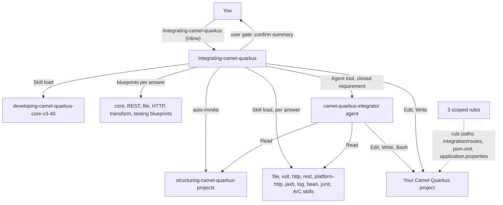

# camel-quarkus-integrator

This package helps you build integrations in Camel Quarkus projects. It gives you an inline skill that interviews you, a skill that says where files go, a non-interactive agent for closed requirements and three scoped rules. You need it when you add routes, REST endpoints, HTTP clients, file processing, XML/XSLT transformation or route tests to a Camel Quarkus 3.40 project. The technical facts come from the version-locked skills in [camel-quarkus-skills](../camel-quarkus-skills/README.md).

> Version lock: Camel Quarkus 3.40 LTS, Camel 4.22, Quarkus 3.40. Quarkus 3.40 is maintained to 2027-09-30; the Camel Quarkus-specific end date is unverified (not published). As of 2026-10-14, Quarkus 4.0 GA was planned for end of November 2026 and no Camel Quarkus build on it was known (medium confidence).

## Contents

<!-- BEGIN GENERATED:contents -->
**Depends on:** `factory-core`, `camel-quarkus-skills`  
**Used by:** [`camel-quarkus-integration`](../../../bundles/camel-quarkus-integration/README.md) (bundle)

| Type | Name | What it does |
|---|---|---|
| inline orchestrator | [`integrating-camel-quarkus`](.apm/skills/integrating-camel-quarkus/SKILL.md) | Interviews the user and orchestrates Camel Quarkus 3.40 integrations, loading only the matching developing-camel-quarkus-* skills. |
| knowledge skill | [`structuring-camel-quarkus-projects`](.apm/skills/structuring-camel-quarkus-projects/SKILL.md) | Single source of truth for where Camel Quarkus integration code goes: directories, packages, file naming and test placement. |
| agent (sonnet) | [`camel-quarkus-integrator`](.apm/agents/camel-quarkus-integrator.agent.md) | Camel Quarkus Integrator — non-interactive executor that implements a CLOSED integration requirement (routes, REST endpoints, HTTP clients, file processing, XM… |
| rule | [`camel-quarkus-integrator-code-standards.instructions`](.apm/instructions/camel-quarkus-integrator-code-standards.instructions.md) | Camel Quarkus 3.40 route code standards: RouteBuilder scope, error handling, logging, testing. |
| rule | [`camel-quarkus-integrator-project-config.instructions`](.apm/instructions/camel-quarkus-integrator-project-config.instructions.md) | Camel Quarkus 3.40 project configuration: BOMs, dependencies, test artifact, native, application properties. |
| rule | [`camel-quarkus-integrator-skills-management.instructions`](.apm/instructions/camel-quarkus-integrator-skills-management.instructions.md) | Points Camel Quarkus route work to the orchestrator and structure skills. |
<!-- END GENERATED:contents -->

## Installation

<!-- BEGIN GENERATED:installation -->
| Item | Value |
|---|---|
| Package name | `agents-factory-camel-quarkus-integrator` |
| Version | `1.0.0` |
| Source folder | `packages/java/quarkus/camel-quarkus-integrator` |
| In this repository | listed directly in the root `apm.yml` |
| Also installs | `factory-core`, `camel-quarkus-skills`, `quarkus-core`, `clean-code-quarkus` |

Install it into another project, from that project's folder:

```bash
apm install <path-to-agents-factory>/packages/java/quarkus/camel-quarkus-integrator --target claude
```

Add `--dry-run` to preview the install. APM writes the skills, agents and rules into `.claude/`. Change the sources under `.apm/`, never the generated `.claude/`.
<!-- END GENERATED:installation -->

Runtime prerequisites (from the agent's verification steps): a JDK and Maven in the target project (`./mvnw` or `mvn`). The Camel Quarkus 3.40 skills support Java 17 and 21. Without a JDK or network the agent still writes code but says it could not compile or test.

## Quick Start

```text
/integrating-camel-quarkus
```

The skill asks four blocks of questions in one message: data source, processing, destination and extra requirements. Answer them, check the summary table it posts, and reply yes. It then generates routes (and tests if you asked) in your project and finishes with a checklist that includes `./mvnw clean compile`.

## Usage Scenarios

### Scenario 1 — Fastest default run: file in, XSLT, HTTP out, with a test

Use it when you can state the whole flow in one sentence.

```text
/integrating-camel-quarkus
I need an integration that watches /input for XML files, transforms them with an XSLT stylesheet, and POSTs the result to an external API. Add a test.
```

You get a confirmation summary first (no code yet). After your yes: structure skill and core skill load first, then the file, XSLT, HTTP and the two JUnit skills. The three specialties are joined through `direct:` endpoints, one `RouteBuilder` per specialty. The skill does not load the REST, platform-http, JAXB, log, bean or ArC skills for this request.

### Scenario 2 — Incomplete input: the four-block interview

Use it when you only know part of the flow. Start the skill with a short request, for example "I need a route" with no detail.

```text
/integrating-camel-quarkus
```

The skill asks all four blocks in one message and skips any block you already answered:

1. Data source (timer, file-watch, http-endpoint, ftp/sftp, direct-call; message-queue and database-query are out of scope).
2. Data processing (validation, transformation, enrichment, filtering, aggregation, routing).
3. Data destination (log-output, file-write, http-forward, ftp/sftp-upload; message-queue, database-store and email-send are out of scope).
4. Additional requirements (error handling, monitoring, security, testing, documentation).

Reply to every block in one message. The skill then posts a table (block, answer, mapped skills, mapped blueprints, out-of-scope items) and waits for your confirmation. It does not generate before you confirm.

### Scenario 3 — Narrow request: REST endpoint only

Use it when you want one piece and nothing else.

```text
/integrating-camel-quarkus
Expose POST /orders that accepts JSON and hands it to direct:process-order. Nothing else yet.
```

Only the REST APIs blueprint loads, with `developing-camel-quarkus-platform-http-v3-40` and `developing-camel-quarkus-rest-v3-40` after the structure and core skills. Expect Ask-First questions (contract-first or code-first, CORS origins). The consumer of `direct:process-order` stays with the core routes specialty, whose blueprint is not loaded.

### Scenario 4 — Out of scope: Kafka and JDBC

Use this to see what the package refuses.

```text
/integrating-camel-quarkus
Consume orders from a Kafka topic, enrich them from a PostgreSQL table with JDBC, and publish to another topic.
```

The skill says plainly that no installed skill covers message brokers or databases. It asks whether to proceed with only the documented parts (the rest stays a stub or a `direct:` boundary you fill in), or to research first with `/researching-technical-frameworks <technology> <version>` and build a skill from that. It loads nothing for those parts and names no Kafka or JDBC extension as verified.

### Scenario 5 — Forbidden patterns are corrected, not generated

Use this to see how the skill reacts to Spring or old-line habits.

```text
/integrating-camel-quarkus
Build the API with a Spring @RestController, wrap the outbound call in camel-quarkus-resilience4j, and write the tests with camel-quarkus-junit5.
```

Each item is corrected with a short reason. Spring annotations do not apply on Quarkus (it offers the REST DSL or a Jakarta REST resource and asks which). `camel-quarkus-resilience4j` is not in 3.40.x, so it uses `camel-quarkus-microprofile-fault-tolerance`. Tests use `camel-quarkus-junit` with `org.apache.camel.test.junit6` imports. It proceeds with the corrected design after you confirm.

### Scenario 6 — Closed requirement: hand off to the agent

Use it when every block is answered and no Ask-First question is open, and you want batch execution.

```text
/integrating-camel-quarkus
Requirement is closed: timer every 10 minutes calls an external API over HTTPS with OAuth2 client credentials, logs the result. Run it as a batch.
```

The skill confirms the summary and asks for anything missing (timer period, timezone, auth source). It then offers to delegate to the `camel-quarkus-integrator` agent with the summary, the skill list and the blueprint list. It tells you that timer and scheduling extension details are not covered by an installed skill (unverified) and relays the medium-confidence tag on the OAuth2 options from the HTTP skill. It never delegates while questions are open.

### Scenario 7 — Where does this file go?

Use it for placement questions. The knowledge skill `structuring-camel-quarkus-projects` loads on its own.

```text
Create a route class that exposes the orders REST endpoint in this Camel Quarkus project.
```

With base package `org.acme.billing` in the project, the class goes to `src/main/java/org/acme/billing/integration/routes/OrdersRestRoute.java` and its test to `OrdersRestRouteTest.java` in the same package under `src/test/java`. For a test of `FileProcessingRoute` you name `FileRouteSpecTest`, the skill flags the convention `[ClassName]Test`, proposes `FileProcessingRouteTest` and asks before using your name. For a non-Camel project (for example a Spring Boot batch project) it says the layout does not apply and moves nothing.

## Commands Reference

### `integrating-camel-quarkus`

*Interactive inline orchestrator for Camel Quarkus 3.40 integrations.*

**Syntax**

```text
/integrating-camel-quarkus
```

**Parameters**

| Parameter | Required | Default | Description |
|---|---|---|---|
| (none) | n/a | n/a | The skill has no `argument-hint` and no parameters. It collects the requirement through the four-block interview. You can add your requirement text after the command, and the skill skips the blocks you already answered. |

**Prerequisites**

- A Camel Quarkus 3.40.x project, or an empty folder for a new one. The skill checks existing code and `pom.xml` extensions before adding files.
- The skill is version-locked. Quarkus 4 or another Camel Quarkus line needs your confirmation first (see Limits).

**What it does**

1. Interview: four blocks (source, processing, destination, extras), asked in one message. It then posts a summary table and waits for a yes.
2. Load: `structuring-camel-quarkus-projects` first, then `developing-camel-quarkus-core-v3-40`, then only the skills and blueprints your answers map to.
3. Resolve each loaded blueprint's Ask-First decisions and record the answers in the summary.
4. Generate one class per specialty at the paths from the structure skill. Add `pom.xml` extensions without versions (the BOM manages them).
5. Verify with the final checklist: summary confirmed, files at the prescribed paths, only mapped skills loaded, `./mvnw clean compile` (or `mvn`), tests run if requested, unverified items listed.

How the answers map to blueprints:

| Interview answer | Blueprint |
|---|---|
| timer, direct-call, routing, filtering, aggregation, bean logic, error handling, log-output | core routes |
| http-endpoint, REST, OpenAPI, upload | REST APIs |
| file-watch, ftp/sftp, file-write, ftp/sftp-upload | file processing |
| http-forward, enrichment by API, circuit breaker | HTTP clients |
| validation by schema, transformation (XML, Java, XSLT) | data transformation |
| testing requested | testing |
| message-queue, database, security (auth), e-mail | none (out of scope) |

Ask-First decisions you may be asked, by specialty: error handling per route and bean naming (core routes); contract-first or code-first and CORS (REST APIs); post-processing, several instances, FTP library (file processing); timeouts and pools, status handling, TLS scope, `http` versus Quarkus REST client, circuit breaker (HTTP clients).

**What is updated and what is not**

- Updated: Java classes, tests, `pom.xml` extensions and `application.properties` entries in your project, after you confirm the summary.
- Not touched: existing classes are not overwritten without saying so. The skill does not migrate an existing layout unprompted. It does not implement message brokers, databases, Quarkus security or e-mail.

**Output files**

Files in your project at the paths from the structure skill:

| Artifact | Location | File name |
|---|---|---|
| RouteBuilder | `src/main/java/<base>/integration/routes/` | `[Functionality]Route.java` |
| Processor | `src/main/java/<base>/integration/processors/` | `[Functionality]Processor.java` |
| Service | `src/main/java/<base>/integration/services/` | `[Functionality]Service.java` |
| Model | `src/main/java/<base>/model/` | `[Entity]Model.java` |
| Config class | `src/main/java/<base>/config/` | `[Config]Config.java` |
| Route test | `src/test/java/<base>/integration/routes/` | `[ClassName]Test.java` |
| Integration test | `src/test/java/<base>/integration/` | `[Functionality]IntegrationTest.java` |

`<base>` is the base package path read from your project; `com.company.project` in the layout file is only a placeholder.

**Examples**

```text
/integrating-camel-quarkus
I need an integration that watches /input for XML files, transforms them with an XSLT stylesheet, and POSTs the result to an external API. Add a test.
```

```text
/integrating-camel-quarkus
Expose POST /orders that accepts JSON and hands it to direct:process-order. Nothing else yet.
```

**Next**

For a closed requirement, delegate to the `camel-quarkus-integrator` agent (see Agents Reference). For uncovered technology, run `/researching-technical-frameworks <technology> <version>`.

## Pipeline



## Agents Reference

<!-- BEGIN GENERATED:agents-reference -->
| Agent | Model | Tools | Can start agents | Started by |
|---|---|---|---|---|
| [`camel-quarkus-integrator`](.apm/agents/camel-quarkus-integrator.agent.md) | sonnet | Read, Grep, Glob, Edit, Write, Bash | no | an orchestrator or another agent |
<!-- END GENERATED:agents-reference -->

### camel-quarkus-integrator

- Role: implements a closed integration requirement in a Camel Quarkus 3.40 LTS project.
- Model: `sonnet`. Tools: Read, Grep, Glob, Edit, Write, Bash.
- How to call it: there is no `/command`. The orchestrator hands over to it through the Agent tool, or you ask for it directly. Input: the confirmed requirement summary, the skill list, the blueprint list and the project path. If the lists are missing it derives them from the orchestrator's mapping table. If the summary or the project path is missing it returns questions.
- Non-interactive: yes. If the requirement is incomplete or needs an uncovered area, it stops and returns numbered questions (status NEEDS-INPUT) and writes no code. It offers a default only when a skill names one.
- Workflow: check the requirement is closed (input, processing, output, error expectations, tests wanted), load the structure skill first, load only the needed `developing-*-v3-40` skills and blueprints, inspect the project, generate, verify, report.
- Verification, in order: files exist where the structure skill says, required extensions are in `pom.xml`, `./mvnw clean compile` (or `mvn clean compile`), and `./mvnw test` (or `mvn test`) when tests exist. It says so when a command cannot run.
- Report: status DONE, NEEDS-INPUT or PARTIAL; files and `pom.xml` changes; verification results; skills used and unverified items; questions and limitations.
- Ask-First items it returns as questions: anything a skill lists as Ask-First, dependency changes beyond the requirement, and a Quarkus 4 target.
- It never: assumes missing requirements, implements messaging, database, security or e-mail parts (it reports a limitation), mixes versions (only the 3.40 skills apply), or claims "compiles" or "tests pass" without running the command.

## Rules

| Rule | Applies to (`applyTo`) | What it enforces |
|---|---|---|
| `camel-quarkus-integrator-code-standards` | `**/integration/routes/**/*.java` | Route code conventions: `RouteBuilder` scope, error handling, logging, testing. |
| `camel-quarkus-integrator-project-config` | `**/{pom.xml,src/main/resources/application.properties,src/main/resources/application.yml}` | Project configuration: BOMs, dependencies, test artifact, native, application properties. |
| `camel-quarkus-integrator-skills-management` | `**/integration/routes/**/*.java` | Points route work to the orchestrator and structure skills. |

Rules refer to skills by name for facts. Path-scoped rules load only when a matching file is read.

## Output structure

The package writes into your project. Paths follow `structuring-camel-quarkus-projects`:

```text
<project>/
├── pom.xml                                   # extensions added without versions
├── src/main/
│   ├── java/<base>/
│   │   ├── integration/
│   │   │   ├── routes/        [Functionality]Route.java
│   │   │   ├── processors/    [Functionality]Processor.java
│   │   │   └── services/      [Functionality]Service.java
│   │   ├── model/             [Entity]Model.java
│   │   └── config/            [Config]Config.java
│   └── resources/application.properties
└── src/test/
    ├── java/<base>/
    │   ├── integration/       [Functionality]IntegrationTest.java
    │   │   └── routes/        [ClassName]Test.java
    │   └── unit/              [ClassName]Test.java
    └── resources/application.properties
```

Service tests go under `src/test/java/<base>/integration/services/`.

## Limits and constraints

| Item | Value |
|---|---|
| Camel Quarkus | 3.40.x (3.40.0 released 2026-09-28, LTS) |
| Camel / Quarkus under it | Camel 4.22.1, Quarkus 3.40.1 |
| Java | 17 and 21 |
| Quarkus 3.40 support | community-maintained until 2027-09-30 |
| Camel Quarkus-specific LTS end date | not published (*unverified*) |
| Quarkus 4 | 4.0.0.Beta1 published 2026-10-01; no Camel Quarkus build on it is known (medium confidence); ask before moving |
| No skill for | message queues and brokers (Kafka, JMS, RabbitMQ, AMQP), databases (JDBC/SQL), Quarkus security (OIDC, authentication, authorization), e-mail |
| Documented gaps | timer and SEDA endpoints, cron-style scheduling, aggregation EIP options, monitoring beyond health checks, CSV/Excel and standalone JSON conversion; treated like out of scope for naming extensions or options |
| Test artifact | `camel-quarkus-junit`, not `-junit5` |
| Skill loading | only what the answers map to; never all skills "just in case" |
| Skill naming | `integrating-camel-quarkus` has no `-v3-40` suffix on purpose: it is updated in place and relays the tags of the sibling skills |
| New Camel Quarkus version | means new `developing-*` skills, not edits of the 3.40 ones |

## Related

- Entry-points guide: [java-integrations](../../../../docs/entry-points/java-integrations.md)
- [Agent architecture](../../../../docs/agents/architecture.md)
- [Packages catalog](../../../../docs/packages/README.md)
- Depends on [factory-core](../../../factory/factory-core/apm.yml) and [camel-quarkus-skills](../camel-quarkus-skills/README.md). The base Quarkus skills come through [quarkus-core](../quarkus-core/README.md).
