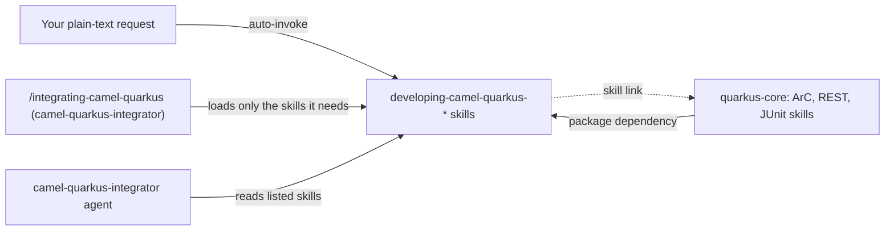

# camel-quarkus-skills

This package holds the version-locked knowledge skills for Camel Quarkus 3.40 LTS, one skill per Camel Quarkus extension. Each skill was generated from a dated, official-source research file. It is for developers who want Claude to answer or write Camel Quarkus code from sourced facts instead of memory, and you need it whenever a project uses `camel-quarkus-*` 3.40 artifacts. The base Quarkus skills (ArC, REST, JUnit) live in [quarkus-core](../quarkus-core/README.md).

> Version lock: Camel Quarkus 3.40 LTS, Camel 4.22, Quarkus 3.40. Every skill is named `...-v3-40` and covers only that version. Research date 2026-10-14. Every skill says "Not for Quarkus 4".

## Contents

<!-- BEGIN GENERATED:contents -->
**Depends on:** `factory-core`, `quarkus-core`  
**Used by:** `camel-quarkus-integrator`

| Type | Name | What it does |
|---|---|---|
| knowledge skill | [`developing-camel-quarkus-bean-v3-40`](.apm/skills/developing-camel-quarkus-bean-v3-40/SKILL.md) | Guides Camel Quarkus 3.40.x bean binding (camel-quarkus-bean, Camel 4.22): bean:, class:, CDI beans, @Handler, native reflection. |
| knowledge skill | [`developing-camel-quarkus-core-v3-40`](.apm/skills/developing-camel-quarkus-core-v3-40/SKILL.md) | Guides Camel Quarkus 3.40.x (Camel 4.22, Quarkus 3.40 LTS) core: BOM, routes, CDI beans, native, TLS. |
| knowledge skill | [`developing-camel-quarkus-file-v3-40`](.apm/skills/developing-camel-quarkus-file-v3-40/SKILL.md) | Guides Camel Quarkus 3.40.x file handling (Camel 4.22): camel-quarkus-file, file-watch, ftp/sftp, mina-sftp, file-cluster-service. |
| knowledge skill | [`developing-camel-quarkus-http-v3-40`](.apm/skills/developing-camel-quarkus-http-v3-40/SKILL.md) | Guides camel-quarkus-http 3.40.x (Camel 4.22, Quarkus 3.40 LTS), the HTTP client/producer: timeouts, TLS registry bridge, auth, errors, fault tolerance. |
| knowledge skill | [`developing-camel-quarkus-jaxb-v3-40`](.apm/skills/developing-camel-quarkus-jaxb-v3-40/SKILL.md) | Guides camel-quarkus-jaxb 3.40.x (Camel 4.22): JAXB marshal/unmarshal, contextPath, native reflection, XSD validation. |
| knowledge skill | [`developing-camel-quarkus-junit-v3-40`](.apm/skills/developing-camel-quarkus-junit-v3-40/SKILL.md) | Guides Camel Quarkus 3.40.x route tests with camel-quarkus-junit: CamelQuarkusTestSupport, AdviceWith, adviceRoute, @QuarkusTest, @QuarkusIntegrationTest. |
| knowledge skill | [`developing-camel-quarkus-log-v3-40`](.apm/skills/developing-camel-quarkus-log-v3-40/SKILL.md) | Guides Camel Quarkus 3.40.x logging (Camel 4.22): camel-quarkus-log, Log EIP, camel-quarkus-mdc, masking, Quarkus log config. |
| knowledge skill | [`developing-camel-quarkus-platform-http-v3-40`](.apm/skills/developing-camel-quarkus-platform-http-v3-40/SKILL.md) | Guides Camel Quarkus 3.40.x platform-http (Camel 4.22, Quarkus 3.40 LTS): endpoints, uploads, TLS, security. |
| knowledge skill | [`developing-camel-quarkus-rest-v3-40`](.apm/skills/developing-camel-quarkus-rest-v3-40/SKILL.md) | Guides camel-quarkus-rest (REST DSL) on Camel Quarkus 3.40.x (Camel 4.22): JSON binding, contract-first and code-first OpenAPI, validation, CORS. |
| knowledge skill | [`developing-camel-quarkus-xslt-v3-40`](.apm/skills/developing-camel-quarkus-xslt-v3-40/SKILL.md) | Guides Camel Quarkus 3.40.x XSLT (Camel 4.22): camel-quarkus-xslt and xslt-saxon, build-time templates, native mode, 3.40 hardening. |
<!-- END GENERATED:contents -->

## Installation

<!-- BEGIN GENERATED:installation -->
| Item | Value |
|---|---|
| Package name | `agents-factory-camel-quarkus-skills` |
| Version | `1.0.0` |
| Source folder | `packages/java/quarkus/camel-quarkus-skills` |
| In this repository | installed transitively, through `camel-quarkus-integrator` |
| Also installs | `factory-core`, `quarkus-core`, `clean-code-quarkus` |

Install it into another project, from that project's folder:

```bash
apm install <path-to-agents-factory>/packages/java/quarkus/camel-quarkus-skills --target claude
```

Add `--dry-run` to preview the install. APM writes the skills, agents and rules into `.claude/`. Change the sources under `.apm/`, never the generated `.claude/`.
<!-- END GENERATED:installation -->

The skills state these runtime facts: Camel Quarkus 3.40 supports Java 17 and 21; the BOMs `quarkus-bom` and `quarkus-camel-bom` are imported with the same `quarkus.platform.version` (3.40.1 in the core skill's scenario). No other tool is required by the package itself.

## Quick Start

This package has no `/command` and no agent. Ask in plain language and Claude loads the matching skill. Three requests to try:

```text
Set up a new Quarkus 3.40 project with a Camel timer route that logs a message every second, using the right BOMs.
```

```text
Create a Camel Quarkus 3.40 REST endpoint GET /fruits and POST /fruits with JSON binding.
```

```text
Write a Camel Quarkus 3.40 test for my route 'orders' that replaces the ERP endpoint toErp with a mock and asserts one message arrives.
```

They load `developing-camel-quarkus-core-v3-40`, `developing-camel-quarkus-rest-v3-40` and `developing-camel-quarkus-junit-v3-40`. For a guided interview that also generates code, use `/integrating-camel-quarkus` from [camel-quarkus-integrator](../camel-quarkus-integrator/README.md).

## Usage Scenarios

Each request is an evaluation scenario of the named skill (quoted `query:` lines).

### Scenario 1 - Fastest default: a new project and a timer route

```text
Set up a new Quarkus 3.40 project with a Camel timer route that logs a message every second, using the right BOMs.
```

Responding skill: `developing-camel-quarkus-core-v3-40`. You get `quarkus-bom` and `quarkus-camel-bom` with the same `quarkus.platform.version`, a plain `RouteBuilder` without `@ApplicationScoped` (it is needed only for `@Inject` and `@ConfigProperty`), and a note that Camel Quarkus 3.40 supports Java 17 and 21.

### Scenario 2 - A file route with safe defaults

```text
Write a Camel Quarkus 3.40 route that picks up XML files from /data/in, which another system writes, archives them on success and quarantines them on failure.
```

Responding skill: `developing-camel-quarkus-file-v3-40`. It adds `camel-quarkus-file` without a version, sets `readLock` explicitly (the default is `none`, so a file still being written would be consumed), and uses `move` and `moveFailed`.

### Scenario 3 - Incomplete or unverified input

Use it when the answer is not in the official pages.

```text
Which package do I import CamelQuarkusTestSupport from, and until when is Camel Quarkus 3.40 supported?
```

Responding skill: `developing-camel-quarkus-core-v3-40`. It points to `developing-camel-quarkus-junit-v3-40` for the `CamelQuarkusTestSupport` package, says the Camel Quarkus-specific LTS end date is *unverified* (the Quarkus 3.40 LTS date 2027-09-30 is only an inference), and mentions that no Camel Quarkus build on Quarkus 4 is known (*medium confidence*, absence of evidence). A second case: "What is the default heartbeat-timeout-multiplier of camel-quarkus-file-cluster-service, and what is the SFTP readLockTimeout default?" answers with the unverified tag instead of a number.

### Scenario 4 - Misuse: Quarkus 4, Spring Boot, wrong extension

```text
Configure Camel Quarkus 4 on Quarkus 4.0 Beta, or write a Spring Boot Camel route for me.
```

The core skill declines. Other refusals by skill: `developing-camel-quarkus-http-v3-40` refuses "Expose an HTTP endpoint with camel-quarkus-http as a server" (it is the client; use platform-http); `developing-camel-quarkus-file-v3-40` refuses "Use camel-quarkus-jsch to set up an SFTP consumer" (jsch is SCP, not SFTP); `developing-camel-quarkus-bean-v3-40` refuses `from("bean:myBean")` (the Bean component is producer-only).

### Scenario 5 - Anti-pattern trap

```text
Expose from("platform-http:/upload") to a file endpoint with no restrictions, call setSSLContextParameters for HTTPS, and set quarkus.tls.protocols=TLSv1.3,TLSv1.2,TLSv1 globally for one old client.
```

Responding skill: `developing-camel-quarkus-platform-http-v3-40`. It restricts the method and the file extension (`httpMethodRestrict=POST`, `fileNameExtWhitelist=pdf` in the canonical scenario), configures HTTPS through `quarkus.tls.*` and `quarkus.http.tls-configuration-name` instead of `SSLContextParameters`, and sets `quarkus.http.insecure-requests` to redirect or disabled.

### Scenario 6 - Route tests and legacy idioms

```text
Port this 3.15 test as-is: it uses camel-quarkus-junit5, org.apache.camel.test.junit5 imports, isUseAdviceWith() returning true, startRouteDefinitions() after adviceWith, and context.stop()/start() to reset state. Also add @Inject ProducerTemplate to the IT that extends CamelQuarkusTestSupport.
```

Responding skill: `developing-camel-quarkus-junit-v3-40`. It replaces each idiom: `camel-quarkus-junit` (renamed in 3.31), no `startRouteDefinitions()` after AdviceWith (since 3.36 non-advised routes start automatically), no `stop()` or `start()` of the shared context, and no `@Inject` or `CamelQuarkusTestSupport` in a `@QuarkusIntegrationTest`.

### Scenario 7 - Chain to the integrator

Use it when you want a guided interview and generated code. Run `/integrating-camel-quarkus` from [camel-quarkus-integrator](../camel-quarkus-integrator/README.md); it loads only the skills it needs from this package. See [Java integration commands](../../../../docs/entry-points/java-integrations.md).

## Skills Reference

Ten knowledge skills, one per extension area. Claude loads a skill when your request matches its description. Claims tagged `(unverified)` or `(medium confidence)` stay tagged; each skill keeps its register under `blueprints/unverified-and-risks.md`. Skill boundaries come from the descriptions.

### `developing-camel-quarkus-core-v3-40`

- Loads when: a project uses `camel-quarkus-core` or other `camel-quarkus-*` 3.40 artifacts, or migrates an older Camel Quarkus (BOM, routes, CDI beans, native, TLS).
- Locks: Camel Quarkus 3.40.x. Not for Quarkus 4.
- Never: set `quarkus.camel.native.reflection.serialization-enabled=false` with jms, sjms, sjms2, sql, netty, jolt or management present; use OpenSSL-style or unknown protocol or cipher names in `quarkus.tls.*` (they fail SSL context creation since 3.40.0); add `@ApplicationScoped` to a `RouteBuilder` that needs neither `@Inject` nor `@ConfigProperty`; rely on dynamic reflection or unlisted classpath resources in native mode.
- Example request: "My app uses camel-quarkus-jms and one legacy endpoint needs TLS 1.0. Set quarkus.tls.protocols=TLSv1.3,TLSv1.2,TLSv1 globally and set serialization-enabled=false to shrink the native image."

### `developing-camel-quarkus-bean-v3-40`

- Loads when: routes call Java or CDI beans (`bean:`, `class:`, `@Handler`, native reflection).
- Locks: Camel Quarkus 3.40.x (Camel 4.22.x docs). Not for consuming from `bean:`.
- Never: leave a name-referenced bean without `@RegisterForReflection` for native (the 3.40.0 processor registers only `@Handler` classes); use `from("bean:...")`; keep mutable fields in a default-scope (`Singleton`) bean.
- Example request: "Write a Camel Quarkus 3.40 route that calls a Java bean named orderService to validate the body, and make it work in native mode."

### `developing-camel-quarkus-file-v3-40`

- Loads when: routes read, write or watch files or move them over FTP or SFTP (`camel-quarkus-file`, file-watch, ftp, sftp, mina-sftp, file-cluster-service).
- Locks: Camel Quarkus 3.40.x. Not for SCP (`camel-quarkus-jsch`).
- Never: consume with `from("file:dir")` while another process still writes (`readLock=none` is the default); use `readLock=fileLock` on a mount or share; leave SFTP on `strictHostKeyChecking=no` in production; put `camel-quarkus-ftp` and `camel-quarkus-mina-sftp` in one build; use `camel-quarkus-jsch` for SFTP.
- Example request: "Add both camel-quarkus-ftp and camel-quarkus-mina-sftp so I can try both, and connect with sftp:user@host/in?password=secret, no extra options, we are going to production."

### `developing-camel-quarkus-http-v3-40`

- Loads when: routes call `http:` or `https:` endpoints (the HTTP client or producer: timeouts, TLS registry bridge, auth, errors, fault tolerance).
- Locks: `camel-quarkus-http` 3.40.x. Not for platform-http (server), the Quarkus REST client or Quarkus 4.
- Never: use OpenSSL-style cipher names or unknown protocol names in `quarkus.tls.*`; assume a bridged bean enforces `certificate-revocation-list`, `hostname-verification-algorithm`, `key-store.sni`, `alpn` or `pqc-enforcement-policy`; add `camel-quarkus-resilience4j` (not in the 3.40.x extension index).
- Example request: "In a Camel Quarkus 3.40 app, call https://partner.example.com/api from a route with our own truststore, a circuit breaker and a fallback."

### `developing-camel-quarkus-platform-http-v3-40`

- Loads when: a route uses `platform-http:` or `camel-quarkus-platform-http` 3.40 (endpoints, uploads, TLS, security).
- Locks: `camel-quarkus-platform-http` 3.40.x on Quarkus 3.40 LTS. Not for Quarkus 4, older lines or Spring Boot.
- Never: call `setSSLContextParameters(...)` expecting HTTPS; expose `from("platform-http:/upload")` with no method restriction and no extension whitelist; configure HTTPS and leave `insecure-requests` at its default `enabled`; add `@ApplicationScoped` to a route that injects nothing.
- Example request: "Create a Camel Quarkus 3.40 route that accepts PDF uploads over HTTPS and writes them to a folder."

### `developing-camel-quarkus-rest-v3-40`

- Loads when: you build `rest()` endpoints with the REST DSL (`camel-quarkus-rest`: JSON binding, contract-first and code-first OpenAPI, validation, CORS).
- Locks: Camel Quarkus 3.40.x. Not for JAX-RS-only apps (use `developing-quarkus-rest-v3-40`) or core setup.
- Never: configure TLS on the REST server with `SSLContextParameters` or `restConfiguration()`; use hyphens or `$` in path parameter names (Vert.x rejects them unless `io.vertx.web.route.param.extended-pattern=true`); add `camel-quarkus-junit5` or import `org.apache.camel.test.junit5`.
- Example request: "Set restConfiguration().port(8443) with an sslContextParameters endpoint property and enableCORS(true) so any site can call my API in production."

### `developing-camel-quarkus-jaxb-v3-40`

- Loads when: routes convert Java objects to or from XML via JAXB (marshal, unmarshal, `contextPath`, native reflection, XSD validation).
- Locks: `camel-quarkus-jaxb` 3.40.x. Not for `jacksonxml`.
- Never: leave non-annotated POJOs that a custom `ObjectFactory` creates unregistered in native builds; annotate a `RouteBuilder` with `@ApplicationScoped` when it injects nothing; use `camel-quarkus-junit5`.
- Example request: "On Camel Quarkus 3.40, marshal a Person object to XML and unmarshal it back, validating against person.xsd."

### `developing-camel-quarkus-xslt-v3-40`

- Loads when: routes transform XML with `xslt:` (`camel-quarkus-xslt`, `xslt-saxon`, build-time templates, native mode, 3.40 hardening).
- Locks: Camel Quarkus 3.40.x. Not for XQuery or XPath.
- Never: use `xslt:file:` or `xslt:http:` templates in a native build; disable secure processing while any template is untrusted or runtime-loaded; call `setAttribute` with `ACCESS_EXTERNAL_DTD` or `ACCESS_EXTERNAL_STYLESHEET` on the Camel Quarkus Xalan factory (it throws); expect DTD or external-entity expansion in input XML (not resolved since 3.40).
- Example request: "We upgrade an older Camel Quarkus application to 3.40. Our input XML has a DOCTYPE with entities and we call TransformerFactory.newInstance() directly. What breaks?"

### `developing-camel-quarkus-log-v3-40`

- Loads when: routes log, mask data or correlate with MDC (`camel-quarkus-log`, Log EIP, `camel-quarkus-mdc`, Quarkus log config).
- Locks: Camel Quarkus 3.40.x. Not for non-Camel logging.
- Never: use `showAll`, `showHeaders` or `showProperties` in production without masking; set `camel.main.useMdcLogging=true` or combine it with `camel-mdc`; use the deprecated `camel.main.mdcLoggingKeysPattern`.
- Example request: "Add audit logging to my Camel Quarkus 3.40 route, with the exchange id in every log line, and without leaking tokens."

### `developing-camel-quarkus-junit-v3-40`

- Loads when: you test Camel routes on Quarkus (`camel-quarkus-junit`, `CamelQuarkusTestSupport`, AdviceWith, `adviceRoute`, `@QuarkusTest`, `@QuarkusIntegrationTest`).
- Locks: Camel Quarkus 3.40.x. Not for generic Quarkus tests (use `developing-quarkus-junit-v3-40`).
- Never: use `camel-quarkus-junit5` or `org.apache.camel.test.junit5` imports; call `startRouteDefinitions()` after AdviceWith; call `stop()` or `start()` on the shared `CamelContext`; use wildcard weave patterns such as `weaveByToUri("kafka:*")`; advise routes defined in `createRouteBuilder()`; use `@Inject`, bean overrides or `CamelQuarkusTestSupport` in `@QuarkusIntegrationTest`; override `isUseAdviceWith()` (deprecated since 3.15.0).
- Example request: "I want the same route tests to run in JVM and native mode. Which base class should I use?"

## Architecture



## Agents Reference

<!-- BEGIN GENERATED:agents-reference -->
This package has no subagents. Claude loads its skills by description, and agents of other packages can load them too.
<!-- END GENERATED:agents-reference -->

This package has no agent, no command and no rule file. The skills are used by the `camel-quarkus-integrator` agent and the inline orchestrator `/integrating-camel-quarkus`, both in [camel-quarkus-integrator](../camel-quarkus-integrator/README.md) (the three Camel Quarkus rules live there too).

## Limits and constraints

| Item | Value | Where stated |
|---|---|---|
| Versions | Camel Quarkus 3.40.x, Camel 4.22, Quarkus 3.40 LTS; research date 2026-10-14 | all skills |
| Java | Camel Quarkus 3.40 supports Java 17 and 21 | core skill, ArC skill |
| Camel Quarkus 3.40 support end date | not published (*unverified*) | ArC and core skills |
| Quarkus 4 | out of scope; no Camel Quarkus build on Quarkus 4 is known (*medium confidence*) | all skills |
| Test artifact | `camel-quarkus-junit`, renamed from `camel-quarkus-junit5` in 3.31 | JUnit, JAXB and REST skills |
| Boundaries | `http` is the client (not platform-http or the Quarkus REST client); XSLT is not XQuery or XPath; JAXB is not `jacksonxml`; file is not SCP (`jsch`); the REST DSL skill is not for JAX-RS-only apps | skill descriptions |
| Generic Quarkus tests | belong to `developing-quarkus-junit-v3-40`; the Camel route test skill covers Camel routes only | JUnit skill |

Provenance: the research files `workspace/research_*_v3.40.md`.

## Related

- Family guide: [Java integration commands](../../../../docs/entry-points/java-integrations.md).
- Depends on [factory-core](../../../factory/factory-core/apm.yml) and [quarkus-core](../quarkus-core/README.md).
- Used by [camel-quarkus-integrator](../camel-quarkus-integrator/README.md).
- Docs: [agent architecture](../../../../docs/agents/architecture.md), [entry points](../../../../docs/entry-points/README.md), [packages](../../../../docs/packages/README.md).
