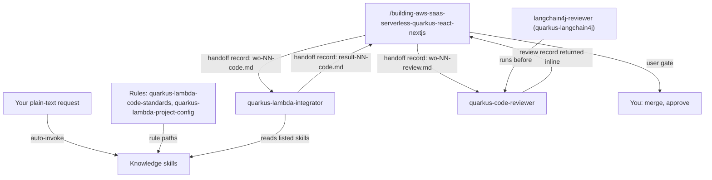

# quarkus-aws

This package helps you build Quarkus 3.40 LTS functions that run on AWS Lambda. It has knowledge skills for the runtime, HTTP, Cognito security, data, messaging, testing, logging, tracing and metrics, two composition skills, an executor agent, a read-only reviewer agent and two scoped rules. It is for developers who write or review Quarkus Lambda code, with or without the SaaS orchestrator, and you need it as soon as a Quarkus project targets Lambda.

> Version lock: Quarkus 3.40 LTS (patch 3.40.1.1 at research date 2026-10-28); Quarkiverse amazon-services 3.23.0 (`io.quarkiverse.amazonservices:quarkus-amazon-services-bom:3.23.0`). `quarkus-test-amazon-lambda` and `LambdaClient` were removed in Quarkus 3.31, so tests use `quarkus-junit` with RestAssured against the mock event server. JVM with SnapStart versus native, and X-Ray SDK versus OpenTelemetry, are ADR decisions, not defaults. Quarkus 4 is out of scope.

## Contents

<!-- BEGIN GENERATED:contents -->
**Depends on:** `factory-core`, `quarkus-core`, `handoff-core`, `aws-skills`  
**Used by:** `aws-saas-serverless-quarkus-react-nextjs`, `quarkus-langchain4j`, [`serverless-java-aws`](../../../bundles/serverless-java-aws/README.md) (bundle)

| Type | Name | What it does |
|---|---|---|
| knowledge skill | [`developing-quarkus-amazon-lambda-http-v3-40`](.apm/skills/developing-quarkus-amazon-lambda-http-v3-40/SKILL.md) | Guides Quarkus 3.40 LTS web apps on AWS Lambda behind API Gateway with quarkus-amazon-lambda-http (HTTP API) and quarkus-amazon-lambda-rest (REST API). |
| knowledge skill | [`developing-quarkus-amazon-lambda-v3-40`](.apm/skills/developing-quarkus-amazon-lambda-v3-40/SKILL.md) | Guides Quarkus 3.40 LTS plain AWS Lambda handlers with quarkus-amazon-lambda: function.zip packaging, JVM vs native, SnapStart. |
| knowledge skill | [`integrating-quarkus-amazon-data-v3-40`](.apm/skills/integrating-quarkus-amazon-data-v3-40/SKILL.md) | Integrates DynamoDB, the DynamoDB enhanced client and S3 (incl. |
| knowledge skill | [`integrating-quarkus-amazon-messaging-v3-40`](.apm/skills/integrating-quarkus-amazon-messaging-v3-40/SKILL.md) | Integrates SQS, SNS, EventBridge clients and SSM/Secrets Manager config sources in Quarkus 3.40 LTS Lambdas with amazon-services 3.23.0, plus queue, topic and… |
| knowledge skill | [`logging-quarkus-lambda-v3-40`](.apm/skills/logging-quarkus-lambda-v3-40/SKILL.md) | Teaches logging from Quarkus 3.40 LTS Lambda functions to CloudWatch Logs: quarkus-logging-json, MDC AWSRequestId/tenantId, Lambda logging controls, no PII or… |
| knowledge skill | [`monitoring-quarkus-lambda-v3-40`](.apm/skills/monitoring-quarkus-lambda-v3-40/SKILL.md) | Guides custom CloudWatch metrics from Quarkus 3.40 LTS Lambdas: EMF to stdout, choice of metric approach, bounded dimensions and cost. |
| knowledge skill | [`observing-quarkus-lambda`](.apm/skills/observing-quarkus-lambda/SKILL.md) | Composes the logging, tracing and metrics skills for Quarkus 3.40 Lambda backends: decision order, requestId/tenantId correlation across logs, X-Ray and EMF, h… |
| knowledge skill | [`securing-quarkus-lambda-cognito-v3-40`](.apm/skills/securing-quarkus-lambda-cognito-v3-40/SKILL.md) | Secures Quarkus 3.40 LTS HTTP Lambdas with Amazon Cognito: Lambda HTTP security mapping, JWT validation, roles and permissions, tenant-from-token isolation. |
| knowledge skill | [`structuring-quarkus-lambda-projects`](.apm/skills/structuring-quarkus-lambda-projects/SKILL.md) | Defines where code goes in a Quarkus 3.40 AWS Lambda SaaS repo: Lambda granularity, Maven modules, package taxonomy, tests, function.zip to Terraform, openspec… |
| knowledge skill | [`testing-quarkus-amazon-lambda-v3-40`](.apm/skills/testing-quarkus-amazon-lambda-v3-40/SKILL.md) | Guides offline tests of Quarkus 3.40 LTS AWS Lambdas: mock event server, quarkus-junit with RestAssured, @QuarkusIntegrationTest, Dev Services, optional SAM em… |
| knowledge skill | [`tracing-quarkus-lambda-v3-40`](.apm/skills/tracing-quarkus-lambda-v3-40/SKILL.md) | Guides distributed tracing from Quarkus 3.40 LTS Lambdas to AWS X-Ray: active tracing, quarkus-amazon-lambda-xray vs quarkus-opentelemetry, trace headers, SDK… |
| agent (sonnet) | [`quarkus-code-reviewer`](.apm/agents/quarkus-code-reviewer.agent.md) | Quarkus Code Reviewer — independent, read-only reviewer (step I7) of the diff produced by quarkus-lambda-integrator. |
| agent (sonnet) | [`quarkus-lambda-integrator`](.apm/agents/quarkus-lambda-integrator.agent.md) | Quarkus Lambda Integrator — non-interactive executor that implements ONE closed task of a Quarkus 3.40 on AWS Lambda project from a work-order record: tests fi… |
| rule | [`quarkus-lambda-code-standards.instructions`](.apm/instructions/quarkus-lambda-code-standards.instructions.md) | Code standards for Quarkus 3.40 AWS Lambda Java: thin handlers, tenant from the verified token, secrets, JSON logs with MDC, Quarkiverse 3.23.0 SDK clients, pe… |
| rule | [`quarkus-lambda-project-config.instructions`](.apm/instructions/quarkus-lambda-project-config.instructions.md) | Build and runtime configuration of Quarkus 3.40 Lambda projects: Quarkus BOM, Quarkiverse amazon-services BOM 3.23.0, quarkus-logging-json, SnapStart and mock-… |
<!-- END GENERATED:contents -->

## Installation

<!-- BEGIN GENERATED:installation -->
| Item | Value |
|---|---|
| Package name | `agents-factory-quarkus-aws` |
| Version | `1.0.0` |
| Source folder | `packages/java/quarkus/quarkus-aws` |
| In this repository | installed transitively, through `aws-saas-serverless-quarkus-react-nextjs`, `quarkus-langchain4j` |
| Also installs | `factory-core`, `quarkus-core`, `handoff-core`, `aws-skills`, `clean-code-quarkus`, `openspec-core` |

Install it into another project, from that project's folder:

```bash
apm install <path-to-agents-factory>/packages/java/quarkus/quarkus-aws --target claude
```

Add `--dry-run` to preview the install. APM writes the skills, agents and rules into `.claude/`. Change the sources under `.apm/`, never the generated `.claude/`.
<!-- END GENERATED:installation -->

Prerequisites come from the skills and agents:

- A Maven project (`mvn -q verify`, or `./mvnw`). The integrator checks `java -version` and `mvn -version` before any Maven command and stops when the JVM is inconsistent with what the skills require.
- No AWS account or credentials. Tests run offline on the mock event server or on Dev Services; the agents never call real AWS.

## Quick Start

This package has no `/command`. Ask in plain language and Claude loads the skill that matches your request. Three requests to try:

```text
Create a plain (non-HTTP) AWS Lambda in Quarkus 3.40 that takes a JSON InputObject and returns an OutputObject, and tell me what to hand to Terraform.
```

```text
Add DynamoDB (enhanced client) and S3 to my Quarkus 3.40 Lambda: list a tenant's documents and read an S3 object.
```

```text
Write an offline test for my plain Quarkus 3.40 Lambda that takes a Person JSON and returns a greeting. No AWS account is available.
```

The two agents are not started by you. The orchestrator `/building-aws-saas-serverless-quarkus-react-nextjs` launches them from a work-order record; see [saas-quarkus-aws](../../../../docs/entry-points/saas-quarkus-aws.md).

## Usage Scenarios

Each request is an evaluation scenario of the named skill (quoted `query:` lines).

### Scenario 1 - Fastest default: a plain handler

Use it for a non-HTTP Lambda such as an event consumer.

```text
Create a plain (non-HTTP) AWS Lambda in Quarkus 3.40 that takes a JSON InputObject and returns an OutputObject, and tell me what to hand to Terraform.
```

Responding skill: `developing-quarkus-amazon-lambda-v3-40`. You get `quarkus-amazon-lambda` without a version (BOM-managed) and a `RequestHandler<InputObject, OutputObject>` annotated `@Named`. The skill states the Lambda handler is `io.quarkus.amazon.lambda.runtime.QuarkusStreamHandler::handleRequest`, that `quarkus.lambda.handler` selects your class and must match the `@Named` value, and that `target/function.zip` is the only deployment artifact (HCL belongs to `provisioning-aws-lambda-v6`, never SAM or CDK). It asks whether you want JVM, JVM with SnapStart or native before fixing a runtime.

### Scenario 2 - An HTTP endpoint behind API Gateway

Use it when a JAX-RS resource becomes a Lambda.

```text
Expose a Quarkus 3.40 JAX-RS resource as a Lambda behind API Gateway and tell me what to hand to Terraform.
```

Responding skill: `developing-quarkus-amazon-lambda-http-v3-40`. It picks `quarkus-amazon-lambda-http` for an HTTP API or `quarkus-amazon-lambda-rest` for a REST API, keeps exactly one HTTP framework, and treats `sam.jvm.yaml` and `sam.native.yaml` as reference output only. Add Cognito with the next request.

### Scenario 3 - Security: tenant from the token

Use it when the endpoint needs authentication and tenant isolation.

```text
My Quarkus 3.40 HTTP Lambda sits behind an API Gateway HTTP API with a Cognito JWT authorizer. Admin endpoints must be limited to the Cognito group admin, and orders live under /tenants/{tenantId}/orders. Secure it.
```

Responding skill: `securing-quarkus-lambda-cognito-v3-40`. The skill derives the tenant from a verified claim, not from the path.

### Scenario 4 - Incomplete input: an ADR decision with no default

Use it when your request hides a decision the skills refuse to make for you.

```text
Should our SaaS backend be one Lambda behind API Gateway with all routes, or one Lambda per endpoint?
```

Responding skill: `structuring-quarkus-lambda-projects`. It does not pick a default. It presents module-per-function, one HTTP Lambda with many routes, and one module with several `@Named` handlers, notes that role, memory, timeout and runtime mode are per Lambda, and asks for an ADR. The same pattern holds for the umbrella skill: for "Make my Quarkus 3.40 order Lambda observable: logs, traces and metrics, with the tenant visible in all three." `observing-quarkus-lambda` first asks three ADR decisions in order (tracing stack, metric approach, tenant representation) before it writes code. Answer each with the option you want, or write the ADR first.

### Scenario 5 - Misuse: Terraform, SAM and Quarkus 4

Use it to see what the skills refuse.

```text
Write the Terraform aws_lambda_function for the orders module and implement the SnapStart afterRestore hook.
```

`structuring-quarkus-lambda-projects` states that it covers placement only, names `provisioning-aws-lambda-v6` for the HCL and `developing-quarkus-amazon-lambda-v3-40` for SnapStart, and offers the artifact path and contract items to hand over. Likewise "Only configure the log group retention and the CloudWatch alarm for Errors on my Lambda in Terraform." is not a multi-pillar application task: retention belongs to `provisioning-aws-cloudwatch-v6` and alarms to `monitoring-cloudwatch-observability`, by name only. Every skill here also refuses Quarkus 4.

### Scenario 6 - Anti-pattern trap: messaging

Use it to see the Never-Do rules fire.

```text
Review: the SQS handler is RequestHandler<SQSEvent, Void> and rethrows on a bad body; a publisher calls sqs.sendMessageBatch with 250 entries and ignores the result; application.properties sets quarkus.sqs.aws.credentials.type=static with AKIA keys.
```

Responding skill: `integrating-quarkus-amazon-messaging-v3-40`. It flags that a thrown exception fails the whole batch and returns `SQSBatchResponse` with the failed `messageId` values instead; that HTTP 200 does not mean every entry succeeded; that one call holds at most 10 entries so you split into chunks of 10 and check each response; and that static keys belong only under `%dev`.

### Scenario 7 - Offline testing

Use it when you have no AWS account.

```text
Write an offline test for my plain Quarkus 3.40 Lambda that takes a Person JSON and returns a greeting. No AWS account is available.
```

Responding skill: `testing-quarkus-amazon-lambda-v3-40`, with the mock event server and `quarkus-junit`. A related request, "After upgrading to Quarkus 3.40 my build cannot resolve io.quarkus:quarkus-test-amazon-lambda. Pin 3.30.8 so LambdaClient.invoke keeps working.", is refused: that artifact was removed in 3.31.

### Scenario 8 - Chain to the executor and the reviewer

Use it when the work is a closed task in an orchestrated project. The orchestrator writes a work-order such as `openspec/changes/<id>/handoff/wo-03-code.md`, launches `quarkus-lambda-integrator`, then launches `langchain4j-reviewer` (only for AI code) and `quarkus-code-reviewer` with a review work-order. You do not launch them by hand. After the code review, the deploy and live checks belong to other packages (`aws-lambda`, `aws-observability`). Clean-code steps use `refactoring-quarkus-java` from [clean-code-quarkus](../../clean-code/clean-code-quarkus/README.md).

## Skills Reference

Knowledge skills (one subsection each); Claude loads one when your request matches its description. Every skill states "Not for Quarkus 4" and keeps `(unverified)` and `(medium confidence)` tags on unconfirmed claims; each has a register in `blueprints/unverified-and-risks.md`.  Each skill links its `blueprints/` folder (always-do and never-do patterns, ask-first decisions, topic files, evaluation scenarios) on demand.

### `developing-quarkus-amazon-lambda-v3-40`

- Loads when: you write plain (non-HTTP) Lambda handlers with `quarkus-amazon-lambda` (`function.zip`, JVM versus native, SnapStart).
- Locks: Quarkus 3.40 LTS patch 3.40.1.1, `quarkus-amazon-lambda`. Not for API Gateway HTTP, Cognito, AWS SDK clients, Terraform or Quarkus 4.
- Never: point the Lambda handler at the user class; ship several handler classes without `quarkus.lambda.handler`; enable SnapStart on a native function; use new `provided`, `provided.al2` or `java17` (AL2) functions; create unique IDs or secrets at init under SnapStart; register a CRaC `Resource` as a temporary object; deploy a native build without `DISABLE_SIGNAL_HANDLERS=true`; write `quarkus.snapstart.enable`.
- Example request: "My afterRestore hook takes 5 seconds. Is that allowed? Also the Quarkus guide says quarkus.snapstart.enable=true, is that right?"

### `developing-quarkus-amazon-lambda-http-v3-40`

- Loads when: you build Quarkus HTTP endpoints as a Lambda with `quarkus-amazon-lambda-http` (HTTP API) or `quarkus-amazon-lambda-rest` (REST API).
- Locks: Quarkus 3.40 LTS patch 3.40.1.1. Not for plain handlers, Cognito, tests, Terraform or Quarkus 4.
- Never: add more than one HTTP framework; inject an event type the guide does not list; deploy a REST API without binary media types `*/*`; copy the REST extension's `sam.native.yaml` `Runtime: provided` (deprecated 2024-01-08); trust combined multi-value headers of an HTTP API event; expect an authorizer `Principal` without `quarkus.lambda-http.enable-security=true`.
- Example request: "Can I put this behind a Lambda function URL or an ALB instead, and what status does the client get when my 40 second request times out at the gateway?"

### `securing-quarkus-lambda-cognito-v3-40`

- Loads when: you add authentication, authorization or multi-tenant checks to an HTTP Lambda with Amazon Cognito.
- Locks: Quarkus 3.40 LTS, the two HTTP extensions, current Cognito and API Gateway documentation. Not for Cognito provisioning, API Gateway setup, login UI or Quarkus 4.
- Never: take the tenant from the path, a header or the body alone; base authorization on a custom attribute that app clients can write; accept any Cognito JWT without checking `token_use` and `client_id` or `aud`; set `quarkus.oidc.token.issuer=any`; build identity from caller-controlled data in a `LambdaIdentityProvider`; set `QUARKUS_AWS_LAMBDA_FORCE_USER_NAME` outside `sam local` testing; expect `custom:` attributes in the access token without a V2_0 or V3_0 pre token generation trigger.
- Example request: "Copy the guide's CustomSecurityProvider that reads the x-user header into our LambdaIdentityProvider, and set QUARKUS_AWS_LAMBDA_FORCE_USER_NAME=admin on the function so it works in the cloud too." The skill refuses both.

### `integrating-quarkus-amazon-data-v3-40`

- Loads when: you add DynamoDB, the DynamoDB enhanced client or S3 (including presigned URLs), the HTTP client, credentials or tenant isolation.
- Locks: Quarkiverse `quarkus-amazon-services` 3.23.0 on Quarkus 3.40 LTS. Not for messaging, Terraform, IAM policies or Quarkus 4.
- Never: put static access keys in `application.properties` of a Lambda; rely on access-key environment variables on a function that uses or may use SnapStart; read a `ResponseInputStream` without closing it; treat one `query` call as the full result.
- Example request: "Review: tenantId comes from the path parameter, I scan the table and filter by tenant, and I presign S3 uploads for 7 days from the Lambda role."

### `integrating-quarkus-amazon-messaging-v3-40`

- Loads when: you send or consume SQS, SNS or EventBridge messages, or load SSM or Secrets Manager config.
- Locks: Quarkiverse `quarkus-amazon-services` 3.23.0 on Quarkus 3.40 LTS. Not for DynamoDB, S3, HTTP, Terraform or Quarkus 4.
- Never (N1 to N10): throw from the SQS handler because one record failed; return the receipt handle or an unknown value as `itemIdentifier`; keep processing after the first failure on a FIFO queue; treat HTTP 200 from a batch publish as success of all entries; send more than 10 entries in one SQS, SNS or classic-bus `PutEvents` call; set the visibility timeout below the function timeout; put static keys in production `application.properties`; subscribe a Lambda to an SNS FIFO topic; read `AWS_SESSION_TOKEN` at init for the extension header; use `sync-client.type=apache` in a native Lambda.
- Example request: "I enable quarkus.ssm.config with the default update interval and SnapStart. Will rotated parameters refresh, and how much cold start does it add?"

### `testing-quarkus-amazon-lambda-v3-40`

- Loads when: you write offline tests of a Quarkus Lambda (mock event server, `quarkus-junit` with RestAssured, `@QuarkusIntegrationTest`, Dev Services, optional SAM emulation).
- Locks: Quarkus 3.40 LTS patch 3.40.1.1. Not for handler code, Terraform deployment, Cognito design or Quarkus 4.
- Never: use `quarkus-test-amazon-lambda` or `LambdaClient` (removed in 3.31); use `@InjectMock` or `@Inject` in a `@QuarkusIntegrationTest`; treat `sam.*.yaml` or `sam deploy` as the deployment path.
- Example request: "Test a Cognito-secured quarkus-amazon-lambda-http endpoint. Can I just use @TestSecurity? Show me the raw event helper."

### `logging-quarkus-lambda-v3-40`

- Loads when: you configure or review logs of a Quarkus Lambda going to CloudWatch Logs (`quarkus-logging-json`, MDC `AWSRequestId` and `tenantId`, Lambda logging controls).
- Locks: Quarkus 3.40 LTS patch 3.40.1.1. Not for tracing, metrics, Terraform, Powertools or Quarkus 4.
- Never: log `System.getenv()`, the whole event or secrets; add Log4j dependencies or the `aws-lambda-java-log4j2` recipe; name a custom log group starting with `aws/`; set `quarkus.log.console.json.pretty-print=true`; write the deprecated `quarkus.log.console.json.enable`.
- Example request: "My Quarkus 3.40 Lambda runs on the java21 managed runtime. Make its logs JSON with the request id and the tenant id on every line."

### `tracing-quarkus-lambda-v3-40`

- Loads when: you add distributed traces to AWS X-Ray (active tracing, `quarkus-amazon-lambda-xray` versus `quarkus-opentelemetry`, trace headers, annotations).
- Locks: Quarkus 3.40 LTS patch 3.40.1.1 and Quarkiverse `quarkus-amazon-services` 3.23.x. Not for logging, metrics, Terraform, Powertools or Quarkus 4.
- Never: leave `TracingConfig` unset and expect traces; expect an API Gateway node from an HTTP API with `quarkus-amazon-lambda-http`; read `_X_AMZN_TRACE_ID` on Java 17+ managed runtimes; put PII or secrets in annotations, metadata or span attributes; name the annotation key `tenant_id`; annotate the Lambda function segment; change tracing mode on a published version; send the default gRPC OTLP export to the X-Ray traces endpoint.
- Example request: "Annotate every trace with tenant_id and the user's email so support can search by them."

### `monitoring-quarkus-lambda-v3-40`

- Loads when: you emit business or technical custom metrics to CloudWatch with EMF written to stdout.
- Locks: Quarkus 3.40 LTS patch 3.40.1.1 and the CloudWatch EMF specification as published 2026-10-28. Not for alarms, logging, tracing, built-in Lambda metrics or Quarkus 4.
- Never: write EMF through the Quarkus logger (`Log.info(emfJson)`); use `requestId`, `orderId`, `userId` or an unbounded `tenantId` as a dimension; re-emit `Invocations`, `Errors`, `Throttles`, `Duration` or `ConcurrentExecutions`; start a custom namespace with `AWS/`; put more than 100 metric definitions in one document; write the timestamp in seconds or as a string; publish from a background thread after the handler returns; emit NaN, Infinity or out-of-range values.
- Example request: "We have about 4000 tenants and want per-tenant order counts. Add TenantId as a dimension." The skill asks for an ADR before an unbounded dimension.

### `observing-quarkus-lambda`

- Loads when: one task spans two or more of logs, traces and metrics. Load it instead of, not together with, a pillar skill.
- Locks: composes the logging, tracing and metrics skills; adds no new facts. Not for one pillar, alarms, dashboards, Terraform or Quarkus 4.
- Never: put `requestId`, `orderId`, `userId` or an unbounded `tenantId` in an EMF dimension; put PII or secrets in logs, annotations, metadata or span attributes; emit EMF through `Log.info(...)`; use a trace annotation key other than the family key; present X-Ray SDK or OpenTelemetry as the default; load the umbrella and a pillar skill for the same pillar.
- Example request: "Put the X-Ray trace id into every log line and the EMF document so I can click from a log to its trace."

### `structuring-quarkus-lambda-projects`

- Loads when: you create or move a module, package, handler or test of a Quarkus Lambda SaaS repository (granularity, Maven modules, package taxonomy, `function.zip` to Terraform, `openspec/` and `infra/`).
- Locks: Quarkus 3.40 LTS patch 3.40.1.1, `quarkus-amazon-services` 3.23.x, OpenSpec v1.15.0. The directory names `functions/`, `shared/`, `infra/` are a team convention (*medium confidence*). Not for handler code, HCL or Quarkus 4.
- Never: put more than one HTTP framework in a function module; deploy from `sam.*.yaml` or write SAM or CDK; copy `Runtime: provided` from the REST extension; rename or move the Lambda handler bean without changing `quarkus.lambda.handler`; add `quarkus-test-amazon-lambda`; ignore `.terraform.lock.hcl`; create or move a module that holds beans without a bean index.
- Example request: "I moved the tenant context bean into shared/tenant and now the orders function cannot find it." The skill points to the missing bean index of the moved module.

## Architecture

Skills load by themselves (`auto-invoke`). The two agents run only when the orchestrator launches them from a work-order. They share one handoff protocol (`coordinating-agent-handoffs` and the profile `coordinating-quarkus-aws-handoffs`).



## Agents Reference

<!-- BEGIN GENERATED:agents-reference -->
| Agent | Model | Tools | Can start agents | Started by |
|---|---|---|---|---|
| [`quarkus-code-reviewer`](.apm/agents/quarkus-code-reviewer.agent.md) | sonnet | Read, Grep, Glob | no | an orchestrator or another agent |
| [`quarkus-lambda-integrator`](.apm/agents/quarkus-lambda-integrator.agent.md) | sonnet | Read, Grep, Glob, Edit, Write, Bash | no | an orchestrator or another agent |
<!-- END GENERATED:agents-reference -->

Neither agent has a `/command`. The orchestrator `/building-aws-saas-serverless-quarkus-react-nextjs` starts them with the Agent tool from a work-order record. Only the orchestrator talks to you.

### quarkus-lambda-integrator

- What it does: implements ONE closed task of a Quarkus Lambda project from a work-order (default `openspec/changes/<id>/handoff/wo-NN-code.md`). Steps: I0 plan, I1 tests first (one test per scenario, named like `R1_otherTenant_returns403`), I2 minimal implementation, I3 refinement, I4 clean code, I5 refactor, I6 offline `mvn -q verify` plus `function.zip` build, I8 fix after a review record (HIGH always fixed, MEDIUM fixed or justified), I9 report with "Spec impact". Writes one record `result-NN-code.md` in the work-order's handoff folder.
- Skills: loads only the skills the work-order lists, plus always `refactoring-quarkus-java` for I4 and I5, and the rules `quarkus-clean-code`, `quarkus-lambda-code-standards` and `quarkus-lambda-project-config`. It may also load `integrating-stripe-quarkus-v3-40` or `integrating-quarkus-langchain4j-v1-15` when the work-order lists them.
- Non-interactive contract: an incomplete work-order, or an Ask-First item of a loaded skill that the work-order does not settle, returns numbered questions with `outcome: needs-input` and no code. The report outcome is `success`, `partial`, `failed` or `needs-input`, with `build_attempts` counted against `limits.build_attempts` from the work-order.
- Never: call real AWS or use real credentials; deploy, or run `terraform`, `aws`, `sam` or `cdk`; spawn agents; edit the spec, ADRs, `tasks.md` or other agents' records; run `git commit` or `git push`; assume missing requirements; loop beyond the work-order limits; review or approve its own output; hardcode secrets or log tokens or PII; write outside the target project and its handoff folder.
- Model and tools: `sonnet`; Read, Grep, Glob, Edit, Write, Bash.
- Not its job: Stripe tasks go to `stripe-integrator` unless the work-order lists `integrating-stripe-quarkus-v3-40` for it.

### quarkus-code-reviewer

- What it does: independent review at step I7 of the integrator's diff against the rule `quarkus-clean-code`, the reviewer checklist of `refactoring-quarkus-java`, the Never-Do items of every listed skill, the accepted ADRs (an ADR violation is always HIGH) and a requirement-scenario-test traceability matrix. It returns one `review-NN` record (outcome `approved` or `changes-requested`, with a round number) inline; the orchestrator saves it.
- Non-interactive contract: with missing files, ADRs, requirements or skill list it gives no verdict, says "review not performed" and lists numbered questions. It does not read `result-*` records. A work-order that lists the LangChain4j skill without the D1 entry in its settled Ask-First line is a HIGH finding.
- Severity: HIGH (ADR violation, a Never-Do with security, data or correctness impact, tenant isolation gap, scenario without a test, behavior change disguised as refactor); MEDIUM (maintainability breaches, weak tests, missing validation); LOW (naming, style).
- Never: write or edit files; run Bash; spawn agents; rely on the author's report; propose rewrites beyond its findings; approve with an open HIGH or without the traceability matrix; state facts from memory; talk to the user.
- Model and tools: `sonnet`; Read, Grep, Glob.

### Rules

| Rule | Scope as the file states it (`applyTo`) | What it enforces |
|---|---|---|
| `quarkus-lambda-code-standards` | `**/src/main/java/**/*.java,**/src/test/java/**/*.java` | Thin handlers, tenant from the verified token claim, secrets from Secrets Manager or SSM, JSON logs through JBoss Logging, CDI-injected SDK clients with an explicit HTTP client artifact, per-entry checks on batch publishes, idempotent event handlers, tests on the mock event server. |
| `quarkus-lambda-project-config` | `**/pom.xml,**/src/main/resources/application.properties,application.yaml,application.yml` | Quarkus 3.40 BOM plus amazon-services BOM 3.23.0, exactly one HTTP client artifact per client, `quarkus-logging-json` with dev and test switches, `quarkus.snapstart.enabled`, mock-event-server port keys, one HTTP framework with `-http` or `-rest`. |

Both rule files use the frontmatter key `applyTo`, while the factory rule convention (`.claude/rules/skill-frontmatter.md`) uses `paths`. Both say a glob cannot test file content, so you apply them only when the build declares `quarkus-amazon-lambda`, `quarkus-amazon-lambda-http` or `quarkus-amazon-lambda-rest`.

## Output structure

The skills tell you what to produce; the agents write inside the target project and the handoff folder.

```text
<target project>/
  functions/ ... shared/ ... infra/        # layout convention of structuring-quarkus-lambda-projects (medium confidence)
  target/function.zip                      # of each function module: the only deployment artifact; Terraform deploys it
openspec/changes/<id>/handoff/
  wo-NN-code.md       # work-order, written by the orchestrator
  result-NN-code.md   # integrator report with "Spec impact" (outcome, build_attempts)
  wo-NN-review.md     # review work-order, written by the orchestrator
  review-NN.md        # reviewer record, returned inline and saved by the orchestrator
```

## Limits and constraints

| Item | Value | Where stated |
|---|---|---|
| Quarkus | 3.40 LTS, patch 3.40.1.1; Quarkus 4 and Quarkiverse 4.0.0.Beta* out of scope | all skills |
| Quarkiverse amazon-services | 3.23.0 (3.23.x for tracing and structure) | data, messaging, tracing skills |
| Research date | 2026-10-28 | all skills |
| Removed in Quarkus 3.31 | `quarkus-test-amazon-lambda`, `LambdaClient` | testing skill |
| SQS and publishing batches | at most 10 entries per call (SQS, SNS, classic-bus `PutEvents`) | messaging skill |
| SQS visibility timeout | at least six times the function timeout; `maxReceiveCount` at least 5 | messaging skill |
| SnapStart restore | the Quarkus guide says 2 seconds, AWS says 10 seconds; which applies is *unverified* | Lambda skill |
| EMF | at most 100 metric definitions per document | monitoring skill |
| Integrator build attempts | `limits.build_attempts` from the work-order; then `failed` or `needs-input` | integrator agent |
| Ask-First items that need an ADR | JVM, JVM with SnapStart or native; HTTP client type; tracing stack; metric approach; tenant isolation tier; Lambda granularity | skills |

Out of scope for all skills, as each description says: Terraform and IAM policies, API Gateway setup, Cognito provisioning, login UI, alarms and dashboards, Powertools. The OCI `java-functions-*` rules do not apply here. If Camel Quarkus is also in the project, the `camel-quarkus-integrator` rules load too and the more restrictive guidance wins. Provenance and version facts: `workspace/quarkus-aws-saas/`.

## Related

- Family guide: [Java integration commands](../../../../docs/entry-points/java-integrations.md); the orchestrator that starts the agents is described in [saas-quarkus-aws](../../../../docs/entry-points/saas-quarkus-aws.md).
- Depends on [factory-core](../../../factory/factory-core/apm.yml), [quarkus-core](../quarkus-core/README.md), [handoff-core](../../../delivery/protocol/handoff-core/README.md) and [aws-skills](../../../cloud/provider/aws/aws-skills/apm.yml).
- Used by [quarkus-langchain4j](../quarkus-langchain4j/README.md).
- Docs: [agent architecture](../../../../docs/agents/architecture.md), [entry points](../../../../docs/entry-points/README.md), [packages](../../../../docs/packages/README.md).
