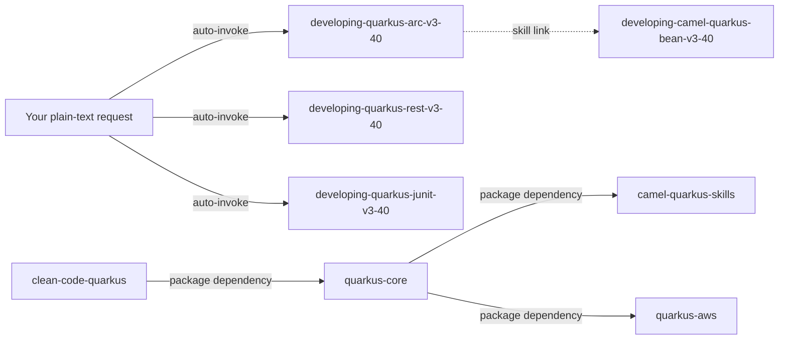

# quarkus-core

This package holds the base Quarkus 3.40 LTS knowledge skills that every Quarkus package of this factory shares: ArC (CDI), Quarkus REST and REST client, and Quarkus JUnit testing. It is for developers who want Claude to write or review plain Quarkus code from sourced facts instead of memory. You need it whenever you build on Quarkus 3.40; [camel-quarkus-skills](../camel-quarkus-skills/README.md) and [quarkus-aws](../quarkus-aws/README.md) depend on it.

> Version lock: Quarkus 3.40 LTS only (released 2026-09-30, community-maintained until 2027-09-30, per the skills' version tables). Research date 2026-10-14. The skills say "Not for Quarkus 4" and not for other versions. Quarkus 4.0.0.Beta1 was published 2026-10-01; no 3.40 guidance applies to it.

## Contents

<!-- BEGIN GENERATED:contents -->
**Depends on:** `factory-core`, `clean-code-quarkus`  
**Used by:** `camel-quarkus-skills`, `quarkus-acceptance-testing`, `quarkus-aws`

| Type | Name | What it does |
|---|---|---|
| knowledge skill | [`developing-quarkus-arc-v3-40`](.apm/skills/developing-quarkus-arc-v3-40/SKILL.md) | Guides quarkus-arc (ArC, the Quarkus CDI container) in Quarkus and Camel Quarkus 3.40.x apps: scopes, qualifiers, unused-bean removal, Jandex, mocking. |
| knowledge skill | [`developing-quarkus-junit-v3-40`](.apm/skills/developing-quarkus-junit-v3-40/SKILL.md) | Guides Quarkus 3.40 testing with quarkus-junit (formerly quarkus-junit5): @QuarkusTest, profiles, test resources, @InjectMock. |
| knowledge skill | [`developing-quarkus-rest-v3-40`](.apm/skills/developing-quarkus-rest-v3-40/SKILL.md) | Guides Quarkus 3.40.x REST: quarkus-rest, quarkus-rest-jackson and quarkus-rest-client (threading, client config, TLS, errors, security). |
<!-- END GENERATED:contents -->

## Installation

<!-- BEGIN GENERATED:installation -->
| Item | Value |
|---|---|
| Package name | `agents-factory-quarkus-core` |
| Version | `1.0.0` |
| Source folder | `packages/java/quarkus/quarkus-core` |
| In this repository | installed transitively, through `camel-quarkus-skills`, `quarkus-acceptance-testing`, `quarkus-aws` |
| Also installs | `factory-core`, `clean-code-quarkus` |

Install it into another project, from that project's folder:

```bash
apm install <path-to-agents-factory>/packages/java/quarkus/quarkus-core --target claude
```

Add `--dry-run` to preview the install. APM writes the skills, agents and rules into `.claude/`. Change the sources under `.apm/`, never the generated `.claude/`.
<!-- END GENERATED:installation -->

The package has no runtime tool of its own. The skills show Maven commands (`./mvnw test`, `./mvnw quarkus:dev`) as verification steps. The minimum JDK for Quarkus 3.40 is not recorded in the skills (tagged *unverified*); Camel Quarkus 3.40 supports Java 17 and 21.

## Quick Start

This package has no `/command`, no agent and no rule. Ask in plain language and Claude loads the skill that matches. Three requests to try:

```text
Write a @QuarkusTest for my Quarkus 3.40 GET /hello resource that mocks the @ApplicationScoped GreetingService, with the right Maven test dependencies.
```

```text
In a Quarkus 3.40 app, add POST /api/orders with Quarkus REST and JSON that validates the body and returns 201 with the created order. The service call uses blocking JDBC.
```

```text
My bean has only @Identifier and nothing injects it. Will ArC remove it?
```

The first loads `developing-quarkus-junit-v3-40`, the second `developing-quarkus-rest-v3-40`, the third `developing-quarkus-arc-v3-40`.

## Usage Scenarios

The requests below are the evaluation scenarios of the three skills (each quoted request is a `query:` line). Claude answers with the skill that matches; you do not name the skill.

### Scenario 1 - Fastest default: a mocked REST test

Use it when you need a test for a Quarkus 3.40 resource.

```text
Write a @QuarkusTest for my Quarkus 3.40 GET /hello resource that mocks the @ApplicationScoped GreetingService, with the right Maven test dependencies.
```

Responding skill: `developing-quarkus-junit-v3-40`. You get a `@QuarkusTest` that uses `@InjectMock` on the `@ApplicationScoped` bean and a REST Assured call with a relative path. The Maven test dependencies are `quarkus-junit`, `rest-assured` and `quarkus-junit-mockito` in test scope; no `-junit5` artifact. The skill also mentions the `java.util.logging.manager` Surefire property from the guide's setup.

### Scenario 2 - A REST endpoint with the right thread model

Use it when you add an endpoint with Quarkus REST.

```text
In a Quarkus 3.40 app, add POST /api/orders with Quarkus REST and JSON that validates the body and returns 201 with the created order. The service call uses blocking JDBC.
```

Responding skill: `developing-quarkus-rest-v3-40`. You get `quarkus-rest`, `quarkus-rest-jackson` and `quarkus-hibernate-validator` without versions, `@Valid` on the body parameter (a constraint failure returns 400 with a violations report), and a plain blocking return type so the JDBC call runs on a worker thread. The skill returns `RestResponse<T>` rather than a raw `Response` and asks whether native mode is a target.

### Scenario 3 - Incomplete or unverified input

Use it when the answer depends on a fact the docs do not state.

```text
My bean has only @Identifier and nothing injects it. Will ArC remove it? Also, until when is Camel Quarkus 3.40 supported, and which Java does Quarkus 3.40 need?
```

Responding skill: `developing-quarkus-arc-v3-40`. The skill does not guess:

- Removal of an `@Identifier`-only bean is *unverified*; it recommends `@Unremovable`.
- The Camel Quarkus-specific support end date is not published; only the Quarkus 3.40 LTS date (2027-09-30) is known.
- The minimum Java for Quarkus 3.40 was not recorded (*unverified*).

Its Ask-First question for this case is "Is the bean injected by type anywhere, or only looked up by name?". Answer it and the skill tells you whether `@Unremovable` is needed.

### Scenario 4 - Misuse: Quarkus 4 and unsupported CDI features

Use it to see what the package refuses.

```text
Write a CDI portable extension observing AfterBeanDiscovery, add a @ConversationScoped bean, and make it run on Quarkus 4.0 Beta1.
```

The ArC skill states that CDI portable extensions are not supported and `@ConversationScoped` is not available in ArC (CDI Lite). It points to Quarkus extension build items as the replacement and declines to apply 3.40 guidance to Quarkus 4. The JUnit skill refuses the matching request "Set up tests for Quarkus 4.0 Beta1 and keep using quarkus-junit5 since it still works."

### Scenario 5 - Anti-pattern trap

Use it to see a Never-Do rule fire.

```text
My REST client fails TLS against the partner API. Just set quarkus.tls.partner.trust-all=true, and make my Uni endpoint call the client synchronously so it stays simple.
```

The REST skill refuses both parts: `trust-all` is not for production (it offers a named TLS bucket with `trust-store.pem.certs` and `tls-configuration-name`), and a blocking call inside a `Uni` endpoint runs on the IO thread (it proposes a blocking signature). The ArC skill has a similar trap: "Mark my Clock service @Singleton, mock it in the test with @InjectMock, and read its public counter field directly from another bean. Keep it simple."

### Scenario 6 - Chain to the next skill or package

Use it after the code works.

- Clean it up without changing behavior: `refactoring-quarkus-java` from [clean-code-quarkus](../../clean-code/clean-code-quarkus/README.md), a dependency of this package.
- Add Camel routes: [camel-quarkus-skills](../camel-quarkus-skills/README.md). Route tests use `developing-camel-quarkus-junit-v3-40`, not the generic JUnit skill.
- Run on AWS Lambda: [quarkus-aws](../quarkus-aws/README.md).

## Skills Reference

Three knowledge skills. There is no `/command`; Claude loads a skill when your request matches its description. Each skill keeps blueprints (`always-do-patterns`, `never-do-patterns`, `unverified-and-risks`, `evaluation-scenarios` and topic files) that it links on demand.

### `developing-quarkus-arc-v3-40`

- Loads when: you write CDI beans in Quarkus or Camel Quarkus 3.40.x (scopes, qualifiers, unused-bean removal, Jandex, mocking).
- Locks: Quarkus 3.40.x and `quarkus-arc`; Jakarta CDI 4.1, CDI Lite (CDI Full is not implemented). It states defaults such as `quarkus.arc.remove-unused-beans=all`.
- Never: read fields of a normal-scoped bean directly (the client proxy delegates only method calls); use `InterceptionFactory` in application code (use `InterceptionProxy`); expect `@IfBuildProfile` or `@IfBuildProperty` to react to runtime profile or properties (they are build-time).
- Example request: "Is using @Inject @Named(\"primary\") forbidden in Quarkus 3.40? A teammate says it breaks the build." The skill answers that the CDI reference recommends `@Identifier` over `@Named` as a recommendation only: a `@Named`-only bean also gets `@Default` and can be ambiguous, and `@Named` stays reasonable when an external language such as Qute needs the name. It is not forbidden.

### `developing-quarkus-rest-v3-40`

- Loads when: you write Jakarta REST resources or REST clients with `quarkus-rest`, `quarkus-rest-jackson` or `quarkus-rest-client`.
- Locks: Quarkus 3.40.x (latest patch 3.40.1.1 at research date). Not for the Camel REST DSL (see `developing-camel-quarkus-rest-v3-40`).
- Never: block inside an endpoint that returns `Uni` or `Multi`; combine `quarkus-rest` with `quarkus-resteasy-client`; use `trust-all` in production; return a raw `Response` whose entity type is not visible at build time in native mode; set `quarkus.rest-client.logging.masked-headers` without `Authorization,Cookie`.
- Example request: "I have a Quarkus REST resource at /orders and a Camel REST DSL route also at /orders. What happens? And do my REST clients inherit the 15000/30000 ms timeouts if I set none?"

### `developing-quarkus-junit-v3-40`

- Loads when: you write or migrate generic Quarkus tests (`@QuarkusTest`, profiles, test resources, `@InjectMock`).
- Locks: Quarkus 3.40.x, artifact `io.quarkus:quarkus-junit` (checked at 3.40.1); it was `quarkus-junit5` before. Not for Camel route tests.
- Never: add `quarkus-junit5` or `quarkus-junit5-mockito` to new 3.40 code (relocation POMs only since 3.31); use `@InjectMock` on a `@Singleton` or `@Dependent` bean without `convertScopes`, or on a bean used during startup; set `quarkus.https.test-port` or `quarkus.https.port` (removed in 3.31); read the test port from the `quarkus.http.test-port` or `test.url` system properties; use `@Inject`, Panache entities or `@InjectMock` in `@QuarkusMainTest`.
- Example request: "Can I enable JUnit parallel execution for my @QuarkusTest suite, and where does JaCoCo write the HTML report in Quarkus 3.40?"

## Architecture

Claude loads each skill by itself when your request matches. The package pulls in `clean-code-quarkus` and the factory rules, and is the base for the other Quarkus packages.



## Agents Reference

<!-- BEGIN GENERATED:agents-reference -->
This package has no subagents. Claude loads its skills by description, and agents of other packages can load them too.
<!-- END GENERATED:agents-reference -->

This package has no agent and no rule; its `.apm/instructions/` is empty. The agents that use these skills (`quarkus-lambda-integrator`, `quarkus-code-reviewer`) live in [quarkus-aws](../quarkus-aws/README.md). The `quarkus-clean-code` rule and the skill `refactoring-quarkus-java` come from [clean-code-quarkus](../../clean-code/clean-code-quarkus/README.md), a dependency.

## Limits and constraints

| Item | Value | Where stated |
|---|---|---|
| Quarkus version | 3.40.x LTS only; "Not for Quarkus 4" | all three SKILL.md files |
| Quarkus 3.40 support | released 2026-09-30, community-maintained until 2027-09-30 | ArC skill, version table |
| Latest patch at research date | 3.40.1.1 (2026-10-19) | ArC skill |
| Camel Quarkus pairing | 3.40.x uses Quarkus 3.40.1 and Camel 4.22.1 | ArC skill |
| CDI | Jakarta CDI 4.1, CDI Lite; no CDI Full, no portable extensions, no `@ConversationScoped` | ArC skill |
| Test artifact | `quarkus-junit`, not `quarkus-junit5`; removed in 3.31: `quarkus.https.test-port`, `quarkus.https.port`, the `quarkus.http.test-port` system property | JUnit skill |
| Minimum Java for Quarkus 3.40 | not recorded (*unverified*) | ArC skill |
| Camel Quarkus 3.40 support end date | not published (*unverified*) | ArC skill |
| Out of scope | Quarkus 4, other versions, CDI Full, the Camel REST DSL, Camel route tests | skill descriptions |

Claims the skills tag `(unverified)` or `(medium confidence)` stay tagged when you rely on them. Each skill keeps its register in `blueprints/unverified-and-risks.md`. The three skills moved here unchanged from `camel-quarkus-skills`; names and installed paths did not change. Provenance: `workspace/research_Quarkus_{ArC,REST,JUnit}_v3.40.md`.

## Related

- Family guide: [Java integration commands](../../../../docs/entry-points/java-integrations.md).
- Depends on [factory-core](../../../factory/factory-core/apm.yml) and [clean-code-quarkus](../../clean-code/clean-code-quarkus/README.md).
- Depended on by [camel-quarkus-skills](../camel-quarkus-skills/README.md) and [quarkus-aws](../quarkus-aws/README.md).
- Docs: [agent architecture](../../../../docs/agents/architecture.md), [entry points](../../../../docs/entry-points/README.md), [packages](../../../../docs/packages/README.md).
